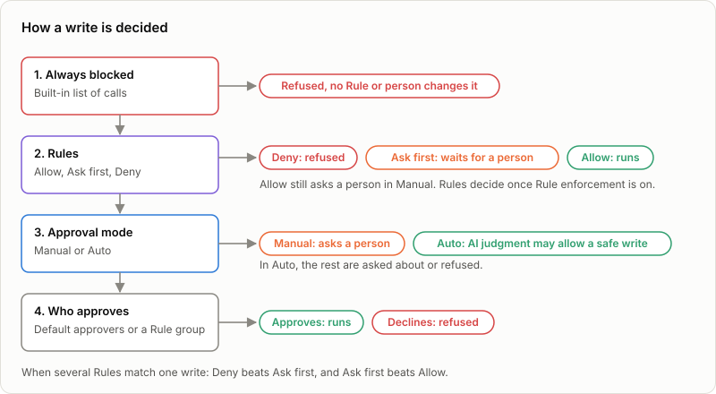
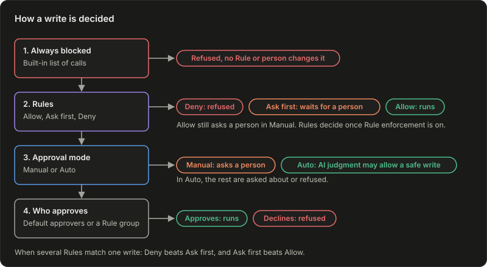
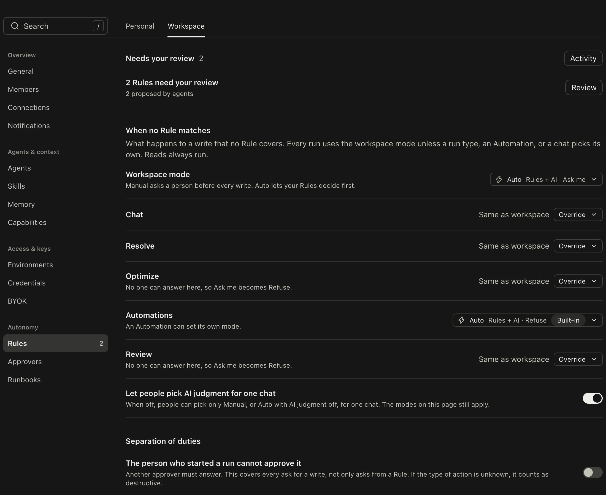

import AutonomyModes from '/snippets/autonomy-modes.mdx';

Approvals controls what happens when an agent wants to change something through a [connection](/guide/connections/overview), such as restarting a service or editing a cloud resource. Each write runs, waits for a person, or is refused, while reads always run.

## How a write is decided

A **write** is any agent call that changes one of your connected systems. Every write goes through these steps in order, and the first step that gives an answer decides.

<Frame caption="The first step that gives an answer decides whether a write runs, waits for a person, or is refused.">
  
  
</Frame>

| Step | What decides | Result |
|------|--------------|--------|
| 1. Always blocked | A built-in list of calls that never run, such as stopping CloudTrail logging, closing an AWS account, or deleting the `kube-system` namespace | Refused. No person and no Rule can change this. |
| 2. [Rules](/guide/approvals/rules) | The Rules you accepted. A Rule names one kind of write. | **Allow** runs it, except in **Manual** mode, where it still asks a person. **Ask first** waits for a person. **Deny** refuses it. |
| 3. [Approval mode](/guide/approvals/approval-mode) | **Manual** or **Auto** for this run | Manual asks a person. Auto can let AI judgment allow a safe write, then asks you or refuses the rest. |
| 4. [Who approves](/guide/approvals/approvers) | Default approvers, or the group a Rule names | A person approves or declines. |

When several Rules match one write, **Deny** beats **Ask first**, and **Ask first** beats **Allow**.

Approvals checks every call that reaches outside CloudThinker: calls through your connections, cloud and cluster CLIs such as `aws` and `kubectl`, remote programs such as `ssh` and `psql`, Git pushes and pulls, and commands that send a stored [credential](/guide/credentials), such as `curl` with `$STRIPE_API_KEY`. A file an agent changes in its own working folder isn't checked. On an [Environment](/guide/workers), the agent's shell commands run on your machine instead of in the CloudThinker managed sandbox. Calls that reach your systems are checked the same way, but don't count on Approvals to stop a command that only acts on that machine, such as `rm` or a local file write.

## What you get out of the box

New workspaces start on **Auto · Rules + AI · Ask me**. In practice:

- Reads run without asking.
- A write that a Rule allows runs.
- A write no Rule covers goes to AI judgment. If it's judged safe, it runs. Otherwise the agent pauses and asks a person. For example, restarting a staging pod you just asked it to restart can run. Deleting an RDS snapshot is destructive, so it asks you.
- Automations, which often run with no one watching, default to **Auto · Rules + AI · Refuse**, so they skip a write instead of waiting forever.

<AutonomyModes />

Agents propose Rules as they work. A proposed Rule does nothing until a workspace Admin accepts it.

## Review your setup

Approvals live in **Settings → Workspace → Autonomy**, with three pages: **Rules**, **Approvers**, and **Runbooks**. Open Settings from the workspace menu at the top of the sidebar, or press ⌘, (Ctrl+, on Windows and Linux). Review your setup once when you start, then whenever **Rules** in the Settings menu shows a count of Rules that need your review.

<Steps>
  <Step title="Open Rules">
    Open **Settings → Workspace → Autonomy → Rules**.

    <Frame caption="Settings → Workspace → Autonomy → Rules: Rules waiting for review, then When no Rule matches and Separation of duties">
      
    </Frame>
  </Step>
  <Step title="Review proposed Rules">
    If **Needs your review** at the top says Rules need your review, click **Review**. Accept the ones that match how your team works, and dismiss the rest.

    No proposals yet? Under **Rules**, click **Find rules**. CloudThinker reads your connections, Optimize findings, incidents, alerts, and approval history, then proposes Rules. Nothing changes until you accept.

    **Success state:** the **Needs your review** section is gone and the **Rules** list shows your active Rules.
  </Step>
  <Step title="Check the workspace mode">
    Under **When no Rule matches**, the **Workspace mode** picker shows the current mode. Change it here. To set a different mode for chats, automations, and other run types, use the run type rows below it.
  </Step>
  <Step title="Check who approves">
    Open **Settings → Workspace → Autonomy → Approvers**. When **Default approvers** is empty, every Developer or above can approve. Add people to narrow it. To stop people from approving their own runs, use **Separation of duties** on the **Rules** page.

    **Success state:** the **Default approvers** row lists the people who answer most asks.
  </Step>
</Steps>

## Answer an approval request

When a write must wait for a person, the agent pauses and the chat shows an approval card that names the action and the connection it touches.

| Button | What it does |
|--------|--------------|
| **Approve** | Runs this one call. |
| **Approve for…** | Runs this call and lets the same operation on the same connection run without asking, in this chat or incident only, for **1 hour**, **This incident**, or **30 days**. This creates a time-limited Rule called a [Window](/guide/approvals/rules#windows). |
| **Approve and draft rule** | Runs this call now. A side chat drafts a Rule for you to accept, and this chat keeps running. |
| **Decline** | Refuses the call. Tell the agent why, so it can try another route. |
| **Break glass…** | Runs one call a **Deny** Rule refused, once. Only the workspace owner and workspace Admins see it, and only when [break-glass](/guide/approvals/approvers#break-glass) is on. |

**Approve for…** appears only for a plain write on one connection in an Auto mode, and only for a workspace Admin. A delete, a call in Manual mode, or a call an Ask first Rule covers never offers a Window.

If you can't approve, the card says "Waiting for an approver." The person who started the conversation can click **Notify approvers** to alert them. Anyone who can chat can **Decline**. In [Google Chat](/guide/google-chat-integration), the card has **Approve**, **Approve with reason**, and **Reject** buttons. [Slack](/guide/slack-integration) and [Microsoft Teams](/guide/teams-integration) only link to the web app, so you decide there. To get these requests by email or chat, turn on **Agent approvals** in [Notifications](/guide/notifications).

## Where approvals live

| Place | What you do there |
|-------|-------------------|
| **Settings → Workspace → Autonomy → Rules** | Review proposed Rules under **Needs your review**. Set the mode for the workspace, each run type, and what people can pick in one chat under **When no Rule matches**. Turn on the two-person rule under **Separation of duties**. Find, accept, edit, and turn off Rules under **Rules**, and import or export your policy as a YAML or JSON file. |
| **Activity** button on the **Rules** page | See what each Rule decided in a period, and export it as CSV |
| **Settings → Workspace → Autonomy → Approvers** | Set Default approvers, approver groups, and break-glass |
| **Settings → Workspace → Autonomy → Runbooks** | Manage your runbooks |

## Who can change Approvals

| Workspace role | View the page | Change Rules, modes, and approvers | Approve a write |
|----------------|---------------|-------------------------------------|-----------------|
| Admin | Yes | Yes | Yes |
| Developer | Yes | No | Yes, unless a group limits it |
| Viewer | Yes | No | No |

Organization Owners and Admins are workspace Admins in every workspace, so a workspace can have several Admins. Controls you can't use stay visible and say "Ask a workspace admin". Some messages say "Ask a workspace owner"; that means the workspace owner or any workspace Admin.

## Troubleshooting

<AccordionGroup>
  <Accordion title="A write still asks me even though a Rule allows it">
    The run is using **Manual** mode, which asks before every write. Check the mode in the chat, on the automation, and for the run type and the workspace under **When no Rule matches** on the **Rules** page.
  </Accordion>
  <Accordion title="An automation skipped a write instead of asking">
    Automations default to **Auto · Rules + AI · Refuse**, because no one may be there to answer. Add an Allow Rule for that write, or change the automation's mode.
  </Accordion>
  <Accordion title="I don't see the Approve button">
    The server checks who can approve on every click. A Rule may name an approver group you aren't in, or Default approvers may not include you. Click **Notify approvers** if you started the conversation, or **Decline**.
  </Accordion>
  <Accordion title="Can I approve a call that Always blocked refused?">
    No. Always blocked calls never run, and break-glass can't override them either.
  </Accordion>
  <Accordion title="Can an agent turn on its own Rule?">
    No. An agent can propose a Rule, change its own proposal, or propose turning a Rule off. A workspace Admin must accept each one.
  </Accordion>
  <Accordion title="Where did Tool Permissions and Command Permissions go?">
    Rules replaced them. Old grants became Rule proposals with the source **Imported**. They wait under **Needs review** on the **Rules** page and do nothing until you accept them.
  </Accordion>
</AccordionGroup>

## Next steps

<CardGroup cols={2}>
  <Card title="Rules" icon="list-check" href="/guide/approvals/rules">
    Find, review, and accept the Rules proposed for each kind of write
  </Card>
  <Card title="Approval mode" icon="bolt" href="/guide/approvals/approval-mode">
    Choose Manual or Auto for the workspace, a run type, or one chat
  </Card>
  <Card title="Approvers and Activity" icon="users" href="/guide/approvals/approvers">
    Choose who approves and check what each Rule decided
  </Card>
  <Card title="Notifications" icon="bell" href="/guide/notifications">
    Send approval requests to email, Slack, Teams, or Google Chat
  </Card>
</CardGroup>
