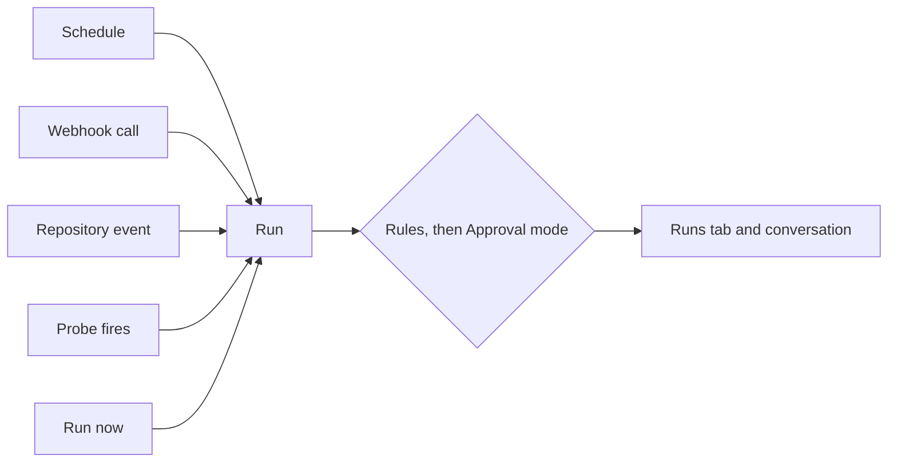

import { AutomationScene } from '/snippets/iso/automation.jsx';

**Put routine cloud ops on autopilot.**

An automation is a saved set of agent instructions plus the triggers that start it: a schedule, an inbound webhook call, a repository event, or a probe script. CloudThinker runs it for you, and each run keeps a conversation that shows what the agent checked, found, and changed.

Use one for work someone would otherwise have to remember: a daily cost check, a weekly incident digest, a triage pass on every new pull request, or a reaction to an alert another tool sends.

## Prerequisites

- A Team plan or above. When your plan caps the number of automations, **New automation** shows `<used> of <limit> automations used`. See [Pricing](/guide/billing/pricing).
- For repository triggers: repositories connected in **Review** with review turned on. See [Code review setup](/guide/code-review/setup).
- The workspace role that fits the job:

| Role | Can |
|------|-----|
| **Admin** | Create, edit, duplicate, delete, turn on or off, **Run now**, and **Enable** a proposal |
| **Developer**, **Viewer** | See the list, the runs, the calendar, and each run's conversation |

<AutomationScene />

## How it works

1. **A trigger fires,** or someone selects **Run now**. Any trigger can start a run, and the automation's switch must be on for triggers to fire.
2. **The run starts.** CloudThinker reads the automation's instructions, plus the event body when a webhook, repository event, or probe started it. That body is treated as data, never as instructions: the agent can use a value from it when your instructions say to (for example, the service named in an alert), but text in the body can't change the instructions or the approvals.
3. **Approvals govern every write.** Reads always run. Automations default to **Auto · Rules + AI · Refuse**, because no one may be online to answer. A write goes through these in order:

   | Step | What it does |
   |------|--------------|
   | **Rules** | Your [Rules](/guide/approvals/rules) decide first: allow, ask first, or deny |
   | **AI** | AI judgment can allow a safe write no Rule covers |
   | **Refuse** | Anything still not allowed is refused instead of left waiting |

   Other choices are on [Autonomous operations](/guide/automation/autonomous-agents#how-a-write-is-decided). In **Manual** mode every write asks a person, even one an Allow Rule covers.
4. **The result lands in Runs.** Each run shows a status and links to its conversation. Pair it with [notifications](/guide/notifications) to get failures and alerts in Slack, Teams, Google Chat, or email.



### One run at a time

An automation never runs twice at once. What happens to a start that arrives mid-run:

| Arrives mid-run | Result |
|-----------------|--------|
| Webhook call | Held and retried every minute for up to 30 minutes. One call is held per trigger: a newer call replaces it. |
| Repository event | Held the same way: one event per trigger, newest kept, up to 30 minutes |
| Probe fires | Starts nothing |
| **Run now** | Refused with "A run is already in progress for this task" (the message calls the automation a task) |

A held start that never ran shows on its trigger card as **Did not run**, with the reason.

## Triggers

| Trigger | Starts a run when |
|---------|-------------------|
| **Schedule** | A clock time arrives: **Daily**, **Weekly**, **Monthly**, **No Repeat** (once), or **Custom** (cron). At most one per automation; the other trigger types can be added more than once. |
| **Webhook** | An HTTP call arrives at a URL CloudThinker issues |
| **Repository** | A push, pull or merge request, comment, or pipeline result lands in a repository connected in CloudThinker's code review module ([Review](/guide/code-review/setup) in the sidebar) |
| **Probe** | A short script the agent wrote finds something, checked every 5, 15, 30, or 60 minutes |

You can add any trigger from the form or chat, except a probe, which only chat can create. Triggers are optional. An automation saved with none shows "No trigger yet" and runs only when someone selects **Run now**.

### Schedule

**Custom** takes a 5-field cron expression: `minute hour day month weekday`. Minute and hour accept one value, `*`, or a step like `*/15`. A list or range in those two fields is rejected with "This schedule format is not supported." Day, month, and weekday accept ranges and lists. Weekdays are numbered `0` (Sunday) to `6` (Saturday), and a single day name such as `MON` is converted for you.

```text
*/15 * * * *     Every 15 minutes
0 */6 * * *      Every 6 hours
0 9 * * 1-5      09:00 on weekdays
```

To make a recurring schedule stop, tick **Set expiration date** on the schedule and pick the last day.

<Note>
Every schedule, **Custom** cron included, is read in the time zone of the browser that saves it. CloudThinker converts it to UTC with the offset that zone has on January 15, and keeps that UTC time all year. In a zone with daylight saving, runs land one hour off for part of the year:

- **New York**, saved at 09:00: runs at 09:00 from November to mid-March, and at 10:00 from mid-March to November.
- **Sydney**, saved at 09:00: runs at 09:00 from October to April, and at 08:00 from April to October.

A teammate in another zone sees the schedule in their own zone. If they save without changing the time, the UTC time stays the same. There's no time zone picker, so for a team across zones, decide the run time in UTC and pick a time where an hour either way is fine.
</Note>

### Webhook

When you save a webhook trigger, the **Webhook trigger added** dialog shows the URL, a secret, and a ready-to-paste **Test command**. The caller sends the secret as an `Authorization: Bearer` header.

```bash
curl -X POST '<your trigger URL>' \
  -H 'Authorization: Bearer <your secret>' \
  -H 'Content-Type: application/json' \
  -d '{"message": "hello"}'
```

- **The secret is shown once.** Copy it before you select **Done**. If you lose it, use **Rotate webhook secret** on the trigger card: the URL stays the same. The old secret stops working within seconds, with no overlap, so update the caller right after you rotate. Until you do, its calls get `403`.
- **Send a JSON object.** The body is appended after your instructions, so the agent sees every field. A body that isn't a JSON object (plain text, an array) still starts a run, but the agent gets only your instructions. Bodies are capped at 1 MB.
- **60 calls an hour per trigger.** Calls past that still get `200`, start no run, and show as **Rate limited** on the card. Past 600 in an hour, the caller gets `429`. The limit is fixed: the form has no setting to raise it.
- **Mid-run calls are held,** as in [One run at a time](#one-run-at-a-time).
- **Security.** The trigger uses bearer authentication with the secret CloudThinker issues, stored encrypted. The form has no request-signing option. Calls come from your tool to CloudThinker, so there are no CloudThinker source IPs to allow. See [Security](/guide/security/overview).

| Response | Meaning |
|----------|---------|
| `200` | Received. A JSON body with `success` and a `request_id`. A call over the 60-an-hour run limit gets the same body. |
| `400` | The automation or the trigger is off, or the automation was deleted |
| `401` | No `Authorization` header, or the URL isn't a trigger |
| `403` | Wrong secret |
| `413` | Body over 1 MB |
| `429` | More than 600 calls in an hour, 10 failed auth attempts within 15 minutes, or the service is briefly busy. Retry later. |

<Warning>
The response can't tell the caller that a call was rate limited, so a noisy source can drop alerts without an error. Give each alert source its own trigger, and deduplicate or group alerts in the sending tool.
</Warning>

Each call is listed on the trigger card with its state:

| Delivery state | Meaning | Started a run? |
|----------------|---------|----------------|
| **Accepted** | Received and queued | Not yet |
| **Processed** | Handed to the automation | Yes, or held to run after the current one |
| **Failed** | Accepted, then couldn't start a run, with the error text. For example, the automation was turned off or deleted after the call arrived. | No |
| **Rate limited** | Over 60 calls in the hour | No |

A held call that a newer one replaces keeps **Processed**. The card's **Did not run** line is where a dropped call shows.

For example, point an alerting tool at the URL with a body like this:

```json
{"service": "orders-api", "alert": "p95 latency above 800 ms", "env": "production"}
```

Then write instructions that name the field:

```text
Investigate the service in the service field of the alert. Summarize the most likely cause and the evidence for it.
```

In the alerting tool, add a webhook destination with the trigger URL and a custom header `Authorization` set to `Bearer <your secret>`. For monitoring alerts from tools like Datadog, Grafana, or PagerDuty that should open an incident, a Resolve webhook signal fits better. See [Webhooks](/guide/webhooks/overview).

### Repository

Pick repositories and one or more events: **Pull or merge request**, **Push**, **Comment**, or **Pipeline finished**. Only repositories with review turned on in Review can be added.

| Event | GitHub | GitLab | Bitbucket | Azure DevOps | AWS CodeCommit |
|-------|:-:|:-:|:-:|:-:|:-:|
| Pull or merge request | ✓ | ✓ | ✓ | ✓ | ✓ |
| Push | ✓ | ✓ | ✓ | ✓ | ✓ |
| Comment | ✓ | ✓ | ✓ | ✓ | ✓ |
| Pipeline finished | ✓ | ✓ | | ✓ | |

| Filter | Applies to | Empty means |
|--------|-----------|-------------|
| Branch: an exact name, or a case-sensitive glob. `*` matches any characters, including `/`, so `release/*` also matches `release/2026/q4`. `?` matches one character. | Push and pull or merge request events only. For a push, the branch it updated. For a pull or merge request, the target branch. | Every branch |
| Action: **Opened**, **New commits**, **Merged**, **Closed** | Pull or merge request events | All four |

<Warning>
**Comment** and **Pipeline finished** take no filters: every one on the chosen repositories starts a run, and every run uses credits. On a busy repository, expect one run per comment. Start with a few repositories.
</Warning>

A repository event that lands mid-run is held, as in [One run at a time](#one-run-at-a-time).

- Label, assignee, review-request, and approval changes never start a run.
- Comments from the CloudThinker review bot never start a run, so an automation can't loop on its own output.

### Probe

A probe is a bash script the agent writes and saves as a trigger. Only chat can create one:

1. Open a chat and describe what to watch, how often, and which automation it belongs to (or ask for a new automation):

   ```text
   Create an automation that watches the orders-api p95 latency every 15 minutes and starts a run if it's above 800 ms.
   ```

2. The agent writes the script and tests it once. It refuses to save a script that doesn't exit `0` or `1`.
3. Open the automation. A probe trigger card showing the interval and the script path confirms it saved.

On each check the script runs for up to 120 seconds in the workspace's sandbox on CloudThinker Cloud (where agent commands run), with read-only credentials for the connections the agent named when it wrote the probe. It's saved there under `.schedules/`. A check runs only the script, not the agent, so it starts no run. A fired run and a repair run are ordinary agent runs and use credits like any other ([Usage](/guide/billing/usage)).

| Script exit code | What happens |
|------------------|--------------|
| `0` | Quiet. Nothing runs. |
| `1` | Fired. A run starts with the first 2,000 characters of the script output, unless the cooldown since the last fired run is active. |
| Anything else | Error. After 3 errors in a row, one repair run starts, and the agent is asked to fix the script or change the probe. |

The cooldown is 60 minutes by default. It can be 5, 15, 60, 240, or 1,440 minutes. To change it, the interval, or the script, ask in chat and name the automation, for example "Set the probe cooldown on the orders-api latency automation to 240 minutes."

The trigger card shows the interval, the script path, the last check (for example "Quiet · checked 5 minutes ago"), and **Last output**. You can pause or delete a probe from the card. Neither the card nor chat lists the connections a probe reads. To review what it does, ask in chat to show the script at the path on the card. On plans with [audit logs](/guide/security/audit-logs), each new probe is recorded as "added a probe trigger".

## Create an automation

The [Automation quickstart](/guide/automation/quickstart) walks through one end to end. In short: open **Automations** in the sidebar, select **New automation**, then pick one of three starts.

| Start | Use it when |
|-------|-------------|
| **Create with chat** | You'd rather describe the job. CloudThinker asks for what's missing, then creates it. Same as typing `/create-automation` in chat. |
| A template in the **Or start from a template** grid, below the chat box | A template below fits. It opens the form filled in. |
| **Start from a blank form** | You know exactly what you want. |

Every template starts with a **Schedule** trigger and instructions, both of which you can change:

| Template | Schedule | What the instructions ask for |
|----------|----------|-------------------------------|
| **Weekly cost report** | Every Monday, 09:00 | Last week's spend by service and account, with the three largest movers and what drove each |
| **Daily cost anomaly alert** | Every day, 08:00 | Services more than 20% above their trailing 14-day average, with the likely cause |
| **Daily security drift check** | Every day, 07:00 | New public storage buckets, security groups open to the internet, and unused admin credentials since yesterday |
| **Weekly incident digest** | Every Monday, 09:00 | The last seven days of incidents, repeats, and the top recurring cause |
| **Monthly idle resource sweep** | First day of the month, 09:00 | Instances, volumes, and load balancers idle for 30 days, ranked by monthly saving |
| **Weekly expiry check** | Every Wednesday, 09:00 | TLS certificates, access keys, and secrets that expire in the next 30 days, with owner and renewal step |

Each one needs a connection that can read what it asks about, such as billing data for the cost templates.

| Field | What to enter |
|-------|---------------|
| **What should the agent do?** | The instructions for every run. Type `#` to point the agent at one connection; without it, the agent picks from the workspace's connections. |
| Model picker | **Pro** or **Ultra**. Ultra costs 1.7x the credits of Pro, so keep Pro unless a run's answers are too weak. There's no fixed credit cost per run ([Usage](/guide/billing/usage)). |
| **Approval** | Leave it on the option marked **Default** to use the **Automations** run type for every automation (see [Approval mode](/guide/approvals/approval-mode)). Pick another option to override it for this automation only. |
| Triggers | One or more of the triggers above |
| **Name** | A short noun phrase. CloudThinker suggests one from the instructions. |
| **Advanced** | The settings below |

| Setting | Options | Choose when |
|---------|---------|-------------|
| **Conversation** | **New conversation each run** (the default: every run starts fresh and reads only its instructions and [workspace memory](/guide/memory)) or **Continue one conversation** (every run posts into one conversation and sees earlier runs; long history is compacted, so older detail is summarized) | Continue for a digest that compares against the last run. New for independent checks. |
| **Run in** | **CloudThinker Cloud** (the default), or a shared [self-hosted sandbox](/guide/workers) | A sandbox when the targets are reachable only from your network |

### From a chat proposal

When chat work is worth repeating, the agent's reply can end with a proposal card that shows a schedule. An Admin selects **Enable** to create the automation with that schedule and the **Automations** run type's approval, or **Dismiss** to drop it.

A card can also show a condition to watch for, next to an eye icon. When a run of that automation meets the condition, CloudThinker sends the **Watched condition met** [notification](/guide/automation/autonomous-agents#notifications-for-unattended-runs).

## Runs and statuses

The **Automations** page has three tabs: **Automations** (the list), **Runs** (every run, newest first, labeled **Schedule**, **Manual**, **Webhook**, **Repository**, or **Probe**), and **Calendar** (past and upcoming scheduled runs by month).

| Status | Meaning |
|--------|---------|
| **Pending** | Queued, or waiting for a busy conversation |
| **Running** | In progress |
| **Succeeded** | Finished. A write the approvals refused doesn't fail the run, so read the conversation to see what was skipped. |
| **Failed** | Ended with an error |
| **Required Approval** | Paused on a write that needs a person. Open the run's conversation to approve or decline. |
| **Cancelled** | Stopped before it finished |

A call or event that starts no run (for example a held webhook call that waited too long, or a probe that fired mid-run) adds no row to **Runs**. Its trigger card shows **Did not run** with the reason.

## Manage automations

Each card has **Run now**, an on/off switch, and a **…** menu with **Edit**, **Duplicate**, and **Delete**. Turning an automation off keeps its settings and history, and **Run now** still works while it's off. Edits apply to future runs only, not one already going. Once deleted, its webhook URLs answer `400` and start nothing. Its past runs stay in **Runs** under their conversation names, and their conversations stay readable.

There's no API or Terraform provider for managing automations. Manage them on this page or by asking in chat. A [webhook trigger](#webhook) is how outside code starts a run.

<Warning>
After 10 failed runs in a row, CloudThinker turns the automation off and sends the **Automation turned off** notification. **Run now** still works so you can debug. Turn it back on once the cause is fixed.
</Warning>

## Troubleshooting

<AccordionGroup>
  <Accordion title="The webhook caller gets 401 or 403">
    `401` means the `Authorization` header is missing or the URL is wrong. `403` means the secret is wrong. Check the header reads `Bearer <secret>` with one space. If the secret is lost, use **Rotate webhook secret** on the trigger card and update the caller. After 10 failures in 15 minutes the caller gets `429` for a while.
  </Accordion>
  <Accordion title="Custom says &quot;This schedule format is not supported&quot;">
    The minute or hour field has a list or range, such as `0 9,17 * * *`. Use one value, `*`, or a step there. For every 12 hours, `0 */12 * * *` works. For two unrelated times, create a second automation.
  </Accordion>
  <Accordion title="A probe keeps erroring">
    The script exited with something other than `0` or `1`. After 3 errors in a row a repair run starts. Read **Last output** on the card, then ask in chat to fix the script.
  </Accordion>
  <Accordion title="A run stays on Pending">
    The run is queued, or its conversation is busy with another turn. It starts once the conversation is free. If you chose **Continue one conversation**, a chat in that conversation can hold it.
  </Accordion>
  <Accordion title="The run succeeded but nothing changed">
    The approvals likely refused the write. A refused write doesn't fail the run. Open the run's conversation to see what was skipped and why. For a write the automation should make every time, add an **Allow** [Rule](/guide/approvals/rules) with **Runs from** set to **Automations**.
  </Accordion>
  <Accordion title="A trigger fired but nothing shows in Runs">
    Check the trigger card. **Did not run** gives the reason, such as a run already in progress or the automation being off. A webhook delivery over the hourly limit shows **Rate limited**.
  </Accordion>
</AccordionGroup>

## Get started

<CardGroup cols={2}>
  <Card title="Automation quickstart" icon="rocket" href="/guide/automation/quickstart">
    Build a daily cost anomaly check that alerts Slack in 10 minutes
  </Card>
  <Card title="Autonomous operations" icon="robot" href="/guide/automation/autonomous-agents">
    Set safe limits for work that runs without anyone watching
  </Card>
  <Card title="Approval mode" icon="bolt" href="/guide/approvals/approval-mode">
    Choose how writes are decided for one automation or all of them
  </Card>
  <Card title="Notifications" icon="bell" href="/guide/notifications">
    Route failures and agent alerts to Slack, Teams, or email
  </Card>
</CardGroup>
