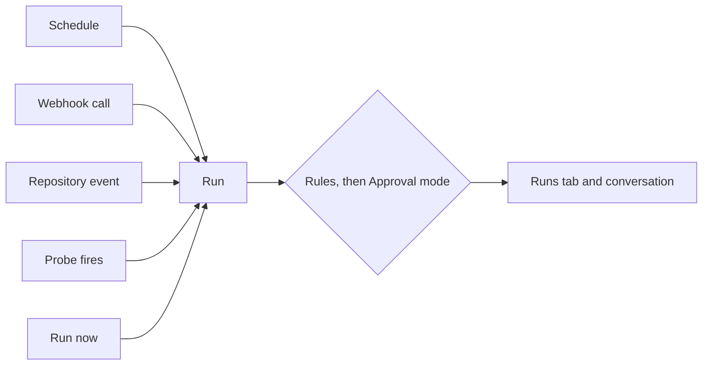

import { AutomationScene } from '/snippets/iso/automation.jsx';

An automation is a saved set of agent instructions plus the triggers that start it: a schedule, an inbound webhook call, a repository event, or a probe script. Each run gets its own conversation, so you can read exactly what the agent checked, found, and changed.

<AutomationScene />

Use an automation for work someone would otherwise have to remember: a daily cost check, a weekly incident digest, a triage pass on every new pull request, or a reaction to an alert another tool sends.

## How it works

1. **A trigger fires.** Triggers are independent: whichever fires first starts a run. **Run now** starts one by hand. The automation's own switch must be on for any trigger to fire.
2. **The run starts.** CloudThinker reads the automation's instructions, plus the event body when a webhook, repository event, or probe started it. That body is treated as data, never as instructions.
3. **Approvals govern every write.** Reads always run. A write goes through your [Rules](/guide/approvals/rules), then the automation's [Approval mode](/guide/approvals/approval-mode). Automations default to **Auto · Rules + AI · Refuse**, because no one may be online to answer.
4. **The result lands in Runs.** Each run shows a status and links to its conversation. Pair it with [notifications](/guide/notifications) to get failures and alerts in Slack, Teams, Google Chat, or email.



## Triggers

| Trigger | Starts a run when | Created from |
|---------|-------------------|--------------|
| **Schedule** | A clock time arrives: **Daily**, **Weekly**, **Monthly**, **No Repeat** (once), or **Custom** (cron). One per automation. | The form or chat |
| **Webhook** | An HTTP call arrives at a URL CloudThinker issues | The form or chat |
| **Repository** | A push, pull or merge request, comment, or pipeline result lands in a repository connected to [Review](/guide/code-review/setup) | The form or chat |
| **Probe** | A short script the agent wrote finds something, checked every 5 to 60 minutes | Chat only |
| *(none)* | You select **Run now** | |

### Schedule

**Custom** takes a 5-field cron expression: `minute hour day month weekday`. Minute and hour accept one value, `*`, or a step like `*/15`. A list or range in those two fields is rejected with "This schedule format is not supported." Day, month, and weekday accept ranges and lists, and `MON` to `SUN` are converted for you.

```text
*/15 * * * *     Every 15 minutes
0 */6 * * *      Every 6 hours
0 9 * * MON-FRI  09:00 on weekdays
```

You pick times in your local time zone, and Runs shows them back in your zone. A recurring schedule can take an expiration date, after which it stops.

<Note>
A recurring schedule keeps its clock time and does not shift for daylight saving, so a run can land an hour off after a DST change.
</Note>

### Webhook

When you save a webhook trigger, the **Webhook trigger added** dialog shows the URL, a secret, and a ready-to-paste **Test command**. The caller sends the secret as an `Authorization: Bearer` header.

```bash
curl -X POST '<your trigger URL>' \
  -H 'Authorization: Bearer <your secret>' \
  -H 'Content-Type: application/json' \
  -d '{"message": "hello"}'
```

- **The secret is shown once.** Copy it before you select **Done**. If you lose it, use **Rotate webhook secret** on the trigger card: the URL stays the same.
- **The body reaches the agent.** It's appended after your instructions, so you don't need template variables. `{{message}}` and `{{event.<key>}}` still work if you want a value inline. Bodies are capped at 1 MB.
- **Deliveries are listed on the card** as **Accepted**, **Processed**, **Failed**, or **Rate limited**, with any error text.
- **One run at a time.** A call that arrives mid-run is held, newest call wins, and retried every minute for up to 30 minutes.

### Repository

Pick repositories and one or more events: **Pull or merge request**, **Push**, **Comment**, or **Pipeline finished**. Only repositories with review turned on in Review can be added.

| Filter | Applies to | Empty means |
|--------|-----------|-------------|
| Branch (a name or a glob like `release/*`, case-sensitive) | Push and pull or merge request events only | Every branch |
| Action: **Opened**, **New commits**, **Merged**, **Closed** | Pull or merge request events | All four |

- Label, assignee, review-request, and approval changes never start a run.
- Comments from the CloudThinker review bot never start a run, so an automation can't loop on its own output.
- Bitbucket and AWS CodeCommit send no pipeline event, so CloudThinker refuses a pipeline trigger for them.

### Probe

A probe is a bash script the agent writes and saves as a trigger when you ask it to watch for something in chat. On each check the script runs for up to 120 seconds with read-only credentials for the connections it names.

| Script exit code | What happens |
|------------------|--------------|
| `0` | Quiet. Nothing runs. |
| `1` | Fired. A run starts with the first 2,000 characters of the script output, unless a cooldown is active. |
| Anything else | Error. After 3 errors in a row, one repair run starts. |

The trigger card shows the interval, the script path, the last check (for example "Quiet · checked 5 minutes ago"), and **Last output**. You can pause or delete a probe from the card. The agent tests a script before saving it, and refuses one that doesn't exit `0` or `1`.

## Create an automation

You need the workspace Admin role to create or edit automations. The [Automation quickstart](/guide/automation/quickstart) walks through one end to end. In short: open **Automations** in the sidebar, select **New automation**, then pick one of three starts.

| Start | Use it when |
|-------|-------------|
| **Create with chat** | You'd rather describe the job. CloudThinker asks for what's missing, then creates it. Same as typing `/create-automation` in chat. |
| **Or start from a template** | A template fits, such as **Weekly cost report** or **Daily cost anomaly alert**. It opens the form filled in. |
| **Start from a blank form** | You know exactly what you want. |

The form has **What should the agent do?** (with model and **Approval** pickers), the triggers, a **Name**, and **Advanced** settings:

| Setting | Options |
|---------|---------|
| **Conversation** | **New conversation each run** (fresh each time) or **Continue one conversation** (each run sees earlier runs, long history is compacted) |
| **Run in** | **CloudThinker Cloud**, or a shared [self-hosted sandbox](/guide/workers). Only workspace admins can change it. |

Agents can also offer one. When chat work is worth repeating, the reply can end with a proposal card. Select **Enable** to create the automation, or **Dismiss**.

## Runs and statuses

The **Automations** page has three tabs: **Automations** (the list), **Runs** (every run, newest first, labeled **Schedule**, **Manual**, **Webhook**, **Repository**, or **Probe**), and **Calendar** (past and upcoming scheduled runs by month).

| Status | Meaning |
|--------|---------|
| **Pending** | Queued, or waiting for a busy conversation |
| **Running** | In progress |
| **Succeeded** | Finished |
| **Failed** | Ended with an error |
| **Required Approval** | Paused on a write that needs a person. Open the run's conversation to approve or decline. |
| **Cancelled** | Stopped before it finished |

## Manage automations

Each card has **Run now**, an on/off switch, and a **…** menu with **Edit**, **Duplicate**, and **Delete**. Turning an automation off keeps its settings and history. Edits apply to future runs only.

<Warning>
After 10 failed runs in a row, CloudThinker turns the automation off and sends the **Automation turned off** notification. **Run now** still works so you can debug. Turn it back on once the cause is fixed.
</Warning>

Your plan caps how many automations a workspace can hold. The count shows beside **New automation** when a limit applies.

## Get started

<CardGroup cols={2}>
  <Card title="Automation quickstart" icon="rocket" href="/guide/automation/quickstart">
    Build a daily cost anomaly check that alerts Slack in 10 minutes
  </Card>
  <Card title="Autonomous operations" icon="robot" href="/guide/automation/autonomous-agents">
    Set safe limits for work that runs without anyone watching
  </Card>
  <Card title="Approval mode" icon="bolt" href="/guide/approvals/approval-mode">
    Choose how writes are decided for one automation or all of them
  </Card>
  <Card title="Notifications" icon="bell" href="/guide/notifications">
    Route failures and agent alerts to Slack, Teams, or email
  </Card>
</CardGroup>
