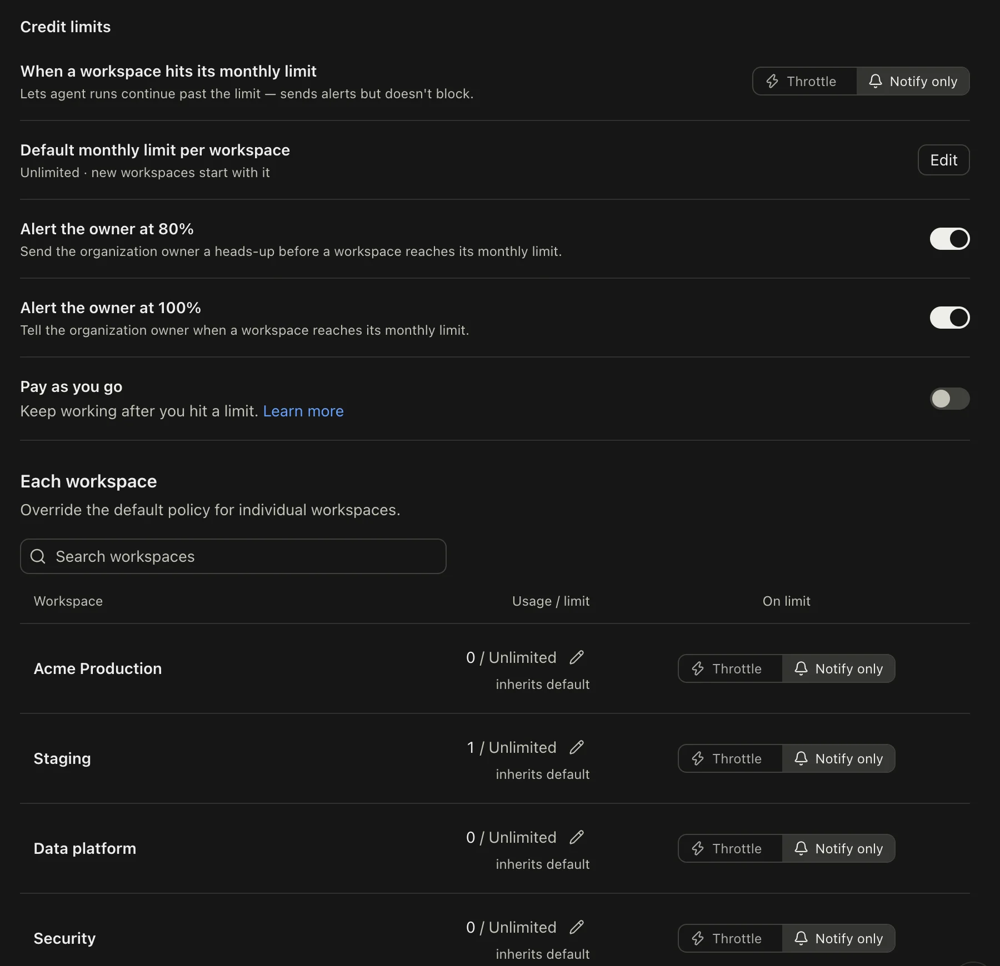

Your organization buys one shared pool of [credits](/guide/billing/usage) each month, and every [workspace](/guide/workspaces) draws from it. A workspace is an isolated space for one team or project. Credit limits put a monthly ceiling on each workspace, so one busy team can't use up the credits everyone else needs.

You set one default policy for all workspaces, then override the few that need a bigger or smaller budget.

## Before you start

| You need | Why |
|---|---|
| A **Scale** or **Enterprise** plan | Credit limits aren't in Free or Team. On those plans the section shows **Unlock credit limits with the Scale plan** and, for the Owner, an **Upgrade plan** button. See [Pricing](/guide/billing/pricing). |
| The organization **Owner** or an **Admin** role | Both roles can view and edit credit limits. Only the Owner can change the plan or turn on Pay-As-You-Go. |

## Set the default policy

The default policy applies to every workspace that has no override of its own.

<Steps>
  <Step title="Open Credit Limits">
    Go to **Settings → Organization → Billing → Credit limits**.
  </Step>
  <Step title="Choose what happens at the limit">
    Under **When a workspace hits its monthly limit**, pick **Throttle** or **Notify only**. [How enforcement works](#how-enforcement-works) explains the difference.
  </Step>
  <Step title="Set the default limit">
    Next to **Default monthly limit per workspace**, click **Edit**, then enter a credit amount or choose **Unlimited** to track usage without a cap.

    Not sure what to enter? Open **Settings → Organization → Usage**, pick **30d**, and check **By workspace** under **Usage breakdown**. Start about 20% above a typical workspace's monthly spend.
  </Step>
  <Step title="Pick the alerts">
    Turn on **Alert the owner at 80%**, **Alert the owner at 100%**, or both. Only the Owner gets these alerts, so Admins and workspace leads should watch the meters on this page.
  </Step>
  <Step title="Save">
    A bar with **Save** and **Discard** appears at the bottom of the page once you change something. Click **Save**. The bar disappears when the policy is stored.
  </Step>
</Steps>

<Frame caption="Credit limits on the Billing page: the default policy, owner alerts, and the Each workspace table">
  
</Frame>

New workspaces follow the default policy automatically.

## Override one workspace

Use an override when a workspace needs a different budget or a different enforcement mode. For example, give production 20,000 credits on **Notify only**, and cap a sandbox at 2,000 on **Throttle**.

<Steps>
  <Step title="Find the workspace">
    Scroll to **Each workspace** and type in **Search workspaces** to filter the table.
  </Step>
  <Step title="Edit its limit">
    In the **Usage / limit** column, click the pencil icon next to the workspace's numbers. Enter a credit amount, or choose **Unlimited**. The meter shows usage against the limit for the current cycle.
  </Step>
  <Step title="Set its enforcement">
    In the **On limit** column, click **Throttle** or **Notify only** for that workspace alone.
  </Step>
  <Step title="Save">
    Click **Save** in the bottom bar. The override wins over the default policy. Every other workspace keeps following the default, and shows **inherits default** under its numbers.
  </Step>
</Steps>

There's no reset button. To send a workspace back to the default, set its limit and **On limit** mode to match the default policy, then click **Save**. It inherits the default again from then on.

## How enforcement works

| Mode | What happens when the workspace hits its limit |
|---|---|
| **Throttle** | Paid credit spend stops in that workspace. Premium, bonus, and Pay-As-You-Go credits are all blocked. The 100 free daily credits still work, but only for chat on the Light model. Chat starts on **Pro**, so a member's next chat is blocked with the standard out-of-credits prompt, which doesn't mention the workspace limit. Chat continues once they click **Switch to Light** or pick **Light** themselves. Spend resumes when the cycle resets or you raise the limit. |
| **Notify only** | Nothing is blocked. The workspace keeps spending, and you rely on the alerts. |

- **The limit is checked when a run starts.** A run already in progress finishes, so a workspace can end slightly above its limit. If you set a limit below what a workspace has already spent this cycle, Throttle applies from its next run.
- **Limits follow your billing cycle.** Each workspace's counter resets when your credits do. That's monthly, including on annual plans.
- **Alerts go to the organization owner only** as an in-app notification and an email, once per threshold per cycle, usually within an hour of crossing 80% or 100%.
- **Limits are ceilings, not reservations.** The total of all limits can be higher than your pool. Setting a limit doesn't set credits aside for that workspace.

<Tip>
  Put experimental or sandbox workspaces on **Throttle**. A runaway agent run there then can't drain the credits your production teams depend on.
</Tip>

## Troubleshooting

<AccordionGroup>
  <Accordion title="Credit limits shows an upgrade prompt instead of the limits">
    **Cause:** your organization is on Free or Team. **Fix:** the Owner clicks **Upgrade plan** and moves to Scale or Enterprise. See [Pricing](/guide/billing/pricing).
  </Accordion>
  <Accordion title="Monthly credits are all used">
    The whole organization has spent its pool, whatever each workspace's limit says. If Pay-As-You-Go is on, further usage is billed that way. If not, paid runs stop, and Light chat continues on daily credits until the pool resets. Raising a workspace limit won't help here. The Owner can turn on [Pay-As-You-Go](/guide/billing/usage#pay-as-you-go) or contact support about more usage. Otherwise, wait for the pool to reset at the start of the next cycle.
  </Accordion>
  <Accordion title="A workspace stopped running agents and chat works only on Light">
    That workspace is on **Throttle** and has hit its limit. Only free daily credits are left to it, so members can keep chatting only after they switch to **Light**. Raise its limit under **Each workspace**, or switch it to **Notify only**, then click **Save**.
  </Accordion>
  <Accordion title="Couldn't refresh credit limits">
    The page couldn't load fresh data and is showing the last data it loaded. Reload the page before you edit, so you don't save over newer values.
  </Accordion>
</AccordionGroup>

## Related

<CardGroup cols={2}>
  <Card title="Usage" icon="coins" href="/guide/billing/usage">
    How credits are spent, model tiers, and Pay-As-You-Go.
  </Card>
  <Card title="Pricing" icon="credit-card" href="/guide/billing/pricing">
    Compare plans and see which ones include credit limits.
  </Card>
</CardGroup>
