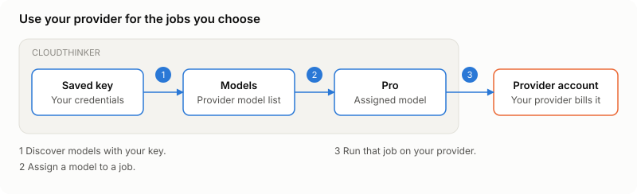
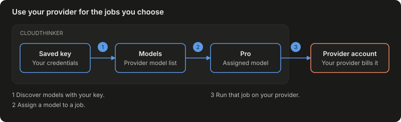

Use your own model endpoint for chat and other CloudThinker jobs. Save the provider once, then choose a model for each job.

## Prerequisites

- An organization Owner for an organization key, or a workspace Admin for a workspace key. See [BYOK prerequisites](/guide/byok#prerequisites).
- Provider credentials with access to the model you want to use.
- For a hosted organization or workspace key, an HTTPS endpoint with a public hostname. Private addresses and localhost are refused.

Deployment administrators and self-hosted installations can use private HTTP endpoints. Deployment-wide setup is under **Instance configuration → Credentials**; customer BYOK setup is separate.

## Provider fields

| Provider | Fields | What to enter |
|---|---|---|
| **OpenAI** | **API key**, **Base URL**, **Organization** | Enter your API key. Leave the other fields empty for the standard endpoint and default organization. |
| **Azure OpenAI** | **Endpoint**, **API key** | Enter your resource URL, such as `https://example.openai.azure.com`, and its resource key. |
| **Google Vertex AI** | **Service account key**, **Project ID**, **Location** | Paste the complete JSON key. The project defaults from that key; the location defaults to `global`. |
| **LiteLLM** | **Proxy URL**, **API key** | Enter your proxy URL and virtual key. Ask the proxy administrator which model names the key can use. |
| **OpenAI-compatible endpoint** | **Base URL**, **API key** | Enter the endpoint's API base URL. Leave the key empty only when the endpoint requires no authentication. |

Use [OpenAI API credentials](https://developers.openai.com/api/docs/guides/api-keys), an Azure resource with a [model deployment](https://learn.microsoft.com/en-us/azure/foundry/openai/api-version-lifecycle), a [Google service account JSON key](https://docs.cloud.google.com/iam/docs/keys-create-delete), or a [LiteLLM virtual key](https://docs.litellm.ai/docs/proxy/api_key_auth).

Azure uses its v1 API. You do not enter a dated API version. A deployment name identifies your Azure deployment, which can differ from the model's published name.

Keep the Google JSON key unchanged. CloudThinker refuses a key that names a non-Google token service. A location must support your selected model; check [Google's model locations](https://docs.cloud.google.com/gemini-enterprise-agent-platform/resources/locations).

## Connect your provider

<Frame caption="A saved provider key connects the model list to the jobs you choose.">
  
  
</Frame>

1. Discover models using your key.
2. Assign a model to a job.
3. Run that job on your provider.

<Steps>
  <Step title="Choose the scope and provider">
    For the organization, open **Admin Settings → BYOK**. For one workspace, open **Workspace settings → Workspace BYOK** and choose **Workspace**.

    Click **Add provider**, choose the provider, and click **Next**. Enter an optional **Name**, then click **Next**.
  </Step>
  <Step title="Enter credentials and pick models">
    Fill in the provider fields above, then click **Next**. In **Models**, choose which jobs use your key.

    Select a model for at least one row. For Azure, enter the **Deployment name**. Other endpoint providers offer **Or type a model name** during setup.
  </Step>
  <Step title="Verify and activate">
    Click **Verify and activate**. CloudThinker checks your selected models before saving the key.

    **Success state:** the provider appears as **Active**. Open it to inspect its models and use **Check key** to test its saved credentials.
  </Step>
</Steps>

Saved secrets stay encrypted and are never returned to the browser. To rotate a key, enter the replacement in its connection fields and save it.

## Choose an endpoint model

The saved key's **Models** list shows what the provider exposes. Search for a model, then assign it in **What runs on which credential** and click **Save**.

A listed model can run even when it is absent from CloudThinker's built-in catalog. Such models use a default context of 128,000 tokens and a maximum output of 16,000 tokens. LiteLLM's reported limits replace those defaults when available.

Endpoint models are selected through BYOK assignments. In chat, choose the assigned mode, such as **Pro**; an endpoint model does not become a separate composer choice.

## Troubleshooting

<AccordionGroup>
  <Accordion title="The endpoint URL is refused">
    Use HTTPS and a public hostname for hosted organization and workspace keys. Enter the endpoint's final URL; redirects are not followed.
  </Accordion>
  <Accordion title="An Azure model cannot be found">
    Check that the deployment exists on the same resource as your endpoint and key. Use its deployment name rather than assuming the public model name matches it.
  </Accordion>
  <Accordion title="No models appear">
    Use **Check key** and read the displayed error. Confirm that the endpoint exposes a model list and that the key can use those models. For Azure, you can type a deployment name during setup.
  </Accordion>
</AccordionGroup>

## Next steps

<CardGroup cols={2}>
  <Card title="BYOK scopes and routing" icon="key" href="/guide/byok">
    Choose organization or workspace keys and assign each kind of work.
  </Card>
  <Card title="Usage and credits" icon="chart-line" href="/guide/billing/usage">
    See usage and charges when work uses platform models.
  </Card>
</CardGroup>
