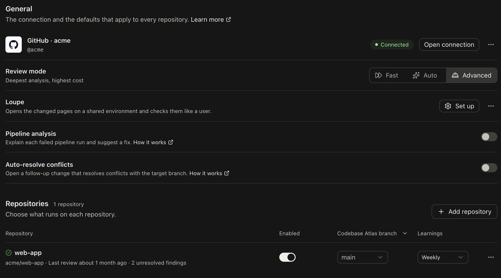

Connect your Git provider once, pick the repositories to watch, and every new pull request (PR) or merge request (MR) in them gets a review with no manual trigger. New to Review? Read the [overview](/guide/code-review/overview) first.

## Prerequisites

- A CloudThinker workspace where you're a workspace **Admin**. Developers and Viewers can see reviews but can't run setup. See [roles](/guide/security/roles).
- An account on GitHub, GitLab, Bitbucket Cloud or Azure DevOps that can install apps or create access tokens for the repositories you want reviewed.
- About ten minutes. GitLab and Azure DevOps need one extra webhook step.
- Self-hosted GitLab only: CloudThinker must be able to reach your GitLab URL over HTTPS, and your GitLab instance must be able to reach the webhook URL the wizard shows.

<Note>
  Each workspace connects one Git provider. If your team uses two, set up Review in a separate workspace for each.
</Note>

## Connect a provider and repositories

<Steps>
  <Step title="Open Review">
    Click **Review** in the left navigation. Before setup, the page reads **AI reviews every pull request and analyzes failed pipelines.**
  </Step>
  <Step title="Start setup">
    Click **Connect repository**, or pick your provider under **Where is your code hosted?** on the same page. A setup sheet opens with three steps: **Provider**, **Connect** and **Finish**.
  </Step>
  <Step title="Choose a provider">
    Under **Where is your code hosted?**, select **GitHub**, **GitLab**, **Bitbucket** or **Azure DevOps**. The sheet moves to **Connect**.
  </Step>
  <Step title="Connect your account">
    Authenticate the way your provider allows:

    | Provider | How you connect |
    |---|---|
    | GitHub | **Install GitHub App** |
    | GitLab | **OAuth** tab (**Connect to GitLab**, GitLab.com only) or **Access Token** tab |
    | Bitbucket | **OAuth** tab (**Connect to Bitbucket**) or **Access Token** tab |
    | Azure DevOps | Personal access token, then **Check token** and **Connect** |

    Not sure which to pick? Use a project, group, workspace or repository access token for a team setup, so comments come from a bot user. Use OAuth for a quick trial on GitLab.com or Bitbucket. [Provider authentication](/guide/code-review/provider-auth#pick-an-auth-method) has the exact scopes and steps for each one.

    <Tip>
      Access tokens and PATs expire. Note the expiry date when you create one, and replace it before then with [Update token](/guide/code-review/provider-auth#token-expiry).
    </Tip>

    **Success state:** the sheet moves to **Finish**.
  </Step>
  <Step title="Select repositories">
    Under **Select Repositories**, check each repository to review. Only repositories your connection can see are listed. On GitHub, a repository must also be granted in the app's repository access first (see [GitHub](/guide/code-review/provider-auth#github)).

    Repositories you create on your provider later don't appear on their own: add them with **Add repository** in **Review → Settings → Repositories**.
  </Step>
  <Step title="Add the webhook (GitLab, Azure DevOps)">
    For GitLab and Azure DevOps, **Finish** also shows the webhook **URL** and **Secret token**. Add them in your provider with the triggers the step lists, then click **Mark as Configured**. GitHub and Bitbucket skip this, because their webhooks register automatically. [Configure webhooks](/guide/code-review/provider-auth#configure-webhooks) has the steps for each one.

    <Warning>
      Without this webhook, CloudThinker never hears about new MRs or PRs and no review runs.
    </Warning>

    To see the URL and secret token again later, open **Review → Settings**, and on the **Connection** row of the **General** section click **Webhook**.
  </Step>
  <Step title="Start reviewing">
    Click **Start reviewing** (the button names how many repositories you picked).

    **Success state:** the sheet lists **Connect your Git provider** and **Save the Review setup** as done, then shows how many repositories are ready. While CloudThinker clones a repository, its row under **Review → Settings → Repositories** shows **Setting up**. If a clone fails, the row shows **Setup failed**; see [repository problems](/guide/code-review/troubleshooting#repository-problems). When an open PR is waiting, the sheet offers to review your latest one. Otherwise click **Close** and open a new PR.
  </Step>
</Steps>

## Get your first review

<Steps>
  <Step title="Open a pull or merge request">
    Push a branch to a selected repository and open a PR or MR against it. Don't open it as a draft: drafts are skipped until you mark them ready for review.

    A PR that arrives while the repository is still cloning gets a "setting up" note and is reviewed once the clone finishes.
  </Step>
  <Step title="Read the findings on the PR">
    CloudThinker posts a progress comment first, then replaces it with a summary. Inline comments land on the exact lines, each with a severity (Critical, High, Medium or Low), an explanation and a suggested fix.

    **Success state:** a summary comment appears on the PR, with a link back to the change in CloudThinker.

    Comments come from the identity you connected with:

    | How you connected | Comments appear as |
    |---|---|
    | GitHub App | The CloudThinker GitHub App |
    | GitLab or Bitbucket access token | The token's bot user |
    | GitLab or Bitbucket OAuth | The person who connected |
    | Azure DevOps PAT | The person who owns the PAT |
    | CodeCommit | The IAM role or user the setup script created |
  </Step>
  <Step title="Follow up from the PR">
    Reply in a finding's thread to dispute it, or mention the bot in a PR comment:

    ```text
    @cloudthinker-ai why is this query a problem?
    @cloudthinker-ai review
    @cloudthinker-ai autofix
    ```

    On AWS CodeCommit, only questions and `@cloudthinker-ai help` work. CodeCommit ignores `review`, `autofix` and replies in a finding's thread. To review a CodeCommit PR again, push a new commit to its source branch.

    To skip review on one PR, put `@cloudthinker:ignore` anywhere in the PR description. See [mention commands](/guide/code-review/mention-commands) for the full list.
  </Step>
</Steps>

You can also open every reviewed change, with its findings and status, under **Review → Changes**. See [review workspace](/guide/code-review/review-workspace).

## Choose a review mode

The review mode applies to every repository in the workspace. Change it under **Review → Settings → General → Review mode**. New workspaces start on **Fast**.

<Frame caption="Review Settings: connected provider, review mode, and Add repository">
  
</Frame>

| Mode | What it does | Use it when |
|---|---|---|
| **Fast** | One reviewer reads the change. Quick analysis, lower cost | Most repositories, small PRs, fast feedback |
| **Auto** | Picks Fast for small changes and Advanced for complex ones | Repositories with a mix of small and large changes |
| **Advanced** | Splits the change across parallel reviewers for the deepest analysis, at the highest cost | Critical services where a missed defect is expensive |

## Other workspace settings

These sit in the same **General** section of **Review → Settings** and are **off** until you turn them on.

| Setting | What it does |
|---|---|
| **Pipeline analysis** | Explains each failed pipeline run and suggests a fix. Each analysis is an agent run and uses credits. See [pipelines](/guide/code-review/pipelines) |
| **Auto-resolve conflicts** | Opens a follow-up MR/PR that resolves merge conflicts. Not shown on Azure DevOps. Each resolution is an agent run and uses credits. See [auto-resolve conflicts](/guide/code-review/conflict-resolution) |

For repository switches, Atlas branches and bulk changes, see [Manage Review Repositories](/guide/code-review/repository-management). To change summary sections, tone or language, see [Review Personalization](/guide/code-review/customizations).

## Filter which PRs get reviewed

Each repository can have filters, so CloudThinker skips PRs you don't want reviewed, such as bot dependency bumps.

<Steps>
  <Step title="Open the repository's filters">
    Go to **Review → Settings → Repositories**, open the repository's actions menu (⋯), and click **Configure filters**.
  </Step>
  <Step title="Add rules">
    Click **Add Filter Rule**, pick the filter type, **Include** or **Exclude**, and the values. Then click **Save Filters**.
  </Step>
</Steps>

| Filter | Matches |
|---|---|
| **Authors** | The PR author's username, exact match, not case-sensitive. No wildcards. For example `dependabot[bot]` |
| **Branches** | The target branch (the one being merged into). Glob patterns work, for example `release/*`. Case-sensitive |
| **Labels** | PR or MR labels, exact match, not case-sensitive. For example `needs-review` |

How rules combine:

- Exclude rules are checked first. A PR that matches any exclude rule is skipped.
- Every include rule must then pass. Within one rule, matching any of its values is enough.

<Note>
  Put several branches in **one** Branches rule. Two separate **Branches** include rules must both match the same target branch, so almost every PR is skipped.
</Note>

| Rules | Reviewed | Skipped |
|---|---|---|
| **Include** Branches `main`, `release/*` (one rule) | PRs into `main` or any `release/` branch | PRs into any other branch |
| **Include** Branches `main` plus **Include** Branches `release/*` (two rules) | Nothing | Every PR: no target branch is both `main` and a `release/` branch |
| **Include** Branches `main` plus **Include** Labels `needs-review` | PRs into `main` that carry `needs-review` | PRs into `main` without the label, and every PR into another branch |

Filters are checked on every new event, so they also apply to MR/PRs CloudThinker already tracks, from their next push. To review one filtered MR/PR anyway, comment `@cloudthinker-ai review` on it. CodeCommit has no `review` command, so a filtered CodeCommit PR stays unreviewed until you change the filters and push a new commit.

For example, **Exclude** Authors `dependabot[bot]` plus **Include** Branches `main` reviews every PR into `main` except Dependabot's. A skipped PR is tracked but not reviewed: it shows on **Review → Changes** in the **All** tab with the **Skipped** verdict. See [verdicts](/guide/code-review/review-workspace#triage-the-changes-list).

## Troubleshooting

<AccordionGroup>
  <Accordion title="No comment appears on a new PR">
    **Cause:** the PR is a draft, the repository isn't selected or is still cloning, a filter excluded it, or the webhook is missing.

    **Check:** open **Review → Settings → Repositories** and confirm the repository's **Enabled** switch is on. Then check your provider:

    - **GitHub:** in your organization or account settings, open **GitHub Apps**, click **Configure** next to the CloudThinker app, and confirm the repository has access.
    - **Bitbucket:** in **Repository settings → Webhooks**, confirm the CloudThinker webhook exists and its recent requests succeeded.
    - **GitLab:** in **Settings → Webhooks**, edit the CloudThinker webhook and check **Recent events** for failed requests.
    - **Azure DevOps:** in **Project Settings → Service hooks**, open each CloudThinker subscription and check its **History**.
    - **CodeCommit:** there's no webhook log. In Amazon EventBridge, in the repository's region, confirm the `CloudThinker-CodeCommit-*` rules exist. If they don't, re-run the CodeCommit webhook setup script.

    **Fix:** mark the PR ready for review, enable the repository, or [re-add the webhook](/guide/code-review/provider-auth#configure-webhooks). Then comment `@cloudthinker-ai review` on the PR to start a review without pushing. On CodeCommit, push a new commit to the PR's source branch instead.
  </Accordion>
  <Accordion title="Review shows Reconnect your Git provider">
    **Cause:** the token expired or was revoked, or the OAuth grant was removed.

    **Fix:** the Review page shows a **Connection needs attention** alert. If you connected with OAuth, click **Reconnect with GitLab** (or **Bitbucket**) and approve access again. If you used a token, click **Update Token** (on CodeCommit, **Update Credentials**), paste the new one and validate it. Your repositories and settings are kept.

    A PR opened while the connection was broken may have no review. Comment `@cloudthinker-ai review` on it to start one, or on CodeCommit, push a new commit to its source branch.

    To replace a token before it expires, open **Review → Settings**, and on the **Connection** row of the **General** section open the actions menu (⋯) and click **Update token**.
  </Accordion>
  <Accordion title="A review stopped before posting its summary">
    **Check:** the progress comment on the PR now reads **CloudThinker Review Did Not Finish**, and may say why, for example that CloudThinker couldn't open the repository. In CloudThinker, open the review and use **More actions (⋯) → View review conversation** to see the run.

    **Fix:** if the repository couldn't be opened, reconnect it in **Review → Settings**. Then comment `@cloudthinker-ai review` on the PR to continue from the last reviewed commit. On CodeCommit, push a new commit to the PR's source branch instead.
  </Accordion>
  <Accordion title="The PR says the workspace is out of credits">
    **Cause:** the progress comment reads **CloudThinker Review Did Not Finish** with the cause "this workspace is out of credits. Add credits or upgrade the plan in CloudThinker, then run the review again."

    **Check:** **Settings → Organization → Usage** shows the credits your organization has left (the Owner and Admins can open it). A workspace can also hit its own [credit limit](/guide/billing/credit-limits).

    **Fix:** add credits, upgrade your plan or wait for credits to renew (see [usage and credits](/guide/billing/usage) for when each credit type resets), then comment `@cloudthinker-ai review` on the PR. On CodeCommit, push a new commit to the PR's source branch instead.
  </Accordion>
  <Accordion title="A repository shows Setup failed or stays on Setting up">
    **Check:** in **Review → Settings → Repositories**, the row shows **Setup failed**, followed by the clone error when there is one. It's often an expired token or missing access to that repository.

    **Fix:** fix the access, then click **Retry** on the row. If a repository stays on **Setting up**, click **Cancel** and confirm **Cancel clone**. The row shows **Setup cancelled**; click **Retry**.
  </Accordion>
</AccordionGroup>

## Next steps

**Walkthrough:** watch Review stop a change that would break production in [Catch a risky pull request with Review](/guide/use-cases/review-risky-pull-request).

<CardGroup cols={2}>
  <Card title="Provider authentication" icon="key" href="/guide/code-review/provider-auth">
    Token scopes and webhook steps for each Git provider.
  </Card>
  <Card title="Mention commands" icon="at" href="/guide/code-review/mention-commands">
    Ask questions, re-review and fix findings from a PR comment.
  </Card>
  <Card title="Review workspace" icon="table-list" href="/guide/code-review/review-workspace">
    Track every reviewed change and its findings in CloudThinker.
  </Card>
  <Card title="Learnings" icon="scroll" href="/guide/code-review/learnings">
    Teach reviews the patterns your team keeps fixing.
  </Card>
</CardGroup>
