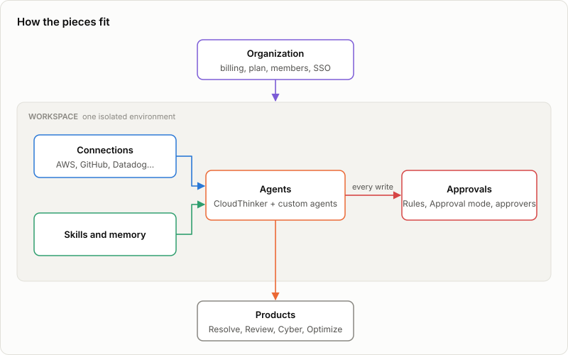
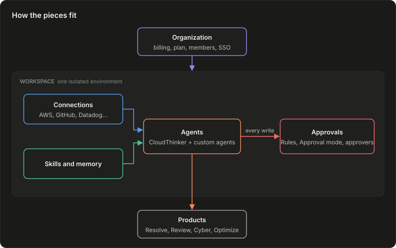

CloudThinker is built from a few pieces: an organization holds workspaces, and each workspace holds the connections, agents, skills, approvals, and memory that every product runs on. Learn these once and every product page reads the same way.

<Frame caption="Connections and skills feed the agents, every agent write passes approvals, and the products run on top.">
  
  
</Frame>

## The concepts at a glance

| Concept | What it is | Where you manage it |
|---|---|---|
| [Organization](/guide/organization) | The billing and membership boundary. Owns the plan, credits, members, and single sign-on. | **Settings → Organization** |
| [Workspace](/guide/workspaces) | An isolated environment inside the organization, such as production and staging, or one per team. Holds connections, chats, and data. | Workspace selector at the top of the sidebar |
| [Connection](/guide/connections/overview) | A credential for one external system: an AWS account, a Kubernetes cluster, a GitHub organization. | **Settings → Workspace → Connections** |
| [Agent](/guide/agents/overview) | The AI that reads your request, uses connections to look things up, and answers or acts. | **Settings → Workspace → Agents** |
| [Skill](/guide/skills/overview) | A reusable instruction set for one kind of task, run from the `/` menu or picked up when relevant. | **Settings → Workspace → Skills** |
| [Approvals](/guide/approvals/overview) | The checks every write passes before it runs: Rules, the Approval mode, and approvers. | **Settings → Workspace → Autonomy → Rules** (applies to the current workspace) |
| [Memory](/guide/memory) | What agents remember between conversations about your environment and preferences. | **Settings → Workspace → Memory** |

## Organization and workspaces

Signing up creates an organization with one workspace. Everything you connect or build lives in a workspace, and nothing crosses between workspaces unless you set it up.

| Lives in the organization | Lives in each workspace |
|---|---|
| Billing, plan, and credits | Connections and [credentials](/guide/credentials) |
| Members and org roles: Owner, Admin, Developer, Viewer | Custom agents, skills, and memory |
| Single sign-on and audit logs | Automations and approval settings |

Org Owners and Admins are Admins in every workspace. Everyone else gets a workspace role per workspace:

| Workspace role | Chat with CloudThinker | Create custom agents | Add connections, change approval rules and mode |
|---|---|---|---|
| **Admin** | Yes | Yes | Yes |
| **Developer** | Yes | Yes | No, view only |
| **Viewer** | No | No, view only | No, view only |

Who can approve a write is set separately, through [approvers](/guide/approvals/approvers). [Workspace permissions](/guide/security/roles#workspace-permissions) has the full list.

<Tip>
Use separate workspaces for production and non-production. A connection, its permissions, and its approval settings then can't leak between them.
</Tip>

## Connections set the outer limit

An agent can only see and act on what the workspace's connections allow. If your AWS role is read-only, no agent can change your AWS account, whatever your approval settings say. Start with read-only access and widen it when you want agents to make changes.

## Agents

| Agent | What it does | How you reach it |
|---|---|---|
| **CloudThinker** | The built-in assistant. Always on, can use every connection in the workspace. For a big question it starts short-lived [subagents](/guide/agents/overview#subagents) to check several things at once, then merges their results into one answer. | Send a message with no mention, or mention `@CloudThinker` |
| [Custom agents](/guide/agents/customize) | Agents your team creates, each with its own instructions and only the connections you assign. | Mention it, such as `@db-reviewer` |

A request follows the pattern `@agent #connection request`, and both parts are optional. Plain language works:

```text
Which pods in the production namespace restarted more than 3 times in the last 24 hours, and why?
```

See [CloudThinker Language](/guide/commands) for the full syntax.

## Skills and memory

These two give agents context before you type anything. Each has a different owner.

| | Holds | Who adds it | Use it when |
|---|---|---|---|
| [Skills](/guide/skills/overview) | Step-by-step instructions for one kind of task | You; a custom agent whose **Skill Learning** setting is **Auto** or **Offer**; and [Dreaming](/guide/memory-dreaming), which runs nightly by default and can create, update, merge, and delete custom skills | The same procedure should run the same way every time |
| [Memory](/guide/memory) | Short notes about your environment, preferences, and recent events | Agents, as they work. Admins edit or forget it directly; anyone who can chat can ask CloudThinker to change it | You're tired of re-explaining your setup |

Every night, [Dreaming](/guide/memory-dreaming) tidies memory: it merges duplicates and removes what's outdated. It's on by default. A workspace Admin can turn it off. Each run's summary of what it changed is under **Settings → Workspace → Memory → Run history**. To get a forgotten memory item back, restore it from the **Forgotten** view of **Settings → Workspace → Memory**. A custom skill Dreaming deletes can't be restored.

## Approvals gate every change

Reads always run. A write (anything that changes a system) is checked in this order:

1. **Always blocked.** A built-in list of calls that never run, such as stopping CloudTrail logging, closing an AWS account, or deleting the `kube-system` namespace. No person or Rule can override it.
2. **Rules.** Each Rule allows a kind of write, asks a person first, or denies it. **Deny** and **Ask first** Rules apply in every mode. See [Rules](/guide/approvals/rules).
3. **Approval mode.** Decides what's left. See [Approval mode](/guide/approvals/approval-mode).

| Mode | What happens to a write no Deny or Ask first Rule caught |
|---|---|
| **Manual** | A person approves it, even one an Allow Rule covers. |
| **Auto · Rules · Ask me** | An Allow Rule runs it. Anything no Rule covers waits for a person. |
| **Auto · Rules · Refuse** | An Allow Rule runs it. Anything no Rule covers is refused. |
| **Auto · Rules + AI · Ask me** | An Allow Rule runs it. AI judgment can allow a safe write no Rule covers. The rest wait for a person. |
| **Auto · Rules + AI · Refuse** | An Allow Rule runs it. AI judgment can allow a safe write no Rule covers. The rest are refused. |

When a write waits, the approval card goes to your [approvers](/guide/approvals/approvers), the people allowed to answer it.

AI judgment counts a write as safe when it matches what you asked for and stays in that scope, such as adding the tag you requested to the resource you named. A destructive write, or one with an unclear effect, goes to a person or is refused.

New workspaces start on **Auto · Rules + AI · Ask me**. You can set a different mode for one chat from the prompt box.

## The products

CloudThinker has four products: Resolve, Review, Cyber, and Optimize. Each investigates one kind of problem and needs only its own connection, so [pick the first one](/#products) and add the rest later.

Approvals, Customize, and Automation aren't products. They're supporting areas that work across all four: Approvals decides which writes run, Customize shapes the agents with your own agents and skills, and Automation runs them on a schedule or an event. Memory belongs to the workspace, so what agents learn in one run is there for later runs in the same workspace, whichever product starts them.

## Where results show up

| Place | What you find there |
|---|---|
| [Home](/guide/activity) | The **Workspace activity** chart of recent and upcoming work, above the chat box |
| [Inbox](/guide/activity#work-through-the-inbox) | What needs you, approvals waiting, notifications, and alerts, searchable and filterable |
| **Resolve → Issues** | Every incident, its root cause, evidence, and proposed fix |
| **Automations** | Each automation's **Past runs**, with each run's status and chat |
| [Library](/guide/artifacts/overview) | Dashboards, reports, and files agents built for you, under **More → Library** in the sidebar |

## Related

<CardGroup cols={2}>
  <Card title="Quickstart" icon="bolt" href="/quickstart">
    Put these concepts to work: connect a system and get your first answer in about 10 minutes
  </Card>
  <Card title="Agents" icon="robot" href="/guide/agents/overview">
    See how CloudThinker, subagents, and custom agents share the work
  </Card>
  <Card title="Approvals" icon="user-check" href="/guide/approvals/overview">
    Decide which changes run on their own and which wait for a person
  </Card>
  <Card title="Glossary" icon="book" href="/guide/glossary">
    Look up any term you meet in the product or these docs
  </Card>
</CardGroup>
