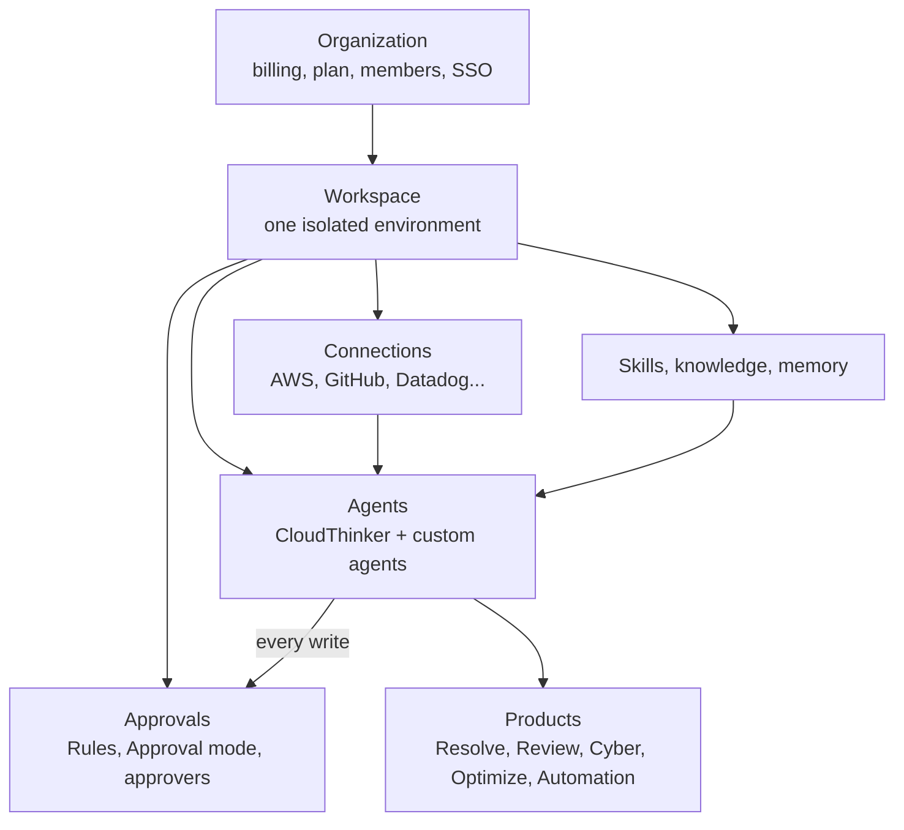

CloudThinker is built from a few pieces: an organization holds workspaces, and each workspace holds the connections, agents, skills, approvals, and memory that every product runs on. Learn these once and every product page reads the same way.



## The concepts at a glance

| Concept | What it is | Where you manage it |
|---|---|---|
| [Organization](/guide/organization) | The billing and membership boundary. Owns the plan, credits, members, and single sign-on. | Admin Settings |
| [Workspace](/guide/workspaces) | An isolated environment inside the organization, such as production and staging, or one per team. Holds connections, chats, and data. | Workspace selector at the top of the sidebar |
| [Connection](/guide/connections/overview) | A credential for one external system: an AWS account, a Kubernetes cluster, a GitHub organization. | **More → Workspace settings → Connections** |
| [Agent](/guide/agents/overview) | The AI that reads your request, uses connections to look things up, and answers or acts. | **More → Workspace settings → Agents** |
| [Skill](/guide/skills/overview) | A reusable instruction set for one kind of task, run from the `/` menu or picked up when relevant. | **More → Workspace settings → Skills** |
| [Knowledge](/guide/knowledge) | Your runbooks, policies, and docs, uploaded or crawled, for agents to cite. | **More → Workspace settings → Knowledge** |
| [Approvals](/guide/approvals/overview) | The checks every write passes before it runs: Rules, the Approval mode, and approvers. | **Approvals** in the sidebar |
| [Memory](/guide/memory) | What agents remember between conversations about your environment and preferences. | **More → Workspace settings → Memory** |

## Organization and workspaces

Signing up creates an organization with one workspace. Everything you connect or build lives in a workspace, and nothing crosses between workspaces unless you set it up.

| Lives in the organization | Lives in each workspace |
|---|---|
| Billing, plan, and credits | Connections and [credentials](/guide/credentials) |
| Members and org roles: Owner, Admin, Developer, Viewer | Custom agents, skills, knowledge, and memory |
| Single sign-on and audit logs | Automations, commands, and approval settings |

Org Owners and Admins are Admins in every workspace. Everyone else gets a workspace role (Admin, Developer, or Viewer) per workspace. See [Workspace members](/guide/workspace-users).

<Tip>
Use separate workspaces for production and non-production. A connection, its permissions, and its approval settings then can't leak between them.
</Tip>

## Connections set the outer limit

An agent can only see and act on what the workspace's connections allow. If your AWS role is read-only, no agent can change your AWS account, whatever your approval settings say. Start with read-only access and widen it when you want agents to make changes.

## Agents

| Agent | What it does | How you reach it |
|---|---|---|
| **CloudThinker** | The built-in assistant. Always on, can use every connection in the workspace. For a big question it starts short-lived [subagents](/guide/agents/overview#subagents) to check several things at once, then merges their results into one answer. | Send a message with no mention, or mention `@CloudThinker` |
| [Custom agents](/guide/agents/customize) | Agents your team creates, each with its own instructions and only the connections you assign. | Mention it, such as `@db-reviewer` |

A request follows the pattern `@agent #connection request`, and both parts are optional. Plain language works:

```text
Which pods in the production namespace restarted more than 3 times in the last 24 hours, and why?
```

See [Commands](/guide/commands) for the full syntax.

## Skills, knowledge, and memory

These three give agents context before you type anything. Each has a different owner.

| | Holds | Who adds it | Use it when |
|---|---|---|---|
| [Skills](/guide/skills/overview) | Step-by-step instructions for one kind of task | You, or agents when skill learning is on | The same procedure should run the same way every time |
| [Knowledge](/guide/knowledge) | Your documents, as written | You, by uploading files or crawling sites | Agents should quote your runbook or policy |
| [Memory](/guide/memory) | Short notes about your environment, preferences, and recent events | Agents, as they work. You can edit or delete | You're tired of re-explaining your setup |

Every night, [Dreaming](/guide/memory-dreaming) tidies memory: it merges duplicates and removes what's outdated.

## Approvals gate every change

Reads always run. A write (anything that changes a system) goes through four steps in order, and the first one that gives an answer decides:

1. **Always blocked.** A built-in list of calls that never run. No person or Rule can override it.
2. **Rules.** Each Rule allows a kind of write, asks a person first, or denies it. See [Rules](/guide/approvals/rules).
3. **Approval mode.** Decides every write no Rule covers. See [Approval mode](/guide/approvals/approval-mode).
4. **Approvers.** Decide who can answer an approval card. See [Approvers](/guide/approvals/approvers).

| Mode | What happens to a write |
|---|---|
| **Manual** | A person approves every write, even one an Allow Rule covers. |
| **Auto** | Rules decide first. With **Rules + AI**, AI judgment can allow a safe write no Rule covers. The rest wait for a person (**Ask me**) or are refused (**Refuse**). |

AI judgment counts a write as safe when it matches what you asked for and stays in that scope, such as adding the tag you requested to the resource you named. A destructive write, or one with an unclear effect, goes to a person or is refused.

New workspaces start on **Auto · Rules + AI · Ask me**. You can set a different mode for one chat from the prompt box.

## The products

Resolve, Review, Cyber, and Optimize all run on the pieces above, and each one needs only its own connection. See [Pick a product](/#pick-a-product) for what each needs to start. What one product learns lands in shared memory, so a past incident can inform a later pull request review.

## Where results show up

| Place | What you find there |
|---|---|
| [Home](/guide/activity) | **Needs you** (approvals and decisions waiting on you), **Products**, and **Automation today** |
| **Investigation** in the sidebar | Every incident, its root cause, evidence, and proposed fix |
| [Artifacts](/guide/artifacts/overview) | Dashboards, reports, and files agents built for you |

## Related

<CardGroup cols={2}>
  <Card title="Quickstart" icon="bolt" href="/quickstart">
    Put these concepts to work: connect a system and get your first answer in about 10 minutes
  </Card>
  <Card title="Agents" icon="robot" href="/guide/agents/overview">
    See how CloudThinker, subagents, and custom agents share the work
  </Card>
  <Card title="Approvals" icon="user-check" href="/guide/approvals/overview">
    Decide which changes run on their own and which wait for a person
  </Card>
  <Card title="Glossary" icon="book" href="/guide/glossary">
    Look up any term you meet in the product or these docs
  </Card>
</CardGroup>
