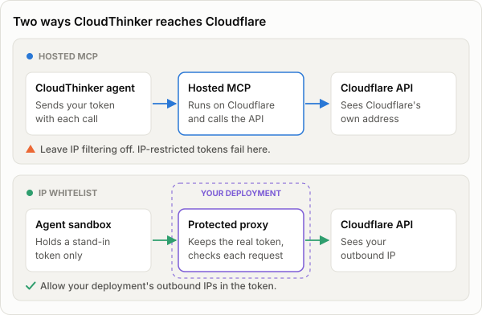
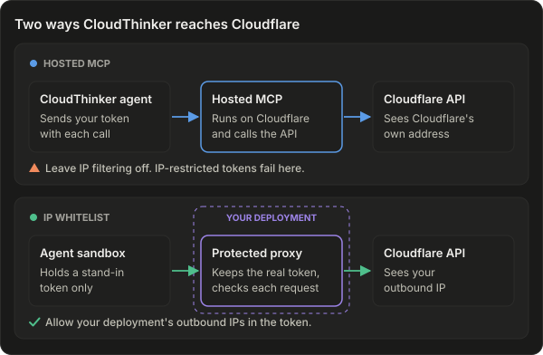
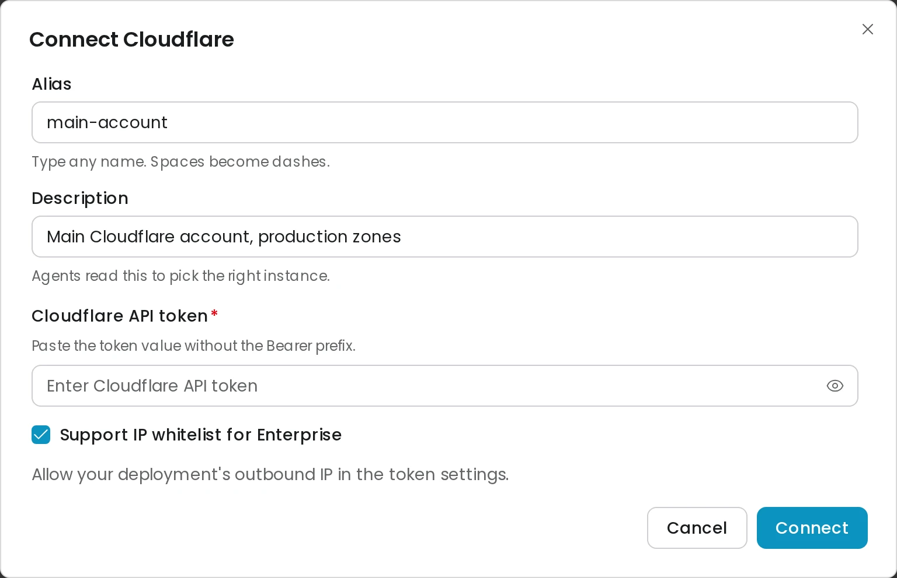
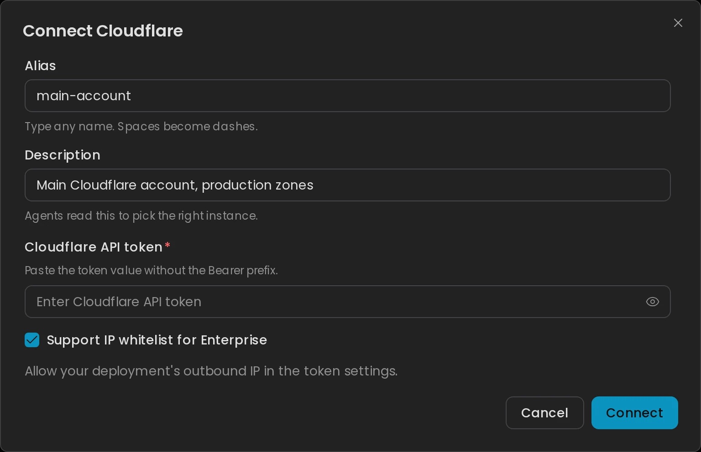

import ApprovalDefault from '/snippets/approval-default.mdx';
import ConnectionSecurity from '/snippets/connection-security.mdx';

Connect Cloudflare so CloudThinker can list your accounts and zones, read DNS records and Workers, summarize traffic and firewall events, and propose changes you approve. CloudThinker authenticates with one **API token**, whose permissions decide what it can reach.

You choose one of two ways for CloudThinker to reach Cloudflare when you connect:

<Frame caption="Hosted MCP calls the API from Cloudflare's address. IP whitelist support calls it from your deployment's address and keeps the real token out of the agent's sandbox.">
  
  
</Frame>

| | Hosted MCP (default) | IP whitelist support |
|---|---|---|
| **Who calls the Cloudflare API** | Cloudflare's [hosted MCP server](https://github.com/cloudflare/mcp) | Your CloudThinker deployment, from its own public outbound IP addresses |
| **IP-restricted tokens** | Not supported. Leave **Client IP Address Filtering** empty. | Supported. Allow the deployment's outbound IP addresses. |
| **Reads** | Go through [Approvals](/guide/approvals/overview), because the same tool can also make changes | Run without asking |
| **Writes** | Go through Approvals | Go through Approvals, and **Allow writes** can turn them off |
| **Traffic analytics** | Up to 7 days of hourly data, plus 24 hours of firewall events | Up to 24 hours of traffic |

Use **IP whitelist support** when your security policy requires API tokens restricted to known IP addresses. Otherwise use hosted MCP.

## Prerequisites

- A Cloudflare account and permission to create an API token in the [Cloudflare dashboard](https://dash.cloudflare.com/).
- For **IP whitelist support**: the public outbound IP addresses of your CloudThinker deployment. On CloudThinker Cloud, email [support@cloudthinker.io](mailto:support@cloudthinker.io). On a self-hosted install, ask your instance admin.

A zone is needed for DNS and traffic analytics, but not for account resources such as Workers KV.

## Setup

<Steps>
  <Step title="Create a custom API token">
    In the Cloudflare dashboard, go to **My Profile → API Tokens → Create Token** for a user token, or **Manage account → Account API tokens → Create Token** for an account token. Under **Create Custom Token**, click **Get started**. Add each permission you need from [Required permissions](#required-permissions). Each row has three dropdowns, so **Zone → DNS → Read** means group **Zone**, permission **DNS**, access **Read**.

    Under **Account Resources** and **Zone Resources**, include only the account and zones CloudThinker should see.
  </Step>
  <Step title="Restrict the token by IP (IP whitelist support only)">
    Under **Client IP Address Filtering**, choose **Is in** and add each public outbound IP address of your CloudThinker deployment. Use `/32` for a single IPv4 address. Include every address the deployment can use.

    For hosted MCP, leave **Client IP Address Filtering** empty. Cloudflare's hosted server calls the API from Cloudflare's own addresses, so an IP-restricted token fails there.
  </Step>
  <Step title="Set an expiry, then create and copy the token">
    Under **TTL**, set an end date, for example 90 days from today. Click **Continue to summary → Create Token**. Copy the token now. Cloudflare shows it only once.
  </Step>
  <Step title="Add the connection in CloudThinker">
    In the sidebar, click **More → Workspace settings → Connections**, select **Cloudflare**, and click **Connect**. Fill in **Alias** (for example `main-account`) and **Description** (for example `Main Cloudflare account, production zones`). Agents read the description to pick the right connection when you have several. Paste the token into **Cloudflare API token**, without the `Bearer` prefix.

    For an IP-restricted token, check **Support IP whitelist for Enterprise**. Leave it unchecked for hosted MCP.

    <Frame>
      
      
    </Frame>

    Click **Connect**. **Success state:** the connection shows **Connecting** and **Verifying**, then **Connected**. Discovery now runs once in the background and spends credits. See [What happens after you connect](/guide/connections/overview#what-happens-after-you-connect).
  </Step>
  <Step title="Set the environment">
    Open **Cloudflare** in **More → Workspace settings → Connections**, click the pencil icon on the connection's row, and set **Environment** in **Edit Instance**. It labels the connection for people and agents.
  </Step>
</Steps>

## Connection details

| Field | What to enter |
|---|---|
| **Alias** | Short name for this connection. Blank picks one for you. |
| **Description** | What the account covers. Agents use it to choose between connections. |
| **Cloudflare API token** | The API token you created, without the `Bearer` prefix. |
| **Support IP whitelist for Enterprise** | Check it for an IP-restricted token. Unchecked uses hosted MCP. |

You don't enter an account ID. CloudThinker finds the accounts and zones the token can see. You can add more than one Cloudflare connection, for example one token per account.

## Required permissions

Grant only what your tasks need. Each permission is written as it appears in the Cloudflare form: group → permission → access.

| Task | Permission |
|---|---|
| List accounts | **Account → Account Settings → Read** |
| List zones and read zone settings | **Zone → Zone → Read** |
| Read DNS records | **Zone → DNS → Read** |
| Read traffic analytics and firewall events | **Zone → Analytics → Read** |
| Inspect Workers | **Account → Workers Scripts → Read** |
| Read Workers KV | **Account → Workers KV Storage → Read** |
| Change DNS records | **Zone → DNS → Edit** |
| Create, write, or delete Workers KV namespaces and values | **Account → Workers KV Storage → Edit** |

For an account token on hosted MCP, also grant the **Account Resources: Read** permission so Cloudflare can identify the account. See Cloudflare's [permission reference](https://developers.cloudflare.com/fundamentals/api/reference/permissions/) for every group.

<Tip>
Start read-only and scoped to specific zones. Any **Edit** permission you add becomes a change agents can propose. Each change still goes through your approvals.
</Tip>

## Agent capabilities

### Hosted MCP

The connection has three tools. Two run freely. The third calls the Cloudflare API and always goes through [Approvals](/guide/approvals/overview), even for a read, because the same tool can also make changes.

| Tool | What CloudThinker does | Approval |
|---|---|---|
| **docs** | Searches Cloudflare's documentation | No |
| **search** | Finds the right Cloudflare API endpoint for a request | No |
| **execute** | Calls the Cloudflare API: lists accounts and zones, reads zone settings and DNS records, runs traffic analytics, reads firewall events, inspects Workers, and makes changes the token allows | Yes |

Traffic summaries cover up to 7 days of hourly data for one zone. Firewall reviews cover up to 24 hours and 50 sample events, without client IP addresses.

Discovery never waits for a person, so it skips any **execute** call that would ask and finds little on hosted MCP. An automation that calls **execute** uses its own Approval mode, **Refuse** by default, so a call that would ask is refused instead.

### IP whitelist support

CloudThinker calls the Cloudflare API from your deployment's network. The real token never enters the agent's sandbox.

- **Reads** of accounts, zones, DNS records, Workers, Workers KV, and other resources the token allows run without asking. Discovery can read them too.
- **Writes**, such as DNS changes and Workers KV operations, go through your Approvals. Each approval covers one exact request. A changed request needs a new approval.
- **Allow writes** is on by default. To keep the connection read-only, select **Cloudflare** in **More → Workspace settings → Connections** and turn off **Allow writes**.
- **Traffic analytics** cover up to 24 hours for one zone.
- **Limits:** CloudThinker sends JSON requests only. Binary or multipart uploads, streaming, WebSocket calls, and custom GraphQL queries aren't available. Calls that create, update, or roll API tokens are always refused, so an agent can't remove the token's own IP restriction.

<ApprovalDefault />

### Verify the connection

```text
List the Cloudflare accounts and zones this connection can access, and name any missing permissions
```

The answer lists your real account and zone names. On hosted MCP, approve the request in the chat first. For an account without zones, ask for its Workers KV namespaces instead.

### Example prompts

```text
Summarize HTTP requests, bandwidth, and cache behavior for example.com over the last 24 hours
Review the DNS records for example.com and propose corrections
Show which firewall rules blocked or challenged requests on example.com in the last 24 hours
```

## Troubleshooting

<Accordion title="IP whitelist support is unavailable in this environment">
The **Support IP whitelist for Enterprise** checkbox is greyed out. On CloudThinker Cloud, email [support@cloudthinker.io](mailto:support@cloudthinker.io). On a self-hosted install, ask your instance admin to enable it.
</Accordion>

<Accordion title="Cloudflare rejected the token, its source IP, or its resource permissions">
The token expired, lacks a permission, or doesn't allow your deployment's outbound IP address. Check the token's TTL, permissions, and zone scope. If it uses **Client IP Address Filtering**, confirm every outbound address is allowed and that **Support IP whitelist for Enterprise** is checked.
</Accordion>

<Accordion title="Cloudflare's token check passes, but the connection fails">
Cloudflare's [Verify Token check doesn't enforce IP filtering](https://developers.cloudflare.com/fundamentals/api/how-to/restrict-tokens/), so a passing check doesn't prove the IP list is right. Compare the token's IP list with your deployment's outbound addresses.
</Accordion>

<Accordion title="The protected Cloudflare API proxy is unavailable">
IP whitelist support isn't ready on your CloudThinker deployment. On CloudThinker Cloud, email [support@cloudthinker.io](mailto:support@cloudthinker.io). On a self-hosted install, ask your instance admin. Once it's fixed, click **Retry** on the connection.
</Accordion>

<Accordion title="Permission denied">
On hosted MCP, CloudThinker reports `CLOUDFLARE_PERMISSION_DENIED`. The token is missing the permission for what you asked about. Edit the token in the Cloudflare dashboard, add the permission, and ask again.
</Accordion>

<Accordion title="No zones found or zone not found">
On hosted MCP, `CLOUDFLARE_NO_ZONES` means the token lists no zones, and `CLOUDFLARE_ZONE_NOT_FOUND` means the zone you named isn't visible to it. Check **Zone Resources** on the token and use the exact zone name. An account without zones is valid for account resources such as Workers KV.
</Accordion>

<Accordion title="Nothing happens after I ask a question">
A Cloudflare call is waiting for approval. Check the chat for a pending approval request, or review your [Approval mode](/guide/approvals/approval-mode). If you reject a request, CloudThinker won't retry it.
</Accordion>

<Accordion title="Analytics come back empty">
A new zone or a zone with little traffic may have no analytics yet. Confirm the zone receives traffic through Cloudflare and that the token has **Zone → Analytics → Read**.
</Accordion>

<Accordion title="Legacy: an older connection shows 'Cloudflare moved to Cloudflare's hosted endpoint'">
New connections never hit this. A connection created before the move to Cloudflare's hosted MCP server shows **Error** with this message, and CloudThinker reconnects it on its own. If the status doesn't change, open the connection and click **Retry**. The old Account ID and Enabled Services values are no longer used.
</Accordion>

## Security

<ConnectionSecurity />

- **Restrict zones**: limit the token to specific zones rather than all zones.
- **Restrict by IP**: with IP whitelist support, allow only your deployment's outbound addresses, and update the list before those addresses change.
- **Rotate before the TTL ends**: [rotate the token](/guide/connections/overview#rotate-a-credential) before the **TTL** end date you set.

## Related

<CardGroup cols={2}>
  <Card title="Approvals" icon="shield-check" href="/guide/approvals/overview">
    Decide how Cloudflare reads and changes get approved.
  </Card>
  <Card title="Connections overview" icon="plug" href="/guide/connections/overview">
    How connections, testing, and discovery work.
  </Card>
</CardGroup>
