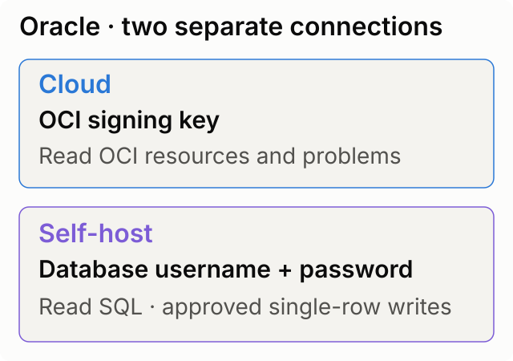
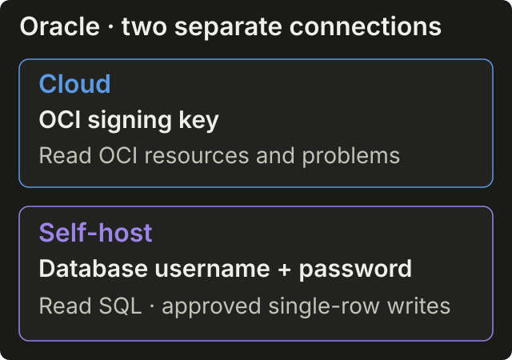

import ConnectionSecurity from '/snippets/connection-security.mdx';

Connect **Oracle** to explore Oracle Cloud Infrastructure (OCI) with an API signing key, or query Oracle Database with a database username and password. The **Cloud** and **Self-host** tabs create separate connections with different credentials and capabilities.

<Note>
Both Oracle connection variants are currently available in development deployments and are not enabled by default in production. [Contact CloudThinker](https://cloudthinker.io/contact) to confirm access before setup. **Self-host** refers to your database, not a self-hosted deployment of CloudThinker.
</Note>

## Prerequisites

- **Cloud**: an OCI user in an IAM group whose policies allow the reads you need. Cloud Guard must already be enabled to inspect problems.
- **Self-host**: [Oracle Database 12.1 or later](https://python-oracledb.readthedocs.io/en/stable/user_guide/installation.html#supported-oracle-database-versions), a dedicated database user, and a DBA who can grant access.
- **Self-host network access**: a route from CloudThinker to your database listener. Follow [Reaching private services](/guide/connections/overview#reaching-private-services); on a [self-hosted deployment](/guide/deployment/overview), allow your CloudThinker deployment. Confirm the listener port and service name with your DBA.

## Setup

<Frame caption="Choose the Oracle connection that matches the credential you have.">
  
  
</Frame>

<Tabs>
  <Tab title="Cloud">
    <Steps>
      <Step title="Get an API signing key">
        Use a dedicated OCI user. In the OCI Console, open **Profile → User settings → API Keys → Add API Key**. Download the private key, then click **Add**.

        Copy the user OCID, tenancy OCID, fingerprint, and region from **Configuration File Preview**. Follow [Oracle's signing-key instructions](https://docs.oracle.com/en-us/iaas/Content/API/Concepts/apisigningkey.htm) if you already have a key pair.
      </Step>
      <Step title="Grant read access">
        Ask your OCI administrator to apply the policies in [Required permissions](#required-permissions) to that user's group.
      </Step>
      <Step title="Connect Oracle Cloud">
        Open **More → Workspace settings → Connections**, select **Oracle**, and click **Connect**. Choose **Cloud**, fill in its fields below, and click **Connect**.

        **Success state:** the connection shows a **Connected** status. The connection test confirms the user can list accessible compartments; it does not verify every resource permission.
      </Step>
    </Steps>
  </Tab>
  <Tab title="Self-host">
    <Steps>
      <Step title="Prepare a database login">
        Ask your DBA for a dedicated password-authenticated user in the target database, with **CREATE SESSION** and read grants from [Required permissions](#required-permissions).

        For a multitenant database, use the pluggable database's service name. A SID is not a service name.
      </Step>
      <Step title="Confirm the listener and TLS">
        Get the hostname, listener port, and service name. For encrypted traffic, use a TCPS listener with a publicly trusted certificate and set **Use TLS** to **Yes**.

        This connection uses python-oracledb Thin mode, without wallet upload, client-certificate fields, or Native Network Encryption.
      </Step>
      <Step title="Connect Oracle Database">
        Open **More → Workspace settings → Connections**, select **Oracle**, and click **Connect**. Choose **Self-host**, enter the fields below, and click **Connect**.

        **Success state:** the connection shows a **Connected** status. The verification message identifies the container, user, database version, and service.
      </Step>
    </Steps>
  </Tab>
</Tabs>

Editing a saved connection keeps its original type. Add another connection to use the other tab; an OCI signing key cannot authenticate a database login.

## Connection details

Use the labels shown in the selected tab. Complete each field below.

| Cloud field | What to enter |
|---|---|
| **Region** | OCI region identifier; defaults to `us-ashburn-1`. Use the Cloud Guard reporting region for problems. |
| **Tenancy OCID** | Tenancy identifier from the configuration preview. |
| **User OCID** | Identifier of the user who owns the signing key. |
| **API key fingerprint** | Fingerprint of that key. |
| **API private key (PEM)** | Unencrypted private key contents, including the BEGIN and END lines. |

| Self-host field | What to enter |
|---|---|
| **Host** | Database hostname or IP address, without a port, URL, or connect descriptor. |
| **Port** | Listener port; defaults to `1521`. Use your DBA's port for TCPS. |
| **Service name** | Database service, such as the pluggable database service; not a SID. |
| **Username** | Dedicated database user. |
| **Password** | That user's password. |
| **Use TLS** | **No (default)** for TCP; **Yes** for TCPS with a publicly trusted server certificate. |

With **Use TLS → No**, query results cross the network unencrypted. **Yes** verifies the server certificate and its name; contact CloudThinker if you need a private certificate authority. See [Oracle's encryption limitations](https://python-oracledb.readthedocs.io/en/stable/user_guide/appendix_b.html#native-network-encryption-and-checksumming).

## Required permissions

| Connection | Access for the job |
|---|---|
| **Cloud: compartments** | `read compartments in tenancy` for the OCI user's group. |
| **Cloud: resources** | `inspect` on the resource types and compartments you want searched. Search omits resources the user cannot inspect. |
| **Cloud: problems** | `read cloud-guard-problems in tenancy`. Use the reporting region. |
| **Self-host: login and rows** | `CREATE SESSION`, plus `SELECT` on each application table the user may read. |
| **Self-host: database status** | `SELECT` on `SYS.V_$DATABASE`. |
| **Self-host: sessions and slow SQL** | `SELECT` on `SYS.V_$SESSION` and `SYS.V_$SQL`. |
| **Self-host: tablespace use** | `SELECT` on `SYS.DBA_TABLESPACE_USAGE_METRICS` and `SYS.DBA_TABLESPACES`. |

Ask your administrator to scope policies to the group and compartments you need. See [Search permissions](https://docs.oracle.com/en-us/iaas/Content/Search/Concepts/queryoverview.htm#Required) and [Cloud Guard policies](https://docs.oracle.com/en-us/iaas/Content/cloud-guard/using/prerequisites.htm).

Ask your DBA to apply [Oracle grants](https://docs.oracle.com/en/database/oracle/oracle-database/19/sqlrf/GRANT.html) in the target database. Missing monitoring grants leave those sections unavailable; they do not mean the database is healthy.

<Tip>
Start with read access to selected resources and tables. Prefer individual monitoring grants over the broader `SELECT_CATALOG_ROLE`; add table-level `INSERT`, `UPDATE`, or `DELETE` only when you need row changes.
</Tip>

## Agent capabilities

| Tab | What CloudThinker can do | Bounds |
|---|---|---|
| **Cloud** | List compartments, search resources, and inspect open Cloud Guard problems. | Read-only. Resource Search covers one region and the first 1,000 results. |
| **Self-host** | Inspect visible schemas, tables, indexes, constraints, statistics, and invalid objects. | Only objects visible to the database user. |
| **Self-host** | Check sessions, blocking, long calls, and slow SQL. | Requires monitoring grants; slow SQL statistics are cumulative, not a recent time window. |
| **Self-host** | Run one `SELECT` or read-only `WITH` query. | Default 25 rows, maximum 100; 30-second timeout per database call. No locking reads or multiple statements. |

Database output can be truncated. Ask for a narrower query or an SQL aggregate for exact totals; a returned sample is not a full inventory.

### Verify the connection

```text
For Oracle Cloud, list accessible compartments and summarize resources in the connected region
For Oracle Database, report the connected database identity and list visible schemas and tables
```

Use the prompt matching your tab. Expect accessible resources or database identity and tables, with any missing permissions called out.

### Example prompts

```text
Show open high-risk OCI Cloud Guard problems in the connected region
Find invalid objects and tables with missing statistics in my Oracle application schema
Show Oracle blocking sessions and the SQL statements with the highest cumulative elapsed time
```

## Write access

**Cloud** cannot change infrastructure or resolve Cloud Guard problems.

**Self-host** supports approved single-row `INSERT`, `UPDATE`, and `DELETE` when the connection permits writes and the database user has the corresponding grants. CloudThinker reads the target first, names its complete primary key and proposed values, then requests [approval](/guide/approvals/overview).

Each change returns its result, before/after values, and an undo command. Undo is another write and needs its own approval. A locked row is refused.

Bulk changes, primary-key changes, tables without primary keys, Oracle-maintained schemas, DDL, `TRUNCATE`, `DROP`, `GRANT`, and PL/SQL are unsupported. LOB, RAW, XML, and object columns cannot be changed. Changes are refused when undo cannot safely restore the values, including unsupported types, line breaks, NUL, or undo commands over 16,000 characters.

## Troubleshooting

<Accordion title="OCI rejected the signature">
Check that the fingerprint and private key belong to the specified OCI user and tenancy. Update the Cloud credentials together.
</Accordion>

<Accordion title="OCI refused the read, or NotAuthorizedOrNotFound">
Check the group's policies for the requested data. For Cloud Guard, confirm it is enabled and **Region** matches its reporting region.
</Accordion>

<Accordion title="The listener does not know this service name">
Ask your DBA for the service name registered with the listener. For a multitenant database, enter the pluggable database service rather than a SID.
</Accordion>

<Accordion title="Oracle rejected the username or password">
Update the database username and password. If the account is locked or lacks **CREATE SESSION**, ask your DBA to correct it.
</Accordion>

<Accordion title="The TLS handshake failed, or Native Network Encryption is required">
Confirm the listener's protocol, port, and trusted certificate. If the server requires Native Network Encryption, ask your DBA for a TCPS listener and select **Use TLS → Yes**. Do not disable encryption to retry.
</Accordion>

<Accordion title="The Oracle listener did not answer">
Check **Host**, **Port**, and the firewall route from CloudThinker. A local address on your computer does not identify a database CloudThinker can reach.
</Accordion>

## Security

<ConnectionSecurity />

- Use a dedicated OCI signing key or database account so you can revoke CloudThinker's access independently.
- Restrict listener access to CloudThinker and use TLS for database traffic. Keep database grants limited to the tables you intend to expose.

## Related

<CardGroup cols={2}>
  <Card title="Connections" icon="plug" href="/guide/connections/overview">
    Manage connection access and reach private services.
  </Card>
  <Card title="Approvals" icon="shield-check" href="/guide/approvals/overview">
    Review database changes before they run.
  </Card>
</CardGroup>
