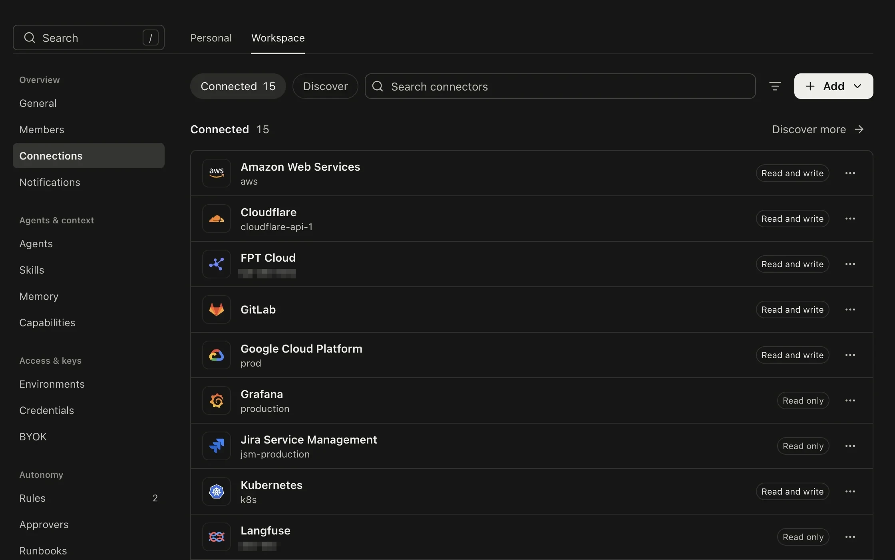
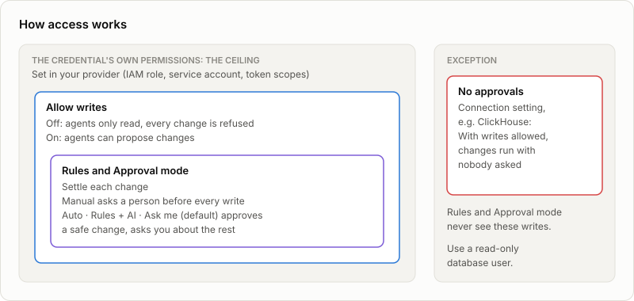
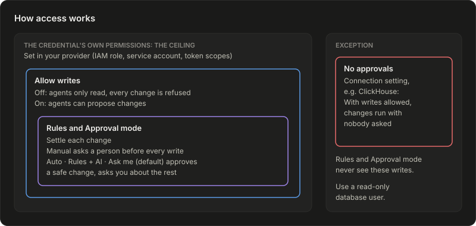

{/* verify-docs: allow-retired-names -- Google SecOps is a vendor product name. */}

import ConnectionSecurity from '/snippets/connection-security.mdx';

A connection is a saved credential for one external service, such as an AWS account, a Kubernetes cluster, or a GitHub organization. Agents can only see and do what your connections allow, so this page covers how to add one, scope it, check it, and keep it healthy. The full list of services is in the [connection catalog](#connection-catalog).

## Add a connection

<Steps>
  <Step title="Open Connections">
    In the sidebar, click **More → Workspace settings → Connections**. The **Builtin Connections** tab lists every supported service. Filter by category or search by name. When a setup guide says "open Connections", it means this screen.

    <Frame caption="Connections: pick a connection to see its discovery, settings, Allow writes switch and agents">
      
    </Frame>
  </Step>
  <Step title="Open the setup guide and follow its order">
    Open the setup guide for your service from the [catalog](#connection-catalog), or click **Setup guide** on the service's detail panel. Each guide lists the minimum permissions for the credential. The order depends on the service:

    | Service | Do this first |
    |---|---|
    | AWS | Open the connect dialog. It generates the External ID your role needs. |
    | OAuth services, such as GitHub, Linear, and Sentry | Usually nothing: click **Connect** and sign in. A few need one-time setup first. Asana needs your own Asana app's Client ID and secret, Atlassian needs an org admin to allow the CloudThinker domain, and Bitbucket asks for the workspace slug. See each guide. |
    | Everything else, such as Google Cloud, Azure, Firebase, and Cloudflare | Create the credential at the provider, then open the dialog. |
  </Step>
  <Step title="Connect">
    Select the service and click **Connect**. Enter or upload the credential and click **Connect** in the dialog.

    Services that support several accounts, such as AWS, Google Cloud, and SSH, also ask for an **Alias** (a short name like `production`) and a **Description**. Agents read the description to pick the right account, so make it specific: `Production AWS account, us-east-1 workloads`.

    <Note>
    A service allows several connections only when its detail panel shows **Supports multiple connections**. Others, such as Microsoft Azure, Kubernetes, VMware vCenter, and every service you connect by OAuth sign-in, allow one connection per workspace. To connect a second Azure tenant or a second cluster, use a separate workspace.
    </Note>
  </Step>
  <Step title="Wait for the test">
    CloudThinker tests the connection before saving it. For most services the test calls the service with your credential. For some, such as Argo CD, Buildkite, CircleCI, Clarity, Databricks, [Notion](/guide/connections/notion), [Prowler](/guide/connections/prowler), [Render](/guide/connections/render), and [Rollbar](/guide/connections/rollbar), it only checks that the connection's tool starts, so a wrong token can still show **Connected**. On those, the verify prompt in the setup guide is the real test.

    | Status | What it means | What to do |
    |---|---|---|
    | **Connecting** | The test is starting | Wait |
    | **Verifying** | CloudThinker is calling the service with your credential | Wait |
    | **Connected** | The test passed and the connection is saved. On services whose test doesn't check the credential, it only means the tool started. | Run the guide's verify prompt, then ask a question against it |
    | **Failed** | The service rejected the credential. The provider's error is shown. | Fix the credential or its permissions, then connect again |
    | **Timed out** | The test didn't finish in time | Check the service is reachable from CloudThinker Cloud. See [Reaching private services](#reaching-private-services). |
    | **Error** | It worked before, then failed in the background | See [When a connection breaks](#when-a-connection-breaks) |

    **Success state:** the service shows **Connected** in the Connections list.
  </Step>
  <Step title="Ask a question against it">
    Open a chat and ask something only that service can answer. Each setup guide has a verification prompt.

    ```text
    Which AWS account and regions can you reach through my connection?
    ```

    **Success state:** the answer names your real account ID or project, not a generic explanation.
  </Step>
</Steps>

## Set the environment

Each connection has an **Environment**: **Production**, **Staging**, **Development**, or **Not set**. It labels the connection for the people and agents who read it. [Rules](/guide/approvals/rules) (conditions that decide whether an agent's change runs, waits for a person, or is refused) don't read it.

<Note>
The connect dialog doesn't ask for an environment, so set it right after you connect. Single-connection services, such as Microsoft Azure, and every OAuth service, such as GitHub, Linear, and Sentry, can't be changed from **Not set**. To treat one connection differently from another, write a [Rule](/guide/approvals/rules#what-a-rule-contains) that names that connection.
</Note>

On a service that supports multiple connections, each account shows as a row on the service's detail panel. To set the environment, click the pencil icon on the account's row, and update **Environment** in the **Edit Instance** dialog.

## What happens after you connect

The first time a connection reaches **Connected**, CloudThinker runs **Discovery**: one background investigation of the service you just connected. Results fill the **Discovery** section of the connection's detail panel.

| Result | What it is | What you can do |
|---|---|---|
| Evidence | Facts about how the service is set up, each citing the read that produced it | Review it to see what agents can reach |
| Related connection | A service that would make the evidence more useful | Click **Connect** on the card |
| Recurring check | A repeat of the check, suggested from the evidence | Click **Schedule** to create an [automation](/guide/automation/automations) |

Discovery is often the first useful answer you get, so check it before you write your first prompt. It runs automatically once, for at most 30 minutes. You can rerun it with **Run Discovery**, for example after you widen the credential's permissions. You need the workspace Admin role to rerun it.

Discovery spends credits, and the cost depends on how much the service holds. It can't use [daily credits](/guide/billing/usage#credit-types) (the 100 free credits a day that cover chat on the [Light model](/guide/billing/usage#what-makes-a-run-cost-more) only), so it needs credits in the workspace balance. If the balance is too low, it pauses with a notice. Add credits, then click **Run Discovery**.

Discovery uses the same tools and [Approvals](/guide/approvals/overview) as a chat, but no one is there to answer, so it never waits for approval. A call that would ask a person is skipped, and Discovery carries on with the reads it can make. On Cloudflare and PostHog, where every API call goes through approvals, on Databricks and Neon, where every SQL statement does, and on Firebase, where project switches and deploy status checks do, Discovery finds less whenever those calls would ask a person.

If Discovery hits its time limit, it ends as **Partial discovery** and keeps the results it already verified. If it verified nothing, it shows **Discovery could not finish**. Your connection keeps working either way.

## How access works

Every connection belongs to one [workspace](/guide/workspaces). Anyone working in that workspace, including the built-in [CloudThinker agent](/guide/agents/overview) and your custom agents, can use it without setting it up again.

| Workspace role | See connections | Add, edit, rotate, delete, rerun Discovery |
|---|---|---|
| Admin | Yes | Yes |
| Developer, Viewer | Yes | No |

Organization Owners and Admins hold workspace Admin in every workspace. See [Workspace roles](/guide/workspace-users#workspace-roles).

<Warning>
On most connections that have it, **Allow writes** starts on. That includes AWS, Google Cloud, Azure, Kubernetes, GitHub, GitLab, Bitbucket, Azure DevOps, AWS CodeCommit, Cassandra, Drata, FortiGate, Okta, and Rootly. A few start off, such as Docker Hub, Fly.io, FireHydrant, and Snowflake. Argo CD has no toggle: its **READ_ONLY** field in the connect form starts on **Full access**. If the credential you connect has any write permission, agents can propose changes the moment you connect, and your Rules and Approval mode decide each one. There's no workspace or organization setting to start it off, so the controls are a read-only credential and turning off **Allow writes** on each connection. Each setup guide's **Write access** or **Agent capabilities** section says what its connection starts with.
</Warning>

Two controls decide what an agent can do with a connection:

<Frame caption="The credential is the ceiling, Allow writes opens changes, and Rules and Approval mode settle each one, except on Connection setting, no approvals connections.">
  
  
</Frame>

| Control | Where it lives | What it decides |
|---|---|---|
| The credential's own permissions | Your provider (IAM role, service account, API token scopes) | The ceiling. Agents can never do more than the credential allows. |
| **Allow writes** | The connection's detail panel in CloudThinker | Off: agents can only read, and every change is refused. On: agents can propose changes, and your [Rules](/guide/approvals/rules) and [Approval mode](/guide/approvals/approval-mode) settle each one. **Manual** asks a person before every write. The default, **Auto · Rules + AI · Ask me**, lets an Allow Rule or AI judgment approve a safe change and asks you about the rest. An Allow Rule decides only once CloudThinker turns on [Rule enforcement](/guide/approvals/rules#troubleshooting) for your workspace, so choose **Manual** until then. |

How writes are controlled depends on the connection. Each setup guide's **Agent capabilities** section says which model applies.

| Write model | How it works | Default | Example |
|---|---|---|---|
| **Allow writes** toggle | Connections where agents run a command-line tool or script against the service. That covers the clouds and also script-based connections such as Bitbucket, Azure DevOps, Cassandra, Drata, and Docker Hub. The toggle is on the connection's detail panel. Reads run without asking. With the toggle on, every write is checked against your Rules and Approval mode. | On for most, such as AWS, Google Cloud, Azure, Azure DevOps, Bitbucket, Cassandra, Drata, and Rootly. Off for a few, such as Docker Hub, Fly.io, FireHydrant, and Snowflake. | [AWS](/guide/connections/aws), [Google Cloud](/guide/connections/gcp), [Azure](/guide/connections/azure), [Rootly](/guide/connections/rootly) |
| A write setting in the connect form | A field you set when you connect, instead of a toggle on the detail panel. With writes allowed, every change still goes through [Approvals](/guide/approvals/overview). | Set per guide. RabbitMQ's **RABBITMQ_ALLOW_MUTATIONS** starts on **Allow writes**. Argo CD's **READ_ONLY** starts on **Full access**. | [RabbitMQ](/guide/connections/rabbitmq), [Argo CD](/guide/connections/argocd) |
| Approvals on each change | There's no toggle. The credential's scopes set what's possible, and every change goes through [Approvals](/guide/approvals/overview). Some reads go through approvals too: every Cloudflare and PostHog API call, Neon and Databricks SQL statements (`SELECT` included), and Firebase project switches and deploy status checks. | n/a | [Neon](/guide/connections/neon), [Firebase](/guide/connections/firebase), [Cloudflare](/guide/connections/cloudflare) |
| Connection setting, no approvals | A write setting in the connect form decides everything. With writes allowed, changes run with nobody asked, and your Rules and Approval mode never see them. | Read-only. ClickHouse's **Write access** starts on **Read-only (default)**. | [ClickHouse](/guide/connections/clickhouse) |
| Read-only | Agents have no write actions at all, so no toggle or Rule can allow one. | n/a | [Rancher](/guide/connections/rancher), [UptimeRobot](/guide/connections/uptimerobot) |
| MCP tools, no toggle | A custom MCP connection has no **Allow writes** switch. CloudThinker sorts each tool the server serves into a read or a write: reads run without asking, and writes go through your Rules and Approval mode. A tool whose name contains a read word, such as `get` or `check`, counts as a read and runs without approval — `get_and_delete_user` included — unless the server marks it destructive. | Decided per tool, from the server's own hints and tool names. | [Custom MCP](/guide/connections/mcp) |

<Warning>
On a **Connection setting, no approvals** connection such as ClickHouse, turning writes on lets agents change data with no Rule or approval in the way. Use a read-only database user unless you want that.
</Warning>

**Allow writes** starts on for most connections because the credential is the ceiling: a read-only credential already blocks every change. Start read-only, and widen the credential only when you have a specific change you want agents to make.

Connections sign in one of two ways:

| Method | How you connect | Examples |
|---|---|---|
| Credentials you paste or upload | An IAM role ARN, an access key, a service-account JSON file, or an API token | AWS, Google Cloud, Datadog, PostgreSQL |
| OAuth sign-in | You sign in to the provider in a pop-up and approve access | GitHub, GitLab, Linear, Sentry |

## Reaching private services

Connections run from CloudThinker Cloud, so the service must accept connections from the internet. That matters for anything on a private network, such as an internal vCenter, PostgreSQL, Prometheus, or Argo CD.

| Option | When to use it |
|---|---|
| Expose the endpoint and allowlist CloudThinker's egress IPs | You can put the service behind a firewall rule. These docs don't publish CloudThinker's egress IP list: ask your CloudThinker contact, or [contact us](https://cloudthinker.io/contact). Never expose a service with no authentication. |
| Run an [Environment](/guide/workers) inside your network | The service must stay private. An Environment is a folder on a machine you run where the agent can run commands. An Environment doesn't make a connection private: workspace connections still run in CloudThinker Cloud, even in an environment chat. Instead, install the service's command-line tool (for example `psql`) and its credentials on the environment machine, and the agent's shell uses them there. The service won't appear in **More → Workspace settings → Connections**. See [What an environment can reach](/guide/workers#what-a-worker-can-reach). Self-hosted environments are in beta. |

## Rotate a credential

You can replace a saved credential without disconnecting. The connection keeps its alias, settings, and history. AWS role connections use short-lived STS credentials, so there's nothing to rotate: the External ID stays the same. Access keys, client secrets, JSON keys, and API tokens do need it.

<Steps>
  <Step title="Create the new credential at the provider">
    Create the new key or token first. Keep the old one active until the swap is done.
  </Step>
  <Step title="Replace it in CloudThinker">
    Open the service in **More → Workspace settings → Connections**, click the pencil icon on the account's row, and in **Edit Instance** click **Replace…** next to the saved credentials. Enter the new values and click **Save and test**.

    **Success state:** the test passes and the connection stays **Connected**. If the test fails, CloudThinker keeps the previous credential and shows the error.
  </Step>
  <Step title="Revoke the old credential">
    Delete or deactivate the old key at the provider.
  </Step>
</Steps>

Single-connection services, such as Microsoft Azure and Backstage, have no pencil icon. Their **Replace credentials** button appears only while the connection shows **Error**, so to rotate early, disconnect and connect again with the new value. The exception is the token-based Git providers (GitLab, Bitbucket, Azure DevOps, and AWS CodeCommit): once Review is set up on them, rotate the token in **Review → Settings → Connection actions → Update token**, with no disconnect. See [Azure DevOps](/guide/connections/azure-devops) and [Bitbucket](/guide/connections/bitbucket).

A disconnect and reconnect starts a new connection, so plan it for a quiet period:

- Agents, scheduled automations, and Optimize refreshes can't use the service between the disconnect and the reconnect.
- Discovery runs again and spends credits.
- **Allow writes** goes back to its default, which is on for most connections. Turn it off again if you had it off.
- Check that [Rules](/guide/approvals/rules) naming the connection still list it.

Most OAuth connections don't have a credential to replace. To switch the signed-in account, disconnect and connect again. Asana is the exception: it stores your Asana app's Client secret, and you enter it again each time you reconnect.

## When a connection breaks

If a credential stops working in the background (an expired token, a revoked key, a deleted role), the connection switches to **Error**. For AWS, that takes three background failures in a row, so one blip doesn't trip it. Other connections switch when a background token refresh or a run hits an authentication failure. Workspace admins get one [notification](/guide/notifications) per outage, not one per failed retry. A test you run yourself never notifies anyone.

While a connection shows **Error**, scheduled work that depends on it is skipped, including [Optimize](/guide/cost-optimization/overview) cost refreshes, scheduled [automations](/guide/automation/automations), and [Pulse](/guide/pulse/overview) alert polling.

To recover:

1. Fix the cause at the provider, for example restore the role or issue a new key.
2. Open the connection. The detail panel shows the error. Click **Retry** to test the saved credential again, or **Replace credentials** to enter a new one. **Replace credentials** opens the same **Edit Instance** dialog as **Replace…**. For an OAuth connection, click **Connect** to sign in again.
3. When the status returns to **Connected**, scheduled work resumes on its next cycle.

## Disconnect a connection

Open the service in **More → Workspace settings → Connections**. On a service with account rows, click the trash icon on the account's row. On a single-connection service, click **Disconnect** on the detail panel. Confirm in the **Disconnect** dialog. It can't be undone.

Agents lose access to the service as soon as the disconnect finishes. Then delete the role, key, or token at the provider, because disconnecting doesn't remove it there.

If you connect the service again, it's a new connection:

- Discovery runs again and spends credits.
- **Allow writes** goes back to its default, and **Environment** goes back to **Not set**.
- [Rules](/guide/approvals/rules) match connections by **Alias**. Reuse the same Alias when you reconnect, and Rules that name the connection keep matching.

## Security

<ConnectionSecurity />

A connection isn't read-only on its own. Many start with **Allow writes** on (see [How access works](#how-access-works)), so a read-only credential is what keeps a connection read-only.

How CloudThinker handles what you connect:

| Question | Answer |
|---|---|
| Where is the credential stored? | Encrypted at rest. It's injected into the CloudThinker-managed sandbox only when a command runs, never sent to an environment, and never shown back in chat. |
| Can data reach the model? | Yes. Anything the credential can read can reach the model, because command output is part of the conversation. Scope the credential to what agents need. |
| Is data used for training, and how long is it kept? | These docs don't cover model-provider data terms. See [Security](/guide/security/overview#at-a-glance) for what they do cover, and ask for the rest in a vendor review. |
| What's logged? | [Audit Logs](/guide/security/audit-logs) (**Admin Settings → Audit Logs**) records connections created, edited, retried, and deleted, credential replacements, and approval decisions, on the Scale and Enterprise plans. Flipping a connection's **Allow writes** switch isn't recorded there. |
| Are agent commands logged? | Each command an agent runs, and its output, stays in the chat's history. The calls also land in the provider's own audit log, such as AWS CloudTrail or Google Cloud Audit Logs. |

See [Security](/guide/security/overview) for encryption details, retention, and the model provider.

## Connection catalog

### Cloud

| Service | What agents can do |
|---|---|
| [Amazon Web Services](/guide/connections/aws) | See compute, storage, identity, cost, and monitoring. |
| [Cloudflare](/guide/connections/cloudflare) | Review zones, traffic analytics, firewall events, and Workers. |
| [DigitalOcean](/guide/connections/digitalocean) | See droplets, databases, Kubernetes, networking, and cost. |
| [FPT Cloud](/guide/connections/fptcloud) | Inspect VMs, networks, activity, and resource tags. |
| [Google Cloud Platform](/guide/connections/gcp) | See compute, GKE, BigQuery, storage, identity, and cost. |
| [GreenNode](/guide/connections/greennode) | Operate compute, Kubernetes, databases, and storage by CLI. |
| [Microsoft Azure](/guide/connections/azure) | See virtual machines, AKS, databases, identity, and cost. |
| [OpenStack](/guide/connections/openstack) | See compute, networks, storage, images, and quotas. |
| [VMware vCenter](/guide/connections/vmware) | See virtual machines, hosts, clusters, and datastores. |
| [Oracle](/guide/connections/oracle) | Inspect OCI resources or database schemas and SQL, with approved single-row changes. Available in development deployments; not enabled by default in production. |
| [Akamai Cloud](/guide/connections/akamai-cloud) | Review instances, LKE clusters, volumes, and events. |
| [Alibaba Cloud](/guide/connections/alibaba-cloud) | Inspect ECS, RDS, load balancers, alarms, and spend. |
| [Anodot Cloud Cost](/guide/connections/anodot) | Explore cloud cost, savings recommendations, and anomalies. |
| [CloudZero](/guide/connections/cloudzero) | Explore cloud cost by dimension, budgets, and insights. |
| [Hetzner Cloud](/guide/connections/hetzner) | Review servers, volumes, and idle cloud spend. |
| [Huawei Cloud](/guide/connections/huawei-cloud) | Review servers, disks, CCE clusters, and security groups. |
| [Oracle Cloud Infrastructure](/guide/connections/oci) | Explore compartments, resources, and Cloud Guard problems. |
| [OVHcloud](/guide/connections/ovhcloud) | Explore Public Cloud projects, instances, and bills. |
| [Scaleway](/guide/connections/scaleway) | Inspect instances, Kapsule clusters, databases, and spend. |
| [Spot by Flexera](/guide/connections/spot) | Review Elastigroups, Ocean clusters, and right-sizing. |
| [Tencent Cloud](/guide/connections/tencent-cloud) | Review instances, disks, idle IPs, and monthly spend. |
| [Ternary](/guide/connections/ternary) | Track multicloud spend, budgets, savings, and cost alerts. |

### Infrastructure

| Service | What agents can do |
|---|---|
| [AWX](/guide/connections/awx) | Inspect Ansible inventories, then launch a job template. |
| [HCP Terraform](/guide/connections/terraform) | Review workspaces and run health, then organize empty ones. |
| [Pulumi](/guide/connections/pulumi) | Review stacks, managed resources, and policy violations, then deploy to AWS. |
| [SSH](/guide/connections/ssh) | Inspect server health, logs, disk capacity, and processes. |
| [Apache Airflow](/guide/connections/airflow) | Inspect DAG runs and manage workflow execution. |
| [Chef Infra](/guide/connections/chef) | Check node convergence, cookbook pins, and environments. |
| [NetBox](/guide/connections/netbox) | Search devices, sites, IP addresses, and prefixes. |

### Containers

| Service | What agents can do |
|---|---|
| [ArgoCD](/guide/connections/argocd) | Inspect deployments, sync state, and managed resources. |
| [Docker Hub](/guide/connections/dockerhub) | Review repositories, tags, sizes, and stale images. |
| [Kubernetes](/guide/connections/kubernetes) | Inspect workloads, rollouts, logs, and node pressure. |
| [Red Hat OpenShift](/guide/connections/openshift) | Check cluster version, operators, nodes, failing pods, and routes. |
| [Rancher](/guide/connections/rancher) | Inspect clusters, projects, nodes, and role bindings. |
| [Densify by Kubex](/guide/connections/densify) | Review rightsizing for cloud instances and Kubernetes. |
| [KubeCost](/guide/connections/kubecost) | Break Kubernetes cost down by namespace, controller, or pod. |

### App Platforms

| Service | What agents can do |
|---|---|
| [Firebase](/guide/connections/firebase) | Review projects, apps, security rules, and deploy state. |
| [Fly.io](/guide/connections/flyio) | Review apps, machines, regional placement, and capacity. |
| [Heroku](/guide/connections/heroku) | Review apps, dynos, logs, add-ons, and deploys. |
| [IBM API Connect](/guide/connections/ibm-api-connect) | Review catalogs, published APIs, analytics, and governance rulesets. |
| [Netlify](/guide/connections/netlify) | Review projects, deploys, and forms, then deploy a change. |
| [Render](/guide/connections/render) | Review services, deploys, logs, and Postgres, then deploy. |
| [Supabase](/guide/connections/supabase) | Review projects, schemas, and migrations, then run a change. |
| [Vercel](/guide/connections/vercel) | Review projects, deployments, and logs, then redeploy. |
| [Kong Konnect](/guide/connections/kong) | Inspect control planes, gateway configuration, and traffic. |
| [MuleSoft Anypoint Platform](/guide/connections/mulesoft) | Inspect apps, deployments, logs, and API policies. |
| [Railway](/guide/connections/railway) | Inspect projects, services, and feature flags, read-only. |
| [Tyk](/guide/connections/tyk) | Review gateway APIs, auth, policies, and certificates. |

### Databases

| Service | What agents can do |
|---|---|
| [Cassandra](/guide/connections/cassandra) | Inspect keyspaces, tables, replication, and node health. |
| [ClickHouse](/guide/connections/clickhouse) | Query databases, tables, and schemas across clusters. |
| [CockroachDB](/guide/connections/cockroachdb) | Inspect databases, schemas, and query performance. |
| [Databricks](/guide/connections/databricks) | Inspect clusters, jobs, notebooks, and catalog assets. |
| [dbt](/guide/connections/dbt) | Explain failed runs, trace lineage, and preview models. |
| [InfluxDB](/guide/connections/influxdb) | Query buckets, databases, retention, and series growth. |
| [Microsoft SQL Server](/guide/connections/mssql) | Discover schemas and read or edit approved tables. |
| [MongoDB](/guide/connections/mongodb) | Inspect databases, collections, indexes, and query plans. |
| [MySQL](/guide/connections/mysql) | Inspect schemas, indexes, table health, and slow queries. |
| [Neon](/guide/connections/neon) | Inspect projects, branches, schemas, and migrations. |
| [PostgreSQL](/guide/connections/postgresql) | Inspect tables, indexes, locks, and slow-query performance. |
| [Redis](/guide/connections/redis) | Inspect memory, capacity, expiration, and slow commands. |
| [Snowflake](/guide/connections/snowflake) | Track credit spend, query history, slow queries, and roles. |

### AI & Vectors

| Service | What agents can do |
|---|---|
| [Braintrust](/guide/connections/braintrust) | Compare experiments, scores, and datasets across projects. |
| [Langfuse](/guide/connections/langfuse) | Investigate LLM traces, prompts, costs, and evaluations. |
| [LangSmith](/guide/connections/langsmith) | Explore run trees, projects, datasets, and experiments. |
| [Pinecone](/guide/connections/pinecone) | Inspect vector indexes and namespaces, then update records. |
| [Chroma](/guide/connections/chroma) | Search Chroma Cloud collections, documents, and embeddings. |

### Monitoring

| Service | What agents can do |
|---|---|
| [AppDynamics](/guide/connections/appdynamics) | Trace APM transactions, tiers, nodes, and health rules. |
| [Coralogix](/guide/connections/coralogix) | Explore log pipelines, metrics, alerts, and incidents. |
| [Datadog](/guide/connections/datadog) | Search logs, metrics, traces, monitors, and dashboards. |
| [Dynatrace](/guide/connections/dynatrace) | Trace APM problems across logs, traces, and metrics. |
| [Grafana](/guide/connections/grafana) | Explore dashboards, metrics, logs, and alert rules. |
| [Honeycomb](/guide/connections/honeycomb) | Explore traces, datasets, waterfalls, triggers, and SLOs. |
| [New Relic](/guide/connections/newrelic) | Query APM entities, dashboards, alerts, and incidents. |
| [Prometheus](/guide/connections/prometheus) | Query live and historical metrics, labels, and alerts. |
| [PRTG Network Monitor](/guide/connections/prtg) | Investigate sensors and alarms, read history, and act on monitoring objects. |
| [Rollbar](/guide/connections/rollbar) | Review top issues, deployments, and replay, then update one. |
| [Sentry](/guide/connections/sentry) | Search issues, traces, events, and root-cause signals. |
| [SigNoz](/guide/connections/signoz) | Trace services, dashboards, alerts, logs, and metrics. |
| [Splunk Observability](/guide/connections/splunkobservability) | Trace service health, dependencies, latency, and errors. |
| [UptimeRobot](/guide/connections/uptimerobot) | Track monitor status, uptime history, and recent incidents. |
| [Zabbix](/guide/connections/zabbix) | Review hosts, templates, triggers, events, and dashboards. |
| [Arista EOS](/guide/connections/arista) | Inspect interfaces, BGP peers, MLAG, and LLDP neighbors. |
| [Axiom](/guide/connections/axiom) | Query logs, traces, metrics, monitors, and dashboards. |
| [Catchpoint](/guide/connections/catchpoint) | Inspect tests and alerts, then acknowledge incidents. |
| [Centreon](/guide/connections/centreon) | Review problems and downtimes, then acknowledge or recheck. |
| [Checkmk](/guide/connections/checkmk) | Check hosts and services, then acknowledge or set downtime. |
| [Chronosphere](/guide/connections/chronosphere) | Track firing monitors, SLOs, metric usage, logs, and traces. |
| [Cisco IOS XE and NX-OS](/guide/connections/cisco) | Inspect interfaces, BGP peers, and CDP neighbors. |
| [HAProxy](/guide/connections/haproxy) | Operate load balancers, server pools, and traffic. |
| [Honeybadger](/guide/connections/honeybadger) | Investigate faults, uptime outages, check-ins, and deploys. |
| [Icinga](/guide/connections/icinga) | Check hosts and services, then acknowledge or recheck one. |
| [Juniper Junos](/guide/connections/juniper) | Inspect interfaces, BGP peers, and chassis alarms. |
| [LibreNMS](/guide/connections/librenms) | Check devices and alerts, then acknowledge or silence one. |
| [Monte Carlo](/guide/connections/monte-carlo) | Investigate data alerts, tables, lineage, and monitors. |
| [Netdata](/guide/connections/netdata) | Review nodes, raised alerts, chart metrics, and silences. |
| [OpenObserve](/guide/connections/openobserve) | Review alerts, failed evaluations, and firing history. |
| [Parseable](/guide/connections/parseable) | Review alerts, their state, and notification mutes. |
| [Pingdom](/guide/connections/pingdom) | Watch uptime checks, alerts, and maintenance windows. |
| [Site24x7](/guide/connections/site24x7) | Watch monitor status, outages, and maintenance windows. |
| [VictoriaMetrics](/guide/connections/victoriametrics) | Query metrics, series cardinality, alerts, and snapshots. |

### Logs & Search

| Service | What agents can do |
|---|---|
| [Elasticsearch](/guide/connections/elasticsearch) | Inspect indices, mappings, shards, and cluster health. |
| [Graylog](/guide/connections/graylog) | Search messages and streams with a read-only API token. |
| [OpenSearch](/guide/connections/opensearch) | Inspect indices, shards, documents, and search relevance. |
| [Splunk Platform](/guide/connections/splunkplatform) | Search logs over time ranges and review index volume. |
| [Sumo Logic](/guide/connections/sumologic) | Search logs, monitors, collectors, and Cloud SIEM insights. |
| [Wazuh](/guide/connections/wazuh) | Investigate alerts and agents, and manage detection rules. |
| [Logstash](/guide/connections/logstash) | Inspect pipeline flow and control diagnostic logging. |
| [VictoriaLogs](/guide/connections/victorialogs) | Search log lines, counts over time, streams, and fields. |

### Incidents

| Service | What agents can do |
|---|---|
| [Better Stack](/guide/connections/betterstack) | Review incidents, on-call coverage, uptime, and heartbeats. |
| [FireHydrant](/guide/connections/firehydrant) | Review incidents, severity, alerts, and the service catalog. |
| [Jira Service Management](/guide/connections/jsm) | Review alerts and on-call, then acknowledge or escalate. |
| [PagerDuty](/guide/connections/pagerduty) | Send incidents to [Resolve](/guide/incident/overview). |
| [Rootly](/guide/connections/rootly) | Review incidents, alerts, and severity, then file an action. |
| [ServiceNow](/guide/connections/servicenow) | Review and update incidents, changes, and problems. |
| [KeepHQ](/guide/connections/keephq) | Connect self-hosted KeepHQ to review stored alerts, incidents, workflows, and topology with an API key. |
| [BigPanda](/guide/connections/bigpanda) | Explore environments, correlated incidents, and alerts. |
| [BMC Helix ITSM](/guide/connections/bmc-helix) | Investigate incidents, work logs, changes, and problems. |
| [Freshservice](/guide/connections/freshservice) | Review tickets, changes, problems, and their SLA state. |
| [ilert](/guide/connections/ilert) | Inspect alerts, incidents, and on-call coverage. |
| [Incident.io](/guide/connections/incident-io) | Review incidents, escalations, and on-call, then update one. |
| [Squadcast](/guide/connections/squadcast) | Operate incidents, responders, notes, and maintenance. |
| [Statuspage](/guide/connections/statuspage) | Operate incidents, maintenance, and component health. |
| [Zendesk](/guide/connections/zendesk) | Review support tickets, queues, and assignees. |
| [Zoho Desk](/guide/connections/zoho-desk) | Review support tickets, departments, and overdue work. |

Opsgenie isn't a connection. Send its alerts to Resolve as a [webhook signal](/guide/incident/webhook-integrations/overview) from **Resolve → Triggers & Outcomes**.

### Code & CI/CD

| Service | What agents can do |
|---|---|
| [AWS CodeCommit](/guide/connections/aws-codecommit) | Browse repositories, pull requests, and review comments. |
| [Azure DevOps](/guide/connections/azure-devops) | Review pull requests, pipelines, and work items. |
| [Bitbucket](/guide/connections/bitbucket) | Review repositories, pull requests, pipelines, and issues. |
| [Buildkite](/guide/connections/buildkite) | Trace build failures through jobs and logs, then retry. |
| [CircleCI](/guide/connections/circleci) | Review pipeline failures and flaky tests, then rerun. |
| [GitHub](/guide/connections/github) | Review repositories, pull requests, and Actions runs. |
| [GitLab](/guide/connections/gitlab) | Review repositories, merge requests, issues, and pipelines. |
| [Harness](/guide/connections/harness) | Review pipelines, deployments, services, and cost. |
| [Jenkins](/guide/connections/jenkins) | Review jobs, builds, logs, and tests, then launch one. |
| [Sonatype Nexus Repository](/guide/connections/nexus) | Connect Nexus Repository with a read-only account to inspect repositories, storage, tasks, and component versions. |
| [JFrog Artifactory](/guide/connections/jfrog) | Review repositories, storage use, and Xray violations. |
| [Sourcegraph](/guide/connections/sourcegraph) | Search code, repositories, and code host sync health. |

### Security

| Service | What agents can do |
|---|---|
| [Cortex XDR](/guide/connections/cortex-xdr) | Triage incidents, alerts, and endpoints, then update incidents. |
| [F5 BIG-IP](/guide/connections/f5) | Review applications, firewall policies, and DNS, then edit configuration. |
| [FortiGate](/guide/connections/fortigate) | Check device health and traffic, then edit configuration. |
| [GitGuardian](/guide/connections/gitguardian) | Scan code for exposed secrets and trace each occurrence. |
| [HashiCorp Vault](/guide/connections/vault) | Read KV secrets and generate temporary credentials. |
| [IBM QRadar SIEM](/guide/connections/qradar) | Triage offenses, search events with AQL, and update offenses. |
| [Keycloak](/guide/connections/keycloak) | Inspect realms, users, clients, roles, and auth flows. |
| [Okta](/guide/connections/okta) | Review users, groups, apps, and one person's access. |
| [Palo Alto PAN-OS](/guide/connections/pan-os) | Check firewall health, security rules, logs, and live sessions. |
| [Prowler](/guide/connections/prowler) | Review security findings, checks, and cloud compliance. |
| [Semgrep](/guide/connections/semgrep) | Scan code for security findings across your repositories. |
| [SonarQube](/guide/connections/sonarqube) | Review issues, quality gates, hotspots, and duplication. |
| [Abnormal AI](/guide/connections/abnormal) | Review email threats and account takeover cases. |
| [Akeyless](/guide/connections/akeyless) | Audit secret inventory, rotation, and auth method expiry. |
| [Akto](/guide/connections/akto) | Review API collections and API security test issues. |
| [Anchore Enterprise](/guide/connections/anchore) | Review image vulnerabilities and manage scan subscriptions. |
| [Aqua Security](/guide/connections/aqua) | Review image vulnerabilities, registries, and Enforcers. |
| [Automox](/guide/connections/automox) | Check device patch status, pending patches, and policies. |
| [Axonius](/guide/connections/axonius) | Inspect assets and queries, then run approved remediation. |
| [BeyondTrust Password Safe](/guide/connections/beyondtrust) | Review managed accounts, password age, and sessions. |
| [Black Duck](/guide/connections/blackduck) | Review project risk, policy status, and vulnerabilities. |
| [Check Point](/guide/connections/checkpoint) | Review gateways, policy packages, and access rules. |
| [Checkmarx One](/guide/connections/checkmarx) | Review projects, scans, and SAST, SCA, and IaC results. |
| [Cisco Secure Firewall](/guide/connections/cisco-fmc) | Review access rules, managed devices, and deploy state. |
| [Cortex XSOAR](/guide/connections/cortex-xsoar) | Review incidents, indicators, and their severity. |
| [Cribl Stream](/guide/connections/cribl) | Check sources, destinations, routes, and worker health. |
| [CrowdStrike Falcon](/guide/connections/crowdstrike) | Investigate alerts, hosts, and open vulnerabilities. |
| [CyberArk](/guide/connections/cyberark) | Audit safes, safe members, and privileged accounts. |
| [Delinea Secret Server](/guide/connections/delinea) | Audit secret heartbeats, rotation, checkouts, and access. |
| [Elastic Security](/guide/connections/elastic-security) | Review detection alerts, cases, and detection rules. |
| [Expel](/guide/connections/expel) | Review investigations, alerts, and remediation actions. |
| [ExtraHop RevealX 360](/guide/connections/extrahop) | Investigate network detections, participants, and devices. |
| [Falco](/guide/connections/falco) | Inspect runtime detections and verify event ingestion. |
| [FortiCNAPP](/guide/connections/forticnapp) | Review alerts, host and container vulnerabilities. |
| [Google SecOps](/guide/connections/google-secops) | Review detections, detection rules, and SOAR cases. |
| [Google Threat Intelligence](/guide/connections/google-threat-intelligence) | Check IPs, domains, URLs, hashes, and threat actors. |
| [JumpCloud](/guide/connections/jumpcloud) | Review users, MFA, lockouts, and managed devices. |
| [Microsoft Defender for Cloud](/guide/connections/defender-for-cloud) | Review secure score, recommendations, and security alerts. |
| [Microsoft Defender XDR](/guide/connections/microsoft-defender) | Investigate incidents, alerts, and their evidence. |
| [Microsoft Entra ID](/guide/connections/microsoft-entra-id) | Review risky users, sign-ins, roles, and access policies. |
| [Microsoft Sentinel](/guide/connections/microsoft-sentinel) | Review incidents, alerts, and entities; run hunting queries. |
| [Netskope](/guide/connections/netskope) | Review security alerts, user activity, and URL lists. |
| [Orca Security](/guide/connections/orca) | Review cloud risk alerts, accounts, and compliance scores. |
| [Panther](/guide/connections/panther) | Review alerts, detection errors, and detection rules. |
| [Proofpoint Threat Response](/guide/connections/proofpoint) | Investigate incidents, threats, and response actions. |
| [Qualys VMDR](/guide/connections/qualys) | Review host vulnerabilities, severities, and assets. |
| [Rapid7](/guide/connections/rapid7) | Review investigations, alerts, and vulnerable assets. |
| [Reco](/guide/connections/reco) | Investigate SaaS alerts, risky accounts, and OAuth grants. |
| [Recorded Future](/guide/connections/recorded-future) | Investigate threats and update notes and watchlists. |
| [SailPoint Identity Security Cloud](/guide/connections/sailpoint) | Audit identities, sources, and certification campaigns. |
| [Saviynt Identity Cloud](/guide/connections/saviynt) | Audit inactive users, orphan accounts, and access approvals. |
| [SentinelOne](/guide/connections/sentinelone) | Investigate threats, endpoint agents, and site licenses. |
| [Snyk](/guide/connections/snyk) | Review projects and their open issues by severity. |
| [Sonatype Nexus IQ Server](/guide/connections/nexus-iq) | Review applications, policy violations, and risky packages. |
| [Sophos Central](/guide/connections/sophos-central) | Inspect alerts, endpoint health, and XDR or MDR cases. |
| [Splunk Enterprise Security](/guide/connections/splunk-enterprise-security) | Review notables, risk scores, and correlation searches. |
| [Tanium](/guide/connections/tanium) | Operate endpoints, actions, groups, and scheduled tasks. |
| [Tenable One](/guide/connections/tenable) | Review vulnerabilities, affected assets, and scan health. |
| [Tines](/guide/connections/tines) | Review stories, failing actions, runs, and cases. |
| [Torq](/guide/connections/torq) | Inspect cases and workflows, then resolve incidents. |
| [Trend Micro Vision One](/guide/connections/trend-vision-one) | Review workbench alerts and observed attack techniques. |
| [Varonis](/guide/connections/varonis) | Investigate data security alerts and update their status. |
| [Vectra AI](/guide/connections/vectra) | Review prioritized hosts, accounts, and detections. |
| [Veracode](/guide/connections/veracode) | Review applications, policy status, and scan findings. |
| [Wiz](/guide/connections/wiz) | Review issues, vulnerability findings, and cloud resources. |
| [Zscaler](/guide/connections/zscaler) | Audit web and firewall rules and private access connectors. |

### Compliance

| Service | What agents can do |
|---|---|
| [Drata](/guide/connections/drata) | Track failing tests, control readiness, and personnel. |
| [6clicks](/guide/connections/sixclicks) | Track risks, issues, assessments, and control health. |
| [Anecdotes](/guide/connections/anecdotes) | Review controls, gaps, risks, and open findings. |
| [Collibra](/guide/connections/collibra) | Search governed assets, domains, and data issues. |
| [Scrut](/guide/connections/scrut) | Track framework progress, failing tests, and controls. |
| [Secureframe](/guide/connections/secureframe) | Track failing tests, framework progress, and vendor risk. |
| [Sprinto](/guide/connections/sprinto) | Review framework readiness and vendor due diligence. |
| [Thoropass](/guide/connections/thoropass) | Track audits, evidence requests, controls, and monitors. |
| [Vanta](/guide/connections/vanta) | Track frameworks, failing tests, and vulnerabilities. |

### Productivity

| Service | What agents can do |
|---|---|
| [Asana](/guide/connections/asana) | Review projects, tasks, and workload, then update a task. |
| [Atlassian](/guide/connections/atlassian) | Search Jira issues and Confluence pages, then update one. |
| [Backlog](/guide/connections/backlog) | Review tickets, milestones, and wikis, then update a ticket. |
| [Backstage](/guide/connections/backstage) | Search the catalog for services, owners, APIs, and docs. |
| [ClickUp](/guide/connections/clickup) | Review tasks, docs, and time tracking, then update work. |
| [Linear](/guide/connections/linear) | Search issues, projects, and cycles, then update one. |
| [monday.com](/guide/connections/monday) | Review workspaces, boards, and items, then update a board. |
| [Notion](/guide/connections/notion) | Search pages and databases, then update content. |
| [Adobe Workfront](/guide/connections/workfront) | Track projects, late tasks, and open issues. |
| [Airtable](/guide/connections/airtable) | Browse bases, table schemas, views, and records. |
| [Glean](/guide/connections/glean) | Search company documents and people, then read one. |
| [JetBrains YouTrack](/guide/connections/youtrack) | Review issues by project, state, and history. |
| [Shortcut](/guide/connections/shortcut) | Search stories, epics, and iterations, then read one. |
| [Smartsheet](/guide/connections/smartsheet) | Read sheets, rows, and reports to track project work. |
| [TOPdesk](/guide/connections/topdesk) | Review service tickets, assignments, and progress. |
| [Trello](/guide/connections/trello) | Review boards and cards, then update your backlog. |
| [Wrike](/guide/connections/wrike) | Review projects, overdue tasks, and workload. |

### Analytics

| Service | What agents can do |
|---|---|
| [Google Analytics](/guide/connections/google-analytics) | Read traffic, key events, and realtime activity with a service account key. |
| [HubSpot](/guide/connections/hubspot) | Search contacts, companies, deals, tickets, and quotes. |
| [Microsoft Clarity](/guide/connections/clarity) | Watch traffic, engagement, and session recordings. |
| [PostHog](/guide/connections/posthog) | Explore feature flags, insights, and user trends. |
| [Amplitude](/guide/connections/amplitude) | Track active users, event volumes, and trends. |
| [Hex](/guide/connections/hex) | Review projects, data connections, and collections. |
| [Metabase](/guide/connections/metabase) | Search dashboards and saved questions, then read results. |
| [Mixpanel](/guide/connections/mixpanel) | Explore top events, event trends, and property breakdowns. |
| [OpsLevel](/guide/connections/opslevel) | Review services, owners, tiers, and maturity levels. |
| [Pendo](/guide/connections/pendo) | Track feature adoption, page usage, and guide reach. |
| [Salesforce](/guide/connections/salesforce) | Review open pipeline, support cases, and API limits. |
| [ThoughtSpot](/guide/connections/thoughtspot) | Read liveboards, answers, data connections, and usage. |
| [Zoho CRM](/guide/connections/zoho-crm) | Search leads, contacts, accounts, and the deal pipeline. |

### Messaging

| Service | What agents can do |
|---|---|
| [Apache Kafka](/guide/connections/kafka) | Watch topics, partitions, consumer lag, and cluster health. |
| [Flespi](/guide/connections/flespi) | Explore devices, channels, messages, and streams. |
| [RabbitMQ](/guide/connections/rabbitmq) | Watch queue depth, consumer lag, dead letters, and alarms. |
| [Airbyte](/guide/connections/airbyte) | Operate data pipelines, sync jobs, and failures. |

### Custom MCP

| Service | What agents can do |
|---|---|
| [Custom MCP](/guide/connections/mcp) | Add any tool or API that runs an MCP server. Set it up on the **MCP Connections** tab. |

If a service isn't listed, connect it as a [custom MCP connection](/guide/connections/mcp). MCP (Model Context Protocol) is an open standard for giving AI agents tools.

Chat platforms are set up as workspace integrations, not connections: see [Slack](/guide/slack-integration), [Microsoft Teams](/guide/teams-integration), and [Google Chat](/guide/google-chat-integration). Connecting GitHub, GitLab, Bitbucket, or Azure DevOps also powers [Review](/guide/code-review/setup).

## Next steps

<CardGroup cols={2}>
  <Card title="Connect AWS" icon="/images/icons/aws.svg" href="/guide/connections/aws">
    Create a read-only IAM role with one script in CloudShell.
  </Card>
  <Card title="Connect Google Cloud" icon="/images/icons/gcp.svg" href="/guide/connections/gcp">
    Create a viewer service account and upload its JSON key.
  </Card>
  <Card title="Approvals" icon="shield-check" href="/guide/approvals/overview">
    Decide which changes agents can make on their own and which need a person.
  </Card>
  <Card title="Custom MCP connections" icon="/images/icons/mcp.svg" href="/guide/connections/mcp">
    Connect a service that isn't in the catalog.
  </Card>
</CardGroup>
