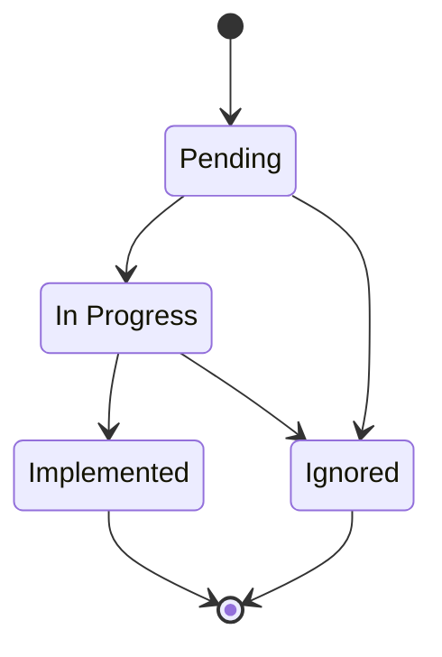

import ApprovalDefault from '/snippets/approval-default.mdx';

A finding is one savings opportunity that an Optimize scan found in a cloud account, with an estimated monthly saving and the evidence behind it. **Optimize → Findings** is where your team decides what to do with each one, from first sight to implemented or ignored.

## Prerequisites

- An Optimize connection that has finished its first scan. See the [Optimize quickstart](/guide/cost-optimization/quickstart).
- The right workspace role for what you want to do. See [Roles](/guide/security/roles).

| Task | Minimum workspace role |
|---|---|
| View findings and read evidence | Viewer |
| Move, edit, or assign a finding, run a scan, start an action such as **Implement** | Developer |
| Mark a finding as expected, snoozed, or disputed | Admin |

Marking needs Admin because it changes what Optimize raises and counts later: an expected finding isn't raised again unless you set an expiry date, and every mark takes the finding out of the savings total.

## How to read a finding

Every finding has a class and an evidence badge. Read both before you act.

| Class | What it means | Counts toward potential savings |
|---|---|---|
| Quick win | Verified evidence, low effort, and reversible. All three must hold. | Yes |
| Needs review | A real opportunity that misses at least one quick-win test, so it needs more context or care | Yes |
| No action | Spend the scan checked and found justified | No |

| Evidence badge | How the agent established the finding |
|---|---|
| Verified | It read the live resource and confirmed the values |
| Inferred | It derived the finding from billing and configuration data without reading the resource |
| Assumed | It could not check part of the finding. Confirm that part yourself before you act. |

**Needs review** here is a finding class and nothing else. The same words name an anomaly's state on [Anomalies](/guide/cost-optimization/anomalies#review-an-anomaly) and an outcome in [Code Audit](/guide/security/code-audit), and the three never affect each other.

The badge qualifies a finding. It doesn't rank it: an inferred finding can still be the largest saving on the account.

**Effort** and **Risk** each take one of three levels: **Low**, **Medium**, or **High**. Only a finding with Low effort can be a quick win.

**No action** findings don't get a column of their own. The summary card counts them next to the findings that need action (for example **6 need action · 3 need no action**). That's the scan's verdict. A mark is your verdict on a finding the scan said needs action.

## Prioritize your findings

<Steps>
  <Step title="Open Findings">
    In the sidebar, select **Optimize → Findings**, then pick the cloud account in the page header.

    **Success state:** three summary cards show **Potential monthly savings**, **Quick wins**, and **Needs review**, with the board below.
  </Step>
  <Step title="Start with quick wins">
    Select the **Quick wins** or **Needs review** card to filter the board to that class. Select it again, or select **Potential monthly savings**, to clear the filter.
  </Step>
  <Step title="Narrow the list">
    Type in **Search findings…** to match titles and descriptions, or filter by **Service**, **Effort**, and **Risk**. The page URL keeps your filters, so you can paste the link to a teammate and they see the same list.
  </Step>
  <Step title="Pick a layout">
    Switch between **Kanban** (columns by status) and **Table** (rows with a row menu).
  </Step>
  <Step title="Open a finding">
    Select a card or row to open the finding. The **Overview** tab shows the evidence, estimate, effort, risk, reversibility, and affected resource.
  </Step>
</Steps>

## Move a finding through the workflow

Board columns are the finding's status. Optimize Findings use their own four statuses, separate from the statuses used elsewhere in CloudThinker. You can move a finding from any status to any other, including back to **Pending**. The diagram shows the usual path.

| Status | Use it for |
|---|---|
| Pending | New work nobody has started |
| In Progress | Your team is evaluating or implementing it |
| Implemented | Your team made the change |
| Ignored | Your team chose not to pursue it |



To change status, drag the card to another column in **Kanban**, or in **Table** open the row's **⋯** menu and pick a status under **Move to**.

**Success state:** the card appears in the new column. Only **Pending** and **In Progress** findings count toward **Potential monthly savings**, so moving a card to **Implemented** or **Ignored** lowers the total, and moving it between Pending and In Progress doesn't change it.

## Act on a finding

<Steps>
  <Step title="Open Actions">
    On the finding's page, select **Actions** in the page header.
  </Step>
  <Step title="Pick an action">
    | Action | What CloudThinker does |
    |---|---|
    | **Impact Analytics** | Compares before and after states, utilization, cost with current pricing, performance impact, and risk. It's the default |
    | **Generate Guidelines** | Writes step-by-step implementation guidance, with testing, a rollback plan, and success criteria |
    | **Custom Prompt** | Answers your own question about the finding |
    | **Implement** | Makes the change in your cloud account. Needs write access on the connection (see below) |

    For **Custom Prompt**, type what you want to know, for example:

    ```text
    Would moving this instance to the next smaller size break the nightly batch job? Check its peak CPU and memory over the last 30 days.
    ```
  </Step>
  <Step title="Start the conversation">
    Select **Start**. CloudThinker opens a new conversation with the finding attached. Every action first checks that the resource still exists and still matches the finding. If it doesn't, CloudThinker says what changed and stops.

    **Implement** also stops if a dependency would break or there's no way to roll back.

    <ApprovalDefault />
  </Step>
</Steps>

<Note>
**Implement** needs write access. The [Optimize quickstart](/guide/cost-optimization/quickstart) grants read-only permissions, so with that setup CloudThinker can analyze a finding but can't change it. Add the write permissions for the change to the role, service account, or service principal, and leave **Allow writes** on for the connection. See write access for [AWS](/guide/connections/aws#write-access), [GCP](/guide/connections/gcp#write-access), and [Azure](/guide/connections/azure#write-access).
</Note>

**Success state:** the conversation ends with the analysis or guidance you asked for, or, for **Implement**, a record of what changed and what to monitor. Move the finding to **Implemented** yourself once the change is in place.

## Mark a finding that needs no action

Use a mark when a finding should leave the active queue but you want to keep the record and the reason.

<Steps>
  <Step title="Choose the mark">
    On the finding's page, select **Mark finding**. In **Table**, use the row's **⋯** menu instead.
  </Step>
  <Step title="Give the reason">
    Pick an option from the table below, fill in the reason, add a date if the option asks for one, and confirm. Every mark needs a reason of at least a short sentence, and a **Snooze until…** date must be tomorrow or later. CloudThinker reads your reason when it re-checks a disputed finding.

    **Success state:** expected and snoozed findings disappear from the board, and a **hidden** toggle (for example **3 hidden**) appears in the toolbar. A disputed finding stays on the board with a **Disputed** label. Every mark takes the finding out of **Potential monthly savings**.
  </Step>
</Steps>

| Mark | Use it when | What happens next |
|---|---|---|
| Mark as expected | The spend is intentional | The agent keeps the evidence fresh but won't raise the finding again, unless you set the optional expiry date. Once that date has passed, the mark lapses: the finding comes back to the board and counts toward the total again, like a snooze that ends. |
| Snooze until… | It may matter later | The finding leaves the board and comes back on the wake date you set (required). |
| Dispute… | The evidence or conclusion looks wrong | The finding stays visible, and the agent re-checks it on the next scan. |

To review hidden findings, select the **hidden** toggle in the toolbar. If every open finding is hidden, the board shows a **Show hidden findings** button instead. To undo a mark, open the finding and choose **Clear mark** (row menu) or **Change mark**.

## Correct an estimate

When your team knows the real number, open the finding, select **Edit** at the bottom of its detail panel (next to **Mark finding**), and change **Potential savings ($/mo)**.

**Success state:** the savings total reflects the new figure, and the change shows on the finding's **Activity** tab.

Later scans never overwrite an edited value. If a scan measures a different figure, CloudThinker reports it in the scan's conversation instead, which **Open analysis** opens. There's no button that restores the scanned figure: to go back, edit the value again using the figure from that conversation. When the resource changes, re-check your edit yourself, or the total keeps the old number.

## Discuss and assign

Open a finding and select the **Discussion** tab to keep the decision next to the evidence. Type `@` to mention a teammate, reply in threads, and mark a thread resolved when it's settled. Set an **Assignee** in the finding's details so one person owns the follow-up. The assignee gets a notification, and so does someone you unassign. They can turn these off in their notification preferences under **Recommendation assignments**.

## Read the savings total

**Potential monthly savings** adds up the estimates on Quick win and Needs review findings in **Pending** or **In Progress** for the selected account, leaving out marked findings. Treat it as an upper bound, because two findings can estimate savings on the same spend. The total follows the **Service** filter only. Search, the class cards, and the **Effort** and **Risk** filters change what the board shows, not the total. See [where the number appears](/guide/cost-optimization/savings#where-the-number-appears). Read [Savings Estimates](/guide/cost-optimization/savings) before you put this number in a forecast.

## Refresh findings

Select **Re-scan** above the board to run a new scan. An account scan can take tens of minutes, and progress shows under the toolbar while it runs. Select **Open analysis** to read the agent conversation from the latest scan, including the read-only commands it ran. While a scan you started is running, the **Re-scan** button itself reads **Open CloudThinker's conversation** and opens the same conversation.

A re-scan keeps your work. It refreshes the evidence on **Pending** and **In Progress** findings in place, never changes a status, and leaves assignees, discussions, and expected or snoozed marks alone. If an issue you set to **Implemented** or **Ignored** shows up again, the scan opens a new **Pending** finding for it.

The button is **Re-scan** on a board that has findings, and **Run scan** on an account that has never been scanned.

<Note>
If some services fail, the board keeps the completed findings and shows **Scan finished with errors**, with a count of services that couldn't be scanned. Fix the permission or billing problem named in the page alert, then re-scan.
</Note>

## Troubleshooting

<AccordionGroup>
  <Accordion title="Mark options are greyed out">
    **Cause:** marking a finding needs the workspace Admin role. **Fix:** ask a workspace Admin to apply the mark, or to change your role in [Workspace users](/guide/workspace-users).
  </Accordion>
  <Accordion title="I can't drag cards or see Re-scan">
    **Cause:** your role is Viewer. Moving findings and scanning need Developer or higher. **Fix:** ask a workspace Admin for the Developer role.
  </Accordion>
  <Accordion title="Implement says it can't make the change">
    **Cause:** the connection is read-only. Either the role, service account, or service principal lacks the write permission, or **Allow writes** is off on the connection. **Check:** read the conversation for a refused change or an access-denied error from the provider. **Fix:** grant only the write permissions this change needs and turn **Allow writes** on. See write access for [AWS](/guide/connections/aws#write-access), [GCP](/guide/connections/gcp#write-access), and [Azure](/guide/connections/azure#write-access). Then start **Implement** again.
  </Accordion>
  <Accordion title="The board is empty but findings exist">
    **Check:** if the page says findings are marked expected or snoozed, everything open has been marked. **Fix:** select **Show hidden findings** to review them. If a filter is on, clear the search and the **Service**, **Effort**, and **Risk** filters.
  </Accordion>
  <Accordion title="The page says no scan has run on this account yet">
    **Cause:** this account has never been scanned. **Fix:** select **Run scan**.
  </Accordion>
</AccordionGroup>

## Next steps

<CardGroup cols={2}>
  <Card title="Savings estimates" icon="chart-pie" href="/guide/cost-optimization/savings">
    Learn which findings count toward the total and why it's an upper bound
  </Card>
  <Card title="Cost anomalies" icon="wave-pulse" href="/guide/cost-optimization/anomalies">
    Review daily cost spikes and see which findings explain them
  </Card>
  <Card title="Optimize reports" icon="file-chart-column" href="/guide/cost-optimization/reports">
    Turn open findings into a ranked savings opportunities report
  </Card>
  <Card title="Optimize troubleshooting" icon="wrench" href="/guide/cost-optimization/troubleshooting">
    Every Optimize problem in one place, with cause, check, and fix
  </Card>
</CardGroup>
