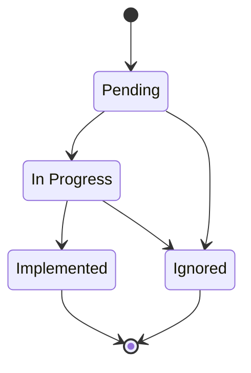

A finding is one savings opportunity that an Optimize scan found in a cloud account, with an estimated monthly saving and the evidence behind it. **Optimize → Findings** is where your team decides what to do with each one, from first sight to implemented or ignored.

## Prerequisites

- An Optimize connection that has finished its first scan. See the [Optimize quickstart](/guide/cost-optimization/quickstart).
- The right workspace role for what you want to do. See [Roles](/guide/security/roles).

| Task | Minimum workspace role |
|---|---|
| View findings and read evidence | Viewer |
| Move a finding between columns, run a scan | Developer |
| Mark a finding as expected, snoozed, or disputed | Admin |

## How to read a finding

Every finding has a class and an evidence badge. Read both before you act.

| Class | What it means | Counts toward potential savings |
|---|---|---|
| Quick win | Verified evidence, low effort, and reversible. All three must hold. | Yes |
| Needs review | A real opportunity that misses at least one quick-win test, so it needs more context or care | Yes |
| No action | Spend the scan checked and found justified | No |

| Evidence badge | How the agent established the finding |
|---|---|
| Verified | It read the live resource and confirmed the values |
| Inferred | It derived the finding from billing and configuration data without reading the resource |
| Assumed | It could not check part of the finding. Confirm that part yourself before you act. |

The badge qualifies a finding. It doesn't rank it: an inferred finding can still be the largest saving on the account.

## Prioritize your findings

<Steps>
  <Step title="Open Findings">
    In the sidebar, select **Optimize → Findings**, then pick the cloud account in the page header.

    **Success state:** three summary cards show **Potential monthly savings**, **Quick wins**, and **Needs review**, with the board below.
  </Step>
  <Step title="Start with quick wins">
    Select the **Quick wins** card to filter the board to that class. Select it again, or select **Potential monthly savings**, to clear the filter.
  </Step>
  <Step title="Narrow the list">
    Type in **Search findings…** to match titles and descriptions, or filter by **Service**, **Effort**, and **Risk**. The page URL keeps your filters, so you can paste the link to a teammate and they see the same list.
  </Step>
  <Step title="Pick a layout">
    Switch between **Kanban** (columns by status) and **Table** (rows with a row menu).
  </Step>
  <Step title="Open a finding">
    Select a card or row to open the finding. The **Overview** tab shows the evidence, estimate, effort, risk, reversibility, and affected resource.
  </Step>
</Steps>

## Move a finding through the workflow

Board columns are the finding's status. Optimize Findings use their own four statuses, separate from the statuses used elsewhere in CloudThinker.

| Status | Use it for |
|---|---|
| Pending | New work nobody has started |
| In Progress | Your team is evaluating or implementing it |
| Implemented | Your team made the change |
| Ignored | Your team chose not to pursue it |

To change status, drag the card to another column in **Kanban**, or in **Table** open the row's **⋯** menu and pick a status under **Move to**.

**Success state:** the card appears in the new column and the **Potential monthly savings** total updates.

## Mark a finding that needs no action

Use a mark (the UI calls the stored reason a disposition) when a finding should leave the active queue but you want to keep the record and the reason.

<Steps>
  <Step title="Choose the mark">
    On the finding's page, select **Mark finding**. In **Table**, use the row's **⋯** menu instead.
  </Step>
  <Step title="Give the reason">
    Pick an option from the table below, fill in the reason, add a date if the option asks for one, and confirm.

    **Success state:** expected and snoozed findings disappear from the board, and a **hidden** counter appears in the toolbar.
  </Step>
</Steps>

| Mark | Use it when | What happens next |
|---|---|---|
| Mark as expected | The spend is intentional | The agent keeps the evidence fresh but won't raise the finding again. Optional expiry date. |
| Snooze until… | It may matter later | The finding leaves the board and comes back on the wake date you set (required). |
| Dispute… | The evidence or conclusion looks wrong | The finding stays visible, and the agent re-checks it on the next scan. |

To review hidden findings, select the **hidden** counter. To undo a mark, open the finding and choose **Clear mark** (row menu) or **Change mark**.

## Discuss and assign

Open a finding and select the **Discussion** tab to keep the decision next to the evidence. Type `@` to mention a teammate, reply in threads, and mark a thread resolved when it's settled. Set an **Assignee** in the finding's details so one person owns the follow-up.

## Read the savings total

**Potential monthly savings** adds up the estimates on open Quick win and Needs review findings for the selected account. Treat it as an upper bound, because two findings can estimate savings on the same spend. Filters change what the board shows, not the total. Read [Savings Estimates](/guide/cost-optimization/savings) before you put this number in a forecast.

## Refresh findings

Select **Re-scan** above the board to run a new scan. Progress shows under the toolbar while it runs. Select **Open analysis** to read the agent conversation from the latest scan, including the read-only commands it ran.

<Note>
If some services fail, the board keeps the completed findings and shows **Scan finished with errors**, with a count of services that couldn't be scanned. Fix the permission or billing problem named in the page alert, then re-scan.
</Note>

## Troubleshooting

<AccordionGroup>
  <Accordion title="Mark options are greyed out">
    **Cause:** marking a finding needs the workspace Admin role. **Fix:** ask a workspace Admin to apply the mark, or to change your role in [Workspace users](/guide/workspace-users).
  </Accordion>
  <Accordion title="I can't drag cards or see Re-scan">
    **Cause:** your role is Viewer. Moving findings and scanning need Developer or higher. **Fix:** ask a workspace Admin for the Developer role.
  </Accordion>
  <Accordion title="The board is empty but findings exist">
    **Check:** if the page says findings are marked expected or snoozed, everything open has been marked. **Fix:** select **Show hidden findings** to review them. If a filter is on, clear the search and the **Service**, **Effort**, and **Risk** filters.
  </Accordion>
  <Accordion title="The page says no scan has run on this account yet">
    **Cause:** this account has never been scanned. **Fix:** select **Run scan**.
  </Accordion>
</AccordionGroup>

## Next steps

<CardGroup cols={2}>
  <Card title="Savings estimates" icon="chart-pie" href="/guide/cost-optimization/savings">
    Learn which findings count toward the total and why it's an upper bound
  </Card>
  <Card title="Cost anomalies" icon="wave-pulse" href="/guide/cost-optimization/anomalies">
    Review daily cost spikes and see which findings explain them
  </Card>
  <Card title="Optimize reports" icon="file-chart-column" href="/guide/cost-optimization/reports">
    Turn open findings into a ranked savings opportunities report
  </Card>
</CardGroup>
