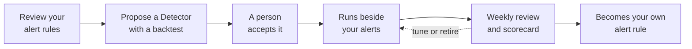

<Warning>
**Coming soon.** Detectors isn't available in any workspace yet. This page describes the planned design so you can see where Resolve is heading. Names, screens, and behavior may change before release, and you can't turn anything on today.
</Warning>

A **Detector** will be a small check that CloudThinker writes for an incident your alert rules didn't catch. It runs on a schedule next to your existing alerts in tools like Datadog or Grafana. When it finds a problem, it sends a signal into Resolve, the same path your own alerts take.

## What it will add to your alerting

Today, an alert rule fires when a metric crosses a line someone picked in advance. A Detector starts from the other end: an incident that no alert caught. CloudThinker looks at what happened before that incident, writes a check for the pattern, and proves it against past incidents before anyone relies on it.

| | Your alert rule | A Detector |
|---|---|---|
| Where it comes from | A person picks a threshold | CloudThinker writes it from an incident your alerts missed |
| What it can read | Data inside one tool | Any tool connected to CloudThinker |
| How it's proven | After it fires (or doesn't) | A backtest on past incidents before you accept it |
| How it improves | Someone remembers to edit it | A weekly review tunes or retires it |

A **backtest** replays a check against past data to show which earlier incidents it would have caught, and how much earlier than your alerts.

Examples of patterns a Detector is meant to catch:

- **A slow burn.** An error budget burning too fast over both a short and a long window, before any single metric looks bad.
- **Unusual for this hour.** Traffic or latency outside its normal range for the same hour of the week, instead of one fixed line.
- **A limit nobody alerted on.** A connection pool near its maximum, a certificate close to expiry, or a quota almost used up.
- **A problem only two tools show together.** One check can compare what two connected tools each see.

## How it will work

1. **Review your alert rules.** CloudThinker finds rules that are noisy, rarely useful, or can never fire.
2. **Propose a Detector.** For a gap it can back with evidence, CloudThinker writes a check, runs it once, and backtests it.
3. **A person accepts it.** Nothing runs until someone on your team says yes.
4. **Run beside your alerts.** A Detector's fire goes to [Pulse](/guide/pulse/overview), then triage, then [root cause analysis](/guide/incident/root-cause-analysis), like any other alert. Triage still decides whether anyone gets paged.
5. **Weekly review.** CloudThinker labels each fire as real or noise, tightens or retires noisy Detectors, and reports how many incidents each one caught before your alerts did.
6. **Promote to your own rule.** A proven Detector can become a native rule in your alerting tool, either as a draft change in the repository that holds your alert rules or as rule text you copy yourself. CloudThinker won't change rules in your alerting tool directly.

## Safety rules in the design

- **Your alerts stay.** Detectors run next to your rules, never instead of them.
- **Only a person turns one on.** CloudThinker can suggest, pause, or retire a Detector, but a scheduled run can never accept one.
- **Your permissions apply.** When you ask CloudThinker to change a Detector in chat, it can do only what your own role allows.

## What you can use today

You can set up the parts of Resolve that Detectors will build on right now. Connecting your monitoring tools and sending alerts through Pulse is the best preparation, since Detectors will learn from the incidents Resolve already records.

<CardGroup cols={2}>
  <Card title="Connect monitoring tools" icon="plug" href="/guide/incident/integrations">
    Send alerts from Datadog, Grafana, and others into Resolve.
  </Card>
  <Card title="Group alerts with Pulse" icon="wave-pulse" href="/guide/pulse/overview">
    Cut noise by grouping related signals before triage.
  </Card>
  <Card title="Investigate incidents" icon="magnifying-glass" href="/guide/incident/root-cause-analysis">
    Get a root cause analysis for each incident.
  </Card>
  <Card title="Start with Resolve" icon="rocket" href="/guide/incident/quickstart">
    Set up Resolve and run your first investigation.
  </Card>
</CardGroup>
