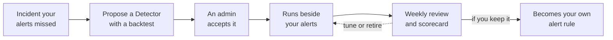

A **Detector** is a small check CloudThinker writes for an incident your alert rules didn't catch. Detectors run inside CloudThinker against the tools you've connected, so nothing is installed in those tools.

Find them under **Resolve → Detectors**, between Pulse and Investigation. The page has three tabs: **Needs you** for proposals and decisions waiting on a person, **Detectors** for the ones already running, and **Alert health** for the audit of your existing alert rules.

## What it adds to your alerting

An alert rule fires when a metric crosses a line someone picked in advance. A Detector starts from the other end: an incident that no alert caught. CloudThinker looks at what happened before that incident, writes a check for the pattern, and proves it against past incidents before anyone relies on it.

| | Your alert rule | A Detector |
|---|---|---|
| Where it comes from | A person picks a threshold | CloudThinker writes it from an incident your alerts missed |
| What it can read | Data inside one tool | Any tool connected to CloudThinker |
| When you learn if it works | In production, after the fact | From a backtest on past incidents, before you accept it |
| How it improves | Someone remembers to edit it | A weekly review tunes or retires it |

<Frame caption="A Detector fires before the first monitoring alert on the same incident">
  
  
</Frame>

Examples of patterns a Detector catches:

- **A slow burn.** An error budget burning too fast over both a short and a long window, before any single metric looks bad.
- **Unusual for this hour.** Traffic or latency outside its normal range for the same hour of the week, instead of one fixed line.
- **A limit nobody alerted on.** A connection pool near its maximum, a certificate close to expiry, or a quota almost used up.
- **A problem only two tools show together.** One check can compare two connected tools, for example rising 5xx errors in Datadog while CloudWatch shows the database at its connection limit.

## Turn it on

Detectors is off until a workspace **Admin** turns it on. Developers and Viewers can read the Detectors page but can't change anything on it. See [Roles](/guide/security/roles).

<Steps>
  <Step title="Open the Detectors settings">
    Go to **Resolve → Settings** and scroll to the **Detectors** section, below **Behaviour**.
  </Step>
  <Step title="Turn on Detectors">
    Flip the **Detectors** switch.

    **Success state:** the switch reads "Your Detectors run, and Resolve reviews them each week", and CloudThinker starts its first review of the alert rules you already have.
  </Step>
  <Step title="Review the first proposals">
    Go to **Resolve → Detectors**. Proposals arrive on the **Needs you** tab, each with its backtest. Nothing runs until an Admin accepts it.
  </Step>
</Steps>

## How a backtest proves a check

A **backtest** replays a check against past data to show which earlier incidents it would have caught, and how much earlier than your alerts.

| Backtest setting | Value |
|---|---|
| Lookback | 30 days by default, up to 90 |
| Counts as caught | The check fires between one hour before the incident started and the moment it was opened |
| Catch rate shown | Only with at least three past incidents in the window. With fewer, you see plain counts |

<Frame caption="The backtest catch window: from one hour before the incident starts to the moment it opens">
  
  
</Frame>

The backtest compares the check against incidents Resolve has recorded, using data the connected tool still holds. If the tool can't return data for the whole window, the backtest is marked incomplete or not possible instead of showing a misleading score.

## What a Detector accesses

| | Value |
|---|---|
| Credentials | The monitoring tools you've already connected to CloudThinker. A Detector names which connections it uses |
| Schedule | Every 5, 15, 30, or 60 minutes. 15 is the default |
| Quiet time between fires | 5 minutes to 24 hours. 60 minutes is the default |
| Cost and quota | Each run queries the tool's API, so it counts toward that tool's usual rate limits and query costs |
| Limits per workspace | Up to 50 active Detectors, 5 open proposals, and 200 fires a day |

## How it works

1. **Find a missed incident.** CloudThinker starts from an incident your alerts didn't catch. On the incident itself you'll see a line such as "No Detector fired. No Detector watches this service", with a link to **Detectors**.
2. **Propose a Detector.** For a gap it can back with evidence, CloudThinker writes a check, runs it once, and backtests it. Proposals wait on the **Needs you** tab.
3. **An admin accepts it.** Nothing runs until a workspace Admin says yes.
4. **Run beside your alerts.** A Detector's fire goes to [Pulse](/guide/pulse/overview), which drops noise and groups related alerts, then to triage, which matches it to an incident, then to [root cause analysis](/guide/incident/root-cause-analysis), like any other alert.
5. **Weekly review.** CloudThinker labels each fire as real or noise, tightens or loosens Detectors, retires the ones that stay noisy, proposes new ones, and builds a scorecard covering the last 30 days. It also posts the scorecard to your chat channel in weeks that have news.
6. **Promote to your own rule.** When you decide a Detector is worth keeping, CloudThinker can turn it into a native rule in your alerting tool — either as a draft merge request in the repository that holds your alert rules, or as rule text you copy yourself. You review and merge; CloudThinker never changes rules in your alerting tool directly.

<Frame caption="A weekly scorecard: each Detector, and the incidents it caught before your monitoring alerts">
  
  
</Frame>

## Settings

Detectors has its own section under **Resolve → Settings**, below Behaviour. The **Detectors** switch itself is covered in [Turn it on](#turn-it-on).

| Setting | What it does |
|---|---|
| **Weekly review** | The day, time, and time zone of the review. It runs Monday at 09:00 by default |
| **Ignored services** | Services Detectors neither audit nor watch. Use `*` as a wildcard, for example `*-staging`. With none set, Detectors look at every service |
| **Sources** | The tools Detectors audit and write checks on. Turning one off skips its rules and data, but its alerts still count in the scorecard |

To let CloudThinker open draft merge requests for promoted Detectors, turn on **Propose alert rule changes** for your Git platform in [Resolve integrations](/guide/incident/integrations). It only ever opens drafts for you to review and merge.

## Alert health

CloudThinker also reviews the alert rules you already have and flags the ones that are noisy, rarely useful, or can never fire. The results appear on the **Alert health** tab, which ranks what to fix first.

## Who can change what

- **Your alerts stay.** Detectors run next to your rules, never instead of them.
- **A scheduled run can only narrow, never start.** On its own, the weekly review pauses, resumes, retires, or loosens a Detector you already accepted. It can't accept a proposal, dismiss one, change Detectors settings, start a run, or turn Detectors on or off for the workspace — each of those waits for a person.
- **You hear about every automatic change.** When a scheduled run pauses, retires, or loosens a Detector, the person who turned Detectors on gets the notice, along with the weekly scorecard. If they leave or lose access, the page reads **Detectors have no owner who can run them** and another workspace Admin can click **Take over**.
- **Your permissions apply.** Asking CloudThinker to change a Detector in chat does only what your own role allows. Viewers and Developers can read the page; accepting, pausing, retiring, or configuring a Detector needs the workspace **Admin** role.
- **Every change is logged.** Each accept, dismiss, pause, retire, and settings change is recorded in **Admin Settings → Audit Logs**, with the person or agent that made it.

## Next steps

<CardGroup cols={2}>
  <Card title="Connect monitoring tools" icon="plug" href="/guide/incident/connect-alert-sources">
    Send alerts from Datadog, Grafana, and others into Resolve, so Detectors have history to learn from.
  </Card>
  <Card title="Group alerts with Pulse" icon="wave-pulse" href="/guide/pulse/overview">
    Cut noise by grouping related signals before triage.
  </Card>
  <Card title="Log a missed incident" icon="pen" href="/guide/incident/manual-logging">
    Record incidents your alerts missed, so there's history to backtest against.
  </Card>
  <Card title="Resolve settings" icon="gear" href="/guide/incident/settings">
    Set the weekly review, ignored services, and which sources Detectors use.
  </Card>
</CardGroup>
