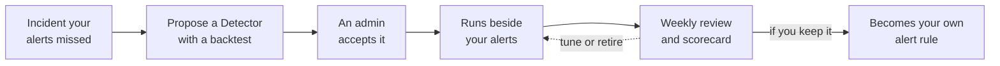

<Warning>
**Coming soon.** Detectors isn't available in any workspace yet. This page describes the planned design so you can see where Resolve is heading. Names, screens, and behavior may change before release, and you can't turn anything on today. There's no release date yet. New releases are listed in the [changelog](/changelog). To hear when it's ready, [contact us](https://cloudthinker.io/contact) and mention Detectors.

To prepare now, connect your monitoring tools and log missed incidents by hand. See [What you can use today](#what-you-can-use-today).
</Warning>

A **Detector** will be a small check that CloudThinker writes for an incident your alert rules didn't catch. Detectors will run inside CloudThinker and query the tools you've connected, such as Datadog or Grafana. Nothing will be installed in those tools. Each Detector will run on its own schedule, and when it finds a problem it will send a signal into [Resolve](/guide/incident/overview) (CloudThinker's incident response module), the same path your own alerts take.

## What it will add to your alerting

Today, an alert rule fires when a metric crosses a line someone picked in advance. A Detector starts from the other end: an incident that no alert caught. CloudThinker looks at what happened before that incident, writes a check for the pattern, and proves it against past incidents before anyone relies on it.

| | Your alert rule | A Detector |
|---|---|---|
| Where it comes from | A person picks a threshold | CloudThinker writes it from an incident your alerts missed |
| What it can read | Data inside one tool | Any tool connected to CloudThinker |
| When you learn if it works | In production, after the fact | From a backtest on past incidents, before you accept it |
| How it improves | Someone remembers to edit it | A weekly review tunes or retires it |

A **backtest** replays a check against past data to show which earlier incidents it would have caught, and how much earlier than your alerts.

| Backtest setting | Planned value |
|---|---|
| Lookback | 30 days by default, up to 90 |
| Counts as caught | The check fires between one hour before the incident started and the moment it was opened |
| Catch rate shown | Only with at least three past incidents in the window. With fewer, you see plain counts |

The backtest compares the check against incidents Resolve has recorded, using data the connected tool still holds. If the tool can't return data for the whole window, the backtest is marked incomplete or not possible instead of showing a misleading score.

## What it will access

| | Planned design |
|---|---|
| Credentials | The monitoring tools you've already connected to CloudThinker. A Detector names which connections it uses |
| Schedule | Every 5, 15, 30, or 60 minutes. 15 is the default |
| Cost and quota | Each run queries the tool's API, so it counts toward that tool's usual rate limits and query costs |
| Limits per workspace | Up to 50 active Detectors, 5 open proposals, and 200 fires a day |

Examples of patterns a Detector is meant to catch:

- **A slow burn.** An error budget burning too fast over both a short and a long window, before any single metric looks bad.
- **Unusual for this hour.** Traffic or latency outside its normal range for the same hour of the week, instead of one fixed line.
- **A limit nobody alerted on.** A connection pool near its maximum, a certificate close to expiry, or a quota almost used up.
- **A problem only two tools show together.** One check can compare two connected tools, for example rising 5xx errors in Datadog while CloudWatch shows the database at its connection limit.

## How it will work

1. **Find a missed incident.** CloudThinker starts from an incident your alerts didn't catch.
2. **Propose a Detector.** For a gap it can back with evidence, CloudThinker writes a check, runs it once, and backtests it.
3. **An admin accepts it.** Nothing runs until a workspace Admin says yes.
4. **Run beside your alerts.** A Detector's fire goes to [Pulse](/guide/pulse/overview) (which drops noise and groups related alerts), then [triage](/guide/pulse/overview), which matches it to an incident, then [root cause analysis](/guide/incident/root-cause-analysis), like any other alert.
5. **Weekly review.** It runs Monday at 09:00 by default, and you'll set the day, hour, and time zone in Resolve settings under **Detectors**. CloudThinker labels each fire as real or noise, tightens or loosens Detectors, retires the ones that stay noisy, and builds a scorecard: how many incidents each one caught before your alerts did over the last 30 days. The scorecard lives on the Detectors page in Resolve, and CloudThinker can post a one-line summary to a team channel you've turned on in [Resolve integrations](/guide/incident/integrations#turn-on-outcomes).
6. **Promote to your own rule.** When a person decides a Detector is worth keeping, they can ask CloudThinker to turn it into a native rule in your alerting tool, either as a draft pull request in the repository that holds your alert rules (GitHub, GitLab, Bitbucket, or Azure DevOps) or as rule text you copy yourself. A person reviews and merges the draft. CloudThinker won't change rules in your alerting tool directly.

## Safety rules in the design

- **Your alerts stay.** Detectors run next to your rules, never instead of them.
- **Only a person turns one on.** CloudThinker can suggest, pause, or retire a Detector, but a scheduled run can never accept one, turn one on or off, or change settings.
- **You hear about every automatic change.** When a scheduled run pauses, retires, or loosens a Detector, the Detectors owner gets a notice. The owner is the person who turns Detectors on for the workspace. If they lose access, another Admin can take over.
- **Your permissions apply.** When you ask CloudThinker to change a Detector in chat, it can do only what your own role allows.
- **Every change is logged.** Each accept, dismiss, pause, retire, and settings change is recorded in **Admin Settings → Audit Logs**, with the person or agent that made it.

## Also planned: Alert Audit

CloudThinker will also review your existing alert rules and flag the ones that are noisy, rarely useful, or can never fire. The results will appear as an **Alert Audit** on the Detectors page, and the Detectors owner gets a notice when one is ready.

## What you can use today

You can set up the parts of Resolve that Detectors will build on right now. Connecting your monitoring tools and sending alerts through Pulse is the best preparation, since Detectors will learn from the incidents Resolve already records. If an incident slips past your alerts today, [log it by hand](/guide/incident/manual-logging) so there's history to backtest against later.

<CardGroup cols={2}>
  <Card title="Connect monitoring tools" icon="plug" href="/guide/incident/integrations">
    Send alerts from Datadog, Grafana, and others into Resolve.
  </Card>
  <Card title="Group alerts with Pulse" icon="wave-pulse" href="/guide/pulse/overview">
    Cut noise by grouping related signals before triage.
  </Card>
  <Card title="Log a missed incident" icon="pen" href="/guide/incident/manual-logging">
    Record incidents your alerts missed, so there's history to backtest later.
  </Card>
  <Card title="Start with Resolve" icon="rocket" href="/guide/incident/quickstart">
    Set up Resolve and run your first investigation.
  </Card>
</CardGroup>
