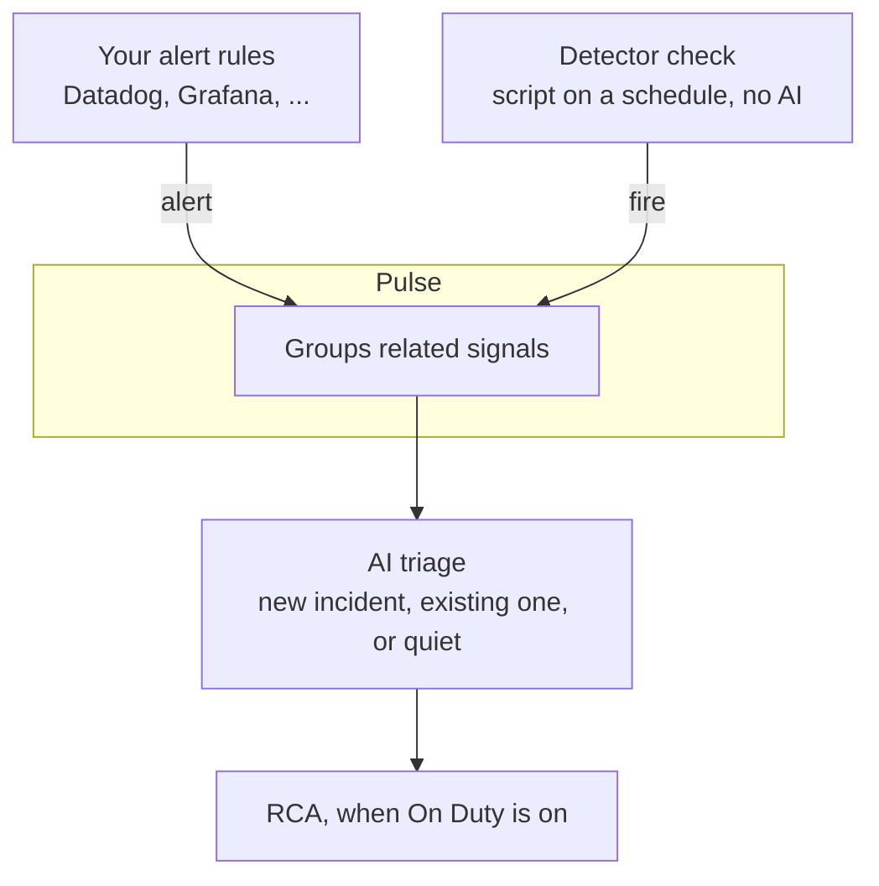
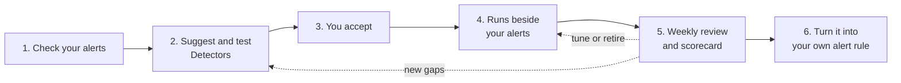
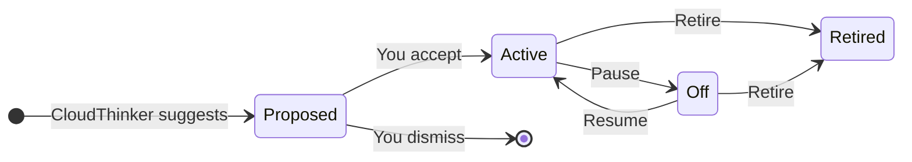

<Note>
**Coming soon** — Detectors is not available in workspaces yet. This page describes how it will work. [Contact us](https://cloudthinker.io/contact) to hear when it launches.
</Note>

Your alerts miss some incidents. CloudThinker reviews your monitoring and past incidents, then writes and tests a small check, called a **Detector**, for each gap it can prove.

## The idea in one picture

You keep your current alerts. CloudThinker adds Detectors next to them. Each Detector is tested on past incidents first, and starts working only after you accept it.



A Detector's fire takes the same path as your own alerts: Pulse, then AI triage, then RCA. Triage decides whether anyone is paged.

Three rules keep this safe:

- **Nothing replaces your alerts.** Detectors work next to the rules you already have.
- **Every Detector is tested before you see it.** CloudThinker runs it once and backtests it on past incidents, so you can judge it before it runs.
- **Only a person can turn a Detector on.** CloudThinker can suggest and fix Detectors, but it can't accept one by itself.

## Words used on this page

| Word | Meaning |
|---|---|
| Detector | A small check that CloudThinker writes and runs on a schedule. |
| Fire | One time a Detector found a problem. |
| Backtest | A test that runs the Detector against the last 30 days to see which past incidents it would have caught. |
| Caught first | The Detector found the problem before any of your alerts did. |
| Gap | A service that had an incident that none of your alerts caught. |

## Get started

<Steps>
  <Step title="Connect a monitoring tool">
    In **Resolve → Integrations**, connect at least one monitoring tool, such as Datadog or Grafana. CloudThinker needs it to read your alert rules and metrics. See [Resolve integrations](/guide/incident/integrations).
  </Step>
  <Step title="Start the first analysis">
    Open **Resolve → Detectors** and click **Analyze my monitoring**. This turns Detectors on. CloudThinker starts reviewing your alert rules, recent signals, and past incidents right away.
  </Step>
  <Step title="Accept or dismiss each suggestion">
    When the analysis ends, go to the **Needs you** tab. Each suggested Detector shows why it is needed and how it did in its tests. Click **Accept** to turn it on, or **Dismiss** to drop it.
  </Step>
</Steps>

**Success state:** the Detectors you accepted appear on the **Detectors** tab with the **Active** label.

Sometimes the analysis suggests nothing. CloudThinker only proposes checks that evidence supports. Open its conversation to see what it checked and what access or history it was missing. Fix the access, then click **Analyze again**.

## Monitoring tools CloudThinker can review

CloudThinker reads two things from a connected monitoring tool. **Rules** are your existing alert rules, which the Alert Audit checks. **History** is past metric data, which CloudThinker uses to write a check and backtest it.

| Tool | What CloudThinker can read |
|---|---|
| AppDynamics | Rules and history |
| Better Stack | Rules and history |
| Datadog | Rules and history |
| Grafana | Rules and history |
| Honeycomb | Rules and history |
| Prometheus | Rules and history |
| SigNoz | Rules and history |
| Splunk | Rules and history |
| Sumo Logic | Rules and history |
| New Relic | Rules only |
| Zabbix | Rules only |
| Dynatrace | History only |
| Elastic | History only |
| Splunk Observability | History only |

The Detectors page lists the tools connected in your workspace under **Sources the agent can review**. Two more labels can appear there:

- **Alerts only**: the tool sends alerts to Pulse, but it isn't connected, so CloudThinker can't read its rules or history.
- **Excluded**: you turned the tool off under **Sources** in the Detectors settings.

Click **Manage integrations** on the page to connect a tool.

## How it works

Detectors run in a weekly cycle. You only step in at the points marked **You**.



1. **Check your alerts.** CloudThinker finds rules that are noisy, rarely useful, or can never fire. You see them on the **Alert health** tab.
2. **Suggest and test Detectors.** For each gap, CloudThinker writes a Detector, runs it once, and backtests it on the last 30 days.
3. **You accept.** Nothing runs until a person clicks **Accept**.
4. **Runs beside your alerts.** The Detector runs on a schedule. When it fires, the fire goes to Pulse and triage, the same as any alert.
5. **Weekly review.** Once a week, CloudThinker marks each fire as real or noise, fixes noisy Detectors, removes the ones that stay noisy, and sends you a scorecard.
6. **Turn it into your own rule.** CloudThinker can copy a proven Detector into your alerting tool as a normal alert rule.

Detector checks don't use AI, so they don't use credits. The CloudThinker runs that write and review Detectors use credits like any other run.

## Detector states

A Detector is always in one of four states.



| State | What it means |
|---|---|
| Proposed | Waiting for you to accept or dismiss it. |
| Active | Running on its schedule. Its fires go to Pulse and triage, like any alert. |
| Off | Paused. It doesn't run until someone clicks **Resume**. |
| Retired | Stopped for good. Its history is kept. |

Open a Detector to **Pause**, **Resume**, or **Retire** it. You also find **Tune**, **Run backtest**, and **Promote to rule** there. **Accept** and **Retire** ask you to confirm.

### What CloudThinker can do on its own

| Action | You | CloudThinker, in a chat with you | CloudThinker, in the weekly review |
|---|---|---|---|
| Suggest a Detector | — | Yes | Yes |
| Accept or dismiss | Yes | Only if you ask in that chat | Never |
| Pause or retire | Yes | Yes | Yes, and tells the owner |
| Make a Detector stricter | Yes | Yes | Yes |
| Make a Detector less strict | Yes | Yes | Yes, and tells the owner |

In a chat, CloudThinker has your permissions, so it can't do anything the page wouldn't let you do. Members with read-only access can see Detectors and fires, but can't change them.

## The Detectors page

**Resolve → Detectors** has four tabs. Each one answers one question.

| Tab | Question | What you see |
|---|---|---|
| Needs you | What do I need to do? | Broken Detectors, new suggestions, and fires to label |
| Detectors | What is running? | All Detectors. Filter by state, service, or tool. |
| Coverage gaps | Where do my alerts miss? | Services that had an incident no alert caught, worst first |
| Alert health | Which of my rules are broken? | Rules marked **Noisy**, **Rarely useful**, or **Can't fire** |

Click **Ask CloudThinker** at the top of the page to ask a question or tell it what to watch:

```text
Where do my alerts miss incidents?
Watch checkout p95 and tell me when it stays above 800 ms
```

## Read a Detector's results

Open a Detector to see its scorecard, its backtest, and its fires.

<Frame>
  
  
</Frame>
<p style={{textAlign: 'center', fontSize: '0.9em', color: '#666', marginTop: '8px'}}>An example scorecard. The numbers are made up to show the layout of the results.</p>

### Caught first and lead time

The scorecard tells you how often the Detector found a problem **before** your own alerts did, and how much earlier.

<Frame>
  
  
</Frame>
<p style={{textAlign: 'center', fontSize: '0.9em', color: '#666', marginTop: '8px'}}>The Detector fired 12 minutes before your first alert.</p>

In this example the Detector **caught it first**, with a **lead time of 12 minutes**. If no alert had fired at all, the lead time would be counted up to when the incident was created.

### Fire labels

Each fire gets one of these labels:

| Label | Meaning |
|---|---|
| Matched | The fire lines up with a real incident. |
| False alarm | The fire lines up with an incident that was closed as a false alarm. |
| Suppressed | Pulse held the fire back, for example because it repeated too soon. |
| Unmatched | No incident lines up with it yet. Click **Real** or **Noise** to label it yourself. |

Only you or the weekly review labels a fire as real or noise. CloudThinker never decides that on its own.

### Backtest

A backtest runs the Detector against past data. It covers the last 30 days by default, and at most 90 days. A past fire counts as a catch only if it lands in the catch window: from one hour before the problem started until the incident was created.

<Frame>
  
  
</Frame>
<p style={{textAlign: 'center', fontSize: '0.9em', color: '#666', marginTop: '8px'}}>Only the fire inside the catch window counts.</p>

### Good to know

- Results count CloudThinker incidents only. Incidents closed as false alarms don't count.
- With fewer than three incidents, the page shows plain counts instead of percentages.
- If a Detector fails three times in a row, CloudThinker tries to fix it. If it can't, it pauses the Detector.
- If someone changes a Detector's script outside CloudThinker, the Detector shows **Changed outside Resolve** and its backtest is marked out of date.

## Turn a Detector into your own alert rule

When a Detector has proven itself, click **Promote to rule**. What happens next depends on whether you set up a rule repository:

| Your setup | What you get |
|---|---|
| A repository that holds your alert rules is set | CloudThinker opens a draft merge request with the new rule. A person on your team reviews and merges it. |
| No repository is set | CloudThinker shows the rule text. Click **Copy rule text** and add it to your alerting tool yourself. |

To set the repository, open [Resolve integrations](/guide/incident/integrations) and turn on **Propose alert rule changes** for GitLab, GitHub, Bitbucket, or Azure DevOps. CloudThinker never changes the rules inside your alerting tool directly.

## Settings

Find the **Detectors** section in [Resolve settings](/guide/incident/settings). Changes save right away.

| Setting | What it does |
|---|---|
| Detectors | Turns all Detectors and the weekly review on or off. Turning it off keeps your Detectors, fires, and history. |
| Weekly review | The day and hour of the weekly review. The default is Monday. |
| Ignored services | Services that Detectors skip completely. Use `*` to match many names, for example `*-staging`. Up to 50 entries. |
| Sources | The monitoring tools that Detectors look at. A tool you turn off still counts toward coverage. |
| Alert rule changes | The repository where promoted rules go as draft merge requests. |

## Limits

| Limit | Value |
|---|---|
| Active Detectors per workspace | 50 |
| Suggestions waiting for you, per workspace | 5 |
| Fires per workspace in 24 hours | 200. Extra fires are skipped and show **Daily fire budget used**. |
| Backtest period | 30 days by default, 90 days at most |

## Related

<CardGroup cols={2}>
  <Card title="Understand Pulse" icon="wave-pulse" href="/guide/pulse/overview">
    See how Detector fires sit next to your own alerts.
  </Card>
  <Card title="Manage integrations" icon="arrows-rotate" href="/guide/incident/integrations">
    Connect monitoring tools and the rule repository.
  </Card>
  <Card title="Tune Resolve behavior" icon="sliders" href="/guide/incident/settings">
    Change automatic RCA and the Detectors settings.
  </Card>
  <Card title="Review RCA" icon="magnifying-glass" href="/guide/incident/root-cause-analysis">
    Follow the investigation of an incident a Detector raised.
  </Card>
</CardGroup>
