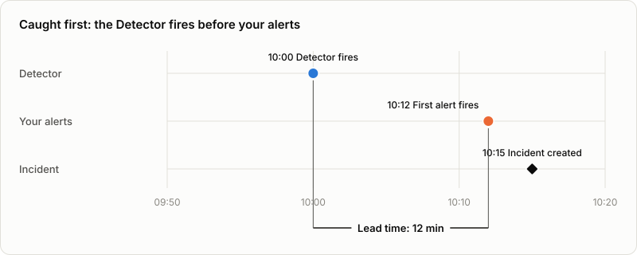
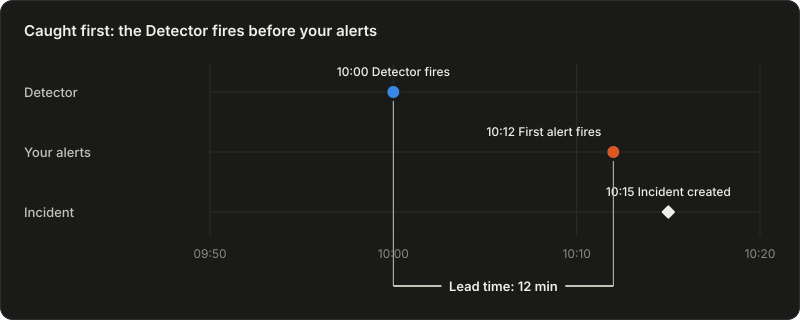
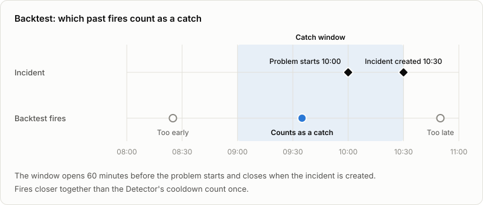
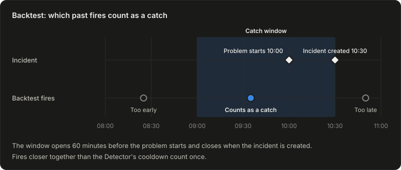
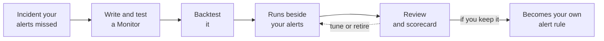
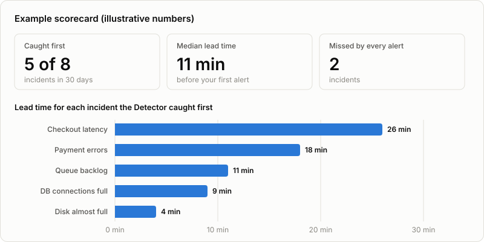
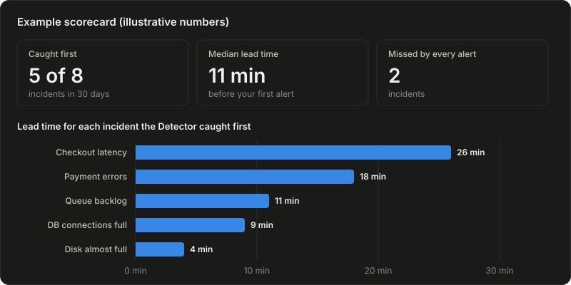

Detectors builds and maintains **Monitors**: small checks CloudThinker writes for the incidents your alert rules didn't catch. Monitors run inside CloudThinker against the tools you've connected, so nothing is installed in those tools.

Find them under **Resolve → Detectors**. The page shows one Monitor list with the pill tabs **Needs attention**, **Running**, and **All**. **Review now** and a **Settings** icon sit at the right end of the filter row.

## What it adds to your alerting

An alert rule fires when a metric crosses a line someone picked in advance. A Monitor starts from the other end: an incident that no alert caught. CloudThinker looks at what happened before that incident, writes a check for the pattern, and proves it against past incidents before anyone relies on it.

| | Your alert rule | A Monitor |
|---|---|---|
| Where it comes from | A person picks a threshold | CloudThinker writes it from an incident your alerts missed |
| What it can read | Data inside one tool | Any tool connected to CloudThinker |
| When you learn if it works | In production, after the fact | From a test run and a backtest on past incidents, before it runs |
| How it improves | Someone remembers to edit it | A review tunes or retires it |

<Frame caption="A Monitor fires before the first monitoring alert on the same incident">
  
  
</Frame>

Examples of patterns a Monitor catches:

- **A slow burn.** An error budget burning too fast over both a short and a long window, before any single metric looks bad.
- **Unusual for this hour.** Traffic or latency outside its normal range for the same hour of the week, instead of one fixed line.
- **A limit nobody alerted on.** A connection pool near its maximum, a certificate close to expiry, or a quota almost used up.
- **A problem only two tools show together.** One check can compare two connected tools, for example rising 5xx errors in Datadog while CloudWatch shows the database at its connection limit.

## Turn it on

Detectors is off until a workspace **Admin** turns it on. Developers and Viewers can read the Detectors page but can't change anything on it. See [Roles](/guide/security/roles).

<Steps>
  <Step title="Open Detectors">
    Go to **Resolve → Detectors**. While Detectors is off, the page reads **Detectors are off**.
  </Step>
  <Step title="Turn on Detectors">
    Click **Turn on**. You can also click the **Settings** icon and flip the **Detectors** switch ("Builds and maintains Monitors").

    **Success state:** the page reads **Finding what to watch…** while CloudThinker reviews the alert rules you already have.
  </Step>
  <Step title="Check the first Monitors">
    Tested Monitors appear in the list and start running on their own. No one needs to accept them. Open a Monitor to see its **Status**, **Watches**, and **Fires**, or to pause it.
  </Step>
</Steps>

## How a backtest proves a check

A **backtest** replays a check against past data to show which earlier incidents it would have caught, and how much earlier than your alerts.

| Backtest setting | Value |
|---|---|
| Lookback | 30 days by default, up to 90 |
| Counts as caught | The check fires between one hour before the incident started and the moment it was opened |
| Catch rate shown | Only with at least three past incidents in the window. With fewer, you see plain counts |

<Frame caption="The backtest catch window: from one hour before the incident starts to the moment it opens">
  
  
</Frame>

The backtest compares the check against incidents Resolve has recorded, using data the connected tool still holds. If the tool can't return data for the whole window, the backtest is marked incomplete or not possible instead of showing a misleading score.

## What a Monitor accesses

| | Value |
|---|---|
| Credentials | The monitoring tools you've already connected to CloudThinker. A Monitor names which connections it uses |
| Schedule | Every 5, 15, 30, or 60 minutes. 15 is the default |
| Quiet time between fires | 5 minutes to 24 hours. 60 minutes is the default |
| Cost and quota | Each run queries the tool's API, so it counts toward that tool's usual rate limits and query costs |
| Limits | Up to 50 active Monitors per workspace. Fires are capped at 24 a day per Monitor and 200 a day per workspace |

## How it works

1. **Find a missed incident.** CloudThinker starts from an incident your alerts didn't catch.
2. **Write and test a Monitor.** For a gap it can back with evidence, CloudThinker writes a check and runs it once. A check that fails its test run is not saved.
3. **Backtest and activate.** A tested Monitor activates on its own, and CloudThinker backtests it against past incidents.
4. **Run beside your alerts.** A Monitor's fire goes to [Signals](/guide/pulse/overview), which drops noise and groups related alerts, then to triage, which matches it to an incident, then to [root cause analysis](/guide/incident/root-cause-analysis), like any other alert.
5. **Review.** Each week, CloudThinker labels each fire as real or noise, tightens or loosens Monitors, retires the ones that stay noisy, writes new ones, and builds a scorecard covering the last 30 days. It also posts the scorecard to your chat channel in weeks that have news. You can add a more frequent review in Detectors settings, or click **Review now**.
6. **Promote to your own rule.** When you decide a Monitor is worth keeping, CloudThinker can turn it into a native rule in your alerting tool — either as a draft merge request in the repository that holds your alert rules, or as rule text you copy yourself. You review and merge; CloudThinker never changes rules in your alerting tool directly.

<Frame caption="A weekly scorecard: each Monitor, and the incidents it caught before your monitoring alerts">
  
  
</Frame>

## Settings

Click the **Settings** icon on **Resolve → Detectors** to open **Detectors settings**. It has three rows.

| Row | What it does |
|---|---|
| **Detectors** | Turns Detectors on or off for the workspace. Saved Monitors are kept while it's off. See [Turn it on](#turn-it-on) |
| **Review** | How often CloudThinker reviews your Monitors: **Off**, or every 15m, 30m, 1h, 3h, 6h, 12h, or 1d. Only a person sets it |
| **Fire limit** | Read only: 24 fires a day per Monitor, 200 per workspace |

To skip a service, or a tool Detectors should not audit, ask CloudThinker in chat. There's no field for it in Detectors settings.

To let CloudThinker open draft merge requests for promoted Monitors, turn on **Propose alert rule changes** for your Git platform in [Resolve Triggers & Outcomes](/guide/incident/triggers-and-outcomes#outcomes). It only ever opens drafts for you to review and merge.

## Who can change what

- **Your alerts stay.** Monitors run next to your rules, never instead of them.
- **A scheduled run can't change the setup.** On its own, a review can write, pause, resume, retire, or loosen Monitors. It can't change Detectors settings, start a job, or turn Detectors on or off for the workspace — each of those waits for a person.
- **You hear about every automatic change.** When a scheduled run pauses, retires, or loosens a Monitor, the person who turned Detectors on gets the notice, along with the weekly scorecard. If they leave or lose access, the page reads **Monitors have no owner who can run them** and another workspace Admin can click **Take over**.
- **Your permissions apply.** Asking CloudThinker to change a Monitor in chat does only what your own role allows. Viewers and Developers can read the page; pausing, resuming, or configuring Monitors needs the workspace **Admin** role.
- **Every change is logged.** Each pause, retire, and settings change is recorded in **Settings → Organization → Audit log**, with the person or agent that made it.

## Next steps

<CardGroup cols={2}>
  <Card title="Connect monitoring tools" icon="plug" href="/guide/incident/connect-alert-sources">
    Send alerts from Datadog, Grafana, and others into Resolve, so Detectors have history to learn from.
  </Card>
  <Card title="Group alerts with Signals" icon="wave-pulse" href="/guide/pulse/overview">
    Cut noise by grouping related signals before triage.
  </Card>
  <Card title="Log a missed incident" icon="pen" href="/guide/incident/manual-logging">
    Record incidents your alerts missed, so there's history to backtest against.
  </Card>
  <Card title="Resolve settings" icon="gear" href="/guide/incident/settings">
    Find where each Resolve control lives.
  </Card>
</CardGroup>
