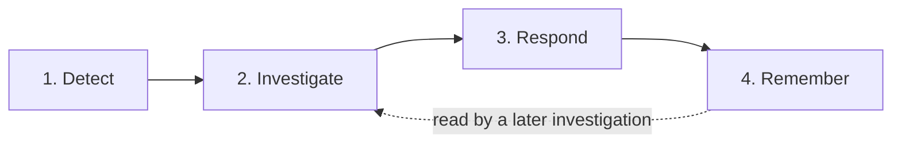

import { ResolveScene } from '/snippets/iso/resolve.jsx';

**Finds the root cause. In minutes.**

Resolve is the Frontier Investigation Agent for production incidents. It takes the alerts your tools already send, drops the noise, investigates what's left to a root cause, and brings in people only when an incident needs them. To start, you need one alert source. For a root cause CloudThinker can verify, also connect the cloud or observability account the alerts are about.

<ResolveScene />

## How it works

Inside Resolve, an alert moves through four stages. They're Resolve's own steps of the platform loop described in the [AgenticOps field guide](/learn/aio/chapter-4-architecture).

| Stage | What happens | Where you see it |
|---|---|---|
| 1. Detect | [Signals](/guide/pulse/overview), the detection layer, suppresses known noise and groups related alerts into clusters, so one outage is one item. | **Resolve → Signals** |
| 2. Investigate | CloudThinker triages each actionable cluster, opens or reopens an incident, and runs a root-cause analysis (RCA) across your connected systems. | **Resolve → Issues** |
| 3. Respond | Once you turn on [On-call](/guide/incident/oncall), it opens an Incident Room for the responders when people are needed. It's off by default. Every fix CloudThinker runs goes through [Approvals](/guide/approvals/overview), including runbook commands. A new workspace starts on **Auto · Rules + AI · Ask me**: a write no Rule allows runs only if AI judges it safe, and otherwise waits for a person. A runbook's **Require Approval** effect applies only where runbook command effects are enabled (see [Runbooks](/guide/incident/runbooks#control-command-effects)). Choose **Manual** to approve every change yourself. See [what you get out of the box](/guide/approvals/overview#what-you-get-out-of-the-box). | Incident Room, Slack war room |
| 4. Remember | CloudThinker writes [incident memory](/guide/incident/incident-memory) that later investigations read at the start. There's no screen to view or edit it: CloudThinker corrects entries itself as new evidence comes in. | In later RCA results that cite a past incident |

Not every incident reaches every stage. An investigation can end without a root cause, and a **Track only** incident (real but not urgent, so no one is paged) stays in the queue unless a person raises it.

## Set up in this order

You need the workspace **Admin** role to change Resolve settings and integrations. See [Roles](/guide/security/roles).

1. **Connect an alert source.** Point a monitoring tool at Resolve, or try a test source first with the [quickstart](/guide/incident/quickstart). [Connect alert sources](/guide/incident/connect-alert-sources) finds the path your tool takes; [Connect Pulse sources](/guide/pulse/setup) has the steps.
2. **Decide on AI auto-investigate.** It's on in a new workspace, so CloudThinker triages and investigates on its own. Turn it off while you connect and tune your first real source, then turn it back on. See [below](#choose-who-starts-investigations).
3. **Set up On-call.** Pick responders and, optionally, a Slack war room. See [On-call](/guide/incident/oncall).
4. **Review your Approvals policy.** It decides which fixes run on their own and which wait for a person. See [Approvals](/guide/approvals/overview).

## Start from the Overview

Open **Resolve → Overview** to see what needs you now and what Resolve handled alone. It starts with four numbers under **At a glance**.

| Tile | What it shows |
|---|---|
| **Time to resolve** | Mean time to resolve incidents over the last 7 days |
| **Time to root cause** | How fast CloudThinker reached a root cause |
| **Causes confirmed** | Root causes people confirmed, out of those they reviewed, over 30 days |
| **Events filtered** | The share of raw events that didn't become an incident, over 30 days |

Below the tiles, **Needs attention** lists incidents waiting on a person, and **In progress** lists the ones CloudThinker is working on now. **All insights** opens [Insights](/guide/incident/insights), where trends, per-service rows, and the funnel from events to incidents live.

| Funnel step | Meaning |
|---|---|
| **Event** | One raw notification from a source, such as a CloudWatch alarm |
| **Signal** | An event that survived noise suppression |
| **Cluster** | A group of related signals treated as one problem |
| **Incident** | The record an actionable cluster is filed as, and the record a person logs directly. CloudThinker investigates it. |

[Signals](/guide/pulse/overview) covers the first three in detail.

## Choose who starts investigations

CloudThinker's autonomy switch, **AI auto-investigate**, sits in the title row of **Resolve → Issues**. It isn't your human on-call rotation. It's on in a new workspace, and only a workspace Admin can change it. [Resolve settings](/guide/incident/settings) lists where every other Resolve control lives.

| Switch state | Behavior |
|---|---|
| On | CloudThinker detects, triages each actionable cluster, and investigates on its own. Each triage and investigation is a run that uses [credits](/guide/billing/usage), so a noisy source costs more. |
| Off | CloudThinker keeps detecting and grouping alerts, and an actionable cluster is still filed as an incident with status **Open** for you to review. CloudThinker doesn't triage or investigate on its own — each incident waits until someone clicks **Investigate**. Incidents a person logs or escalates still investigate right away. |

Per-webhook options, logged incidents and manual starts change this. [What starts an investigation](/guide/incident/settings#what-starts-an-investigation) has the full rules in one table.

**Send to triage**, **Investigate** and **Log Incident** always work, whichever way the switch is set.

## What you can do

| Job | What it covers | Read |
|---|---|---|
| Try it end to end | Send a test alert and follow it from Signals to an incident | [Resolve quickstart](/guide/incident/quickstart) |
| Follow a walkthrough | One production incident, from the first alert to a verified root cause, an approved fix, and a closed incident | [Investigate a checkout incident end to end](/guide/use-cases/resolve-checkout-incident) |
| Connect alert sources | Which path your tool takes into Resolve: a webhook, AWS polling, or a chat channel | [Connect alert sources](/guide/incident/connect-alert-sources) |
| Choose what Resolve posts back | Follow-up tickets, postmortems, chat updates, and the readiness badge on each platform | [Triggers & Outcomes](/guide/incident/triggers-and-outcomes#outcomes) |
| Work the alert feed | Lanes, clusters, Escalate, Link to incident, snooze | [Signals](/guide/pulse/overview) |
| Read a root cause | Verdict, confidence, evidence, timeline, remediation suggestions | [Investigation and RCA](/guide/incident/root-cause-analysis) |
| Bring people in | Responders, paging, the Incident Room, and the Slack war room | [On-call](/guide/incident/oncall) |
| Log something Signals didn't see | A customer report or an operator hunch | [Log an incident](/guide/incident/manual-logging) |
| Govern fixes | Which actions run on their own and which wait for a person | [Approvals](/guide/approvals/overview) |
| Add fix procedures | Your written procedures from Confluence, GitHub, GitLab, or Markdown, read during RCA. Runbooks still work; the sidebar marks them **Legacy**. | [Runbooks](/guide/incident/runbooks) |
| Catch what your alerts miss | Monitors CloudThinker writes and backtests for incidents no alert rule caught, running beside your own alerts | [Detectors](/guide/incident/detectors) |
| Measure results | Trends, accuracy, and per-service reliability | [Insights](/guide/incident/insights) |
| Tune behavior | Every Resolve control and where it lives | [Settings](/guide/incident/settings) |

## Get started

<CardGroup cols={2}>
  <Card title="Resolve quickstart" icon="rocket" href="/guide/incident/quickstart">
    Send a test alert and watch Signals turn it into an incident in about 10 minutes.
  </Card>
  <Card title="Connect a source" icon="plug" href="/guide/incident/triggers-and-outcomes#triggers">
    Point an existing monitoring tool at Resolve.
  </Card>
  <Card title="Set up On-call" icon="users" href="/guide/incident/oncall">
    Choose who joins the Incident Room when an incident needs people.
  </Card>
  <Card title="Read an investigation" icon="magnifying-glass" href="/guide/incident/root-cause-analysis">
    Learn what each part of an RCA result means and how to act on it.
  </Card>
</CardGroup>
