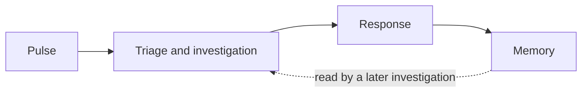

import { ResolveScene } from '/snippets/iso/resolve.jsx';

Resolve is CloudThinker's incident response module. It takes the alerts your tools already send, drops the noise, investigates what's left to a root cause, and brings in people only when an incident needs them.

<ResolveScene />

## How it works

Resolve follows the platform's Detect, Analyze, Resolve, Validate loop, explained on [How CloudThinker works](/#how-cloudthinker-works). Inside Resolve, an alert moves through four stages:

| Stage | What happens | Where you see it |
|---|---|---|
| 1. Detect | [Pulse](/guide/pulse/overview), the detection layer, suppresses known noise and groups related alerts into clusters, so one outage is one item. | **Resolve → Pulse** |
| 2. Investigate | CloudThinker triages each actionable cluster, opens or reopens an incident, and runs a root-cause analysis (RCA) across your connected systems. | **Resolve → Investigation** |
| 3. Respond | When people are needed, [On-call](/guide/incident/oncall) opens an Incident Room for the responders. Fixes run through [runbooks](/guide/incident/runbooks) and [Approvals](/guide/approvals/overview), so nothing changes without the policy you set. | Incident Room, Slack war room |
| 4. Remember | CloudThinker writes [incident memory](/guide/incident/incident-memory) that later investigations read at the start. | Inside the next RCA |

Not every incident reaches every stage. An investigation can end without a root cause, and no runbook may match.

## Start from the Overview

Open **Resolve → Overview** to see what needs you now and what Resolve handled alone.

| Tile | What it counts |
|---|---|
| **Needs your decision** | Resolve found the cause, or paused, and is waiting on you |
| **Awaiting your approval** | Runbooks staged and blocked on an approval decision |
| **Critical & high open** | Unresolved incidents at the top two severities |
| **AI is handling** | Incidents being investigated right now, no action needed |

Each tile opens the matching slice of the Investigation queue. The page also shows the funnel from raw **events** to **signals**, **clusters**, and **incidents**. If a connected source stops sending, a banner says so, so a broken feed doesn't look like a quiet system.

## Choose who starts investigations

The **On duty** switch sits in the header of **Resolve → Investigation**. It's CloudThinker's autonomy switch, not your human on-call rotation.

| Switch | Behavior |
|---|---|
| **On duty** | CloudThinker detects, triages, and investigates on its own. |
| **Paused** | Pulse keeps detecting and incidents are filed as Open. RCA waits until someone clicks **Investigate**. |

Manual investigation always works, whichever way the switch is set.

## What you can do

| Job | What it covers | Read |
|---|---|---|
| Try it end to end | Send a test alert and follow it from Pulse to an incident | [Resolve quickstart](/guide/incident/quickstart) |
| Connect alert sources | Webhooks, cloud polling, Slack and Teams channels, and where Resolve posts updates | [Integrations](/guide/incident/integrations) |
| Work the alert feed | Lanes, clusters, Escalate, Attach to incident, snooze | [Pulse](/guide/pulse/overview) |
| Read a root cause | Verdict, confidence, evidence, timeline, remediation suggestions | [Investigation and RCA](/guide/incident/root-cause-analysis) |
| Bring people in | Responders, paging, the Incident Room, and the Slack war room | [On-call](/guide/incident/oncall) |
| Log something Pulse didn't see | A customer report or an operator hunch | [Log an incident](/guide/incident/manual-logging) |
| Govern fixes | Procedures Resolve runs, with an Allow, Require Approval, or Deny effect per command (marked **Legacy** in the sidebar) | [Runbooks](/guide/incident/runbooks) |
| Measure results | Trends, accuracy, and per-service reliability | [Insights](/guide/incident/insights) |
| Catch what alerts miss | Checks CloudThinker writes from your incidents (coming soon) | [Detectors](/guide/incident/detectors) |
| Tune behavior | Live progress updates and response policies | [Settings](/guide/incident/settings) |

## Get started

<CardGroup cols={2}>
  <Card title="Resolve quickstart" icon="rocket" href="/guide/incident/quickstart">
    Send a test alert and watch Pulse turn it into an incident in about 10 minutes.
  </Card>
  <Card title="Connect a source" icon="plug" href="/guide/incident/integrations">
    Point an existing monitoring tool at Resolve.
  </Card>
  <Card title="Set up On-call" icon="users" href="/guide/incident/oncall">
    Choose who joins the Incident Room when an incident needs people.
  </Card>
  <Card title="Read an investigation" icon="magnifying-glass" href="/guide/incident/root-cause-analysis">
    Learn what each part of an RCA result means and how to act on it.
  </Card>
</CardGroup>
