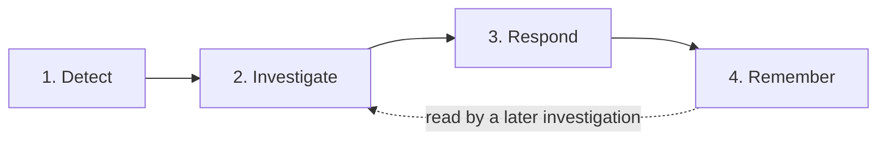

import { ResolveScene } from '/snippets/iso/resolve.jsx';

**Finds the root cause. In minutes.**

Resolve is the Frontier Investigation Agent for production incidents. It takes the alerts your tools already send, drops the noise, investigates what's left to a root cause, and brings in people only when an incident needs them. To start, you need one alert source. For a root cause CloudThinker can verify, also connect the cloud or observability account the alerts are about.

<ResolveScene />

## How it works

Inside Resolve, an alert moves through four stages. They're Resolve's own steps of the platform loop described in [How CloudThinker works](/#how-cloudthinker-works) on the docs home page.

| Stage | What happens | Where you see it |
|---|---|---|
| 1. Detect | [Pulse](/guide/pulse/overview), the detection layer, suppresses known noise and groups related alerts into clusters, so one outage is one item. | **Resolve → Pulse** |
| 2. Investigate | CloudThinker triages each actionable cluster, opens or reopens an incident, and runs a root-cause analysis (RCA) across your connected systems. | **Resolve → Investigation** |
| 3. Respond | When people are needed, [On-call](/guide/incident/oncall) opens an Incident Room for the responders. Every fix CloudThinker runs goes through [Approvals](/guide/approvals/overview). A new workspace starts on **Auto · Rules + AI · Ask me**: a write no Rule allows runs only if AI judges it safe, and otherwise waits for a person. See [what you get out of the box](/guide/approvals/overview#what-you-get-out-of-the-box). | Incident Room, Slack war room |
| 4. Remember | CloudThinker writes [incident memory](/guide/incident/incident-memory) that later investigations read at the start. There's no screen to view or edit it: CloudThinker corrects entries itself as new evidence comes in. | In later RCA results that cite a past incident |

Not every incident reaches every stage. An investigation can end without a root cause, and a **Track only** incident (real but not urgent, so no one is paged) stays in the queue unless a person raises it.

## Set up in this order

You need the workspace **Admin** role to change Resolve settings and integrations. See [Roles](/guide/security/roles).

1. **Connect an alert source.** Point a monitoring tool at Resolve, or try a test source first with the [quickstart](/guide/incident/quickstart). See [Connect Pulse sources](/guide/pulse/setup).
2. **Decide on On duty.** It's on in a new workspace, so CloudThinker triages and investigates on its own. Pause it while you connect and tune your first real source, then turn it back on. See [below](#choose-who-starts-investigations).
3. **Set up On-call.** Pick responders and, optionally, a Slack war room. See [On-call](/guide/incident/oncall).
4. **Review your Approvals policy.** It decides which fixes run on their own and which wait for a person. See [Approvals](/guide/approvals/overview).

## Start from the Overview

Open **Resolve → Overview** to see what needs you now and what Resolve handled alone.

| Tile | What it counts |
|---|---|
| **Needs your decision** | Incidents waiting on a person: **Cause found**, **Paused** (CloudThinker asked you something and waits for the answer), **Investigation complete**, **Checks incomplete**, or an investigation that stopped or was cancelled. See [the investigation queue](/guide/incident/root-cause-analysis#the-investigation-queue). |
| **Awaiting your approval** | Runbooks staged and blocked on an approval decision |
| **Critical & high open** | Unresolved incidents at the top two severities |
| **AI is handling** | Incidents being investigated right now, no action needed |

Each tile opens the matching slice of the Investigation queue. The page also shows the funnel from alerts to incidents. If a connected source stops sending, a banner says so, so a broken feed doesn't look like a quiet system.

| Funnel step | Meaning |
|---|---|
| **Event** | One raw notification from a source, such as a CloudWatch alarm |
| **Signal** | An event that survived noise suppression |
| **Cluster** | Related signals Pulse treats as one problem |
| **Incident** | What triage, or a person, opens from a cluster. CloudThinker investigates it. |

[Pulse](/guide/pulse/overview) covers the first three in detail.

## Choose who starts investigations

CloudThinker's autonomy switch sits in the header of **Resolve → Investigation**, and its label shows its state: **On duty** or **Paused**. It isn't your human on-call rotation. It's on in a new workspace, and only a workspace Admin can change it. [Resolve settings](/guide/incident/settings) lists every other Resolve control.

| Switch state | Behavior |
|---|---|
| **On duty** | CloudThinker triages each actionable cluster and investigates on its own. Each triage and investigation is a run that uses [credits](/guide/billing/usage), so a noisy source costs more. |
| **Paused** | Pulse keeps detecting and clustering. Automatic triage waits until you switch back, so new alerts don't open incidents on their own. Held triage runs once you switch back. |

**Send to triage** and **Investigate** always work, whichever way the switch is set.

## What you can do

| Job | What it covers | Read |
|---|---|---|
| Try it end to end | Send a test alert and follow it from Pulse to an incident | [Resolve quickstart](/guide/incident/quickstart) |
| Connect alert sources | Webhooks, cloud polling, Slack and Teams channels, and where Resolve posts updates | [Integrations](/guide/incident/integrations) |
| Work the alert feed | Lanes, clusters, Escalate, Attach to incident, snooze | [Pulse](/guide/pulse/overview) |
| Read a root cause | Verdict, confidence, evidence, timeline, remediation suggestions | [Investigation and RCA](/guide/incident/root-cause-analysis) |
| Bring people in | Responders, paging, the Incident Room, and the Slack war room | [On-call](/guide/incident/oncall) |
| Log something Pulse didn't see | A customer report or an operator hunch | [Log an incident](/guide/incident/manual-logging) |
| Govern fixes | Which actions run on their own and which wait for a person | [Approvals](/guide/approvals/overview) |
| Add fix procedures | Your written procedures from Confluence, GitHub, GitLab, or Markdown, read during RCA. Runbooks still work; the sidebar marks them **Legacy**. | [Runbooks](/guide/incident/runbooks) |
| Measure results | Trends, accuracy, and per-service reliability | [Insights](/guide/incident/insights) |
| Tune behavior | Every Resolve control and where it lives, including live progress updates | [Settings](/guide/incident/settings) |

## Get started

<CardGroup cols={2}>
  <Card title="Resolve quickstart" icon="rocket" href="/guide/incident/quickstart">
    Send a test alert and watch Pulse turn it into an incident in about 10 minutes.
  </Card>
  <Card title="Connect a source" icon="plug" href="/guide/incident/integrations">
    Point an existing monitoring tool at Resolve.
  </Card>
  <Card title="Set up On-call" icon="users" href="/guide/incident/oncall">
    Choose who joins the Incident Room when an incident needs people.
  </Card>
  <Card title="Read an investigation" icon="magnifying-glass" href="/guide/incident/root-cause-analysis">
    Learn what each part of an RCA result means and how to act on it.
  </Card>
</CardGroup>
