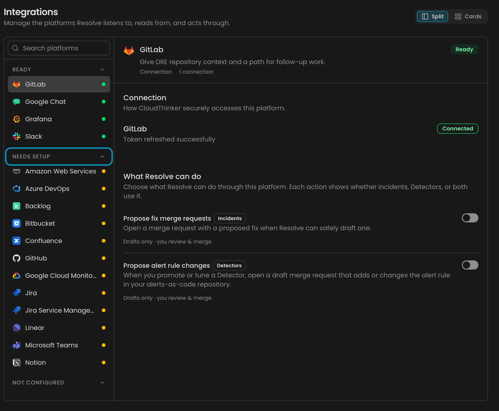

In about 10 minutes you create an alert endpoint, send it a test alert with `curl`, and follow that alert from Signals to an incident and its root-cause analysis (RCA). You need no monitoring tool for this: a Custom source accepts any JSON you POST to it.

## Prerequisites

- The workspace **Admin** role. Developers and Viewers can see **Resolve → Triggers & Outcomes** but can't add a signal. See [Roles](/guide/security/roles).
- A terminal with `curl`.
- Optional, for a meaningful RCA: at least one cloud or observability [connection](/guide/connections/overview), so CloudThinker has something to investigate.

## Create an alert endpoint

<Steps>
  <Step title="Open Resolve">
    Click **Resolve** in the sidebar. On a workspace with no source yet, you see a setup screen. Click **Skip for now**. The wizard behind **Connect monitoring** asks you to type field paths, while the **Custom source** on **Triggers & Outcomes** captures your test payload so you can click the fields instead.
  </Step>
  <Step title="Add a Custom source">
    Go to **Resolve → Triggers & Outcomes** and select **Custom source**. In its panel, under **Signals to Resolve**, click **Add signal**.

    <Frame caption="Resolve Triggers & Outcomes: platforms grouped by readiness, Needs attention first">
      
    </Frame>
  </Step>
  <Step title="Name it">
    Enter a **Source name**, for example `quickstart-test`, and click **Create endpoint**.

    **Success state:** the dialog shows a **Webhook URL** and a **Secret Key**, then says **Waiting for the first payload**.
  </Step>
  <Step title="Copy the URL and Secret Key">
    Copy both into a scratch file. The **Secret Key** is shown only here. If you lose it, see [Troubleshooting](#troubleshooting).
  </Step>
</Steps>

## Send a test alert

Keep the dialog open and run this from your terminal. Replace the two placeholders with the values you copied.

```bash
curl -X POST "<your-webhook-url>" \
  -H "Authorization: Bearer <your-secret-key>" \
  -H "Content-Type: application/json" \
  -d '{
    "title": "Checkout API 5xx rate above 5%",
    "severity": "critical",
    "service": "checkout-api",
    "resource": "checkout-api-prod",
    "description": "Test alert from the Resolve quickstart"
  }'
```

**Success state:** `curl` returns a `2xx` status with a JSON body that includes `"success": true`. The dialog checks for the payload on its own and switches to **Payload received**. If it doesn't, click **Check again** next to the waiting message.

`severity` accepts `critical`, `high`, `medium`, `low`, or `info`, in any letter case, so `Critical` works too. Any other value lands as `medium` unless you add a [severity mapping](/guide/incident/webhook-integrations/custom-source).

<Steps>
  <Step title="Map the fields">
    When the dialog shows **Payload received**, click **Map the fields**. For each target, click the matching field in the captured JSON:

    | Target | Pick |
    |---|---|
    | **Incident title** (required) | `title` |
    | **Severity** | `severity` |
    | **Service** | `service` |
    | **Resource** | `resource` |
    | **Description** | `description` |

    Click **Save mapping**.
  </Step>
  <Step title="Send the alert twice more, a minute apart">
    Run the `curl` command again, wait at least one minute, and run it a third time. The repeats join the first signal's cluster instead of creating new work, because they share a title and a service. The payload has no `resource_id`, so title and service are what group them here. [Clusters](/guide/pulse/clusters#how-signals-join-a-cluster) has the full rule.

    Each send that survives suppression becomes a signal, including the first one. The payload has no top-level `timestamp` field, so Pulse uses the time it received each send. An identical send in the same minute as an earlier one is dropped as a duplicate, which is why you wait. Expect two or three signals, depending on whether the first two sends landed in the same minute.
  </Step>
</Steps>

## Watch Signals cluster it

**Signals** is Resolve's detection layer. A **signal** is an event that survived noise suppression, and a **cluster** is a group of related signals treated as one problem.

<Steps>
  <Step title="Open Signals">
    Go to **Resolve → Signals**.

    **Success state:** a cluster titled `Checkout API 5xx rate above 5%` with at least two signals, in the **Needs you** lane. If it shows **Forming** with one signal, the repeats were too close together: wait a minute and send again.

    Already in **Handled**? **AI auto-investigate** is on in a new workspace, so triage picked the cluster up on its own. Skip to [Open the investigation](#open-the-investigation-and-root-cause).
  </Step>
  <Step title="Hand it to triage">
    Click the cluster, then **Open incident** → **Send to triage**. CloudThinker reads the cluster and matches it to an open incident, opens a new one, or decides it needs no incident.

    **Success state:** triage runs and settles the cluster. It moves to the **Handled** lane once triage links it to an open incident. If triage decides the cluster needs no incident, it doesn't move to **Handled** — see the note below.
  </Step>
</Steps>

<Note>
For a made-up alert, both triage outcomes are normal. A test alert about a service CloudThinker can't find in your connections may be judged as needing no action, so no incident opens and the cluster doesn't move to **Handled**. That isn't a mistake on your side: log the incident by hand in the next step. To make an incident more likely, replace `checkout-api` with a real service name from a connected account.
</Note>

## Open the investigation and root cause

<Steps>
  <Step title="Find the incident">
    Go to **Resolve → Issues**. If triage opened an incident, it's in the queue, and its **Status** reads **AI is handling** while RCA runs.

    No incident? Click **Log Incident**. Enter the alert title in **What's happening?**, set **Severity** to **Critical**, and save. A logged incident starts its investigation as soon as you save, even while **AI auto-investigate** is off. See [Log an incident](/guide/incident/manual-logging) for the other fields.
  </Step>
  <Step title="Start RCA if it hasn't started">
    RCA starts on its own when triage opens an incident from Signals, and a logged incident starts it as soon as you save. If the incident's status reads **Not started**, open it and click **Investigate**. [What starts an investigation](/guide/incident/settings#what-starts-an-investigation) has the full rules.
  </Step>
  <Step title="Read the result">
    Open the incident. CloudThinker shows its verdict, confidence, the evidence it read, a timeline, and remediation suggestions.

    **Success state:** the incident leaves **AI is handling**. With a connection that covers the alert, it usually lands in **Needs you** with a root cause. With no connections, expect one of two results:

    - It lands in **Needs you**, and the result says CloudThinker couldn't verify the cause.
    - Its status becomes **Not found**, because the evidence didn't support a root cause. A **Not found** incident drops out of the queue, so copy the incident's URL from your browser before you leave the page. See [Investigation outcomes](/guide/incident/root-cause-analysis#investigation-outcomes).
  </Step>
</Steps>

A result without a verified cause is the honest answer for a made-up alert. Connect the system the alert is about and the same flow produces a real root cause.

## Clean up

The test source keeps accepting alerts until you remove it.

1. Close the test incident so it doesn't stay in your queue. Open it from **Resolve → Issues**, click the status badge in the incident header, pick **False alarm**, and click **Change Status**.
2. In **Resolve → Signals**, open the test cluster, open the **⋯** menu, and click **Resolve**. It shows once no open incident holds the cluster. Left alone, the cluster closes after 12 hours with no new signal.
3. Go to **Resolve → Triggers & Outcomes** → **Custom source**, open the `quickstart-test` row's **⋯** menu, and click **Delete**.

## Troubleshooting

<AccordionGroup>
  <Accordion title="The dialog keeps waiting for the first payload">
    Check the status `curl` returned, then click **Check again**.

    | Status | Usual cause |
    |---|---|
    | `401` | The `Authorization` header is missing, or the URL isn't the current **Webhook URL** (mistyped, cut short, or replaced by **Regenerate credentials**). Check the header and paste the full URL again. |
    | `403` | The **Secret Key** is wrong, or the header isn't in the form `Bearer <secret-key>`. Paste the key again. |
    | `422` | The body isn't a JSON object: invalid JSON, an array, or a plain value. |
    | `429` | Too many requests, or too many failed authentication attempts in a short time. Wait, then retry. |

    If the dialog says an event arrived but no field could be read from its body, the send was accepted and its fields still couldn't be mapped. Send the sample payload above again, then click **Check again**.
  </Accordion>
  <Accordion title="I lost the Secret Key">
    It isn't shown again. On the **Custom source** card, open the source row's **⋯** menu and click **Regenerate credentials**. That replaces both the **Webhook URL** and the **Secret Key**, and the old pair stops working at once, so update the URL and the key in anything that already sends to it.
  </Accordion>
  <Accordion title="Nothing shows up in Signals">
    Switch to the **History** lane and widen the time window. Then check the funnel at the top of **Resolve → Signals**: if the raw event count went up but no cluster appeared, suppression dropped the event, most often as a duplicate sent in the same minute. Change the `title` and send again.
  </Accordion>
  <Accordion title="Open incident is missing">
    **Open incident** only shows on a **Forming** or **Active** cluster that isn't routed yet. If the cluster is already in **Handled**, triage has it: open the incident from **Resolve → Issues**.
  </Accordion>
</AccordionGroup>

## Next steps

**Your own tools:** [Connect alert sources](/guide/incident/connect-alert-sources) matches the tool that already sends your alerts to a webhook, a polling source, or a chat channel.

**Walkthrough:** see this same path on a real production incident in [Investigate a checkout incident end to end](/guide/use-cases/resolve-checkout-incident).

<CardGroup cols={2}>
  <Card title="Connect a real source" icon="plug" href="/guide/incident/triggers-and-outcomes#triggers">
    Point Datadog, Grafana, PagerDuty, or CloudWatch alerts at Resolve, and watch the Slack channels where people report incidents.
  </Card>
  <Card title="Read an investigation" icon="magnifying-glass" href="/guide/incident/root-cause-analysis">
    What the verdict, confidence, and remediation queue mean.
  </Card>
  <Card title="Set up On-call" icon="users" href="/guide/incident/oncall">
    Bring responders into an Incident Room when an incident needs people.
  </Card>
  <Card title="Custom source reference" icon="code" href="/guide/incident/webhook-integrations/custom-source">
    Field paths, authentication, and changing the mapping later.
  </Card>
</CardGroup>
