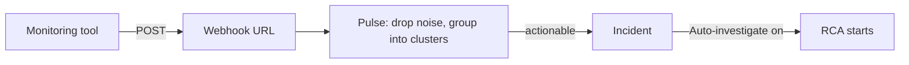

A webhook signal is a URL that your monitoring tool calls each time an alert fires, so Resolve sees the alert within seconds. You create one per tool, map the tool's JSON fields to a title, severity, and service, and decide whether CloudThinker starts a root cause analysis (RCA) on its own.

## How an alert flows

An alert that reaches the webhook doesn't become an incident directly. It goes through [Pulse](/guide/pulse/overview) first.



A **signal** is an alert that survived noise suppression. A **cluster** is a group of related signals that Pulse treats as one problem. Only an actionable cluster turns into an incident.

## Prerequisites

- Permission to manage Resolve integrations.
- Admin access to the monitoring tool, so you can add a webhook to it.
- One real alert payload you can trigger on demand, or a sample of its JSON.

## Create the webhook

<Steps>
  <Step title="Open the platform">
    Go to **Resolve → Integrations** and select your tool, for example Datadog, Grafana, or PagerDuty.
  </Step>
  <Step title="Add a signal">
    Under **Signals to Resolve**, click **Add signal** (or **Add another signal**). The **Create Webhook** dialog opens with three steps.
  </Step>
  <Step title="Basic Info">
    Keep or change **Webhook Name** (it defaults to `<Tool> Webhook`) and add an optional **Description**. Click **Next**.
  </Step>
  <Step title="Configure">
    Check **Field Mapping** and **Severity Mapping**. Both come pre-filled for the tool you picked. Follow the **Setup Guide** for that tool at the bottom of the step. Click **Next**.
  </Step>
  <Step title="Advanced">
    Pick an **Auth Method** and set **Auto-investigate** (both explained below). Click **Create**.
  </Step>
</Steps>

**Success state:** a dialog shows the **Webhook URL**, the secret under **Authentication Setup**, and **Integration Examples** in JavaScript, Python, and Node.js. Copy the URL and secret now, then paste them into your monitoring tool.

<Tip>
Copy the secret before you click **Done**. If you lose it later, regenerating credentials invalidates the current token and secret, so every tool using them needs the new value.
</Tip>

## Map the fields

Each mapping field takes a path into the alert's JSON, like `event.data.title`. Only **Title Path** is required.

| Field | What it fills in |
|---|---|
| **Title Path** | The incident title. Required. |
| **Severity Path** | The severity level, translated by **Severity Mapping**. |
| **Description Path** | The incident description. |
| **Service Path** | The affected service. Helps Pulse group related alerts. |
| **Resource ID Path** | The affected resource's identifier. |
| **Resource Name Path** | The affected resource's name. |
| **Timestamp Path** | When the event started. |

For example, the Datadog preset maps a payload like this:

```json
{
  "title": "High CPU on web-server-01",
  "body": "CPU usage exceeded 90% for 5 minutes",
  "alert_type": "critical",
  "tags": ["service:web-api", "env:production"]
}
```

| Field | Path | Value |
|---|---|---|
| **Title Path** | `title` | High CPU on web-server-01 |
| **Description Path** | `body` | CPU usage exceeded 90% for 5 minutes |
| **Severity Path** | `alert_type` | critical |
| **Service Path** | `tags` | service:web-api, env:production |

**Severity Mapping** translates the tool's own words into CloudThinker's five levels: critical, high, medium, low, and info. The generic preset maps `warning` to medium and `error` to high, for example. Add a row for any value your tool sends that isn't covered.

If your tool isn't listed, use [Custom source](/guide/incident/webhook-integrations/custom-source) instead. It captures one real payload and lets you click the fields to map.

## Choose authentication

| Auth Method | Your tool sends | Use when |
|---|---|---|
| **Bearer Token** | `Authorization: Bearer <secret>` | The tool lets you add a custom header. Default for most tools. |
| **HMAC Signature** | A signature header computed from the body, such as `X-PagerDuty-Signature` | The tool signs its webhooks, like PagerDuty. |
| **API Key** | The key in a header you name | The tool only supports API key headers, like CloudWatch through EventBridge. |
| **No Authentication** | Nothing | Only for a quick test. Anyone with the URL could send alerts. |

## Decide when RCA starts

**Auto-investigate** is on by default. CloudThinker starts one root cause investigation when this webhook creates an incident. Turn it off and CloudThinker investigates only when someone asks.

| Setting | Effect |
|---|---|
| **Auto-investigate** off | No automatic RCA from this webhook. |
| **Auto-investigate** on, no minimum | Every incident from this webhook gets an RCA. |
| **Only from a minimum severity** on | Pick a floor, for example **High and above**. Alerts below it still group with related alerts, but get no automatic RCA. |

The **On duty** switch on **Resolve → Investigation** also has to be on. When it shows **Paused**, incidents still open, but no RCA starts until someone starts it. See [Resolve settings](/guide/incident/settings).

**Send directly to CloudThinker** (on the **Configure** step, off by default) skips Pulse filtering and grouping. CloudThinker then judges each event on its own. Leave it off unless the tool already deduplicates its alerts.

## Test the whole path

<Steps>
  <Step title="Fire one real alert">
    Trigger a representative alert from your tool, or send the request from **Integration Examples**. A successful delivery returns `202 Accepted`.
  </Step>
  <Step title="Check Pulse">
    Open **Resolve → Pulse** and find the signal with the title you mapped.
  </Step>
  <Step title="Check the incident">
    If the cluster is actionable, open **Resolve → Investigation**. With **Auto-investigate** and **On duty** both on, the incident shows **AI is handling**.
  </Step>
</Steps>

**Success state:** the signal appears in Pulse with the right title, severity, and service, and an eligible incident shows **AI is handling**. A `202` alone only proves delivery.

Test one normal alert and one critical alert, so you know both severity mappings work.

## Troubleshooting

<AccordionGroup>
  <Accordion title="The tool reports 401 or 403">
    **Cause:** the auth header doesn't match the **Auth Method**. **Check:** the header name and secret in your tool against **Authentication Setup**. **Fix:** paste the secret again, or regenerate it from the webhook's details.
  </Accordion>
  <Accordion title="Delivery succeeds but nothing appears in Pulse">
    **Cause:** Pulse suppressed the alert as noise, or the time window hides it. **Check:** widen the window on **Resolve → Pulse**. **Fix:** see [Pulse clusters](/guide/pulse/clusters) for how suppression works.
  </Accordion>
  <Accordion title="Signals arrive with an empty title or the wrong severity">
    **Cause:** a path doesn't match the payload, or the tool's severity value has no mapping row. **Fix:** compare the paths against a real payload, then add the missing value to **Severity Mapping**.
  </Accordion>
  <Accordion title="An incident opened but no RCA started">
    **Cause:** **Auto-investigate** is off, the severity is below the floor, or **On duty** shows **Paused**. **Fix:** check all three, or start the investigation by hand.
  </Accordion>
</AccordionGroup>

## Next steps

<CardGroup cols={2}>
  <Card title="Connect CloudWatch" icon="aws" href="/guide/incident/webhook-integrations/cloudwatch">
    Send CloudWatch alarms through EventBridge.
  </Card>
  <Card title="Add a custom source" icon="plug" href="/guide/incident/webhook-integrations/custom-source">
    Connect a system with no preset by clicking its payload fields.
  </Card>
  <Card title="Understand Pulse" icon="pulse" href="/guide/pulse/overview">
    See how signals are filtered, grouped, and routed.
  </Card>
  <Card title="Manage integrations" icon="arrows-rotate" href="/guide/incident/integrations">
    Check readiness and turn on outcomes for each platform.
  </Card>
</CardGroup>
