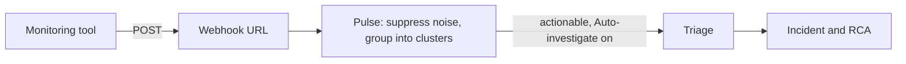

A webhook is a URL that your monitoring tool calls each time an alert fires, so Resolve sees the alert within seconds. You create one per tool, map the tool's JSON fields to a title, severity, and service, and decide whether CloudThinker starts a root cause analysis (RCA) on its own.

## How an alert flows

An alert that reaches the webhook doesn't become an incident directly. It goes through [Pulse](/guide/pulse/overview) first.



A **signal** is an event that survived noise suppression. A **cluster** is a group of related signals that Pulse treats as one problem. Only a cluster that holds an actionable signal goes to triage, which decides whether it becomes an incident.

## Before you start

- The workspace **Admin** role.
- Admin access to the monitoring tool, so you can add a webhook to it.
- One real alert payload you can trigger on demand, or a sample of its JSON.

## Create the webhook

<Steps>
  <Step title="Open the platform">
    Go to **Resolve → Integrations** and select your tool, for example Datadog, Grafana, or PagerDuty.
  </Step>
  <Step title="Add a signal">
    Under **Signals to Resolve**, click **Add signal** (or **Add another signal**). The **Create Webhook** dialog opens with three steps.
  </Step>
  <Step title="Basic Info">
    Keep or change **Webhook Name** (it defaults to `<Tool> Webhook`) and add an optional **Description**. Click **Next**.
  </Step>
  <Step title="Configure">
    Check **Field Mapping** and **Severity Mapping**. Both come pre-filled for the tool you picked. Leave **Send directly to CloudThinker** off ([why](#decide-when-rca-starts)). Click **Next**.
  </Step>
  <Step title="Advanced">
    Pick an **Auth Method** and set **Auto-investigate** (both explained below). Click **Create**.
  </Step>
</Steps>

**Success state:** a dialog shows the **Webhook URL**, the **Secret Key** under **Authentication Setup**, and **Integration Examples** with **cURL**, **JavaScript**, **Python**, and **Node.js** tabs. Copy the URL and the **Secret Key** now: the key is shown only once. The same dialog shows a **Setup Guide** for your tool: follow it to paste them in. The **cURL** tab is the fastest way to send a test.

<Tip>
Copy the **Secret Key** before you click **Done**. If you lose it, go to **Resolve → Integrations**, open the tool, and under **Signals to Resolve** open the webhook row's **Manage** menu (**⋯**) → **Regenerate credentials**. That replaces both the **Webhook URL** and the **Secret Key**, and the old pair stops working at once. Every tool using the webhook needs the new URL and key.
</Tip>

## Map the fields

Each mapping field takes a path into the alert's JSON. Only **Title Path** is required.

- Use dotted keys, like `event.data.title`, and `[n]` for a list item, like `alerts[0].labels.severity`. A leading `$.` is accepted and dropped.
- A path can have at most 8 segments. Keys that contain a dot can't be addressed, and there are no fallback paths.
- A path must end at a single text or number value. A path that ends at a list or object maps to nothing.

| Field | What it fills in |
|---|---|
| **Title Path** | The incident title. Required. |
| **Severity Path** | The severity level, translated by **Severity Mapping**. |
| **Description Path** | The incident description. |
| **Service Path** | The affected service. Signals that name the same service can join one cluster, so use one service name, not a broad value like `prod`. |
| **Resource ID Path** | The affected resource's identifier. Repeats with the same resource ID join one cluster. Left empty, CloudThinker reads a top-level `resource_id` key. See [How signals join a cluster](/guide/pulse/clusters#how-signals-join-a-cluster). |
| **Resource Name Path** | The affected resource's name. |
| **Timestamp Path** | When the event started, as an ISO 8601 time. Left empty, CloudThinker reads a top-level `timestamp` key. With neither, or a value it can't parse, it uses the time the delivery arrived. |

Your tool decides the payload shape. In Datadog, for example, you write the JSON yourself in the webhook's **Payload** field, using Datadog's template variables. The Datadog preset reads `title`, `body`, and `alert_type`. Add a `service` key with one service name, because the preset's default **Service Path** (`tags`) points at a list and maps to nothing:

```json
{
  "title": "$EVENT_TITLE",
  "body": "$EVENT_MSG",
  "alert_type": "$ALERT_TYPE",
  "service": "web-api"
}
```

| Field | Path | Example value |
|---|---|---|
| **Title Path** | `title` | High CPU on web-server-01 |
| **Description Path** | `body` | CPU usage exceeded 90% for 5 minutes |
| **Severity Path** | `alert_type` | error |
| **Service Path** | `service` (change it from `tags`) | web-api |

A fixed `service` value applies to every monitor that notifies this webhook. Datadog's `$ALERT_TYPE` sends `error`, `warning`, `info`, or `success`, but the Datadog preset's **Severity Mapping** covers `alert`, `warn`, `ok`, and `no data`. Under **Severity Mapping**, click **Customize**, then **Add Mapping** for each of these rows (change the levels to suit your team). You can also add them later from the webhook row's **Manage** menu (**⋯**) → **Edit**.

| Source value | Severity |
|---|---|
| `error` | high |
| `warning` | medium |
| `info` | info |
| `success` | info |

A `success` (recovery) event doesn't close anything. It arrives as an ordinary signal, and the cluster still closes after 12 quiet hours or when a person resolves it. CloudThinker's classifier treats a recovery or healthy state as not actionable, so its cluster doesn't go to triage on its own. The check is a model judgment, so a recovery can still slip through. A person can always send a cluster to triage with **Escalate**.

**Severity Mapping** translates the tool's own words into CloudThinker's five levels: critical, high, medium, low, and info. The generic preset maps `warning` to medium and `error` to high, for example. Matching ignores case and surrounding spaces, so `ERROR` and `error` hit the same row.

| The value at **Severity Path** | Result |
|---|---|
| One of the five levels | Used as is. No row needed. |
| Has a mapping row | The row's level |
| Anything else | **medium** |
| **Severity Path** empty or finds nothing | CloudThinker reads a top-level `severity` or `priority` key instead |
| No `severity` or `priority` key either | **medium** |

If your tool isn't listed, use [Custom source](/guide/incident/webhook-integrations/custom-source) instead. It captures one real payload and lets you click the fields to map.

## Choose authentication

| Auth Method | Your tool sends | Use when |
|---|---|---|
| **Bearer Token** | `Authorization: Bearer <secret>` | The tool lets you add a custom header. Default for most tools. In Datadog, the webhook's **Custom Headers** field takes JSON: `{"Authorization": "Bearer <secret>"}`. |
| **HMAC Signature** | An HMAC-SHA256 of the raw request body, hex-encoded, sent as `sha256=<hex digest>` in the header you name. PagerDuty's `X-PagerDuty-Signature` (`v1=<hex digest>`) is also accepted. | The tool signs its webhooks, like PagerDuty. Set the header name in **HMAC Signature Header**. If the tool generates its own signing secret, paste it into **Provider signing secret**. |
| **API Key** | The key in a header you name | The tool only supports API key headers, like CloudWatch through EventBridge. Set **API Key Header** and an optional **Key Prefix**. |
| **No Authentication** | Nothing | Only for a quick test. Anyone with the URL could send alerts. |

The dialog names the credential after the method you pick: **Secret Key** for **Bearer Token**, **HMAC Secret** for **HMAC Signature**, and **API Secret** for **API Key**. It's the same credential, shown once either way.

## Decide when RCA starts

**Auto-investigate** is on by default: this webhook's actionable clusters go to triage, which opens an incident and investigates it. Turn it off and its alerts stay in Pulse until someone clicks **Escalate** and **Send to triage**. With **Only from a minimum severity**, pick a floor: **Info and above**, **Low and above**, **Medium and above**, **High and above**, or **Critical only**. Alerts below it still group with related alerts, but don't start triage on their own.

[What starts an investigation](/guide/incident/settings#what-starts-an-investigation) shows how these options combine with **On duty** and manual starts.

<Note>
Each automatic investigation is billed in credits. Set a minimum severity, or a [Credit limit](/guide/billing/credit-limits), before you connect a noisy tool.
</Note>

**Send directly to CloudThinker** (on the **Configure** step, off by default) skips Pulse filtering and grouping. CloudThinker then judges each event on its own. Leave it off unless the tool already deduplicates its alerts.

## Test the whole path

<Steps>
  <Step title="Fire one real alert">
    Trigger a representative alert from your tool, or send the request from the **cURL** tab in **Integration Examples**. With **Bearer Token**, a test looks like this:

    ```bash
    curl -X POST "https://YOUR_WEBHOOK_URL" \
      -H "Content-Type: application/json" \
      -H "Authorization: Bearer YOUR_SECRET_KEY" \
      -d '{"title": "Test: high CPU on web-01", "alert_type": "error", "service": "web-api"}'
    ```

    A successful delivery returns `200` with a body that includes `"success": true` and a `request_id`. If you haven't added the Datadog rows yet, `error` maps to medium.
  </Step>
  <Step title="Check Pulse">
    Open **Resolve → Pulse** and find the signal with the title you mapped.
  </Step>
  <Step title="Check the incident">
    On **Resolve → Pulse**, a cluster that went to triage moves to the **Routed** lane once it's linked to an incident. Then open **Resolve → Investigation**. With **Auto-investigate** and **On duty** both on, the incident shows **AI is handling**. If the cluster never reaches **Routed**, classification may have judged it not actionable. See [Clusters troubleshooting](/guide/pulse/clusters#troubleshooting).
  </Step>
</Steps>

**Success state:** the signal appears in Pulse with the right title, severity, and service, and an eligible incident shows **AI is handling**. A `200` alone only proves delivery.

Test one alert for each severity row you rely on. With the Datadog example above, send one `error` (maps to high) and one `warning` (maps to medium).

## Limits and responses

| Response | When |
|---|---|
| `200` with `"success": true` | The delivery was accepted. |
| `400` | The webhook is paused or disabled. Its row under **Signals to Resolve** shows **Paused**. |
| `401` | The auth header is missing, or the URL isn't a current **Webhook URL** (mistyped, or replaced by **Regenerate credentials**). |
| `403` | The secret or signature is wrong. |
| `413` | The body is larger than 1 MB. |
| `429` | Too many requests, or too many failed auth attempts: after 10 failures within 15 minutes, the webhook rejects requests until that 15-minute window ends. Retry after the time in the `Retry-After` header when it's present. |

<Warning>
Each webhook takes up to 1,000 deliveries an hour by default. Deliveries past that still get `200` with `"success": true`, because the limit is checked after the response, but they're dropped silently. They never become signals and don't count in **Signals ingested** on [Pulse analytics](/guide/pulse/analytics). Resolve doesn't show a dropped count, so the only sign is alerts missing from **Resolve → Pulse** during a burst.

To avoid it:

- Raise the limit: open the webhook row's **Manage** menu (**⋯**) → **Edit** and change **Rate limit (requests per hour)**. It goes up to 10,000, and `0` means no limit.
- Split high-volume monitors across more than one webhook.
- Deduplicate or group alerts in the tool before they're sent.
</Warning>

Pulse treats a delivery as a duplicate when its source, resource, title, severity, and event time (to the minute; see **Timestamp Path** for where it comes from) match a signal from the last hour. A duplicate adds to that signal's count instead of creating a new one. A cluster closes after 12 hours with no new signal, or when a person resolves it. See [Cluster lifecycle](/guide/pulse/clusters#cluster-lifecycle).

## Troubleshooting

<AccordionGroup>
  <Accordion title="The tool reports 401 or 403">
    **Cause:** the auth header doesn't match the **Auth Method**, or (for a `401`) the tool still sends to an old **Webhook URL**. **Check:** the URL, and the header name and secret in your tool against **Authentication Setup**. **Fix:** paste the secret again, or use **Regenerate credentials** in the webhook row's **Manage** menu under **Resolve → Integrations**.
  </Accordion>
  <Accordion title="Delivery succeeds but nothing appears in Pulse">
    **Cause:** Pulse suppressed the alert as noise, counted it as a duplicate of an earlier signal, or the time window hides it. **Check:** widen the window on **Resolve → Pulse**, then hover the funnel at the top to see how many events were suppressed. If you sent the same alert twice within a minute, look for the earlier signal: its count went up instead (see [Limits and responses](#limits-and-responses)). **Fix:** see [Noise suppression](/guide/pulse/clusters#noise-suppression) for each check.
  </Accordion>
  <Accordion title="Signals arrive with an empty title or the wrong severity">
    **Cause:** a path doesn't match the payload, or the tool's severity value has no mapping row. **Fix:** compare the paths against a real payload, then add the missing value to **Severity Mapping**.
  </Accordion>
  <Accordion title="An alert reached Pulse but no RCA started">
    **Cause:** **Auto-investigate** is off, the severity is below the floor, or **On duty** shows **Paused**. **Fix:** check all three against [What starts an investigation](/guide/incident/settings#what-starts-an-investigation), or click **Escalate** and **Send to triage** on the cluster. If an incident is already open, click **Investigate** on it.
  </Accordion>
</AccordionGroup>

## Next steps

<CardGroup cols={2}>
  <Card title="Connect CloudWatch" icon="aws" href="/guide/incident/webhook-integrations/cloudwatch">
    Send CloudWatch alarms through EventBridge.
  </Card>
  <Card title="Add a custom source" icon="plug" href="/guide/incident/webhook-integrations/custom-source">
    Connect a system with no preset by clicking its payload fields.
  </Card>
  <Card title="Understand Pulse" icon="wave-pulse" href="/guide/pulse/overview">
    See how signals are filtered, grouped, and routed.
  </Card>
  <Card title="Manage integrations" icon="arrows-rotate" href="/guide/incident/integrations">
    Check readiness and turn on outcomes for each platform.
  </Card>
</CardGroup>
