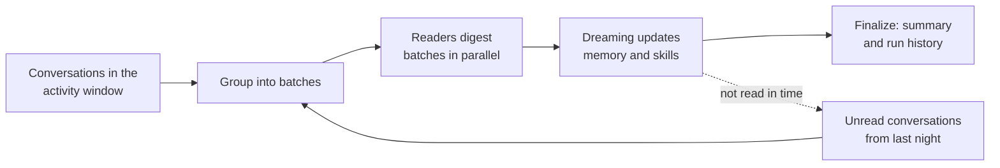

Dreaming is the nightly run that keeps [workspace memory](/guide/memory) short, current, and consistent. Once a night it reviews recent conversations, adds what is new, merges duplicates, and removes outdated memory and custom skills.

## Why Dreaming

- **Memory stays tidy without effort.** Agents save facts as they work; Dreaming merges the overlaps and drops what no longer holds.
- **Nothing slips through.** It reads every conversation in the activity window, and a conversation it can't finish is read first the next night.
- **Skills stay lean.** Dreaming also merges and retires redundant [custom skills](/guide/skills/custom-skills), within limits you control.
- **Safe by design.** Connections stay read-only, and conversation and connection notes are never changed.

## Turn it on

Dreaming is on by default for every workspace. Only a workspace admin can change it.

<Steps>
  <Step title="Open Memory settings">
    Go to **Settings → Memory**.
  </Step>
  <Step title="Set the switch">
    Turn **Consolidate memory nightly (Dreaming)** on or off.
  </Step>
</Steps>

**Success state:** the card shows **Next run** with a date and time. Runs start within 45 minutes of that time.

<Frame>
  
</Frame>

## How a run works

Each night Dreaming starts at 00:30 UTC, spread over the next 45 minutes across workspaces. One run per workspace happens at a time.

1. **Gather.** Dreaming lists every conversation updated in the activity window, people's chats first, plus any conversation the previous run didn't finish.
2. **Read in parallel.** Readers digest batches of conversations at the same time and report what is worth keeping. Readers can only read.
3. **Consolidate.** Dreaming compares the digests with existing memory, then adds, edits, merges, or deletes items and keeps the memory index in step.
4. **Finalize.** Dreaming records a summary in **Run history**. Near the time limit, it stops reading and finalizes with what it has.
5. **Carry over.** Conversations it didn't read to the end are read first on the next run.

### What Dreaming reads and changes

| Area | Dreaming |
|---|---|
| Chats, rooms, Memory chats, and deep dives | Reads every one updated in the activity window |
| Scheduled tasks and CloudKeepers runs | Reads them when **Include automated conversations** is on |
| Webhook, alert, and pipeline-log conversations | Never reads them |
| Memory items and the memory index | Adds, edits, merges, and deletes |
| Custom skills | Creates, updates, and merges; deletes up to 10 per run when allowed |
| Conversation notes and connection notes | Never changes them — a run that touches them is rolled back and publishes nothing |
| Connections | Reads only |

## Customize Dreaming

Open **Customize** on the Dreaming card. Workspace admins can change these options; members see them read-only.

| Option | Default | What it does |
|---|---|---|
| **Activity window** | Last 24 hours | How far back Dreaming reads: **Last 24 hours**, **Last 3 days**, or **Last 7 days** |
| **Include automated conversations** | On | Also read scheduled tasks and CloudKeepers runs, not only chats |
| **Allow Dreaming to delete redundant custom skills** | On | When off, Dreaming keeps every skill but can still create and update them |
| **Focus instructions** | Empty | Up to 1,000 characters on what to pay attention to, such as a project or a convention. Click **Save focus** |

<Frame>
  
</Frame>

Focus instructions never override the safety rules: connections stay read-only, and protected notes stay untouched.

## Run Dreaming now

Click **Run now**, then **Run at Pro rate** to start a run without waiting for the night. The run lands in **Run history** when it finishes.

| Message | Why the run didn't start |
|---|---|
| Dreaming is already running for this workspace | Only one run per workspace at a time |
| There are no conversations in the activity window | Widen the window under **Customize**, or chat first |
| This workspace has no credits left to run Dreaming | Dreaming needs credits; the free daily pool doesn't count |
| Nightly consolidation is off for this workspace | Turn the switch on first |

## Read the run history

**Run history** lists the latest 20 runs with a status, start time, trigger (**Scheduled** or **Manual**), and duration. Expand a run to see what it did.

<Frame>
  
</Frame>

| Status | Meaning |
|---|---|
| **Succeeded** | The run finished. The row shows conversations read, skills deleted, and the summary |
| **Skipped** | The run didn't start work, for example **No conversations in the activity window** or **Another run was already going** |
| **Failed** | The run stopped early. Edits it already made are kept; skill deletes are not applied. An instance admin can find the cause in the server logs under the run ID shown |
| **Queued** or **Running** | The run is waiting or in progress |

## Time and cost

| Item | Value |
|---|---|
| Time limit | One hour per run. Dreaming starts finalizing five minutes before the limit |
| Model and billing | Pro mode, billed at the Pro rate from the workspace's credits |
| Carry-over | Up to 200 unread conversations, kept for up to 7 days |
| Failed runs | Not re-run; the next night picks up from the carry-over |

## FAQ

<AccordionGroup>
  <Accordion title="Can Dreaming lose a memory item I edited by hand?">
    Dreaming can merge or delete any item, including one you edited, when a newer conversation shows it is outdated. Deleted items keep a copy in the revision history.
  </Accordion>
  <Accordion title="Why did a run say Succeeded but change nothing?">
    Dreaming changes memory only when conversations add something new. A quiet night can end with no edits; the run summary says so.
  </Accordion>
  <Accordion title="Can I stop Dreaming for the whole instance?">
    An instance admin can turn Dreaming off for every workspace. The card then says Dreaming will not run until they turn it back on.
  </Accordion>
</AccordionGroup>

## Related

<CardGroup cols={2}>
  <Card title="Workspace Memory" icon="brain-circuit" href="/guide/memory">
    Browse, edit, delete, or import what CloudThinker remembers
  </Card>
  <Card title="Custom skills" icon="wand-magic-sparkles" href="/guide/skills/custom-skills">
    Manage the custom skills Dreaming keeps tidy
  </Card>
</CardGroup>
