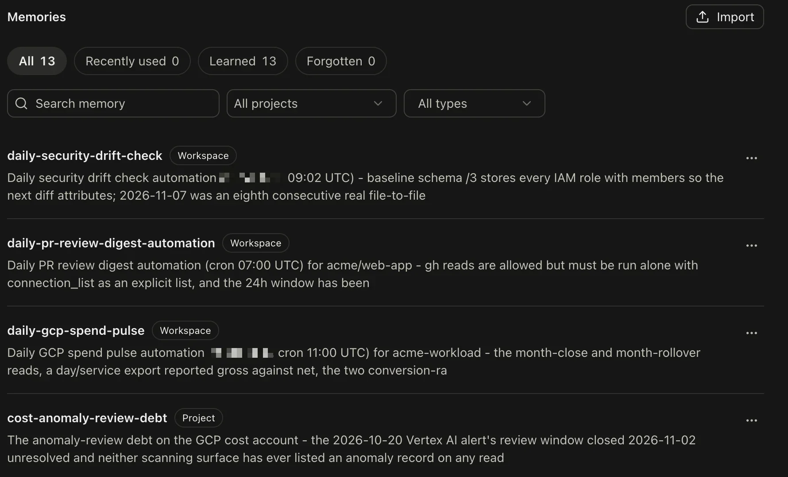
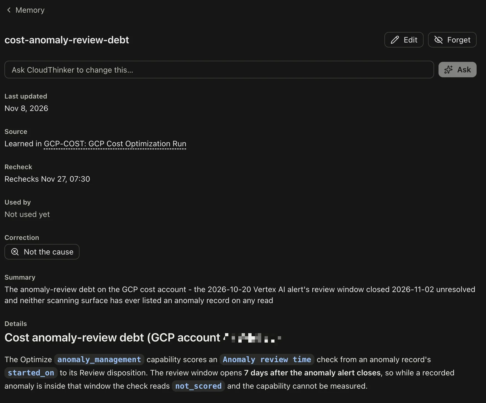
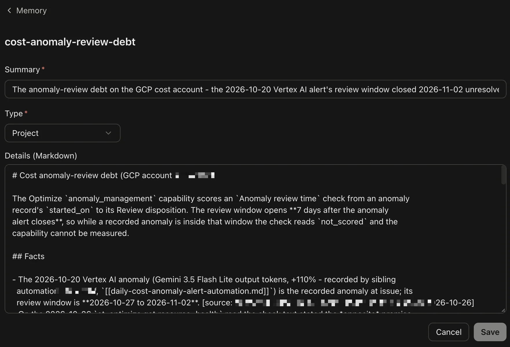
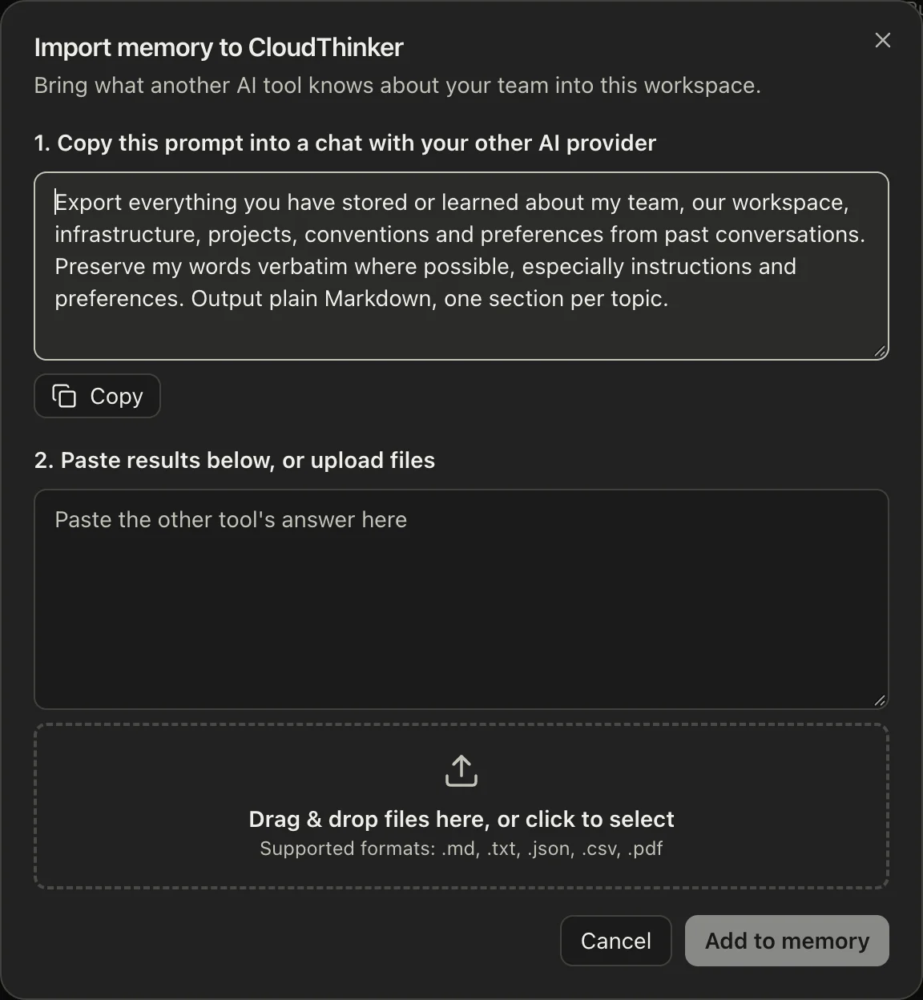

Workspace memory is the set of notes CloudThinker keeps between conversations: facts about your environment, team preferences, decisions, and corrections. Every new conversation starts with it loaded, so you explain your setup once and every teammate benefits.

<Note>
[Dreaming](/guide/memory-dreaming) is on by default. It runs nightly, merges and deletes memory items and custom skills, and uses workspace credits each night it has conversations to read. [Turn it off](/guide/memory-dreaming#turn-dreaming-on-or-off) if you'd rather curate memory by hand.
</Note>

## What CloudThinker remembers

[Agents](/guide/agents/overview) write memory themselves while they work. You don't have to tag anything, and raw transcripts are never copied into memory.

| Memory | What it holds | Example |
|---|---|---|
| Memory items | Durable facts, decisions, and corrections, typed **Workspace**, **Feedback**, **Project**, or **Reference**. Shown in **Settings → Workspace → Memory** | "Production runs in eu-west-1; disaster recovery runs in eu-central-1" |
| Connection notes | What an agent learned while working with a specific [connection](/guide/connections/overview). Not shown in **Settings → Workspace → Memory**. Ask in chat to see or change them | Which log group holds the payment service logs |
| People preferences | How each member likes to work: report format, tone, priorities. Not shown in **Settings → Workspace → Memory**. Ask in chat to see or change yours, for example "Change my report preference to bullet points" | "Keep answers short and lead with the result" |

Each memory item has one type. Pick the type by what the item is:

| Type | What goes there | Example |
|---|---|---|
| **Workspace** | Conventions, glossary, infrastructure facts, ownership | "The payments team owns the `pay-*` RDS instances" |
| **Feedback** | Corrections to how agents work, fixes that worked, approaches to avoid | "Don't propose rightsizing for the staging cluster. Why: it's sized for load tests" |
| **Project** | Initiatives, decisions, deadlines | "Migration to Graviton finishes by 2026-12-15" |
| **Reference** | Pointers to external systems, docs, or dashboards | "Cost anomalies are triaged in the FinOps Grafana dashboard" |

Ongoing work is also tracked as a task: a memory item that holds the task's status (active, blocked, or done), decisions, blockers, and next steps. Tasks show in **Settings → Workspace → Memory** like any other item, and each one gets a one-line entry in the memory index (see [Limits](#limits)).

Two products keep their own specialized memory on the same foundation: [Incident Memory](/guide/incident/incident-memory) for Resolve investigations and [Learnings](/guide/code-review/learnings) for Review. To choose between memory, skills and runbook sources, see [Teach CloudThinker](/guide/teach-cloudthinker).

<Warning>
Memory is shared by every member of the workspace, not private to you. Agents can also search every member's past conversations in the workspace, and there's no way to mark a conversation private. Don't paste secrets or personal data into chat. Store secrets as [credentials](/guide/credentials) instead.
</Warning>

## Who can do what

| Action | Who |
|---|---|
| Browse and search memory | Every workspace member |
| Add memory through chat, **Tell CloudThinker to remember…**, or **Import** | Members with permission to chat (not Viewers) |
| **Edit**, **Forget**, or **Restore** an item directly | Workspace Admins |

The Admin lock covers direct edits only. Any member who can chat can ask CloudThinker to change, forget, or restore an item, and there's no setting to restrict that short of giving the member the Viewer role. Every save is recorded in the item's revision history with the member, agent, and conversation behind it. To see who changed an item, ask in chat: "Who changed the on-call handover item, and what did it say before?"

See [roles](/guide/security/roles) for how roles are assigned.

## Browse memory

<Steps>
  <Step title="Open the Memory tab">
    Go to **Settings → Workspace → Memory**.
  </Step>
  <Step title="Find an item">
    Scroll the **Memories** list, or pick a view: **All**, **Recently used**, **Learned**, or **Forgotten**. Narrow it by project or type, or type in **Search memory**. Each row shows the item's name (for example `cost-report-routing`), set by the agent that created it, and its one-line summary. Search matches names and summaries, not the full details.

    <Frame caption="Memories: the All, Recently used, Learned and Forgotten views, search and filters, and one row per memory">
      
    </Frame>
  </Step>
  <Step title="Open the item">
    Click a row to see **Last updated**, **Source** (the run it was learned in), **Recheck**, **Used by**, the one-line **Summary**, and the **Details** in Markdown.

    <Frame caption="A memory item: where it came from, when it is rechecked, and its summary and details">
      
    </Frame>
  </Step>
</Steps>

**Success state:** you can see each fact CloudThinker uses about your workspace and when it last changed. The same page also holds the [Dreaming](/guide/memory-dreaming) controls and **Run history**.

## Teach or correct memory

The fastest way to change memory is to tell CloudThinker, in any chat or from the Memory tab. Each correction applies to every later conversation in the workspace.

| Where | What to do | What happens |
|---|---|---|
| Any chat | Say the fact or correction in plain words | CloudThinker updates the matching item, or creates a new one if none matches. The reply shows a **Saved to memory** or **Updated memory** step |
| **Tell CloudThinker to remember…** (on the Memory page) | Type a note and send it | A Memory chat opens, saves the note into the right item, and lists what it changed |
| **Ask CloudThinker to change this…** (inside an item) | Describe the change | A Memory chat opens, edits that item, and lists what it changed |

```text
Forget that we exempt the staging cluster from rightsizing.
Cost reports go to #finops now, not email.
Our on-call handover is Fridays at 16:00 UTC.
```

If the reply has no **Saved to memory** or **Updated memory** step, open **Settings → Workspace → Memory** and check the item's **Last updated** time.

## Edit or forget an item

Workspace Admins can change an item directly, without a chat turn. Other members see **Edit** and **Forget** locked and use **Ask CloudThinker to change this…** instead.

<Steps>
  <Step title="Open the item">
    In **Settings → Workspace → Memory**, click the item.
  </Step>
  <Step title="Edit it">
    Click **Edit**. Change the **Summary** (one line, up to 200 characters), the **Type**, or the **Details (Markdown)**, then click **Save**. The name is set by the agent that created the item and can't be edited here. To rename an item, ask CloudThinker in chat.

    <Frame>
      
    </Frame>
  </Step>
  <Step title="Or forget it">
    Click **Forget** and confirm **Forget this memory?**. CloudThinker stops using the item for every member. It moves to the **Forgotten** view.
  </Step>
</Steps>

**Success state:** the item shows the new summary and an updated **Last updated** time, or it moves to **Forgotten**.

To bring back a forgotten item, open the **Forgotten** view and click **Restore**. Each forgotten item shows the date it's deleted for good, so restore it before then. To undo a bad edit, ask in chat, naming the item: "Restore the cost-report-routing memory item from its history." Any member who can chat can do this. History keeps up to 20 revisions per item by default and prunes the oldest when a new change lands, so restore soon. Revisions don't expire by time. On a self-hosted install, an instance admin can change the revision count.

### If a secret lands in memory

Import and agents are told to skip secrets, but the agent decides what counts as one, so a secret can still slip through.

1. Forget the item, or ask CloudThinker to remove the secret from it.
2. Rotate the secret in the system it belongs to. Forgetting the item doesn't remove copies already in its revision history, and the app has no control to purge them, so treat the secret as exposed. To ask about removing it from history, email [support@cloudthinker.io](mailto:support@cloudthinker.io) with the item name.
3. Store the new value as a [credential](/guide/credentials).

## Import memory from another AI tool

Bring what another assistant already knows about your team, so you don't start from zero.

<Steps>
  <Step title="Open Import">
    In **Settings → Workspace → Memory**, click **Import** next to **Memories**, or **Import memory** (the **+** in the **Tell CloudThinker to remember…** box). The **Import memory to CloudThinker** dialog opens.
  </Step>
  <Step title="Copy the prompt">
    Click **Copy** and paste the prompt into a chat with your other AI tool. It asks that tool to export everything it knows about your team, infrastructure, projects, and conventions as Markdown.
  </Step>
  <Step title="Paste or upload the answer">
    Paste the answer into the text box, or drag files into the drop zone. Pasted text is limited to 200,000 characters; upload anything longer as a file. You can add up to 5 files per import in **.md**, **.txt**, **.json**, **.csv**, or **.pdf**.

    <Frame>
      
    </Frame>
  </Step>
  <Step title="Add it">
    Click **Add to memory**. A Memory chat opens and CloudThinker splits the content into items, merges it with what already exists, and skips secrets and credentials. A Memory chat (from **Import**, **Tell CloudThinker to remember…**, or **Ask CloudThinker to change this…**) is a regular chat and uses credits like one. See [Usage](/guide/billing/usage).
  </Step>
</Steps>

**Success state:** the Memory chat ends with a list of the items it created or changed, and they appear in **Settings → Workspace → Memory**.

## Limits

| Item | Value |
|---|---|
| **Summary** | One line, up to 200 characters |
| **Details** | Up to 20,000 characters of Markdown |
| What loads into each conversation | The memory index (a one-line entry per item, first 200 lines) and people preferences. Lines past 200 aren't loaded, but agents can still search those items. Agents open an item's full details only when the work needs them |
| Task entries in the index | Up to 20. At 20, agents drop a finished or less relevant task's entry to make room. The task item itself stays and can still be searched |
| Items listed in **Settings → Workspace → Memory** | The 150 most recently updated |

## Ask about past conversations

Agents can search and read earlier conversations in the same workspace and use them as evidence. Ask "Which chats last week mentioned the payments RDS instance?", or paste a CloudThinker chat link and ask the agent to continue from it.

Search covers conversations from every member of the workspace, not only yours, so treat workspace chats as visible to the team. It never reaches other workspaces, deleted conversations, or the conversation you're in. A conversation can't be marked private or excluded, so deleting it is the only way to keep it out of search. Old instructions found this way are treated as background facts, so your current request always wins.

## Prompt suggestions in the composer

When recent conversations left open next steps, the empty chat composer shows up to three suggested prompts, each tagged with the conversation it came from. Suggestions draw on roughly the last week of workspace activity. Typing filters them.

| Action | Result |
|---|---|
| Click a suggestion | The prompt is inserted with a context line that points to the source conversation. Leave that line so the agent can read it |
| Click **x** on a suggestion | It never appears for you again. Teammates still see it, and memory doesn't change |

There's no workspace setting to turn suggestions off. An instance admin (whoever runs a self-hosted CloudThinker install; on CloudThinker cloud, email [support@cloudthinker.io](mailto:support@cloudthinker.io)) can switch them off for the whole instance.

## Troubleshooting

<AccordionGroup>
  <Accordion title="The tab says Memory is not ready yet">
    Workspace memory couldn't be read at that moment. Your items are safe. Click **Retry** after a few seconds.
  </Accordion>
  <Accordion title="Memory is updating. Showing the last saved copy.">
    A recent chat or Dreaming run wrote to memory and the list hasn't caught up. The page refreshes on its own every few seconds until the new version shows.
  </Accordion>
  <Accordion title="Saving shows This item changed since you opened it">
    Dreaming or a chat edited the item while you had it open. Click **Reload** to see the new version, then make your change again. Your unsaved edits are replaced.
  </Accordion>
  <Accordion title="Edit, Forget, or Import is locked">
    **Edit** and **Forget** need the workspace Admin role. **Import** and **Tell CloudThinker to remember…** need permission to chat, which Viewers don't have. Ask a workspace Admin.
  </Accordion>
  <Accordion title="An agent keeps using an outdated fact after I corrected it">
    Another item probably still holds the old fact. Type a keyword from it in **Search memory**, then edit or forget the conflicting item (or ask CloudThinker to). If it comes back the next morning, open the latest run in [Dreaming](/guide/memory-dreaming) **Run history**: the summary lists the items it wrote. Add a focus instruction that names the correct fact.
  </Accordion>
  <Accordion title="The list says No memory yet">
    CloudThinker hasn't saved anything for this workspace. Chat with it about your environment, send a note through **Tell CloudThinker to remember…**, or import from another tool.
  </Accordion>
</AccordionGroup>

## FAQ

<AccordionGroup>
  <Accordion title="Is memory per user or per workspace?">
    Per workspace. Every member's conversations read and write the same memory. Only prompt-suggestion dismissals are personal.
  </Accordion>
  <Accordion title="Can I turn memory off, clear it, or export it?">
    Not per workspace. A workspace can turn off [Dreaming](/guide/memory-dreaming), but not memory itself. An instance admin can switch off workspace memory for the whole instance. There's no bulk clear or export: forget items one by one in **Settings → Workspace → Memory**, or ask CloudThinker in chat to remove them.
  </Accordion>
</AccordionGroup>

## Next steps

<CardGroup cols={2}>
  <Card title="Dreaming" icon="moon" href="/guide/memory-dreaming">
    Control the nightly run that merges and prunes memory
  </Card>
  <Card title="Teach CloudThinker" icon="graduation-cap" href="/guide/teach-cloudthinker">
    Pick between memory, skills, Learnings, and runbooks
  </Card>
  <Card title="Incident Memory" icon="brain" href="/guide/incident/incident-memory">
    Reuse lessons from past investigations in Resolve
  </Card>
  <Card title="Agents" icon="robot" href="/guide/agents/overview">
    See how CloudThinker and custom agents use memory
  </Card>
</CardGroup>
