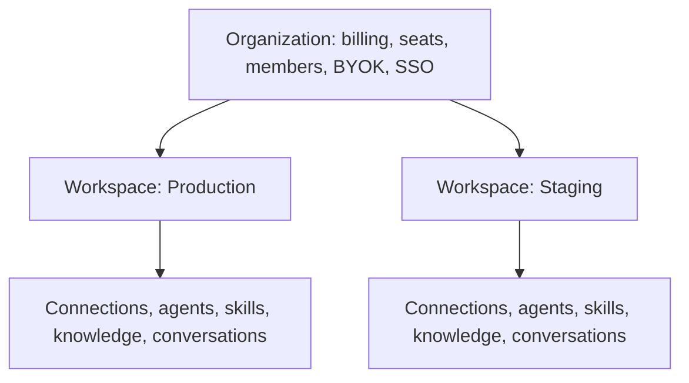

An organization is the top-level account in CloudThinker. It owns billing, seats, and the member list, and it contains one or more [workspaces](/guide/workspaces) where the actual work happens.

## How organizations and workspaces fit together

When you sign up, CloudThinker creates an organization named after you (for example, "Jane's Organization") and makes you its Owner. Onboarding then creates your first workspace inside it.

| Lives in the organization | Lives in each workspace |
|---|---|
| Plan, billing, and seats | [Connections](/guide/connections/overview) and [credentials](/guide/credentials) |
| Member list and organization roles | [Custom agents](/guide/agents/customize), [skills](/guide/skills/overview), and [knowledge](/guide/knowledge) |
| [BYOK](/guide/byok), [SSO and provisioning](/guide/security/sso), [audit logs](/guide/security/audit-logs) | Conversations, artifacts, and module data (Optimize, Review, Cyber, Resolve) |
| [Usage](/guide/billing/usage) and [credit limits](/guide/billing/credit-limits) | [Approvals](/guide/approvals/overview), [notifications](/guide/notifications), and workspace members |

## Prerequisites

- You're an organization **Owner** or **Admin**. Developers and Viewers don't see Admin Settings.

## Open Admin Settings

Organization controls live in **Admin Settings**, separate from the per-workspace Chat Settings.

<Steps>
  <Step title="Open the account menu">
    Click your avatar at the bottom of the sidebar. The menu lists your organizations on the left and the selected organization's workspaces on the right.
  </Step>
  <Step title="Open Admin settings">
    With your current organization selected, click **Admin settings**.

    **Success state:** the sidebar switches to the **Admin Settings** list, starting with **Organization** and **Workspaces**.
  </Step>
</Steps>

What each Admin Settings page is for, and who sees it:

| Page | Use it to | Visible to |
|---|---|---|
| **Organization** | Rename the organization, see seats and workspace count, manage members | Owner, Admin |
| **Workspaces** | Create, open, configure, and delete workspaces | Owner, Admin |
| **Billing** | Change plan, payment method, and seats | Owner |
| **Usage** | Track credit consumption | Owner, Admin |
| **BYOK** | Use your own LLM credentials | Owner |
| **Identity and access** | Domain verification, SSO, and provisioning (managing SSO is Owner-only) | Owner, Admin |
| **Audit Logs** | Review who changed what | Owner, Admin |

Some pages, such as **Credit limits**, **Guardrails**, and **Sandboxes**, show only when they're enabled for your organization.

## Rename your organization

<Steps>
  <Step title="Open the organization overview">
    Go to **Admin Settings → Organization**. The **Organization overview** shows **Organization name**, **Total seats**, and **Total workspaces**.
  </Step>
  <Step title="Edit the name">
    Click **Update** next to the name. In the **Organization Settings** dialog, change **Organization Name** and, optionally, **Description**.
  </Step>
  <Step title="Save">
    Click **Save Changes**.

    **Success state:** the new name shows in the overview and in the account menu.
  </Step>
</Steps>

## Invite members

<Steps>
  <Step title="Open the invite dialog">
    Go to **Admin Settings → Organization** and click **Invite Members** in the **Members** section. You can also click **Invite members** in the account menu.
  </Step>
  <Step title="Add email addresses">
    Type an address and press Enter or a comma to add it. You can invite up to 10 people at a time.
  </Step>
  <Step title="Choose a role">
    Pick **Admin**, **Developer**, or **Viewer** under **Role**. Developer is the default. You can't invite someone as Owner.
  </Step>
  <Step title="Pick workspaces for Developers and Viewers">
    Click **Select workspaces** and choose the workspaces they should join. Admins don't need this, because they get every workspace automatically.
  </Step>
  <Step title="Send">
    Click **Send Invitations**.

    **Success state:** each invitee appears in the invitations list with a status and an expiry date, and receives an invitation email.
  </Step>
</Steps>

<Warning>
If you invite a Developer or Viewer without selecting a workspace, they join the organization but can't open any workspace until you grant access. See [workspace members](/guide/workspace-users).
</Warning>

## Organization roles

Every member has one organization role. Owners and Admins are Admins in every workspace. Developers and Viewers only see the workspaces they're assigned to.

| Permission | Owner | Admin | Developer | Viewer |
|---|:---:|:---:|:---:|:---:|
| Edit organization name and description | ✓ | ✓ | | |
| Invite and remove members, change roles | ✓ | ✓ | | |
| Create and delete workspaces | ✓ | ✓ | | |
| Admin access to every workspace | ✓ | ✓ | | |
| View usage, set credit limits | ✓ | ✓ | | |
| Manage plan, billing, and seats | ✓ | | | |
| Configure BYOK and SSO | ✓ | | | |
| Work in assigned workspaces | ✓ | ✓ | ✓ | read-only |

You can raise or lower a Developer's or Viewer's role inside a single workspace. See [workspace roles](/guide/workspace-users#workspace-roles). "Member" is a legacy role name and works like Developer.

## Manage members and invitations

All of these live in **Admin Settings → Organization → Members**.

| Task | How |
|---|---|
| Change a member's role | Pick a new value in the **Role** dropdown on their row |
| Change which workspaces a Developer or Viewer can open | Click **Edit Workspace Access** on their row |
| Remove a member | Click **Remove Member** and confirm. They lose access to every workspace in the organization |
| Activate a member | Click **Activate Member** on a row with **Inactive** status |
| Resend or cancel an invitation | Open the actions menu on the invitation row, then click **Resend Invitation** or **Cancel Invitation** |

A member shows as **Inactive** when they were provisioned (for example, through SSO) while the organization had no free seat. Activating them uses a seat.

## Seats

On per-seat plans, each active member and each pending invitation holds a seat. **Total seats** in the organization overview shows how many you've bought and how many are free. The Owner can click **Manage** there to add seats. When every seat is used, the invite button shows **Seats full**. See [plans and pricing](/guide/billing/pricing).

## Leave an organization

Admins, Developers, and Viewers can leave from the account menu: select the organization, then click **Leave organization**. The Owner can't leave.

## Troubleshooting

<AccordionGroup>
  <Accordion title="I don't see Admin settings in the account menu">
    **Cause:** your organization role is Developer or Viewer, or you've selected an organization other than the one you're working in.

    **Fix:** select your current organization in the account menu. If it still doesn't appear, ask an Owner to make you an Admin.
  </Accordion>
  <Accordion title="The invite button says Seats full">
    **Cause:** active members plus pending invitations have used every seat.

    **Fix:** cancel invitations nobody will accept, remove members who left, or ask the Owner to add seats from **Total seats → Manage**.
  </Accordion>
  <Accordion title="I can't remove a member">
    **Cause:** one of these rules applies:

    - Admins can't remove other Admins or the Owner.
    - The organization Owner can't be removed.
    - Members provisioned through SCIM have to be removed in your identity provider. The error reads "This member was provisioned via SCIM."

    **Fix:** ask the Owner, or deprovision the user in your identity provider. See [SCIM](/guide/security/scim).
  </Accordion>
  <Accordion title="A new teammate signed in but sees no workspace">
    **Cause:** they're a Developer or Viewer with no workspace assigned.

    **Fix:** go to **Admin Settings → Organization**, click **Edit Workspace Access** on their row, select the workspaces, and click **Save**.
  </Accordion>
</AccordionGroup>

## Next steps

<CardGroup cols={2}>
  <Card title="Create workspaces" icon="building" href="/guide/workspaces">
    Split work by environment, team, or customer.
  </Card>
  <Card title="Manage workspace members" icon="users" href="/guide/workspace-users">
    Give people access to a workspace and set their role there.
  </Card>
  <Card title="Set up SSO" icon="key" href="/guide/security/sso">
    Let your team sign in with your identity provider.
  </Card>
  <Card title="Plans and pricing" icon="credit-card" href="/guide/billing/pricing">
    Compare plans, seats, and workspace limits.
  </Card>
</CardGroup>
