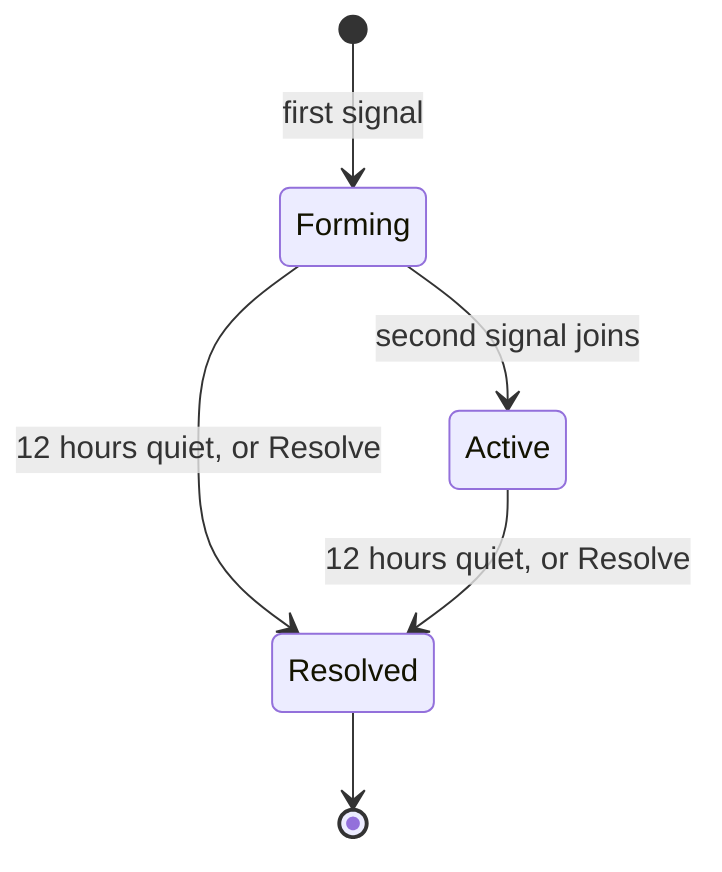

A **cluster** is a group of related signals that Pulse treats as one problem (a **signal** is an event that survived noise suppression), so a flapping alarm that fires 18 times becomes one item with 18 members. This page covers how clusters open and close, what Pulse drops before clustering, and what each action does. Every cluster action, including **Snooze**, needs the workspace **Admin** role. Developers and Viewers can read clusters but don't see the actions. See [Roles](/guide/security/roles).

## Cluster lifecycle

A cluster has three statuses. Only its own signals, or a person, move it.

A resolved cluster never reopens. The next matching signal starts a new cluster. The 12-hour rule reads only the cluster's own signals, so it closes routed clusters too.

| Status | Meaning |
|---|---|
| **Forming** | One signal so far. |
| **Active** | Two or more signals. |
| **Resolved** | No signal for 12 hours, or a person resolved it. This is the only closed status. |

**Routed is a lane, not a status.** A cluster is routed when an open incident holds it, and it stays Forming or Active underneath. Three rules follow:

- A new matching signal joins the routed cluster and updates the incident. It doesn't start a second investigation.
- Closing the incident doesn't close the cluster. If the same fault fires again, triage decides whether to reopen that incident or open a new one.
- Once the incident is closed, you can escalate the cluster again.

## How signals join a cluster

Pulse compares each new signal with signals from the last 6 hours whose cluster is still open. The first rule that matches decides where it goes:

1. **Same resource or same title.** The signals share a resource ID, or they share a title (letter case ignored). A shared title doesn't count when both signals carry different resource IDs: one alert name on two resources is two faults.
2. **Same service.** The signals share a **Service** value. Signals with no service, which show as `unknown`, and chat messages skip this rule. This rule ignores resource IDs, so two faults on different resources join when they name the same service.

If neither rule matches, the signal opens a new cluster in **Forming**. A resolved cluster never takes new signals.

The resource ID comes from **Resource ID Path**, or from a top-level `resource_id` key when no path is set. A CloudWatch alarm falls back to its alarm ARN when neither finds a value. The **Resource** field (a display name) isn't used. So, for a webhook source:

- Map **Resource ID Path** so repeats of one fault group even when their titles vary, and so the same alert on two resources stays apart.
- Map **Service Path** only to a value that names one service, such as `checkout-api`. A broad value like `prod` joins unrelated faults into one cluster.

## Noise suppression

Before a raw event becomes a signal, Pulse runs four checks in order. The first match drops it.

| Check | Drops | Exceptions |
|---|---|---|
| Dedup | An exact repeat: same source, event type, resource, title and severity, with a timestamp in the same minute as an earlier event. Pulse remembers each event for one hour to catch repeats. | None. |
| Rate limit | Events past 100 per minute from one source. The limit is fixed, not a setting. | Critical and high events always pass. |
| Snooze | Events matching a snooze someone set. | None. |
| Verdict | Repeats of a pattern CloudThinker learned is noise while investigating. The quiet window grows from 6 hours to 24 hours to 7 days. | Critical and high events always pass. |

The timestamp is the event's own time: for a webhook, the field **Timestamp Path** points to, or a top-level `timestamp` key when no path is set. When that field is missing or isn't a date Pulse can read, Pulse uses the time it received the event. For example, a tool that retries an alert 20 minutes later with its original timestamp is dropped as a duplicate. Two sends with no timestamp, a minute apart, are not.

Dedup counts each dropped repeat on the original signal. Rate limit, Snooze and Verdict keep the event, marked suppressed, instead of deleting it. Suppressed events don't join clusters. To see how many there are, hover the funnel at the top of **Resolve → Pulse**, which counts every raw event that arrived, or open **Resolve → Insights → Pulse analysis** for **Noise suppressed** and **Top noisy sources**. See [Pulse Analytics](/guide/pulse/analytics).

Learned Verdict patterns aren't listed anywhere you can edit. Three things end one early: a critical or high event with the same pattern, which passes and clears it; **Unsnooze** on a matching snoozed signal, which also clears it; or the quiet window running out, after 7 days at most.

After a signal joins its cluster, CloudThinker classifies it. A signal judged **Not actionable** doesn't send its cluster to triage, except IAM, SSO and KMS key lifecycle events, which are never dropped this way.

## Triage a cluster

<Steps>
  <Step title="Open the cluster">
    In **Resolve → Pulse**, start with the **Needs you** lane, then **Active**. Click a cluster to open its detail panel. It shows the **AI summary**, the **Cluster members** list, each signal's raw payload, and the suppression and enrichment steps each signal went through.
  </Step>
  <Step title="Acknowledge or assign it">
    Click **Acknowledge** to mark it seen. It takes the cluster out of **Needs you**, but the cluster stays open and new signals still join it. Click **Acknowledged** to undo. To give it an owner, click **Assign** and pick a teammate. Assigning doesn't notify the teammate, so tell them.

    **Success state:** the cluster leaves **Needs you**.
  </Step>
  <Step title="Hand it to an incident">
    Click **Escalate**, then **Send to triage**. Triage matches the cluster to an open incident, a closed one that's back, or a new one. To pick the incident yourself, use **Attach to incident...**. Open incidents are listed first, and picking a closed one reopens it.

    **Success state:** the cluster moves to the **Routed** lane.
  </Step>
  <Step title="Close it when fixed">
    Click the cluster's **Resolve** button, then confirm in **Resolve Cluster**. This can't be undone: if the fault fires again, a new matching signal opens a new cluster. A routed cluster hides **Escalate** and **Resolve**, because its incident owns it.
  </Step>
</Steps>

## Action reference

| Action | Where | Result |
|---|---|---|
| **Acknowledge** | Cluster panel | Marks the cluster seen and takes it out of **Needs you**. Stays open. |
| **Assign** | Cluster panel | Gives the cluster an owner. |
| **Escalate** | Cluster panel | Sends the cluster to triage. Hidden while an open incident holds it. |
| **Attach to incident...** | Cluster panel | Links the cluster to an incident you pick. Always available. On a cluster that's already routed, it adds a second link: the cluster stays with its first incident too. |
| **Resolve** | Cluster panel | Closes the cluster for good. Hidden while routed. |
| **Snooze** | **Snooze** button at the bottom of a signal's panel. It shows only on a signal row that isn't in a cluster, such as a suppressed signal. A cluster panel and its **Cluster members** list don't offer it. | Mutes matching signals for **1 hour**, **4 hours**, **1 day** or **Forever**. Click **Unsnooze** to undo. |

A snooze on a signal that names a resource mutes similar alerts on that resource only. Otherwise it mutes every alert with the same source and event type, so check the hint in the menu before you pick a duration. A **Forever** snooze never expires: matching alerts stay muted until someone clicks **Unsnooze** on that signal.

## Troubleshooting

<AccordionGroup>
  <Accordion title="Escalate and Resolve are missing">
    The cluster is routed: an open incident holds it. Work it from the incident, or close the incident first.
  </Accordion>
  <Accordion title="Triage didn't start after Escalate">
    The cluster panel shows **Queued for triage** or **Triage could not run**. If it couldn't run, click **Retry** next to that message. A failed triage also puts critical and high clusters back in **Needs you**.
  </Accordion>
  <Accordion title="An important alert never showed up">
    Check each cause in turn:

    - **Snooze:** someone muted that source or resource. Open a matching signal and click **Unsnooze**.
    - **Rate limit:** low and medium alerts past 100 a minute from one source are dropped during a burst.
    - **Verdict:** CloudThinker learned the pattern is noise. Low and medium repeats stay quiet for up to 7 days; see [Noise suppression](#noise-suppression) to clear it.
    - **Not actionable:** the alert arrived and clustered, but classification judged it not actionable, so it never went to triage. Look for its cluster in the **All** lane and click **Escalate**.

    Hover the funnel at the top of **Resolve → Pulse** to see whether events are being suppressed.
  </Accordion>
</AccordionGroup>

## Next steps

<CardGroup cols={2}>
  <Card title="Root cause analysis" icon="magnifying-glass" href="/guide/incident/root-cause-analysis">
    Follow a routed cluster into its investigation.
  </Card>
  <Card title="Pulse Analytics" icon="chart-line" href="/guide/pulse/analytics">
    See how much noise Pulse removes and how fast clusters close.
  </Card>
  <Card title="Connect Pulse sources" icon="plug" href="/guide/pulse/setup">
    Add more webhook, polling or chat sources.
  </Card>
  <Card title="On-call" icon="users" href="/guide/incident/oncall">
    Choose who gets brought in when an incident qualifies.
  </Card>
</CardGroup>
