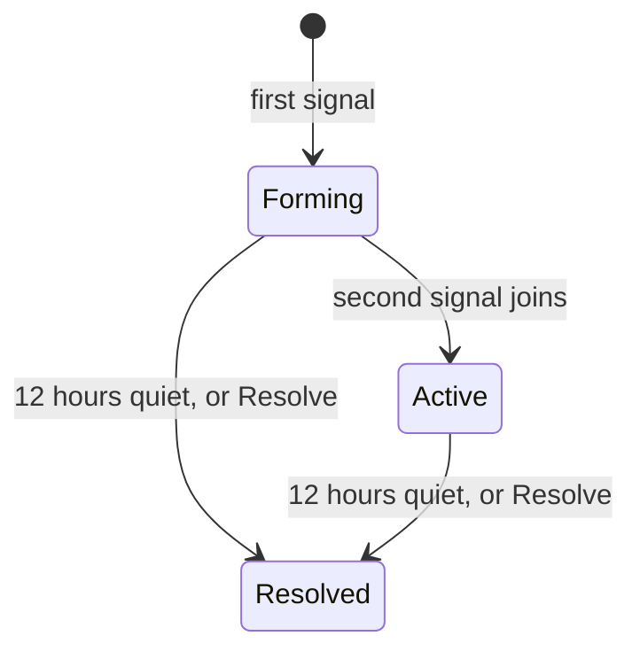

A cluster is a group of related signals that Pulse treats as one problem, so a flapping alarm that fires 18 times becomes one item with 18 members. This page covers how clusters open and close, what Pulse drops before clustering, and what each action does.

## Cluster lifecycle

A cluster has three statuses. Only its own signals, or a person, move it.

| Status | Meaning |
|---|---|
| **Forming** | One signal so far. |
| **Active** | Two or more signals. |
| **Resolved** | No signal for 12 hours, or a person resolved it. This is the only closed status. |

**Routed is a lane, not a status.** A cluster is routed when an open incident holds it, and it stays Forming or Active underneath. Three rules follow:

- A new matching signal joins the routed cluster and updates the incident. It doesn't start a second investigation.
- Closing the incident doesn't close the cluster. If the same fault fires again, triage decides whether to reopen that incident or open a new one.
- Once the incident is closed, you can escalate the cluster again.

## Noise suppression

Before a raw event becomes a signal, Pulse runs four checks in order. The first match drops it.

| Check | Drops | Exceptions |
|---|---|---|
| Dedup | Exact repeats of an event within one hour. | None. |
| Rate limit | Events past 100 per minute from one source. | Critical and high events always pass. |
| Snooze | Events matching a snooze someone set. | None. |
| Verdict | Repeats of a pattern CloudThinker learned is noise while investigating. The quiet window grows from 6 hours to 24 hours to 7 days. | Critical and high events always pass. |

Surviving signals are then classified. A signal the classifier judges **Not actionable** is suppressed too and doesn't reach triage, except IAM, SSO and KMS key lifecycle events, which are never dropped this way.

## Triage a cluster

<Steps>
  <Step title="Open the cluster">
    In **Resolve → Pulse**, start with the **Needs you** lane, then **Active**. Click a cluster to open its detail panel. It shows the **AI summary**, the **Cluster members** list, each signal's raw payload, and the suppression and enrichment steps each signal went through.
  </Step>
  <Step title="Acknowledge or assign it">
    Click **Acknowledge** to mark it seen. This silences alerts, but the cluster stays open; click again to undo. Use the assign control to pick a teammate.

    **Success state:** the cluster leaves **Needs you**.
  </Step>
  <Step title="Hand it to an incident">
    Click **Escalate**, then **Send to triage**. Triage matches the cluster to an open incident, a closed one that's back, or a new one, and opens its conversation. To pick the incident yourself, use **Attach to incident...**. Open incidents are listed first, and picking a closed one reopens it.

    **Success state:** the cluster moves to the **Routed** lane.
  </Step>
  <Step title="Close it when fixed">
    Click **Resolve**, then confirm in **Resolve Cluster**. This can't be undone. A routed cluster hides **Escalate** and **Resolve**, because its incident owns it.
  </Step>
</Steps>

## Action reference

| Action | Where | Result |
|---|---|---|
| **Acknowledge** | Cluster panel | Marks the cluster seen and silences its alerts. Stays open. |
| Assign | Cluster panel | Gives the cluster an owner. |
| **Escalate** | Cluster panel | Sends the cluster to triage. Hidden while an open incident holds it. |
| **Attach to incident...** | Cluster panel | Links the cluster to an incident you pick. Always available. |
| **Resolve** | Cluster panel | Closes the cluster for good. Hidden while routed. |
| **Snooze** | A signal in the panel | Mutes matching signals for **1 hour**, **4 hours**, **1 day** or **Forever**. Click **Unsnooze** to undo. |

A snooze on a signal that names a resource mutes similar alerts on that resource only. Otherwise it mutes every alert with the same source and event type, so check the hint in the menu before you pick a duration.

## Troubleshooting

<AccordionGroup>
  <Accordion title="Escalate and Resolve are missing">
    The cluster is routed: an open incident holds it. Work it from the incident, or close the incident first.
  </Accordion>
  <Accordion title="Triage didn't start after Escalate">
    A message says it couldn't start or is still queued. Open the cluster again and retry. A failed triage also puts critical and high clusters back in **Needs you**.
  </Accordion>
  <Accordion title="An important alert never showed up">
    Check for a snooze on that source or resource and click **Unsnooze**. Low and medium alerts can also be dropped by the rate limit during a burst.
  </Accordion>
</AccordionGroup>

## Next steps

<CardGroup cols={2}>
  <Card title="Root cause analysis" icon="magnifying-glass" href="/guide/incident/root-cause-analysis">
    Follow a routed cluster into its investigation.
  </Card>
  <Card title="Pulse Analytics" icon="chart-line" href="/guide/pulse/analytics">
    See how much noise Pulse removes and how fast clusters close.
  </Card>
  <Card title="Connect Pulse sources" icon="plug" href="/guide/pulse/setup">
    Add more webhook, polling or chat sources.
  </Card>
  <Card title="On-call" icon="users" href="/guide/incident/oncall">
    Choose who gets brought in when an incident qualifies.
  </Card>
</CardGroup>
