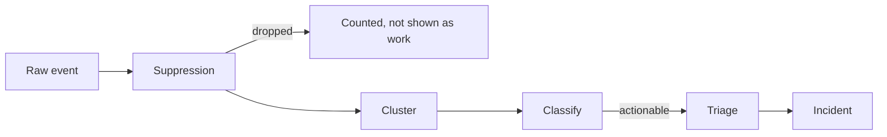

Pulse is the detection layer of [Resolve](/guide/incident/overview), CloudThinker's incident response module. It takes every alert your tools send, drops the noise, groups what's left into clusters, and passes only the actionable ones on to triage, so one outage shows up as one item instead of hundreds of pages.

## How it works

A **raw event** is one notification from a source, such as a CloudWatch alarm or a Datadog monitor. A **signal** is a raw event that survived noise suppression and was classified. A **cluster** is a group of related signals that Pulse treats as one problem.

1. **Ingest.** Events arrive from webhooks, polled AWS services (CloudTrail, AWS Health, AWS GuardDuty, AWS IAM Access Analyzer, AWS Config), and Slack or Microsoft Teams channels you choose.
2. **Suppress.** Four checks run in order, and the first match drops the event. See [noise suppression](/guide/pulse/clusters#noise-suppression).
3. **Cluster.** Pulse joins a signal to the open cluster for the same fault (same source, event type and resource) or to recent related signals from the same service.
4. **Classify.** CloudThinker reads the cluster and records a category, a severity and whether it is actionable.
5. **Triage.** An actionable cluster goes to triage. CloudThinker matches it to an open incident, reopens a closed incident when the same fault comes back, or opens a new one.

Pulse only groups. It never opens an incident by itself: triage, or a person, decides which incident a cluster belongs to.

<Note>
The **On duty** switch on **Resolve → Investigation** controls whether CloudThinker starts root cause analysis (RCA) on its own. When it's **Paused**, Pulse still detects and incidents are still filed as Open, but investigation waits until someone starts it. See [Settings](/guide/incident/settings).
</Note>

## Work from the Pulse page

Open **Resolve → Pulse**. The header shows the live funnel from raw events to clusters and a time window selector (**Last 1 hour** to **Last 30 days**). A row of lanes picks which clusters you see:

| Lane | What it shows | Use it to |
|---|---|---|
| **Needs you** | Critical or high clusters that are still forming, nobody has acknowledged or claimed, and no open incident holds. Also clusters whose triage failed and wait for a retry. | Start your shift here. |
| **Active** (default) | Clusters that have received more than one signal. | See everything currently in play. |
| **Forming** | Clusters with a single signal so far. | Spot new problems early. |
| **Routed** | Clusters held by an open incident, whatever their status. | Check what an incident already owns. |
| **Resolved** | Closed clusters. | Review what's done. |
| **All** | Every cluster in the time window. | Search history. |

Narrow any lane with the severity, source and category filters, or with **Search signals...**. Click a cluster to open its detail panel, where you can **Acknowledge**, assign it, **Escalate**, **Attach to incident...** or **Resolve** it. [Clusters](/guide/pulse/clusters) explains each action.

**Success state:** after you connect a source, the next alert from that source appears as a cluster in the **Forming** or **Active** lane.

## When Pulse is empty or quiet

| What you see | What it means | What to do |
|---|---|---|
| **No signals yet** with a **Connect a source** button | Nothing has reached this workspace. | Follow [Connect Pulse sources](/guide/pulse/setup). |
| **No signals yet** with a **Manage sources** button | A webhook exists, but no event has arrived. | Fire a test alert from the source tool. |
| "No new signals in ... your source may be down." | Nothing has arrived for at least an hour. | Click **Check sources** and look for a platform marked **Needs attention**. |
| **Nothing needs you** | No critical or high cluster waits on a person. | Switch to **Active**. Sources that emit mostly low or info alerts never fill **Needs you**. |

## Next steps

<CardGroup cols={2}>
  <Card title="Connect Pulse sources" icon="plug" href="/guide/pulse/setup">
    Send your first alerts into Pulse and confirm they arrive.
  </Card>
  <Card title="Work with clusters" icon="layer-group" href="/guide/pulse/clusters">
    Learn the cluster lifecycle, suppression and every cluster action.
  </Card>
  <Card title="Pulse Analytics" icon="chart-line" href="/guide/pulse/analytics">
    Measure how much noise Pulse removes and how fast clusters close.
  </Card>
  <Card title="Root cause analysis" icon="magnifying-glass" href="/guide/incident/root-cause-analysis">
    See what happens after triage opens an incident.
  </Card>
</CardGroup>
