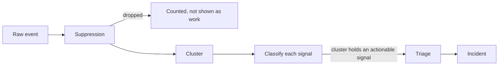

Pulse is the detection layer of [Resolve](/guide/incident/overview), CloudThinker's incident response module. It takes every alert your tools send, drops the noise, groups what's left into clusters, and passes only the actionable ones on to triage, so one outage shows up as one item instead of hundreds of pages.

## How it works

A **raw event** is one notification from a source, such as a CloudWatch alarm or a Datadog monitor. A **signal** is an event that survived noise suppression. A **cluster** is a group of related signals that Pulse treats as one problem.

1. **Ingest.** Events arrive from webhooks, polled AWS services, and Slack or Microsoft Teams channels you choose. Webhooks arrive as they're sent. Polled AWS services arrive on a schedule; [Connect Pulse sources](/guide/pulse/setup) lists the intervals.
2. **Suppress.** Four checks run in order, and the first match drops the event. See [noise suppression](/guide/pulse/clusters#noise-suppression).
3. **Cluster.** Pulse joins a signal to a recent open cluster that has a signal with the same resource ID or title, or failing that, the same service. [How signals join a cluster](/guide/pulse/clusters#how-signals-join-a-cluster) has the full rule.
4. **Classify.** After a signal joins its cluster, CloudThinker classifies that signal: a category (compute, network, security, deploy, communication, cost or data, the same values as the category filter), a severity and whether it's actionable.
5. **Triage.** A cluster that holds an actionable signal goes to triage. CloudThinker matches it to an open incident, reopens a closed incident when the same fault comes back, or opens a new one.

Pulse only groups. It never opens an incident by itself: triage, or a person, decides which incident a cluster belongs to.

Pulse keeps detecting and grouping alerts whether the **On duty** switch in the **Resolve → Investigation** header is on or **Paused**. While it's **Paused**, automatic triage and investigation are held until **On duty** is back on, so clusters don't become incidents on their own. **Send to triage** still runs when a person clicks it. [What starts an investigation](/guide/incident/settings#what-starts-an-investigation) has the full rules.

## Work from the Pulse page

Open **Resolve → Pulse**. The header shows the live funnel from raw events to clusters and a time window selector (**Last 1 hour** to **Last 30 days**). The window applies to every lane, **Needs you** included: a cluster shows only if it has a signal inside the window, so widen it to find an older cluster nobody handled. A row of lanes picks which clusters you see:

| Lane | What it shows | Use it to |
|---|---|---|
| **Needs you** | Critical or high clusters that wait on a person (see below). | Start your shift here. |
| **Active** (default) | Clusters in **Active** status: more than one signal. | See everything currently in play. |
| **Forming** | Clusters in **Forming** status: a single signal so far. | Spot new problems early. |
| **Routed** | Clusters held by an open incident, whatever their status. | Check what an incident already owns. |
| **Resolved** | Closed clusters. | Review what's done. |
| **All** | Every cluster in the time window. | Search history. |

A critical or high cluster is in **Needs you** when either is true:

- It's in **Forming** status, nobody has acknowledged or claimed it, and no open incident holds it.
- Its triage failed and waits for **Retry**.

Lanes overlap. A routed cluster also shows in **Active** or **Forming** by its status, and a cluster that's in **Needs you** because nobody has picked it up also shows in **Forming**. One there because its triage failed can be **Active** instead.

Narrow any lane with the severity, source and category filters, or with **Search signals...**. Click a cluster to open its detail panel, where you can **Acknowledge**, assign it, **Escalate**, **Attach to incident...** or **Resolve** it. [Clusters](/guide/pulse/clusters) explains each action.

To check a new source works, follow [Send a test alert](/guide/pulse/setup#connect-a-source) on the setup page.

## When Pulse is empty or quiet

| What you see | What it means | What to do |
|---|---|---|
| **No signals yet** with a **Connect a source** button | Nothing has reached this workspace. | Follow [Connect Pulse sources](/guide/pulse/setup). |
| **No signals yet** with a **Manage sources** button | A webhook exists, but no event has arrived. | Fire a test alert from the source tool. |
| A banner such as **No new signals in 2h**, saying your source may be down | Nothing has arrived for more than an hour. The banner shows how long it's been. | Click **Check sources** and look for a platform marked **Needs attention**. |
| **Nothing needs you** | No critical or high cluster waits on a person. | Switch to **Active**. Sources that emit mostly low or info alerts never fill **Needs you**. |

## Next steps

<CardGroup cols={2}>
  <Card title="Connect Pulse sources" icon="plug" href="/guide/pulse/setup">
    Send your first alerts into Pulse and confirm they arrive.
  </Card>
  <Card title="Work with clusters" icon="layer-group" href="/guide/pulse/clusters">
    Learn the cluster lifecycle, suppression and every cluster action.
  </Card>
  <Card title="Pulse Analytics" icon="chart-line" href="/guide/pulse/analytics">
    Measure how much noise Pulse removes and how fast clusters close.
  </Card>
  <Card title="Root cause analysis" icon="magnifying-glass" href="/guide/incident/root-cause-analysis">
    See what happens after triage opens an incident.
  </Card>
</CardGroup>
