Code Audit reads the source code of one repository branch or tag, flags suspect code, investigates it, and verifies each candidate before it reports a finding. Its findings stay separate from [Pentest apps and findings](/guide/security/security-testing).

## Prerequisites

- A [connected Git provider](/guide/connections/overview) with access to the repository: GitHub, GitLab, Bitbucket, Azure DevOps, or AWS CodeCommit.
- Permission to audit that source. You don't need an app, a URL, DNS proof, or a test login.
- The right workspace role. See [Roles](/guide/security/roles).

| Task | Admin | Developer | Viewer |
| --- | --- | --- | --- |
| Monitor a branch, set its schedule, delete a repository | ✓ | | |
| Audit a tag once, **Audit now**, stop or resume a run, verify fixes | ✓ | ✓ | |
| Triage findings, **Open fix pull request** | ✓ | ✓ | |
| Read audits, findings, libraries, and reports | ✓ | ✓ | ✓ |

## How an audit works

<Frame caption="One audit pins a commit, scans and reviews it in parallel, verifies, then publishes">
  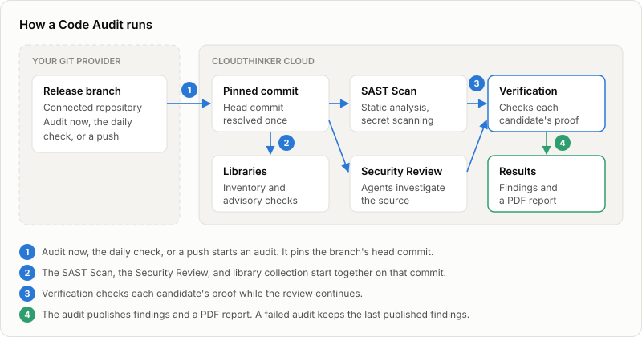
  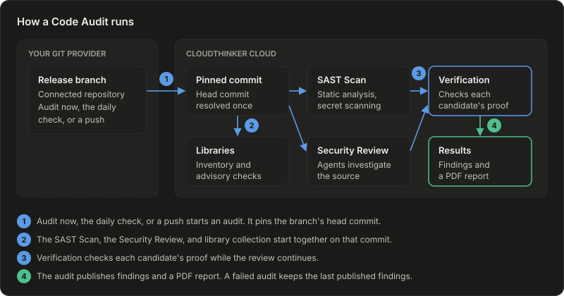
</Frame>

1. **Audit now**, the daily check, or a push starts an audit. It pins the branch's head commit, so a push during the run doesn't change what it reads.
2. The **SAST Scan** finds suspect code and exposed secrets with static analysis. The **Security Review** has agents investigate the source in depth. Code Audit also collects the branch's [libraries](/guide/security/cyber-libraries).
3. Verification checks each candidate's proof while the review continues.
4. The audit publishes its findings and a PDF report. A failed audit keeps the last published findings.

## Start monitoring a repository

<Steps>
  <Step title="Choose the repository and branch">
    Open **Cyber**, click **Code Audit** in the sidebar, then click **Audit repository**. Before your first audit, click **Run a Code Audit** instead.

    Under **1. Choose release source**, select the repository, then pick the branch you ship. Pick a tag to audit one release once.

    <Frame caption="The Source step with a repository selected and its release branch">
      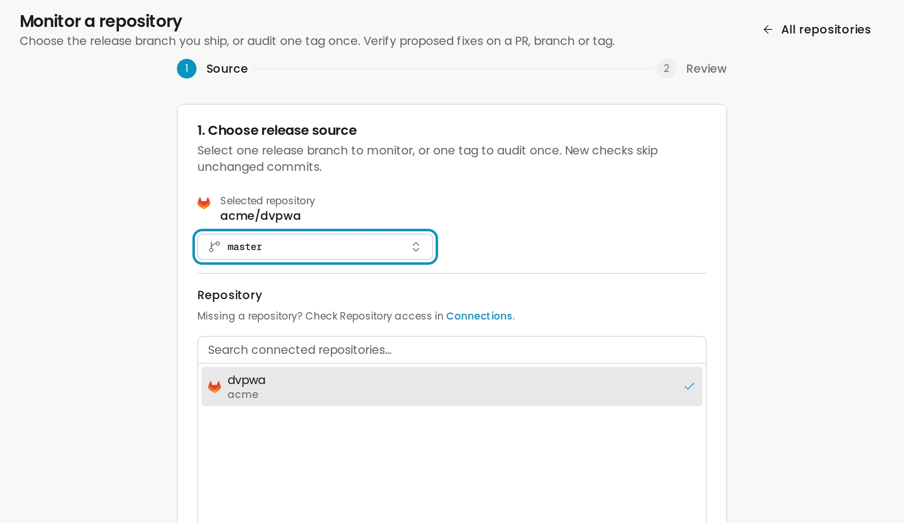
    </Frame>

    You can also open **Review → Settings → Repositories**, then choose **Run Code Audit** from a repository's actions menu. The repository is preselected, with its default branch.
  </Step>
  <Step title="Review and start">
    Click **Review audit**. Check the repository, the release branch, and the daily check time, then click **Start monitoring**. For a tag, the button is **Audit tag**.

    <Frame caption="The Review step for a release branch">
      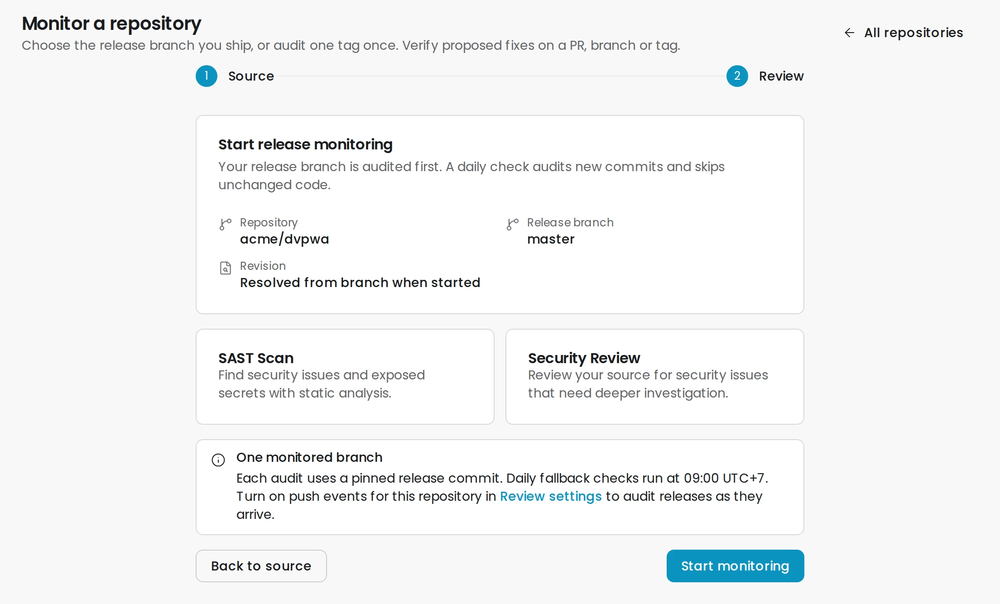
    </Frame>

    **Success state:** the repository's **Runs** tab opens on the new run. Each repository monitors one release branch.
  </Step>
</Steps>

Monitoring a branch also creates its daily audit at 09:00 UTC+7. Push audits turn on when the repository is set up in [Review](/guide/code-review/setup). A Developer can audit a tag but can't start monitoring a branch.

## Follow a run

The **Runs** tab lists every run under **Run history**. Select a run to see its **Timeline**, **Libraries**, and **Report**.

<Frame caption="A run in progress: SAST complete, Security Review running">
  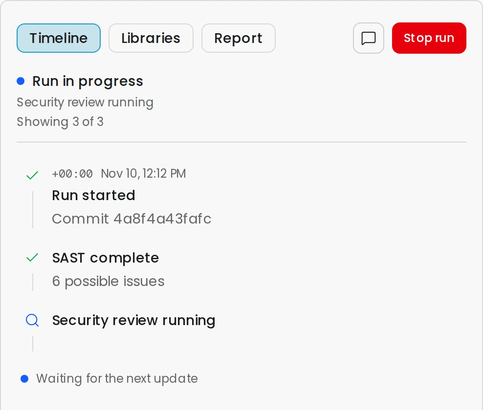
</Frame>

- **Stop run** ends the run. A stopped run can't be resumed; start a new audit instead.
- An incomplete or failed run offers **Restart audit**, **Resume saved work**, or **Resume audit**. Each continues at the same commit and keeps finished work. **Resume audit** first asks for more attempts and a higher credit limit for that run; your workspace credits still apply.
- The conversation icon opens the agent conversation behind the run.

When a run ends, you get a **Code Audit complete**, **Code Audit progress saved**, or **Code Audit needs attention** notification. A failed run also sends you an email.

## Read the results

The repository's **Overview** tab shows open findings by severity, the top release findings, and recent runs.

<Frame caption="Release findings on the repository Overview tab (sample data)">
  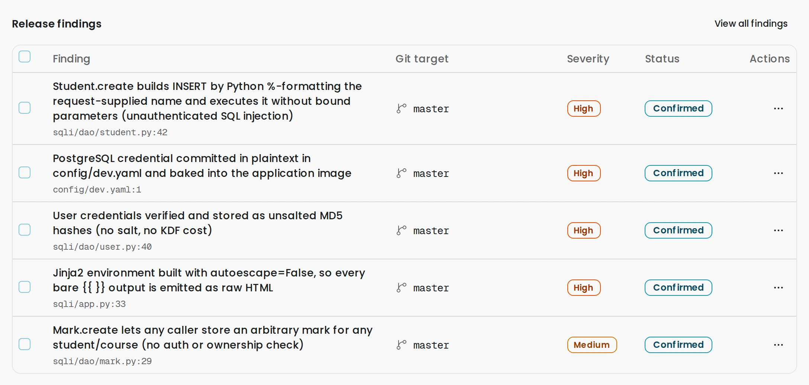
</Frame>

Every finding has one status:

| Status | Meaning |
| --- | --- |
| **Confirmed** | Verification found proof of the problem in the audited commit |
| **Needs verification** | Verification is pending, blocked, or inconclusive. Treat it as unresolved |
| **Fixed** | A later audit no longer detects it, or a fix check proved the repair |
| **Dismissed** | Someone dismissed it with a reason |

Candidates that verification refutes become false positives. Lists, boards, counts, and the PDF report leave them out.

Open a finding to read its **Description**, the agent's assessment, the **Source trace**, the **Source evidence**, and the **Verification** record. **Confidence** is the audit agent's confidence in the assessment, not a probability that the problem can be exploited.

<Frame caption="A confirmed finding with its description and summary (sample data)">
  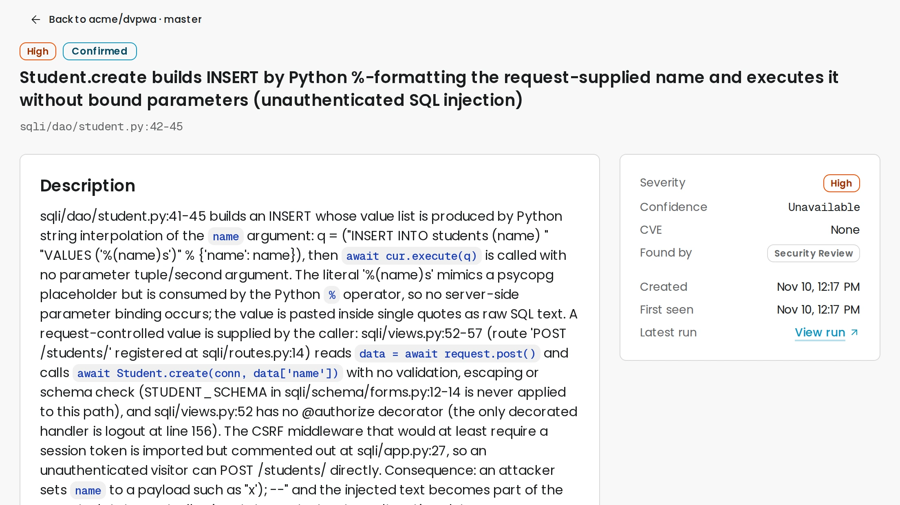
</Frame>

Proof in source code doesn't prove the problem is reachable in your running app. A [Pentest](/guide/security/security-testing) tests that.

## Triage findings

The **Findings** tab has **Open**, **Fixed**, and **All** tabs. Filter by severity or by branch and tag under **Git target**. Switch between **Table** and **Kanban**.

<Frame caption="Who moves a finding between statuses">
  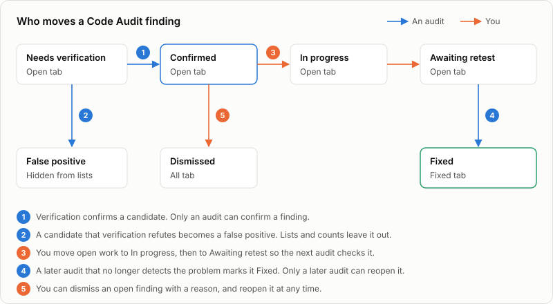
  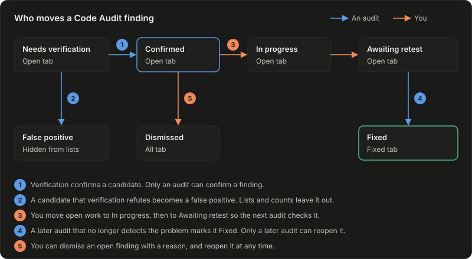
</Frame>

1. Only verification confirms a finding. You can't drag one into **Confirmed**.
2. A refuted candidate becomes a false positive and leaves the lists.
3. Drag open work to **In progress**, then to **Awaiting retest** so the next audit checks it.
4. A later audit that no longer detects the problem marks it **Fixed**. You can also choose **Mark as fixed** on the finding.
5. **Dismiss** asks for a reason. **Reopen** brings a dismissed finding back.

<Frame caption="The Kanban view of the Findings tab (sample data)">
  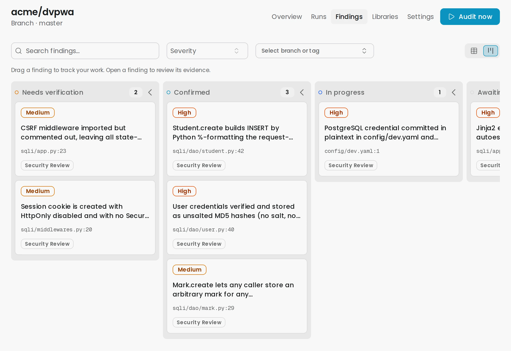
</Frame>

For the shared workflow across Cyber, see [Triage security findings](/guide/security/cyber-findings).

## Fix and verify

Click **Open fix pull request** on a confirmed finding. CloudThinker opens a chat that works on the branch's current code, commits a fix, and opens a pull request for you to review. **Open conversation** returns to that chat.

A fix pull request doesn't change the finding. Merge it, then let the next audit check it, or verify the fix first:

<Steps>
  <Step title="Select the findings">
    On the **Overview** tab, select up to 20 release findings and click **Verify fixes**. For one finding, choose **Verify fix** from its menu on the **Findings** tab.
  </Step>
  <Step title="Choose the target">
    Under **Verify against**, pick the pull request, branch, or tag that carries the fix, then click **Verify fixes**.

    **Success state:** each finding shows **Fix verified**, **Still detected**, or **Unable to verify**.
  </Step>
</Steps>

A fix check uses credits. It never closes a release finding; the next release audit does.

## Keep the branch audited

Open the repository's **Settings** tab. Under **Automatic audit**, click **Set up schedule** or **Manage schedule**.

<Frame caption="The repository Settings tab">
  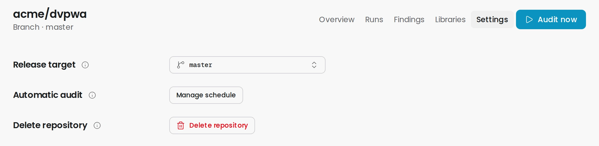
</Frame>

- **Repeat** sets a daily, weekly, or monthly time in your browser's timezone. A saved schedule opens as an [Automation](/guide/automation/automations).
- **Also audit after commits are pushed to this branch** runs one audit for each burst of pushes, once the branch goes quiet.
- An audit skips a commit that has already been audited.

**Audit now** in the repository header asks you to confirm, then audits the branch. The **Run audit** button on the **Code Audit** list lets you choose **Incremental** or **Full** per branch. Incremental audits what changed; Full rescans the whole branch and takes more time and credits.

Code Audit runs a full scan on its own for the first audit, after seven days, and when the scanner settings or the branch history change.

## Download the report

Open a finished run and select **Report**. Each run saves a PDF of its confirmed, needs-verification, and fixed findings. Choose a **Part** when a large report is split, then click **Download report**. If the PDF failed, click **Retry PDF**.

## Delete a repository

On the **Settings** tab, click **Delete repository**. Code Audit permanently deletes the repository's branches, audits, findings, evidence, library results, and audit conversations. Your source repository, your Review setup, and separate fix chats stay. Adding the repository again starts with no history.

You can't delete a repository while an audit runs.

## Troubleshooting

For every Cyber problem in one place, see [Cyber troubleshooting](/guide/security/cyber-troubleshooting).

<AccordionGroup>
  <Accordion title="The repository is missing from the Source step">
    Check the repository's access in Connections; the Source step links there. A repository set up for Review isn't added to Code Audit until you select it here.
  </Accordion>
  <Accordion title="Monitoring a branch needs schedule edit permission">
    Monitoring a branch also creates its schedule, which needs the Admin role. Ask an Admin to start it, or choose a tag to audit it once.
  </Accordion>
  <Accordion title="The audit failed but old findings are still visible">
    A failed audit never replaces the last published findings. Read the run's timeline for the cause, then use the run's restart or resume button, or click **Audit now**.
  </Accordion>
  <Accordion title="Audit may be stuck">
    The run hasn't reported progress for a while. Open its conversation to see what the agent is doing, or stop the run and start a new audit.
  </Accordion>
  <Accordion title="A merged fix hasn't changed the finding">
    A finding changes only when a later audit checks the fix. Click **Audit now**, or use **Verify fix** against the branch.
  </Accordion>
</AccordionGroup>

## Next steps

<CardGroup cols={2}>
  <Card title="Monitor library vulnerabilities" icon="cubes" href="/guide/security/cyber-libraries">
    Read dependency advisories and their impact on your code
  </Card>
  <Card title="Run a security test" icon="crosshairs" href="/guide/security/security-testing">
    Test the running application and collect runtime proof
  </Card>
  <Card title="Connections" icon="plug" href="/guide/connections/overview">
    Manage the repository access Code Audit uses
  </Card>
</CardGroup>
