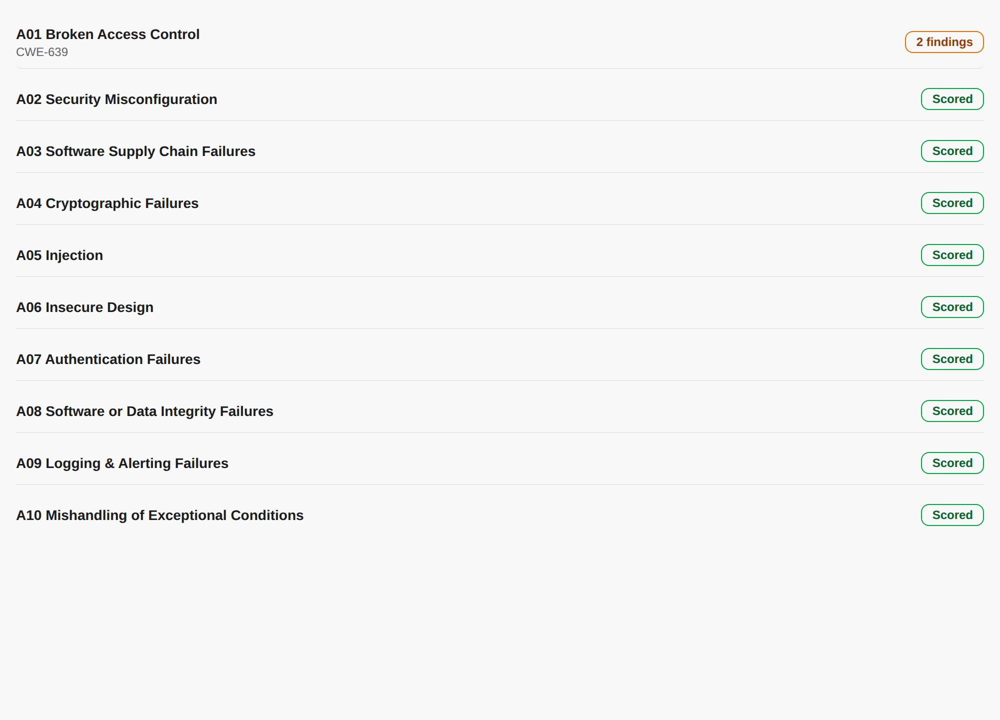
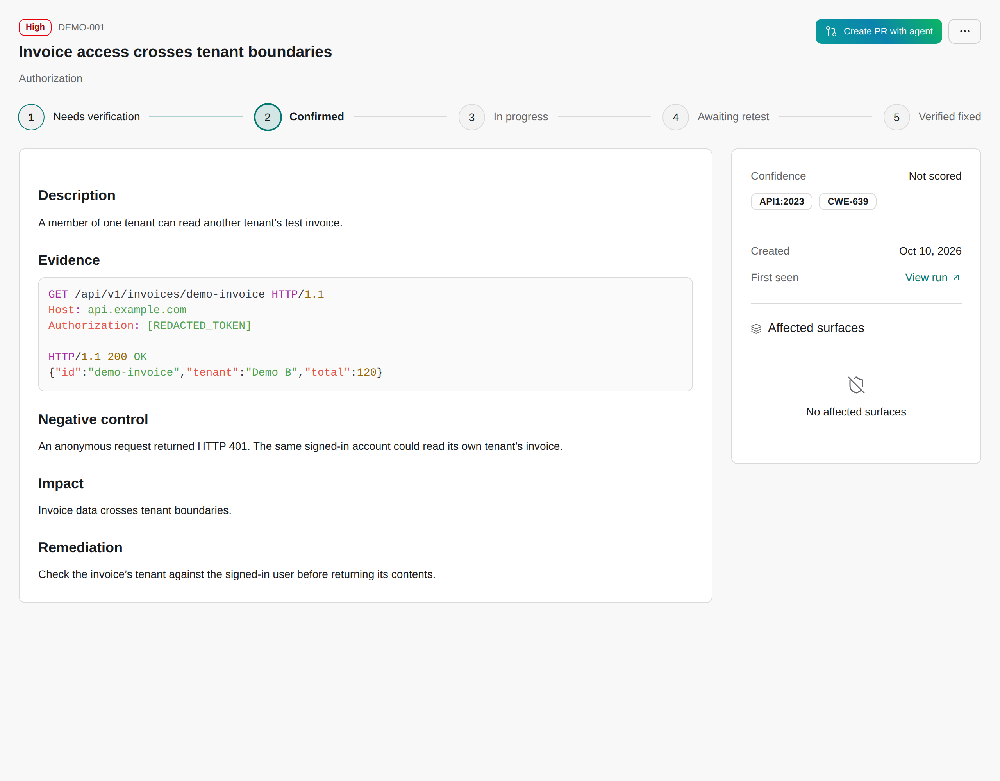

An issue is one security problem a [pentest run](/guide/security/security-testing) verified against your running app, saved with the requests, responses, and screenshots that show it. Each app keeps one living issues list across all its runs, so a later scan updates the same issue instead of filing a duplicate.

## Prerequisites

- A Cyber app with at least one completed run. See [Run a security test](/guide/security/security-testing).
- The workspace **Admin** or **Developer** role to triage, dismiss, or reopen issues. Viewers can browse, copy, and download them. See [Roles](/guide/security/roles).

## Where issues live

Cyber calls each finding an **issue**. The **Issues** tab at the top of Cyber lists every app and repository together. Each app also has its own **Issues** tab: open the app from **Pentest apps**, and its header shows these tabs:

| Tab | What you use it for |
| --- | --- |
| **Overview** | The app's current verdict, issue counts per severity, and a fix queue of open issues |
| **Runs** | Each run's timeline and report, and what it added, fixed, or left open |
| **Issues** | The full working list of the app's issues, with **Export** |
| **Settings** | Scope, test logins, source context, defaults, schedule, and report settings |

On **Issues**, status tabs split the list. Filter with **Search issues**, **Priority** (Critical, High, Medium, Low, Info), and **Weakness**. The Cyber-wide list adds **Target**.

| Tab | Shows issues that are |
| --- | --- |
| **Open** | Not yet closed |
| **Needs verification** | Leads Cyber couldn't prove yet (status **To verify**) |
| **Confirmed** | Proven by Cyber |
| **In progress** | Picked up by your team |
| **Awaiting retest** | Waiting for a scan to check the fix |
| **Fixed** | Fixed, whether a scan verified it or you marked it fixed |
| **Snoozed** | Set aside with **Remind me later…** until a date you chose |
| **All** | Everything, including **Dismissed** issues, which have no tab of their own |

The app's **Overview** breaks issues down by OWASP category:

<Frame>
  
</Frame>

## Who decides what

Two parties own different parts of an issue. Knowing which is which explains every rule on this page.

| Decision | Owner | How it changes |
| --- | --- | --- |
| Is it real, still present, or proven fixed? | CloudThinker | A scan replays the proof. Only a scan can reopen a fix a scan proved |
| Where is it in your team's work? | You | You move it between **Needs you**, **In progress**, and **Awaiting retest**, or mark it fixed, snooze it, or dismiss it yourself |

A **Needs verification** issue is a lead, not yet proven. Move it to **Awaiting retest** so the next scan checks it. If you've already reproduced it, click its status on the **Issues** list and choose **Confirm issue**.

## Read an issue's proof

Open an issue to see its description, proof flow, evidence, impact, and remediation.

<Frame>
  
</Frame>

| Evidence | What it shows |
| --- | --- |
| **HTTP captures** | The captured requests and responses that prove the problem. Secrets appear as redacted placeholders |
| **Screenshots** | Pages captured when the problem depends on what the browser renders. API-only issues don't need them |
| **Affected** | The routes or endpoints where the problem was found |

To check the proof yourself, replay the request with your own test credentials in place of the placeholders.

Severity is CloudThinker's rating on a Critical to Info scale. Issues don't carry a CVSS score. Each one also shows its **Weakness** category.

## Move an issue through your workflow

The issue page shows a lifecycle stepper: **Needs you**, **In progress**, **Awaiting retest**, **Verified fixed**. Click a stage to move the issue there. On the **Issues** list, click the issue's status to get the same moves.

<Steps>
  <Step title="Pick up the issue">
    Open a **Confirmed** issue and click **In progress** on the stepper.

    **Success state:** it moves to **In progress**.
  </Step>
  <Step title="Fix it">
    Click **Open PR** to open a chat where CloudThinker prepares a fix as a pull request, or fix it your own way. On an issue that still needs you, **Open PR** also moves it to **In progress**. The chat works on the repositories attached to the app, so attach one first if there's none (see [Connect a Git provider](/guide/connections/github)). Review and test any proposed change before you merge it. Once a PR is linked, **View fix PR** opens it.
  </Step>
  <Step title="Ask for a retest">
    After the fix ships, click **Awaiting retest** on the stepper.

    **Success state:** the issue sits in **Awaiting retest**. This doesn't start a scan.
  </Step>
  <Step title="Let the next scan settle it">
    Run the pentest again, or wait for its schedule. A scheduled run signs in only with a **Long-lived token** test user, so for an issue behind the login, run it manually unless the app has one. If the proof no longer works, the scan moves the issue to **Verified fixed**. You can't pick that stage yourself. If the proof still works, the issue stays open.
  </Step>
</Steps>

To ask about an issue, click **Ask Cyber** in its header. A chat opens beside the issue. Under **More**, **Verify Issue…** asks CloudThinker to replay the proof against your live app right away, without starting a full pentest, and to report whether the issue still reproduces. It uses credits like any chat. See [Usage](/guide/billing/usage).

## Dismiss an issue

<Steps>
  <Step title="Open the dismiss dialog">
    On the **Issues** list, click the issue's status, then **Dismiss…**.
  </Step>
  <Step title="Pick a reason">
    In **Dismiss this issue**, choose a **Reason**: **False positive** (not a real vulnerability), **Acceptable risk** (real, but you accept it), or **Out of scope** (not yours to fix). Add a **Note (optional)** on what you checked, so the next reviewer doesn't redo it.
  </Step>
  <Step title="Confirm">
    Click **Dismiss issue**.

    **Success state:** the issue moves to **Dismissed**, and later scans stop raising it.
  </Step>
</Steps>

A dismissal isn't final. Reopen it from its status on the **Issues** list, or with **Reopen issue** under **More** on the issue page, and CloudThinker tests for it again.

## Snooze an issue

To fix an issue later, choose **Remind me later…** from its status on the **Issues** list or under **More** on the issue page. Pick a date under **Remind me in**, add an optional note, and confirm. The issue moves to **Snoozed** until that date.

## Mark fixed or reopen

- **Fixed…** in the issue's status menu closes an issue you've remediated without waiting for a scan. It asks you to confirm, because nothing proves the fix. The next scan can still reopen it.
- **Reopen issue** appears on anything you dismissed or marked fixed. It returns the issue to your open work.
- An issue CloudThinker verified as fixed can only be reopened by a scan that proves it's back.

## Share a single issue

Under **More** on the issue page, **Copy as Markdown** copies it for a ticket or chat, and **Download Markdown** saves it as a file. To share several issues in one document, use **Export** on the **Issues** list. See [Create Cyber reports](/guide/security/cyber-reports).

## Troubleshooting

For every Cyber problem in one place, see [Cyber troubleshooting](/guide/security/cyber-troubleshooting).

<AccordionGroup>
  <Accordion title="A stage on the stepper can't be clicked">
    You can move only **Confirmed** and **Needs verification** issues. **Verified fixed** is never a button: only a passing retest sets it. A dismissed issue shows its status instead of the stepper.
  </Accordion>
  <Accordion title="I can't triage, dismiss, or reopen anything">
    You have the Viewer role. Ask a workspace admin for the Developer role. You can still copy and download issues.
  </Accordion>
  <Accordion title="I dismissed an issue by mistake">
    Open it and choose **Reopen issue** under **More**, or reopen it from its status on the **Issues** list. CloudThinker includes it in scans again.
  </Accordion>
  <Accordion title="A fixed issue came back">
    A later scan proved the problem again. Open the app's **Runs** tab to see which run reopened it, then open the issue for the new evidence.
  </Accordion>
  <Accordion title="Awaiting retest never clears">
    Moving an issue to **Awaiting retest** doesn't start a scan. Click **Run pentest** in the app header, or check that a schedule is on in **Settings**. A schedule can't recheck an issue behind the login unless the app has a **Long-lived token** test user, so run those manually.
  </Accordion>
</AccordionGroup>

## Next steps

<CardGroup cols={2}>
  <Card title="Create Cyber reports" icon="file-lines" href="/guide/security/cyber-reports">
    Export issues or download a run's full report
  </Card>
  <Card title="Run a security test" icon="crosshairs" href="/guide/security/security-testing">
    Run or schedule the scans that verify your fixes
  </Card>
</CardGroup>
