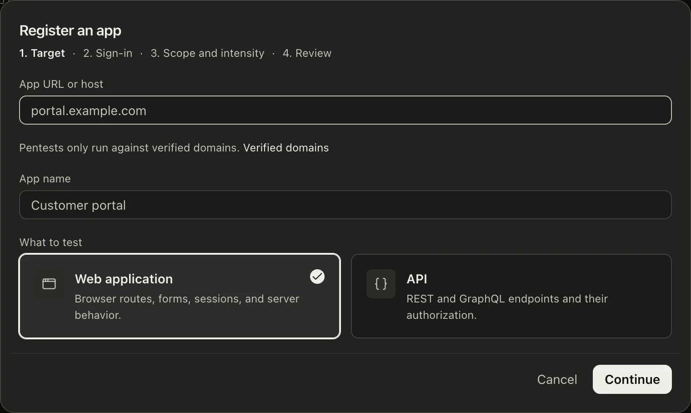
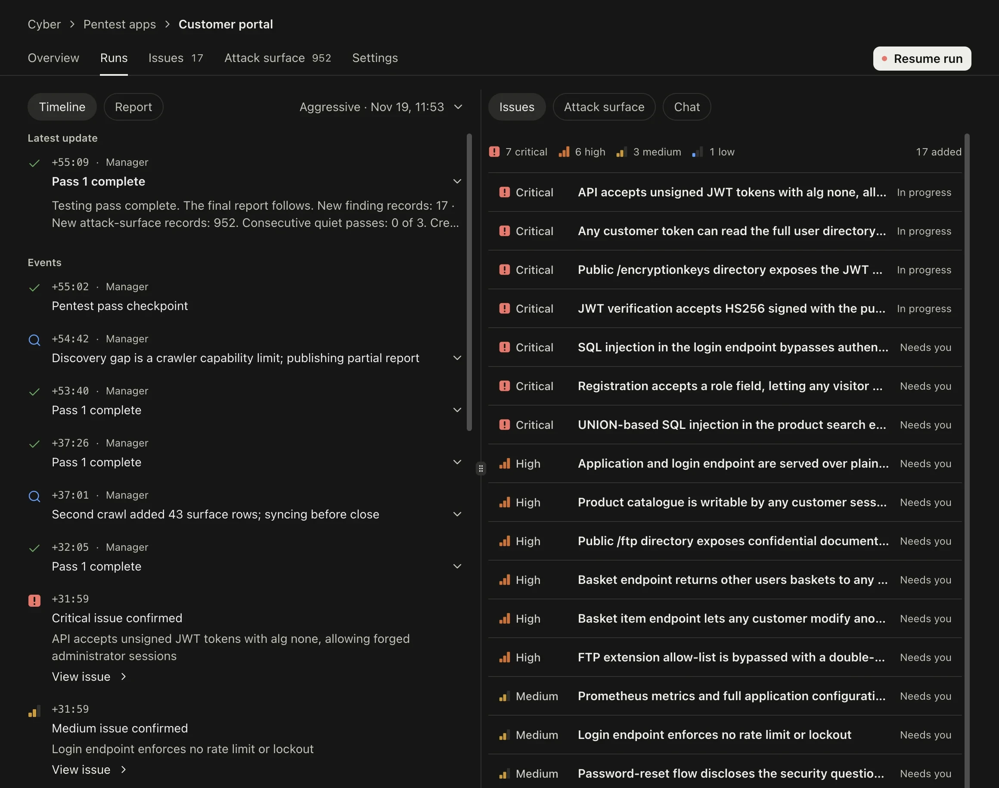

In about 10 minutes of setup, plus however long your DNS change takes to appear, you register a staging app, prove you own its domain, give Cyber a test login, limit the run to the paths you choose, and start a Safe pentest. When the run finishes you open an issue and read the request and response that prove it.

## Prerequisites

- A staging or test deployment of a web app or API that you're authorized to test. Don't use production for your first run.
- Access to the DNS records for that app's domain, so you can add a TXT record.
- Workspace admin rights, or an admin who can verify the domain for you. The admin verifies it from **Cyber → Settings**, or by opening this app's **Target ownership** card.
- Optional: a dedicated test account in the app (username and password). Without one, Cyber tests only what a logged-out visitor can reach.

## Register the app

<Steps>
  <Step title="Open Cyber">
    Click **Cyber** in the sidebar, open the **Pentest apps** tab, and click **Register an app**. The **Register an app** dialog walks through four steps: **Target**, **Sign-in**, **Scope and intensity**, and **Review**.
  </Step>
  <Step title="Enter the target">
    On **Target**, fill in:

    | Field | Example |
    | --- | --- |
    | **App URL or host** | `https://staging.shop.example.com` |
    | **App name** | `Shop staging` |
    | **What to test** | **Web application** for a browser app, **API** for an API. Pick one. |

    Click **Continue**. Target and framework can't be changed after setup, so check them now.

    <Frame caption="Register an app, step 1 of 4: enter the URL, name the app, and choose Web application or API">
      
    </Frame>
  </Step>
  <Step title="Verify the domain">
    Under **Target ownership**, click **Create DNS proof**. Copy the **DNS record name** and **TXT value**, and add them as a TXT record at your DNS provider. For `https://staging.shop.example.com` the record looks like this:

    | Type | Name | Value |
    | --- | --- | --- |
    | TXT | `_cloudthinker-appsec-<random>.staging.shop.example.com` | `cloudthinker-appsec-domain-verification=<token>` |

    If your provider appends the zone name automatically, leave that suffix off the name. Then click **Check again**. A verified domain also covers its subdomains, so an admin who verifies `example.com` in **Cyber → Settings** covers `staging.shop.example.com` too.

    **Success state:** **Target ownership** shows **Verified**. DNS changes can take a few minutes to appear; recheck the name and value before you retry.
  </Step>
</Steps>

## Add a test user (optional)

No test account? Click **Continue** on **Sign-in** and skip to [Choose an intensity and save](#choose-an-intensity-and-save).

<Steps>
  <Step title="Open the test user form">
    On **Sign-in**, type a name for the test identity, such as `customer-a`, and click **Add authentication**.
  </Step>
  <Step title="Describe the account">
    Fill in who this user is, so Cyber knows what it should and shouldn't see:

    | Field | Example |
    | --- | --- |
    | **Identity label** | `customer-a` |
    | **Identity description** | `Standard customer who owns test orders` |

    Set **Authentication method** to **Password**, then enter **Username or email**, **Password**, and **Login URL (optional)** if the sign-in page isn't easy to find from the home page. For the example shop, set it to `https://staging.shop.example.com/login`. Click **Save login**.

    **Success state:** the user appears in the list of test identities. Saved credentials are masked.

    Saving doesn't sign in, so a saved password isn't proof that it works. The run signs in when it starts, and if that sign-in fails the run ends as **Incomplete** instead of testing as a logged-out visitor. A **Login URL** must be on the same origin as the app. For a login that needs MFA or sits on a separate identity provider domain, use a **Session token** instead: see [Add test users](/guide/security/security-testing#add-test-users).
  </Step>
  <Step title="Skip what you don't have">
    **Source code** and **API documentation** are optional. Skip them for this run and click **Continue**. Checks that needed them stay limited, not passed.
  </Step>
</Steps>

<Tip>
  Add a second test user from a different role or tenant. With two users, Cyber can test whether one can read the other's data.
</Tip>

## Choose an intensity and save

<Steps>
  <Step title="Pick Safe">
    On **Scope and intensity**, under **Default intensity**, select **Safe**. Its tests send only read requests (`GET`, `HEAD`, `OPTIONS`), so intentional writes and deletes are off for the whole run. A read can still change data if your app changes state on `GET` (see the [intensity table](/guide/security/security-testing#choose-access-and-intensity)). Signing in your password test user is a separate step, so it can still submit the login form at Safe. The intensity you pick here is saved as the app's default, so the run dialog preselects it later. Leave **Weekly pentest** off for now, then click **Continue**.

    The UI marks **Aggressive** as **Recommended**. It adds `POST`, `PUT` and `PATCH` to test forms and flows, so it can create and edit test data. Save it for your second run, once you've checked the scope. Leave **Full**, **Deep dive**, and **Fortress** for later: they send destructive requests, including `DELETE`. All five are compared in [Run a security test](/guide/security/security-testing#choose-access-and-intensity).
  </Step>
  <Step title="Click Run later">
    On **Review**, check the **Target**, **Domain**, **Sign-in**, **Intensity**, and **Schedule** facts. Setup sets no include or exclude paths, so **Register app** would start a run against the whole target. Click **Run later** instead.

    **Success state:** the saved app opens with no run.
  </Step>
</Steps>

## Set the scope

<Steps>
  <Step title="Open Manage scope">
    In the app header, click **Settings**. Under **Testing**, click **Edit** on the **Scope** row. The **Manage scope** dialog opens.
  </Step>
  <Step title="Add include and exclude paths">
    Add the paths this first run may test under **Include paths**, and anything that must stay off-limits under **Exclude paths**. For the example shop:

    | List | Rules |
    | --- | --- |
    | **Include paths** | `/login`, `/shop/**`, `/api/products/**` |
    | **Exclude paths** | `/admin/**`, `/api/payments/**` |

    `**` matches any depth, and a path that matches both lists is excluded. Your test user's **Login URL** must match an include rule, or the sign-in fails with **Login could not stay within its safety boundary** and the run ends as **Incomplete**. That's why `/login` is in the example. Click **Save scope**. Pattern rules are in [Set scope and context](/guide/security/security-testing#set-scope-and-context).

    **Success state:** you see **Scope saved**, and the **Scope** row lists your include paths and the number excluded instead of reading **Whole target**.
  </Step>
</Steps>

## Start the pentest

<Steps>
  <Step title="Open the run dialog">
    In the app header, click **Run pentest**. Check that **Safe** is selected under the testing intensity cards.
  </Step>
  <Step title="Launch">
    Click **Run Safe pentest**.

    **Success state:** the app's run workbench opens and the run shows **Running**, with a live timeline of what Cyber is testing.
  </Step>
</Steps>

<Frame caption="A run on the Runs tab: the Timeline on the left, the issues it confirmed on the right">
  
</Frame>

You can leave the page. The run keeps going and uses credits (see [Usage](/guide/billing/usage)). You get a notification when it ends, and the person who owns the workspace is notified when a run fails or is blocked at sign-in. The app's **Runs** tab shows every run. If your password test user can't sign in, the run ends as **Incomplete**. To cancel, click **Stop run**. Issues already saved remain. A failed run shows **Resume run** when it can continue.

## Read the issues

<Steps>
  <Step title="Open Issues">
    When the run finishes, open the app's **Issues** tab and select **Confirmed**: these are verified issues that Cyber reproduced.
  </Step>
  <Step title="Open an issue">
    Click an issue. The detail page shows severity, the weakness category, the impact, how to fix it, and the evidence: the exact request and response that prove the issue.
  </Step>
  <Step title="Decide what to do">
    For a real issue, click **Open PR** to have CloudThinker draft a fix. The fix chat uses the repositories attached to the app. This quickstart skipped that, so attach one first: see [Connect a Git provider](/guide/connections/github). For a non-issue, dismiss it with a reason from its status on the **Issues** list. Issues under **Needs verification** are leads Cyber couldn't prove yet.
  </Step>
</Steps>

A run with no confirmed issues doesn't mean the app is secure. Read the run's **Report** tab: anything Cyber couldn't reach wasn't tested.

## Troubleshooting

For every Cyber problem in one place, see [Cyber troubleshooting](/guide/security/cyber-troubleshooting).

<AccordionGroup>
  <Accordion title="Target ownership stays at Needs proof">
    Compare the TXT record you published with the **DNS record name** and **TXT value** shown. A common cause is a provider that appends the zone name, so the domain appears twice in the record name. Remove the duplicate, wait a few minutes, and click **Check again**.
  </Accordion>
  <Accordion title="The run ends as Incomplete right after it starts">
    The test user couldn't sign in. Saving a password doesn't test it, so the first check happens when the run starts, and a failed sign-in stops the run instead of testing as a logged-out visitor. Update the password or **Login URL** on the **Test identities** row in the app's **Settings**, and run again. For MFA or a login on another domain, use a **Session token**.
  </Accordion>
  <Accordion title="The login page has a CAPTCHA">
    Configure CAPTCHA options on the test user before the run. See [Handle CAPTCHA logins](/guide/security/captcha).
  </Accordion>
</AccordionGroup>

## Next steps

**Walkthrough:** follow one proven finding from a scoped staging test run to a verified fix in [Test a staging app with Cyber](/guide/use-cases/cyber-staging-testing).

<CardGroup cols={2}>
  <Card title="Cyber troubleshooting" icon="wrench" href="/guide/security/cyber-troubleshooting">
    Every Cyber problem in one place, with cause, check and fix
  </Card>
  <Card title="Triage issues" icon="list-check" href="/guide/security/cyber-findings">
    Work through proof, fixes, and retests
  </Card>
  <Card title="Run a security test" icon="crosshairs" href="/guide/security/security-testing">
    Add scope rules, more access, and a schedule
  </Card>
</CardGroup>
