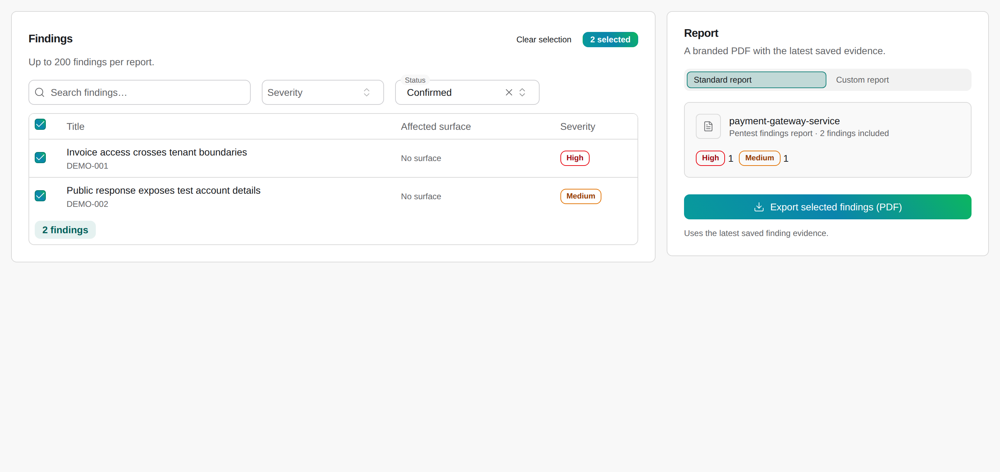

Cyber gives you two kinds of report: an export of the issues you pick, for a ticket, a fix review, or a customer, and the full report each [pentest run](/guide/security/security-testing) writes when it finishes. An export never starts a new scan, so you can export as often as you need.

## Prerequisites

- View access to the Cyber app. Viewers can export issues and download run reports.
- For an export: at least one issue in the app. See [Triage security issues](/guide/security/cyber-findings).
- For a custom report: Chat access in the workspace.

## Choose a report

| Report | What it contains | Where you get it |
| --- | --- | --- |
| **CSV** | One row per issue that matches your filters or selection | **Export** on the **Issues** list |
| **PDF report** | A branded PDF of the issues you export: a cover, a severity summary, the export scope, an index, then one section per issue with its details and evidence | **Export** on the **Issues** list |
| **Custom report…** | The issues you export, written by CloudThinker from your brief, optionally in a reference report's structure and style | **Export** on the **Issues** list, delivered in Chat |
| Run report | One run's full assessment, including what it couldn't test | The run's **Report** tab |

## Export issues

<Steps>
  <Step title="Open Issues">
    Open your app from **Pentest apps** and click its **Issues** tab. You can also use the **Issues** tab at the top of Cyber with the **Target** filter set to one app.
  </Step>
  <Step title="Pick the issues">
    Filter the list, or check the rows you want. Your checked rows stay selected while you page through the list, and clear when you change a filter.
  </Step>
  <Step title="Export">
    Click **Export** at the right of the toolbar. Under **Issues**, choose **All matching filters** or **Selected rows**, then pick **CSV** or **PDF report**.

    **Success state:** you see **Issues exported as CSV** or **PDF report ready**, and the file downloads.
  </Step>
</Steps>

<Frame>
  
</Frame>

**PDF report** and **Custom report…** take up to 200 issues from one pentest app. On the Cyber-wide **Issues** list, filter to one app or select rows from one app first; the menu says why when they're off. A failed export keeps your selection, so you can retry.

## Write a custom report in your format

Use a custom report when issues must match a template your team or customer already uses, such as an internal security review format.

<Steps>
  <Step title="Open Custom report">
    On **Issues**, click **Export**, choose the scope, then click **Custom report…**.
  </Step>
  <Step title="Write the brief">
    In **Brief**, say what the report should do, for example:

    ```text
    Write an executive summary for leadership, then group issues by risk with clear fix steps.
    ```

    To copy a template's structure and style, click **Upload a reference report** and choose a PDF or DOCX up to 5 MB.
  </Step>
  <Step title="Generate">
    Click **Generate report**.

    **Success state:** a chat opens with your issues and any reference loaded, and CloudThinker writes the report there. Ask follow-ups in the same chat to refine it.
  </Step>
</Steps>

CloudThinker copies the reference's structure and style, not its facts. Example findings in the reference never appear as your results.

## Set how future runs write their report

Report settings belong to the app, not the workspace. Each run writes its report using the settings saved when it starts, so change them before the next run.

<Steps>
  <Step title="Open the Reports section">
    Open the app's **Settings** tab and go to **Reports**.
  </Step>
  <Step title="Choose the style and format">
    Under **Style**, pick **Standard** or **Custom**. For Custom, write a brief and optionally add a reference report (PDF or DOCX, up to 5 MB). Under **Format**, choose **PDF** or **DOCX**. **Delivery** links to your notification settings.
  </Step>
  <Step title="Save">
    Click **Save changes** in the bar that appears.

    **Success state:** the bar closes. The next run uses these settings. Runs already started, and exports from **Issues**, aren't affected.
  </Step>
</Steps>

## Download a run report

<Steps>
  <Step title="Open the run report">
    Open the app's **Runs** tab, select the run, and click its **Report** tab.
  </Step>
  <Step title="Download it">
    Click **Download report**. Click **Expand preview** to read it larger first.

    **Success state:** the file downloads in the format chosen in the app's report settings when that run started.
  </Step>
</Steps>

Read the report's coverage and authentication limitations before you share its conclusion. For a new verdict after a fix, run another pentest.

## What reports include

- **Evidence:** captured requests, responses, and screenshots saved during the run. Exporting never captures new evidence.
- **Redaction:** passwords, tokens, cookies, and keys are replaced with placeholders. Use your own test credentials to replay a request.
- **Limitations:** a run report states what the run couldn't test, such as areas behind a failed login, and when a needed screenshot is missing.
- **Proof flow:** shown on the issue page and in copied issues, but left out of the PDF report.

## Troubleshooting

For every Cyber problem in one place, see [Cyber troubleshooting](/guide/security/cyber-troubleshooting).

<AccordionGroup>
  <Accordion title="PDF report or Custom report is disabled">
    They need up to 200 issues from one pentest app. The menu shows why, for example **Select issues from one pentest app.** Narrow the filters, filter to one app, or select fewer rows.
  </Accordion>
  <Accordion title="Custom report can't be selected">
    A custom report starts a chat, so it needs Chat access. Ask a workspace admin for it.
  </Accordion>
  <Accordion title="The export fails">
    You see **Could not export issues.** Your selection is kept, so check it and export again.
  </Accordion>
  <Accordion title="A run shows No report yet">
    The report is written when the run finishes. A failed run that ends before writing it shows the same message. A stopped run doesn't produce one and shows **Run stopped** instead. Start a new run to get a report.
  </Accordion>
  <Accordion title="New report settings didn't change an older report">
    Each run keeps the report settings from when it started. Start a new run to get a report in the new style.
  </Accordion>
</AccordionGroup>

## Next steps

<CardGroup cols={2}>
  <Card title="Triage security issues" icon="list-check" href="/guide/security/cyber-findings">
    Check each issue's proof before you share it
  </Card>
  <Card title="Run a security test" icon="crosshairs" href="/guide/security/security-testing">
    Run again to verify fixes and get a new report
  </Card>
</CardGroup>
