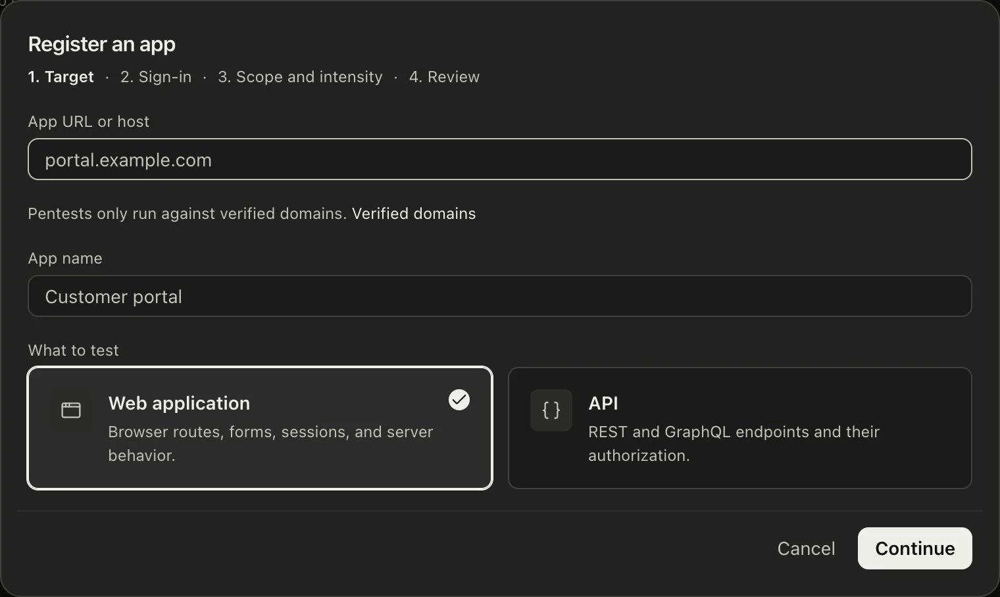
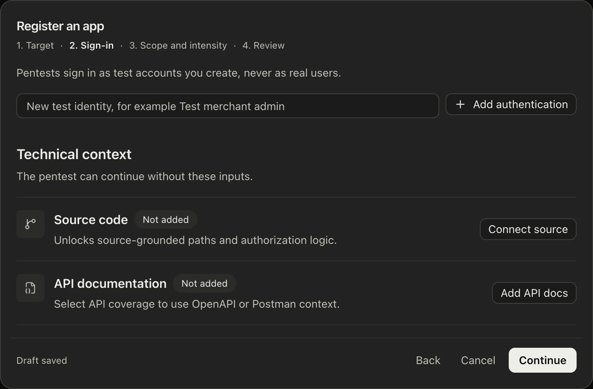
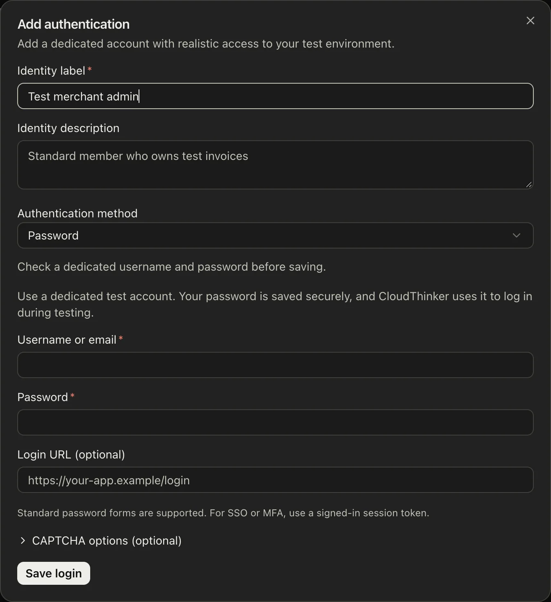
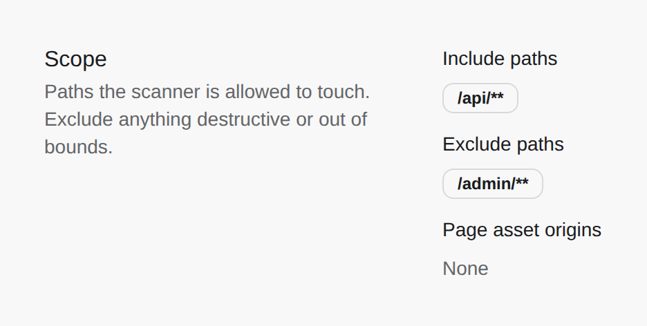
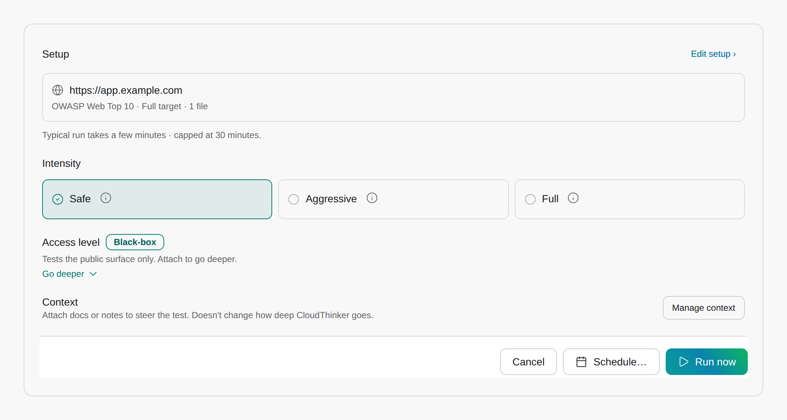
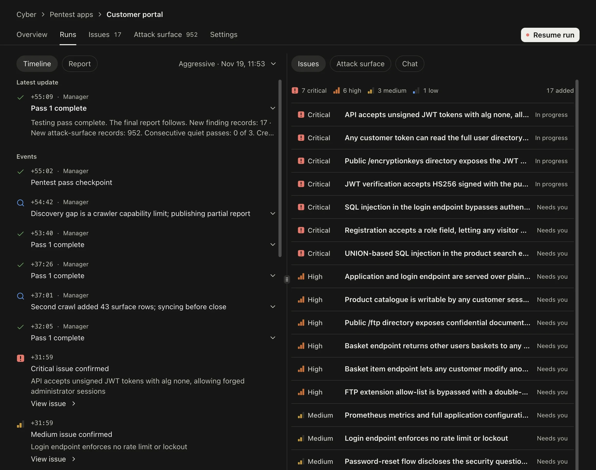

A pentest run is a DAST scan of one of your running apps: CloudThinker tests it within limits you set and records request and response proof for every problem it confirms. This page covers every setup option; for a minimal first run, use the [Cyber quickstart](/guide/security/cyber-quickstart).

## Prerequisites

- An app you're authorized to test, reachable at a domain URL. Use staging for anything above **Safe** intensity.
- Access to the domain's DNS records, and workspace admin rights to verify the domain.
- Credits for the run. Every run uses them, and Deep dive and Fortress use the most. See [Usage](/guide/billing/usage).
- Optional: dedicated test accounts, an OpenAPI spec or Postman collection, and a [Git connection](/guide/connections/github) for white-box testing.

## Register the app

<Steps>
  <Step title="Set the target">
    Open **Cyber**, go to **Pentest apps**, and click **Register an app**. The dialog has four steps: **Target**, **Sign-in**, **Scope and intensity**, and **Review**. On **Target**, enter **App URL or host** and **App name**, then choose **Web application** or **API** under **What to test**. Click **Continue**.

    That choice decides which OWASP categories the coverage report measures. You can't combine them or change them later; create a second app to test the same host as an API.

    <Frame>
      
    </Frame>
  </Step>
  <Step title="Verify the domain">
    Under **Target ownership**, click **Create DNS proof**. Add the shown **DNS record name** and **TXT value** as a TXT record at your DNS provider, then click **Check again**. If your provider appends the zone name, leave that suffix off.

    **Success state:** **Target ownership** shows **Verified**. If the host is covered by a domain you already verified, the card says **Proof reused from** that domain and no new record is needed.
  </Step>
  <Step title="Add access">
    On **Sign-in**, add test users, **Source code**, and **API documentation**. All three are optional. See the sections below for each.

    <Frame>
      
    </Frame>
  </Step>
  <Step title="Choose the intensity and review">
    On **Scope and intensity**, choose the **Default intensity**, and turn on **Weekly pentest** if you want a weekly run. Click **Continue**. On **Review**, check the summary, then click **Register app** to register the app and start a run, or **Run later** to save it without running.

    Setup sets no include or exclude paths, so **Register app** runs against the whole target. For a first run, pick **Safe**, click **Run later**, then set include and exclude paths in [Scope](#set-scope-and-context) under the app's **Settings** before you run. The [Cyber quickstart](/guide/security/cyber-quickstart) walks through this.

    **Success state:** **Register app** starts the first run. **Run later** opens the saved app with no run.
  </Step>
</Steps>

You can manage verified domains for the whole workspace from **Cyber → Settings**. Verifying a domain authorizes testing on it. It doesn't widen any app's scope.

## Add test users

Test users let Cyber reach pages behind a login and check authorization: can user A see user B's data? During setup, type a name and click **Add authentication**. In the app's **Settings**, use **Add** or **Manage** on the **Test identities** row. In the **Run pentest** dialog, click **Add auth**. All three open the same form: describe the user (**Identity label**, **Identity description**), then pick an **Authentication method**.

| Method | What you enter | How it's checked |
| --- | --- | --- |
| **Password** | **Username or email**, **Password**, **Login URL (optional)** | Saved without signing in. The run signs in when it starts, and a failed sign-in ends the run as **Incomplete**. See [Handle CAPTCHA logins](/guide/security/captcha#configure-the-login) |
| **Session token** | A signed-in `GET` request copied as cURL from your browser's Network panel | **Verify and attach** sends the request once and saves it only if it succeeds. CloudThinker re-checks it twice more: when you open **Run pentest**, and again as the run starts |
| **Long-lived token** | One header name and value per row, for example name `Authorization`, value `Bearer <token>`. A blank first name defaults to `Authorization`. | Saved without a check. The run reports if access is rejected. |
| **Agent creates new account** | **Instructions** for creating users through a signup page or admin API | Each manual run creates fresh users and reports whether signup and login worked. Signup creates real accounts in your app, so pick **Aggressive** or above for this method |

For **Agent creates new account**, write instructions that name the roles to create, use `<generated_username>` and `<generated_password>` for the credentials, and say what proves the login worked:

```text
Sign up at /register with <generated_username> and <generated_password>.
Create one "member" and one "admin" user.
Login succeeded when the page shows "Welcome back" and the URL is /dashboard.
```

The instructions are stored encrypted and never shown again. To change them, open the account from the **Test identities** row in the app's **Settings** and enter new instructions, which replace the saved ones. Signup that needs an email or SMS code isn't supported.

Scheduled runs sign in only with **Long-lived token** users, because only those are safe to reuse unattended: sessions expire, and password and agent-created logins aren't used on schedules. A schedule never switches itself off. If the token has been deleted when an occurrence fires, that occurrence ends as **Incomplete** and you're notified, and the next one signs in again as soon as a working token is saved. Without a long-lived token, a schedule runs without signing in as your test users, so it can't test or recheck anything behind the login. Run those checks manually, or add a long-lived token user.

<Tip>
  Add two users from different roles or tenants. With two of them, Cyber can test whether one user can read or change the other's data.
</Tip>

A copied cURL request contains a live session. Treat it as a password and paste it only into this form. If the login uses a CAPTCHA, set it up first: see [Handle CAPTCHA logins](/guide/security/captcha).

<Frame>
  
</Frame>

## Set scope and context

Open the app and click **Settings**. The page has the sections **General**, **Testing**, **Schedule**, **Reports**, and **Archive**. Target and framework are fixed after setup, so they don't appear here.

| Section | What to set |
| --- | --- |
| **Scope** (Testing) | Click **Edit** to open **Manage scope**. Set **Include paths**, **Exclude paths**, and **Page asset origins**, then click **Save scope**. With no rules, the row reads **Whole target**. |
| **Context files** (Testing) | An OpenAPI spec, Postman collection, runbook, architecture note, or other document. These help Cyber find endpoints it can't discover by crawling. |
| **Repositories** (Testing) | A connected repository and branch. This makes the run white-box. |
| **Test identities** (Testing) | The same methods as in setup |
| **Schedule** | The app's recurring run, which you can turn on or off, edit, or delete. With none, click **Add schedule** |
| **Default intensity** (General) | The intensity preselected for later runs |
| **Reports** | How each run writes its report. See [Cyber reports](/guide/security/cyber-reports) |

Edits to the app name, default intensity, and report settings save together from the **Save changes** bar.

Path rules are globs matched against the whole path:

| Pattern | Matches | Doesn't match |
| --- | --- | --- |
| `/api/*` | `/api/users` (one segment) | `/api/users/42` |
| `/api/**` | `/api/users`, `/api/users/42` (any depth) | `/api` itself |
| `/admin/**` in **Exclude paths** | Everything under `/admin/` | `/administrator` |

- **Exclude always wins.** A path that matches both lists is off-limits.
- **No include rules means the whole target.** Every path on the app's host is in scope until you add one.
- **Other hosts stay out.** **Page asset origins** takes exact HTTPS origins, such as `https://cdn.example.com`, and only lets pages load scripts, styles, images, and fonts from them. Navigation and active requests stay on your target.
- Each list holds up to 100 rules of up to 100 characters.

<Frame>
  
</Frame>

## Choose access and intensity

The access level comes from what you provided, not from a setting:

| Access level | You provided |
| --- | --- |
| **Black-box** | The URL only |
| **Gray-box** | The URL plus test users |
| **White-box** | The URL plus a repository, with or without test users |

Intensity decides what the run may do. This is the reference table for every Cyber page:

| Intensity | What it does | Run it against |
| --- | --- | --- |
| **Safe** | Explores routes and responses with read requests only (`GET`, `HEAD`, `OPTIONS`). Writes and deletes are off. | Your first run on a new app, and any environment where data must not change |
| **Aggressive** (the UI marks it **Recommended**) | Adds `POST`, `PUT` and `PATCH` to test forms and business flows. Can create and edit test data. `DELETE` stays off. | Staging, once a Safe run has confirmed scope and logins |
| **Full** | Adds `DELETE` and tests high-impact actions, including changing and deleting in-scope data. Asks you to confirm first. | Staging with disposable data only |
| **Deep dive** | Everything Full does, over several passes that follow connected multi-step flaws. Uses the most time and credits. Asks you to confirm first. | Staging with disposable data only. See [Deep dive testing](/guide/security/deep-dive-testing) |
| **Fortress** (marked **Enterprise**) | A team of agents that validates in-scope exploitable paths, proves impact, and connects the evidence into one report. Destructive like Full. Asks you to confirm first. Disabled without an Enterprise plan. | Staging with disposable data only |

Safe avoids intentional data changes, but a read request can still change data if your app changes state on `GET`. Set include paths before a first run either way. The sign-in step for a **Password** test user is separate from the intensity limits, so it can submit your login form at any intensity, Safe included.

For **Deep dive** and **Fortress**, **Stop when** sets how the run ends: **Investigation complete** (the default), or **Duration**, a whole number of hours from 1 to 168, with presets of 1, 4, 8, and 24.

<Warning>
  **Full**, **Deep dive**, and **Fortress** send destructive requests, including `DELETE`, to the target. Before they start, a dialog asks you to confirm. Use a disposable environment and test accounts; data inside the saved scope can be permanently changed or deleted.
</Warning>

## Run now or on a schedule

<Steps>
  <Step title="Open the run dialog">
    On the app page, click **Run pentest**. The dialog opens with the app's saved setup and shows any blocker, such as **Domain verification required**. Saved scope, context, and other optional settings sit under **Advanced options**.
  </Step>
  <Step title="Pick intensity and scan scope">
    Choose an intensity. For Deep dive or Fortress, also set **Stop when**. On a white-box app, also set **Scan scope**: **Changes only** tests the commits on each attached repository's saved branch since the commit the last successful run recorded. **Whole codebase** tests everything. The first run must use **Whole codebase**, and a branch with no new commits gets a whole-codebase pass.
  </Step>
  <Step title="Run or schedule">
    Click **Run Safe pentest** (the label follows the intensity) to start now. To repeat it, click **Schedule…** instead and pick a cadence such as **Daily**, **Weekly**, **Monthly**, or **Once**, or enter a cron expression under **Advanced · Cron expression**. Times are in your browser's local time zone. You can also set an expiration date. Click **Schedule** to save. For **Full**, **Deep dive**, or **Fortress**, a dialog asks you to confirm the schedule. Schedules sign in only with **Long-lived token** test users (see [Add test users](#add-test-users)).

    **Success state:** a run opens the workbench with status **Running**. A schedule appears in the **Schedule** section of the app's **Settings**, switched on.
  </Step>
</Steps>

<Frame>
  
</Frame>

To change a schedule, click **Edit** on its card in the app's **Settings**. Turning it off keeps its configuration. An app runs one pentest at a time, so while a run is in flight the header button reads **View run**.

<Warning>
  A scheduled **Full**, **Deep dive**, or **Fortress** run sends destructive requests each time it fires, with nobody confirming that occurrence. Schedule them only against staging with disposable data and tight scope.
</Warning>

## Watch the run

The workbench shows run history, issues as they're saved, and the app surface Cyber discovered. Each run has a **Timeline** tab for live activity and a **Report** tab for the finished report, which lists what the run couldn't test, such as areas behind a failed login. Fortress runs also have a **Graph** tab. A run ends as **Completed**, **Incomplete**, or **Stopped**.

The person who started the run gets a notification when it ends. When a run fails or is blocked, the person who owns the workspace is notified too. If a **Session token** fails its check as the run starts, the run ends as **Incomplete** without testing anything, and the notification reads **Pentest run blocked**. A **Password** sign-in that fails also ends the run as **Incomplete**. A **Long-lived token** isn't checked first, so a token your app rejects doesn't stop the run: it keeps going and its report lists what it couldn't test. Update the login on the **Test identities** row in the app's **Settings** and start a new run.

**Stop run** cancels the run. Issues saved so far stay. A failed run, or a stopped Fortress run, shows **Resume run** when it can continue from saved work. A failed or stopped run is an incomplete test, so don't read its results as a clean bill of health.

<Frame caption="A run on the Runs tab: the Timeline on the left, the issues it confirmed on the right">
  
</Frame>

## Troubleshooting

For every Cyber problem in one place, see [Cyber troubleshooting](/guide/security/cyber-troubleshooting).

<AccordionGroup>
  <Accordion title="Run pentest is blocked with Domain verification required">
    The domain isn't verified yet, or the TXT check failed. Compare your DNS record with the **DNS record name** and **TXT value** in **Target ownership**, fix any duplicated zone suffix, and click **Check again**. If you aren't a workspace admin, ask one to verify it.
  </Accordion>
  <Accordion title="The run is blocked or fails at sign-in">
    A saved login didn't work. A session token is re-checked twice: when you open **Run pentest**, where the dialog shows **A saved login no longer works** and won't let you launch the run, and again as the run starts, where a failure ends the run as **Incomplete**. A password is never checked in advance — it's first tried when the run starts, and a failed sign-in ends the run as **Incomplete**. Update the password, refresh the cURL session, or replace the token on the **Test identities** row in the app's **Settings**, and run again.
  </Accordion>
  <Accordion title="The report shows limited checks">
    A check needed something you didn't provide: a second role, a tenant, a repository, or API docs. Add it and rerun. Limited checks aren't passed checks.
  </Accordion>
  <Accordion title="Changes only is locked">
    It compares against the last successful run. Complete one **Whole codebase** run first.
  </Accordion>
</AccordionGroup>

## Next steps

<CardGroup cols={2}>
  <Card title="Cyber troubleshooting" icon="wrench" href="/guide/security/cyber-troubleshooting">
    Every Cyber problem in one place, with cause, check and fix
  </Card>
  <Card title="Triage issues" icon="list-check" href="/guide/security/cyber-findings">
    Read the proof, fix, and retest
  </Card>
  <Card title="Cyber reports" icon="file-lines" href="/guide/security/cyber-reports">
    Export issues or download a run's report
  </Card>
  <Card title="Run a Code Audit" icon="code" href="/guide/security/code-audit">
    Audit the source code behind the app you just tested
  </Card>
</CardGroup>
