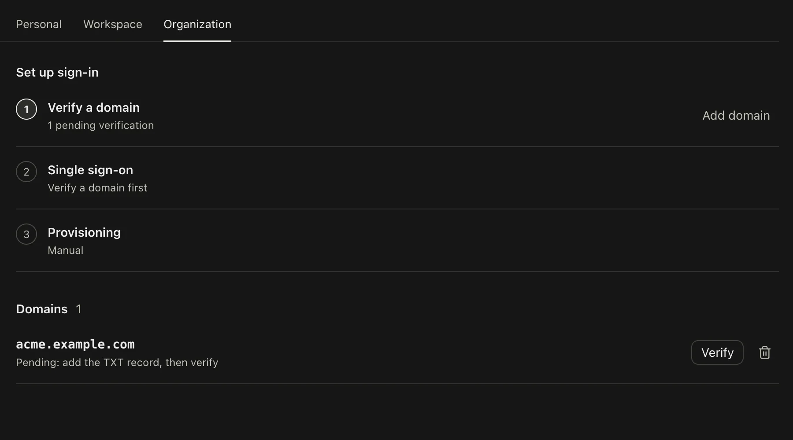

Single sign-on (SSO) lets your team sign in to CloudThinker through your company identity provider (IdP), such as Okta, Microsoft Entra ID or Google Workspace, so you manage access in one place. This page takes you from an unverified domain to a working, enforced SSO connection.

## Prerequisites

- An organization on the **Scale** or **Enterprise** plan. On other plans, **Settings → Organization → Identity** shows **Unlock SSO with the Scale plan**, and Owners see an **Upgrade plan** button. See [Pricing](/guide/billing/pricing).
- The organization **Owner** role. Only Owners can change SSO. Admins can open the page read-only and see **Only organization owners can change single sign-on**. See [Roles and permissions](/guide/security/roles).
- Access to your DNS provider, to add one TXT record.
- Admin access to your identity provider.

## How setup works

**Settings → Organization → Identity** opens with a **Set up sign-in** section of three numbered rows. Each one unlocks the next, and a finished row shows a check mark.

| Row | What you do | Done when |
|---|---|---|
| 1. **Verify a domain** | Prove you own your email domain with a DNS TXT record | The row shows, for example, **1 verified** |
| 2. **Single sign-on** | Create a SAML or OIDC connection to your identity provider | The row shows the connection name, protocol and **Active** |
| 3. **Provisioning** | Choose how user accounts get created | The row shows **Just-in-time provisioning** or **SCIM directory sync** |

<Frame caption="Organization → Identity: verify a domain, set up single sign-on, then choose provisioning">
  
</Frame>

## Verify your domain

Your domain tells CloudThinker which sign-ins to send to your identity provider. Anyone whose email ends in a verified domain is routed to SSO.

<Steps>
  <Step title="Add the domain">
    Go to **Settings → Organization → Identity**. On the **Verify a domain** row, click **Add domain**. In the **Update organization email domains** dialog, type your email domain (for example, `example.com`), click the **+** button, then close the dialog.

    A domain can belong to only one CloudThinker organization. If another organization already claimed it, you see an error and need to contact that organization's Owner.
  </Step>
  <Step title="Add the DNS TXT record">
    In the **Domains** section, click **Verify** next to the domain. The **Verify domain** dialog shows two values. Create a TXT record at your DNS provider with them:

    | DNS field | Value |
    |---|---|
    | Name / Host | `_cloudthinker` (your DNS provider appends `.example.com`) |
    | Type | `TXT` |
    | Value | The **Record Value** shown in the dialog, for example `cloudthinker-domain-verification=Xy7...` |
  </Step>
  <Step title="Check verification">
    Wait for the record to propagate, then click **Check verification**. Propagation is often a few minutes but can take longer, depending on your DNS provider.

    **Success state:** the domain shows **Verified** in the **Domains** section, and the **Single sign-on** row shows a **Set up SSO** button.

    CloudThinker checks the record only when you click **Check verification**. It doesn't re-check later, so you can delete the TXT record once the domain is verified.
  </Step>
</Steps>

You can verify more than one domain, for example `example.com` and `example.co.uk`. While the connection is active, you can't remove the last verified domain; deactivate the connection first.

## Create the connection

An organization has one SSO connection, and it serves every verified domain. Pick the protocol your identity provider supports. If it supports both, either works; SAML is the most common choice for enterprise IdPs.

| Protocol | Use it when | Guide |
|---|---|---|
| **SAML 2.0** | Your IdP is Okta, Entra ID, Google Workspace, AWS IAM Identity Center, OneLogin, or another SAML 2.0 provider | [SAML setup](/guide/security/sso-saml) |
| **OpenID Connect (OIDC)** | Your IdP issues OAuth 2.0 clients and publishes an OIDC discovery document | [OIDC setup](/guide/security/sso-oidc) |

<Steps>
  <Step title="Start the wizard">
    On the **Single sign-on** row, click **Set up SSO**. Choose **SAML 2.0** or **OpenID Connect (OIDC)** and click **Next**.
  </Step>
  <Step title="Follow your provider's guide">
    Open the SAML or OIDC guide above and complete the steps for your provider, then click **Create Connection**.

    **Success state:** the dialog shows **SSO Connection Created**. The connection is active right away, and sign-in through SSO is available but not yet required.
  </Step>
  <Step title="Run the connection test">
    On the **Single sign-on** row, click **Edit**. In the **Manage SSO** dialog, on the **Overview** tab, under **Connection test**, click **Run connection test**.

    The test checks your configuration, not a full sign-in. For SAML it checks the IdP Entity ID, SSO URL and certificate. For OIDC it checks that the discovery document is reachable, the issuer matches, the required endpoints exist, and the signing keys are reachable.

    **Success state:** **All checks passed**. If you see **Some checks failed**, the failing check and an error message are listed; fix the value on the **Configuration** tab and click **Save Changes**.
  </Step>
  <Step title="Sign in through SSO">
    In a private browser window, open the CloudThinker sign-in page at `https://app.cloudthinker.io/auth/login`, enter an email on your verified domain, click **Continue with email**, then click **Continue with SSO**. You can also click **Sign in with SSO** and enter your **Work email**.

    **Success state:** your IdP's sign-in page opens, and after you sign in you land back in CloudThinker with your name shown.
  </Step>
</Steps>

<Note>
  As soon as a connection is active, new people on your verified domain can't create an account with Google or GitHub sign-in. They're told "Your organization signs in with SSO." Existing users can still pick **Use an email code instead** on the SSO screen until you require SSO.

  People who already have a CloudThinker account keep it. Their first SSO sign-in matches the account by email and links it to your IdP, so no duplicate is created.
</Note>

## Choose how users are provisioned

Provisioning is how a CloudThinker account gets created for someone in your company. The **Provisioning** section appears once the connection is active.

| Mode | What happens | Pick it when |
|---|---|---|
| **Manual** | No accounts are created automatically. You invite each person. | You want to approve every member by hand |
| **Just-in-time** | An account is created the first time someone signs in through SSO. This is the default for new connections. | Anyone your IdP lets in should get access |
| **SCIM** | Your IdP creates, updates and deactivates users and groups automatically | You want joiners and leavers handled by your directory. See [SCIM provisioning](/guide/security/scim) |

For **Just-in-time** and **SCIM**, also set:

- **Auto-assigned organization role**: **Viewer** (default), **Developer** or **Admin**. Start with Viewer and promote people later.
- **Auto-assigned workspaces**: the workspaces new users join automatically. The default is your organization's default workspace. See [Workspaces](/guide/workspaces).

## Require SSO

With SSO optional, people on your domain can still sign in with an email code. Turning on **Require single sign-on** removes that option.

<Steps>
  <Step title="Confirm SSO works for you">
    Complete the sign-in test above with your own account first.
  </Step>
  <Step title="Turn on Require single sign-on">
    In the **Sign-in rules** section, turn on **Require single sign-on**.

    **Success state:** the switch stays on. Users on your verified domains must sign in through your identity provider. Google and GitHub sign-in are refused with "Your organization signs in with SSO.", and **Use an email code instead** no longer signs them in.
  </Step>
</Steps>

**Require single sign-on** is checked at sign-in. It doesn't sign out anyone who is already signed in; they move to SSO the next time they sign in. The toggle only shows while the connection is **Active**.

Requiring SSO also changes invitations: you can only invite emails on a verified domain. With **SCIM** selected, manual invitations are turned off, and you manage people in your IdP.

### If your IdP is unavailable

Each organization has exactly one Owner, and the Owner is exempt from **Require single sign-on**, so an IdP outage or an expired certificate doesn't lock you out. The Owner enters their email on the sign-in page, then picks **Use an email code instead** on the SSO screen. Everyone else waits until the IdP is back, or until the Owner turns off **Require single sign-on** in **Sign-in rules**.

<Warning>
  Before you turn on **Require single sign-on**, make sure the Owner's email address receives mail outside your IdP, for example a monitored shared mailbox. That inbox is your way back in.
</Warning>

## Manage or remove the connection

Click **Edit** on the **Single sign-on** row. The **Manage SSO** dialog has two tabs:

| Tab | What you can do |
|---|---|
| **Overview** | See **Status**, **Protocol**, **Display name**, **Verified domains**, **SCIM** and **Created**. **Activate**, **Deactivate** or **Delete** the connection, and run the connection test. |
| **Configuration** | Edit IdP values, for example a rotated certificate or a new client secret, then click **Save Changes**. For SAML, this tab also shows the **SP Metadata URL**. |

| Status | How it gets there | What users see |
|---|---|---|
| **Active** | Set automatically when you create a valid connection on a verified domain, or by clicking **Activate** | Sign-ins on your verified domains go to your IdP. **Require single sign-on** applies if it's on. |
| **Inactive** | You click **Deactivate** | SSO isn't used. People sign in with an email code, Google or GitHub, and **Require single sign-on** doesn't apply. Your settings are kept, so **Activate** turns it back on. |
| **Testing** | Not set from the dashboard | Behaves like **Active** |

**Delete** is permanent and does more than deactivating:

- **Require single sign-on** goes away with the connection, and users fall back to email-code sign-in.
- SCIM is removed: the token stops working, and group mappings and sync logs are deleted. Turn off provisioning in your IdP too.
- Member accounts and their roles stay, including people created by just-in-time or SCIM provisioning.

To pause SSO, deactivate instead.

## Troubleshooting

<AccordionGroup>
  <Accordion title="There's no Set up SSO button">
    The **Single sign-on** row reads **Verify a domain first**. Open **Verify** on the domain in the **Domains** section and confirm your TXT record name is `_cloudthinker` and its value matches the **Record Value** exactly. Some DNS providers add the domain for you, so a name of `_cloudthinker.example.com` can turn into `_cloudthinker.example.com.example.com`. Then click **Check verification** again.
  </Accordion>
  <Accordion title="Identity shows Unlock SSO with the Scale plan">
    Your organization's plan doesn't include SSO. An Owner clicks **Upgrade plan**, or see [Manage your subscription](/guide/billing/subscription).
  </Accordion>
  <Accordion title="'Only organization owners can change single sign-on'">
    You're signed in as an Admin, so the page is read-only. Ask an organization Owner to make the change, or to [change your role](/guide/security/roles).
  </Accordion>
  <Accordion title="A user can't sign in after you required SSO">
    Check that the user is assigned to the CloudThinker app in your identity provider. If they still fail, an Owner can turn off **Require single sign-on** while you fix the IdP side.
  </Accordion>
  <Accordion title="A user still signs in with an email code">
    Either **Require single sign-on** is off, the user's email isn't on a verified domain, or the user is an organization Owner, who is exempt by design.
  </Accordion>
  <Accordion title="Names show as email addresses">
    Your identity provider isn't sending first and last name. Fix the attribute mapping in the [SAML](/guide/security/sso-saml) or [OIDC](/guide/security/sso-oidc) guide.
  </Accordion>
  <Accordion title="Finding out why an SSO sign-in failed">
    When the person already has a CloudThinker account, a failed SSO sign-in is recorded in [audit logs](/guide/security/audit-logs) as `security.sso_login_failed`. In every case, start from the message the user sees on the CloudThinker sign-in page:

    | Message | Cause |
    |---|---|
    | "SSO login is not available for this domain" | The email's domain isn't verified, or the connection is **Inactive** |
    | "No account found. Contact your administrator for access." | Provisioning is **Manual** or **SCIM**, and the person has no account or invitation |
    | "You are not a member of this organization. Please ask your administrator to invite you." | The person has a CloudThinker account but isn't in your organization, and just-in-time provisioning is off |
    | "This organization has reached its seat limit." | A pending invitation can't be accepted because every seat is taken |
    | "SSO authentication did not provide an email address" | Your IdP isn't sending an email. Fix the attribute mapping |
    | "Your identity provider's signature could not be verified. Ask your administrator to check the SSO certificate." | CloudThinker couldn't verify the IdP's signature, for example because the SAML certificate in CloudThinker is out of date |
    | "SSO sign-in failed. Try again or contact your administrator." | CloudThinker rejected the SAML or OIDC response for another reason, for example an unsigned or encrypted assertion or clock drift. Other failures show a more specific message that names what to check. See the [SAML](/guide/security/sso-saml#troubleshooting) or [OIDC](/guide/security/sso-oidc#troubleshooting) troubleshooting |
  </Accordion>
</AccordionGroup>

## Next steps

<CardGroup cols={2}>
  <Card title="SAML setup" icon="shield" href="/guide/security/sso-saml">
    Step-by-step SAML configuration for Okta, Entra ID, Google Workspace and more
  </Card>
  <Card title="OIDC setup" icon="id-badge" href="/guide/security/sso-oidc">
    Step-by-step OIDC configuration for Google, Entra ID, Okta and others
  </Card>
  <Card title="SCIM provisioning" icon="users-gear" href="/guide/security/scim">
    Let your directory add and remove users automatically
  </Card>
  <Card title="Roles and permissions" icon="user-shield" href="/guide/security/roles">
    Decide what auto-provisioned users can do
  </Card>
</CardGroup>
