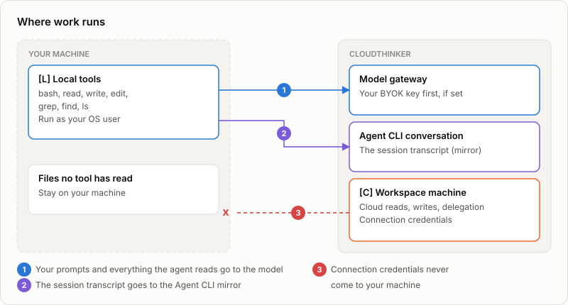
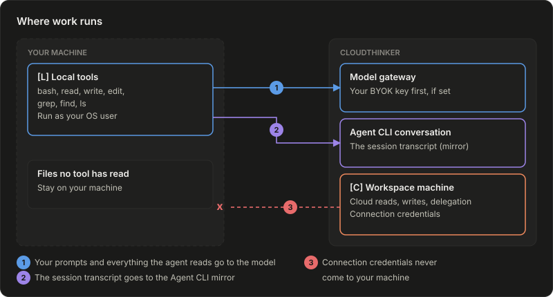

CloudThinker Agent は、ターミナルで動作するコーディングエージェントです。あなたのマシン上でファイルを編集しコマンドを実行し、クラウドにはワークスペースの[接続](/ja/guide/connections/overview)を通じてのみアクセスします。そのため、クラウドの認証情報がノート PC に置かれることはありません。

<Note>
エージェントは macOS と Linux（x86_64 と arm64）で動作します。CLI は Windows にもインストールできますが、エージェントの Windows ビルドはありません。有料プラン（Team、Scale、Enterprise）が必要です。Free のワークスペースでは、セッションの開始がアップグレードの案内とともに拒否されます。[料金](/ja/guide/billing/pricing)を参照してください。
</Note>

## 前提条件

- CloudThinker CLI がインストールされ、ログイン済みであること。[CLI](/ja/guide/cli/overview) と [CLI 認証](/ja/guide/cli/authentication)を参照してください。
- エージェントにクラウドを操作させたい場合は、ワークスペースに少なくとも 1 つの接続（[AWS](/ja/guide/connections/aws) や [Kubernetes](/ja/guide/connections/kubernetes) など）。ローカルの作業には不要です。

## セッションを開始する

<Steps>
  <Step title="リポジトリを開いてエージェントを実行する">
    ```bash
    cd my-terraform-repo
    cloudthinker
    ```

    引数なしの `cloudthinker` と `cloudthinker agent` は同じ動作です。まだログインしていない場合、エージェントがブラウザでのログインを開始します。他のコマンドはそうしません。終了コード 3 で終了し、`cloudthinker login` を実行するよう案内します。

    初回実行時、CLI はプラットフォーム用のエージェントビルドをダウンロードし、リリースの SHA-256 チェックサムで検証して、`~/.cloudthinker/agent/bin/<version>/` にインストールします。以降の実行ではそれを再利用します。このステップが失敗すると、原因とともに `agent install failed:` が表示され、終了コード 1 で終了します。プロキシ環境では `HTTPS_PROXY` を設定し、プロキシが HTTPS を再署名する場合は `SSL_CERT_FILE` も設定します。[Environment variables](/ja/guide/cli/reference#環境変数) を参照してください。
  </Step>
  <Step title="起動画面を確認する">
    ヘッダーには、ワークスペース、ユーザー、セッションリンク、ワークスペースの Approval mode（`· Auto` または `· Manual`）が表示されます。その下の 2 行に、作業が実行される場所が表示されます。

    - `[L] this machine <folder>` とローカルツール
    - `[C] sandbox workspace <name> - <N> connections` とクラウドツール。これらはワークスペースマシン上で実行されます（起動行では sandbox workspace と呼ばれます。[作業が実行される場所](#作業が実行される場所)を参照）

    **成功時の状態:** プロンプトが入力可能になり、フッターにワークスペース、Approval mode、`◆ 0.00 credits`、接続が表示されます。
  </Step>
  <Step title="タスクを与える">
    やりたいことを平易な言葉で入力します。エージェントが初めての場合は、`/skill:tour` を実行してください。ローカルとクラウドの作業、接続、承認を説明するガイド付きの初回セッションです。

    クラウドの調査の例です。`[C]` の読み取り行の後、リポジトリを読む `[L]` の行が続きます。

    ```text
    Why is the api deployment in staging restarting? Check the pod events and logs, then tell me which commit in this repo is the likely cause.
    ```

    ローカル編集の例です。`[L]` の読み取りと編集の行が表示され、クラウドへの書き込みはありません。

    ```text
    Add a lifecycle rule to the logs bucket in main.tf that expires objects after 90 days. Don't apply it.
    ```

    セッションを終了するには `/quit`（または `/exit`）と入力します。クラウドですでに実行中の作業は継続します。終了時、エージェントはこのセッションを再開するコマンド `cloudthinker agent --session <id>` を表示します。
  </Step>
</Steps>

## 作業が実行される場所

すべてのツール呼び出しの行は `[L]` または `[C]` で始まるため、どのマシンが作業したかが常に分かります。

<Frame caption="ローカルツールはあなたのマシンで実行されます。エージェントが読んだ内容はモデルに送られ、接続の認証情報はワークスペースマシンにとどまります。">
  
  
</Frame>

| タグ | 場所 | 実行されるもの | 認証情報 |
|---|---|---|---|
| `[L]` | あなたのマシン | ローカルツール: `bash`、`read`、`write`、`edit`、`grep`、`find`、`ls` | CloudThinker からは提供されません。コマンドはあなたの OS ユーザーとして実行されます。**Manual** では、ファイル編集や何かを変更する可能性のあるコマンドの前に確認されます |
| `[C]` | ワークスペースマシン | クラウドの読み取り、クラウドへの書き込み、委任された作業 | ワークスペース接続の認証情報。その実行に使われ、あなたのマシンには送られません |

ワークスペースマシン（起動時に `sandbox workspace` と表示され、クラウドツールが `ct_sandbox_*` という名前なのはこのためです）は、ワークスペース全体で共有する CloudThinker ホストのマシンです。使い捨てのシェルではありません。ワークスペースのメモリ、スキル、以前の実行が残したファイルを保持します。各セッションにはそこに専用のフォルダーが割り当てられますが、マシンは共有されているため、実行がそこに書き込んだファイルはチームメイトの実行からも見えると考えてください。各接続の CLI がそこにインストールされ、その接続の認証情報で認証されています。ワークスペースのデータの保存方法は [Data protection](/guide/security/data-protection) を参照してください。

エージェントは、チャットと同じワークスペースの接続一覧を受け取り、毎ターンの前に更新します。認証情報は含まれません。ブラウザで追加した接続は、次のプロンプトから利用できます。

<Warning>
`[L]` ツールは承認 Rules を経由しません。**Auto** では確認なしで実行されます。**Manual** では、ファイルの編集や書き込み、何かを変更する可能性のあるコマンドの前に、ターミナルに **Manual mode: local change** が表示され、**Run**（`y`）または **Decline**（`n`）を選びます。`ls`、`cat`、`rg`、`git status`、`kubectl get`、`aws describe`/`list`/`get` などの読み取り専用コマンドは確認なしで実行されます。ローカルの `bash` は、`AWS_PROFILE` や kubeconfig など、シェルがすでに持っているものを使って実行されます。読み取り専用のセッションにするには `cloudthinker agent --tools read,grep,find,ls` でエージェントを起動するか、`--exclude-tools bash,write,edit` でツールをオフにします。
</Warning>

セッションを完全にローカルに保つには、`/cloud off` を実行します。クラウドツールと委任が非表示になります。クラウドですでに実行中の作業は継続します。`/cloud on` で元に戻ります。

## エージェントがクラウドでできること

| ツール | 用途 | 例 | 承認 |
|---|---|---|---|
| `ct_sandbox_read` | 読み取り専用のコマンド 1 つ | S3 バケットの一覧、デプロイメントの describe、CloudWatch ログの読み取り | 承認不要 |
| `ct_sandbox_write` | 名前を挙げられる状態変更コマンド 1 つ | `kubectl rollout restart deployment/api` | 常にワークスペースが判断します。[クラウドへの書き込みを承認する](#クラウドへの書き込みを承認する)を参照 |
| `ct_ask` | 委任: エージェントが複数ステップの調査や変更をクラウドの CloudThinker に引き渡し、CloudThinker はワークスペースの[メモリ](/guide/memory)、ツール、インシデント履歴を使って作業します | "Compare this outage with past incidents on the same service" | 内部の書き込みは、チャットと同様にワークスペースの Approval mode に従います。承認待ちになると、ターミナルに **CloudThinker Agent needs your approval** が表示され、承認者は承認、理由付きの却下、またはブラウザでの判断ができます |

`ct_ask` の結果行は `CloudThinker Agent answered`、`waiting for approval in browser → <link>`、または `failed` です。セッションごとに 1 つの CloudThinker 会話を開き、それを再利用します。

エージェントは読み取り・書き込みコマンドごとにタイムアウトを自分で設定します。デフォルトは 60 秒、最大 120 秒です。それより長いコマンドはバックグラウンドで実行され、エージェントが後で出力を確認します。（リファレンスの `CLOUDTHINKER_AUTO_BACKGROUND_SECONDS` は、ローカルの `bash` コマンド用の別の設定です。）

クラウドツールはワークスペース内のどの[接続](/ja/guide/connections/overview)でも使え、1 つのコマンドで複数を使うこともできます。同じ種類の接続が複数ある場合は、`#` を入力して選びます。プロンプトに `#connection/<prefix>/<alias>` が挿入されます。

## クラウドへの書き込みを承認する

クラウドへの書き込みは、エージェントが自分で実行するものではなく、ワークスペースが判断するリクエストです。まず[承認 Rules](/guide/approvals/rules) が判断し、次に [Approval mode](/guide/approvals/approval-mode) が判断します。あなたのマシン上のコマンドは Rules を経由しません。**Manual** では、ローカルの変更の前にターミナルが確認します。

書き込みの結果行は判定から始まります。

| 結果行 | 意味 |
|---|---|
| `auto: allowed (<reason>) · ran on the workspace machine · …` | ルールまたは [AI チェック](/guide/approvals/approval-mode)が許可し、すぐに実行されました。理由が表示されます |
| `auto: needs approval · waiting for approval in browser → <link>` | 書き込みが人の判断を待っています |
| `manual: needs approval · …` | ワークスペースが **Manual** のため、すべての書き込みが人の判断を待ちます |
| `… · approved by <name> · ran on the workspace machine · …` | 人が承認し、実行されました |
| `… · declined by <name>` | 人が却下しました。何も実行されていません |
| `auto: denied · <reason>` | ルールまたは Approval mode が拒否しました。何も実行されず、承認しても実行できません |
| `… · execution outcome unknown; do not replay` | コマンドが開始された可能性がありますが、CloudThinker は結果を確認できていません。下の Warning を参照してください |

書き込みに承認が必要な場合、ターミナルに **Cloud write needs your approval** が、理由、接続、コマンド、ブラウザのリンクとともに表示されます。次のいずれかを選びます。

| オプション | キー | 動作 |
|---|---|---|
| **Approve and run** | `y` | この書き込み 1 件を実行します |
| **Decline** | `n` | 書き込みを拒否します。エージェントへの理由を入力できます |
| **Decide in the browser** | `b` | 判断をブラウザのカードに任せます。ターミナルに **Waiting for approval in the browser…** が表示され、最大 10 分間数秒ごとに確認した後、結果行を表示します。それまでに誰も判断しなかった場合、エージェントは後で同じ書き込みを再開できます |

Escape でも却下になります。承認者であるチームメイトがブラウザでセッションを開くと、同じカードが表示されます。

保留中の書き込みは、リクエストされたときの接続をそのまま保持します。後から接続を追加しても範囲は広がらず、アクセスを削除するとブロックされます。応答のない書き込みは 1 時間で期限切れになります。期限切れ自体の結果行は表示されません。その後に判断しようとすると `Cloud write is expired, so it cannot be decided` で失敗するため、エージェントにもう一度依頼してください。

<Warning>
書き込みの結果が不明と報告された場合は、もう一度依頼する前に、クラウドでその影響を確認してください。エージェントが書き込みを自動で再実行することはありません。
</Warning>

### 誰が何をできるか

| 操作 | 実行できる人 |
|---|---|
| クラウドへの書き込みを承認または却下する | ワークスペースの[承認者](/guide/approvals/approvers) |
| `/cloudthinker:auto` で Approval mode を変更する | ワークスペースの Admin |
| ブラウザで Agent CLI の会話を読む | Viewer を含むすべてのワークスペースメンバー |
| Agent CLI の会話を削除する | セッションを開始した本人のみ。Admin を含め、他の人はできません |

ロールについては [Roles](/guide/security/roles) で説明しています。

### 承認できないときは承認者に依頼する

カードがすでに目の前にあるため、エージェントは承認通知を自動では送りません。あなたが承認者でない場合は、`/cloudthinker:notify` を実行すると、承認者が[通知](/ja/guide/notifications)で設定したチャネルに、リクエストが 1 回送信されます。実行するたびに再送信されます。

## ターミナルから Approval mode を変更する

セッションはワークスペースの Approval mode を使います。セッション単位で上書きする方法や、ノート PC から承認をスキップするフラグはありません。

<Warning>
`/cloudthinker:auto on` と `off` はワークスペース全体のモードを変更するため、ワークスペースのモードを使うチームメイト全員のチャットとセッションが新しいモードに従います。切り替えられるのはワークスペースの Admin だけで、各切り替えは[監査ログ](/guide/security/audit-logs)に記録されます。
</Warning>

| コマンド | 動作 |
|---|---|
| `/cloudthinker:auto` | 現在のモードを表示します |
| `/cloudthinker:auto on` | ワークスペースを **Auto · Rules + AI · Ask me** に設定します。まずルールが判断し、次に AI チェックが判断し、それでも不明なものは人の判断を待ちます。すでに Auto モードのワークスペースは、その選択を維持します |
| `/cloudthinker:auto off` | ワークスペースを **Manual** に設定します。すべての書き込みが人の判断を待ちます |

その他の Auto の選択肢は、ブラウザで **Settings → Workspace → Autonomy → Rules** を開き、**When no Rule matches** セクションで設定します。それぞれの説明は [Approval mode](/guide/approvals/approval-mode) にあります。

## エージェント内のコマンド

`/` を入力するとすべてのコマンドが表示されます。CloudThinker のコマンドは次のとおりです。

| コマンド | 動作 |
|---|---|
| `/cloud` | Cloud のオン・オフ、ワークスペース、接続、セッションリンクを表示します |
| `/cloud on`、`/cloud off` | このセッションのクラウドツールと委任をオン・オフします |
| `/cloud retry` | 失敗したクラウドリンクを今すぐ再試行します |
| `/where` | エージェントが作業する 2 つの場所を表示します |
| `/open` | このセッションをブラウザで開きます |
| `/model` | エージェントのモード（`light`、`pro`、`ultra`）を選びます。`cloudthinker agent --list-models` でワークスペースが提供するモードが分かります |
| `/skill:tour` | ガイド付きの初回セッション: ローカルとクラウドの作業、接続、承認 |
| `/rewind` | 直前のターンを取り消します。エージェントが編集または作成したファイルを元に戻し、会話を巻き戻します。それらのファイルのいずれかがその後に変更されている場合は拒否されます |
| `/doctor` | `cloudthinker doctor` を実行し、チェックが失敗した場合はエージェントが問題を説明して修正方法を提案します |
| `/quit`、`/exit` | セッションを終了します。クラウドですでに実行中の作業は継続します |
| `/share` | このセッションの CloudThinker リンクをコピーします（ワークスペースメンバーのみ） |
| `/cloudthinker:workspace` | 別のワークスペースに切り替え、そこで新しいセッションを開始します |
| `/cloudthinker:session` | このセッションのメッセージ、トークン、クレジットを表示します |
| `/cloudthinker:auto [on\|off]` | ワークスペースの Approval mode を表示または変更します |
| `/cloudthinker:notify` | クラウドへの書き込みが待機中であることを承認者に知らせます |
| `/cloudthinker:about` | バージョン、設定フォルダー、セッションリンクを表示します |
| `/login`、`/logout` | CloudThinker にサインインまたはサインアウトします |
| `/changelog`、`/bug` | 新機能を表示するか、ブラウザで CloudThinker CLI の GitHub リポジトリに新しい issue を開きます。下書きに含まれるのはエージェントのバージョン、プラットフォーム、アーキテクチャだけです。会話は添付されず、送信するまで何も投稿されません |

ターミナルウィンドウがバックグラウンドにある間にターンが終了するか承認が待機中になると、エージェントはベルを鳴らしてデスクトップ通知を表示します。これは `/settings` → **Notifications** でオフにできます。フォーカスを報告しないターミナルでは通知されません。

`@` を入力すると、カスタムエージェント、接続、リポジトリ内のファイルをメンションできます。`#` は接続一覧だけを開きます。エージェントはリポジトリの `AGENTS.md` または `CLAUDE.md` からプロジェクトの指示を読み込みます。

## 画面なしでエージェントを実行する

`agent -p` は、このフォルダーについてローカルエージェントに質問し、回答を表示して終了します。ローカルファイルが必要なスクリプトで使います。代わりにクラウドの CloudThinker に質問するには、[ヘッドレスチャット](/ja/guide/cli/headless-chat)を使います。

```bash
cloudthinker agent -p "Summarize what changed in src/ since main"
git diff | cloudthinker agent -p "Review this change"
cloudthinker agent --tools read,grep,find,ls -p "Review src/ without editing"
```

`--max-turns <n>` を追加すると、`-p` の実行を n 回のモデルターンで停止します。その場合は終了コード 1 で終了します。同じセッションで別のフォルダーでも作業するには、`--add-dir <path>` を追加します（複数ある場合は繰り返します）。エージェントはそのフォルダーの `AGENTS.md` または `CLAUDE.md` も読み込みます。

`-p` でもクラウドツールはオンのままです。承認が必要なクラウドへの書き込みはターミナルのカードを表示できないため、エージェントは stderr に `waiting for approval in the browser → <link>` を表示し、誰かがブラウザで判断するまで最大 10 分待ちます。**Manual** では、`-p` はローカルのファイル編集と何かを変更する可能性のあるコマンドをブロックし、その理由をエージェントに伝えます。無人で実行する場合は、`--tools read,grep,find,ls` でローカルに限定するか、CI ジョブが終了コードで分岐できる[ヘッドレスチャット](/ja/guide/cli/headless-chat)で CloudThinker に質問します。すべてのフラグは [CLI reference](/ja/guide/cli/reference#agent) にあります。

## マシンの外に出るもの

| データ | CloudThinker に送信されるか | 送信先 |
|---|---|---|
| プロンプトと、エージェントがコンテキストに読み込んだすべてのもの（ファイルの内容、ローカルコマンドの出力） | はい | CloudThinker のモデルゲートウェイ。組織の [BYOK](/ja/guide/byok) キーが設定されていればまずそれで応答し、なければ CloudThinker のモデルプロバイダーを使います |
| セッションのトランスクリプト: プロンプト、回答、ツール呼び出しとその結果 | はい | ワークスペースの **Agent CLI** 会話（ミラー）。サーバーはエントリを保存する前に認証情報を秘匿化します。メールアドレス、IP、ホスト名は保持されます。1 MB を超えるエントリは構造を保ったまま、最も長いテキストが収まるまで切り詰められ、切り詰め済みとマークされます |
| どのツールも読んでいないファイル | いいえ | あなたのマシンにとどまります |
| クラウド接続の認証情報 | あなたのマシンには来ません | ワークスペースマシンにとどまります |

<Warning>
エージェントが読んだものは、シークレットを含めてすべてモデルに送られます。`.env` ファイル、kubeconfig、キーを出力するコマンドの結果などです。ミラーはエントリを保存する前に認識できる認証情報を秘匿化しますが、それだけに頼らないでください。Viewer を含むすべてのワークスペースメンバーがミラーを読むことができ、削除できるのはセッションを開始した本人だけです（Admin でもできません）。シークレットは手の届かない場所に置いてください。`--exclude-tools bash` で起動し、認証情報ファイルを読むようエージェントに依頼しないでください。
</Warning>

CloudThinker がワークスペースのデータをどのように保存・保護するかは、[Data protection](/guide/security/data-protection) を参照してください。

## セッション履歴とクレジット

すべてのセッションは、ワークスペースに **Agent CLI** 会話として表示されます。これはミラーと呼ばれる、セッションのブラウザ上のコピーです。`/open` を実行するとすぐに開けます。ブラウザでは、リポジトリ、ブランチ、ツール呼び出し、リンクされた CloudThinker 会話を読み取り専用で表示します。ミラーのエントリは追記のみです。誰も編集できず、会話を削除できるのはセッションを開始した本人だけです（Admin でもできません）。

ローカルのコピーは、プロジェクトごとに 1 つのフォルダーとして `~/.cloudthinker/agent/sessions/` に保存されます。`cloudthinker agent -c` はこのフォルダーの最新のセッションを続行し、`-r` でセッションを選べます。

フッターには、このセッションで課金されたクレジットが表示されます（例: `◆ 1.75 credits`）。[使用量](/ja/guide/billing/usage)を参照してください。

## トラブルシューティング

<AccordionGroup>
  <Accordion title="フッターにクラウドリンクが失敗したと表示される">
    メッセージに、サインアウト、アクセス拒否、ホストに到達できないなどの原因が表示されます。オフラインやサーバーエラーは自動で再試行されます。今すぐ再試行するには `/cloud retry` を、サインアウトしている場合は `/login` を実行します。
  </Accordion>
  <Accordion title="Only a workspace approver can approve a cloud write">
    あなたは承認者ではありません。`/cloudthinker:notify` を実行するか、カードのブラウザリンクを承認者に送ってください。
  </Accordion>
  <Accordion title="エージェントはローカルでは動くが、クラウドにアクセスできない">
    `/cloud` を実行します。Cloud がオフなら `/cloud on` を実行します。接続が 1 つも表示されない場合は、[Connections](/ja/guide/connections/overview) で追加してから、次のプロンプトを送信します。
  </Accordion>
  <Accordion title="agent install failed">
    初回のダウンロードまたはその SHA-256 チェックが失敗しました。メッセージに原因が表示されます。社内プロキシの環境では `HTTPS_PROXY` を設定し、プロキシが HTTPS を再署名する場合は `SSL_CERT_FILE` も設定してから、もう一度 `cloudthinker` を実行します。[Environment variables](/ja/guide/cli/reference#環境変数) を参照してください。
  </Accordion>
  <Accordion title="No CloudThinker Agent mode is loaded, so the message was not sent">
    エージェントがワークスペースからモードを読み込めませんでした。`/cloud retry` を実行してから ↑ を押し、メッセージを再送信します。`cloudthinker agent --list-models` でワークスペースが提供するモードが分かります。
  </Accordion>
  <Accordion title="フッターに mirror offline と表示される">
    このセッションのブラウザ上のコピー（ミラー）が同期できませんでした。作業は続けてください。保留中のエントリはあなたのマシンで待機し、リンクが復旧したとき、または次に `cloudthinker agent -c` でこのセッションを続行したときにアップロードされます。
  </Accordion>
</AccordionGroup>

## 次のステップ

<CardGroup cols={2}>
  <Card title="ヘッドレスチャット" icon="message-code" href="/ja/guide/cli/headless-chat">
    スクリプトや CI ジョブから CloudThinker にプロンプトを 1 つ送信します
  </Card>
  <Card title="Approval mode" icon="shield-check" href="/guide/approvals/approval-mode">
    ワークスペースでクラウドへの書き込みをどう判断するかを選びます
  </Card>
  <Card title="CLI リファレンス" icon="book" href="/ja/guide/cli/reference">
    すべてのコマンド、フラグ、変数、終了コード
  </Card>
  <Card title="接続" icon="plug" href="/ja/guide/connections/overview">
    エージェントが使えるクラウドアカウントとツールを追加します
  </Card>
</CardGroup>
