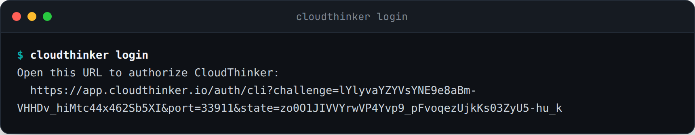

CloudThinker CLI はブラウザー経由でサインインし、ワークスペースごとに 1 つの認証情報を保存するため、API キーを貼り付ける必要はありません。このページでは、ノート PC やリモートマシンでのログイン、ワークスペースの切り替え、スクリプトや CI ジョブの認証について説明します。

## 前提条件

- CLI がインストールされていること。[CLI 概要](/ja/guide/cli/overview)を参照してください。
- 少なくとも 1 つのワークスペースにアクセスできる CloudThinker アカウント。ワークスペースとは、接続と会話を保持するプロジェクトです。

## ログインする

<Steps>
  <Step title="ログインを開始する">
    ```bash
    cloudthinker login
    ```

    対話型のターミナルでは、CLI が **How would you like to log in?** と尋ねます。

    | 選択肢 | 使う場面 |
    | --- | --- |
    | **Log in with browser** | ブラウザーのある自分のマシンを使っている場合。ほとんどのユーザーにおすすめです |
    | **Log in with a code** | ブラウザーのない SSH やリモートセッションにいる場合 |

    矢印キーを使うか `1` または `2` を押して、Enter を押します。
  </Step>

  <Step title="ブラウザーで承認する">
    CLI はリンクとともに `Open this URL to authorize CloudThinker:` を表示し、そのリンクを開きます。ブラウザーが開かなかった場合は、`c` を押してリンクをコピーします。サインインし、ワークスペースを選び、5 分以内にリクエストを承認します。

    <Frame>
      
    </Frame>

    **完了の状態:** ターミナルに `Logged in to <workspace>.` と表示されます。

    **Log in with a code** を選んだ場合は、代わりに[リモートマシンでログインする](#リモートマシンでログインする)に従ってください。
  </Step>

  <Step title="認証情報を検証する">
    ```bash
    cloudthinker whoami
    ```

    `whoami` はローカルファイルではなく API に問い合わせるため、認証情報が有効であることを証明できます。

    **完了の状態:** `host=`、`email=`、`workspace=` の値を含む 1 行が表示されます。機械可読な出力が必要な場合は `--json` を追加します。
  </Step>
</Steps>

### リモートマシンでログインする

SSH 経由や、ディスプレイのない Linux では、CLI が自動でコードフローを選び、`No local browser detected (SSH session). Using device-code login.` と表示します。コードが入力済みの URL、コード自体、コードの有効期間が表示されます。任意のデバイスの任意のブラウザーで URL を開き、承認する前に、ページに同じコードが表示されていることを確認してください。

```text
Open this URL to authorize CloudThinker:
  <verification URL with the code>

Confirm that it shows this code:
  <code>
(or enter it at <verification URL>)

The code expires in <m:ss>.
```

待機中、ターミナルには `Waiting for approval: … elapsed, code expires in …` と表示されます。

| やりたいこと | 実行するコマンド |
| --- | --- |
| コードフローを強制する | `cloudthinker login --device-auth` |
| ブラウザーを開かずに URL を表示する | `cloudthinker login --no-browser` |
| このマシンで常に 1 つのフローを使う | `CLOUDTHINKER_LOGIN=browser` または `CLOUDTHINKER_LOGIN=device` を設定する |

## 複数のワークスペースを扱う

ワークスペースごとに 1 回ログインします。各ログインはホストとワークスペースごとに保存されるため、2 つ目のワークスペースにログインしても 1 つ目は残ります。

| やりたいこと | 実行するコマンド |
| --- | --- |
| 保存済みのワークスペースログインを一覧表示し、有効なものを確認する | `cloudthinker auth status` |
| 別の保存済みログインを有効にする | `cloudthinker auth switch Production` |
| 1 つのコマンドだけでワークスペースを使う | `cloudthinker --workspace Production whoami` |
| シェルセッション全体でワークスペースを使う | `export CLOUDTHINKER_WORKSPACE=Production` |

`--workspace`、`auth switch`、`CLOUDTHINKER_WORKSPACE` には、ワークスペース ID か正確なワークスペース名を指定します。空白を含む名前は引用符で囲んでください。`--workspace` はコマンド名の前に置きます。

```bash
cloudthinker --workspace 11111111-1111-4111-8111-111111111111 chat -p "Check the error budget"
```

### カスタムホストを使う

`https://app.cloudthinker.io` 以外のホストを使うには、`cloudthinker login --url <origin>` を一度実行します。以降のコマンドはそれを記憶します。`CLOUDTHINKER_URL` を設定することもできます。[CLI リファレンス](/ja/guide/cli/reference#環境変数)を参照してください。

## スクリプトや CI ジョブを認証する

パイプラインにはブラウザーがないため、ログインを承認できません。代わりに、[サービスアカウント](/guide/api/tokens#service-accounts)のトークンか[個人用 API トークン](/guide/api/tokens)を `CLOUDTHINKER_TOKEN` に渡します。[CI/CD で CloudThinker を使う](/guide/api/ci-cd)を参照してください。

| 方法 | 使う場面 |
| --- | --- |
| `CLOUDTHINKER_TOKEN` にサービスアカウントトークン（推奨） | CI ジョブ。`ct_sat_` トークンは人ではなくサービスアカウントとして動作し、期限が切れるか Admin が失効させるまで有効です |
| `CLOUDTHINKER_TOKEN` に個人用 API トークン | 自分のスクリプト。`ct_pat_` トークンはあなたとして動作し、選んだスコープと自分のロールの範囲に制限されます |
| `cloudthinker login --token < token.txt` | 保存済みのログインを保持すべきジョブ。個人用 API トークン（`ct_pat_`）をコマンドラインからではなく stdin から読み取り、サーバーで確認して、対象となる各ワークスペースに保存します。`Logged in with an access token. Active workspace: …`、トークンのスコープ、有効期限が表示されます |
| ランナーでログインする | 自分で管理するランナーでジョブを実行する場合。ランナーで `cloudthinker login --device-auth` を一度実行します。保存済みのログインは自動で更新されます |
| `CLOUDTHINKER_TOKEN` に `auth token` の短期トークン | 短いジョブが、ラッパーから 30 分間有効なトークンを受け取る場合。CLI はこれを更新しないため、期限が切れるとジョブは[終了コード 3](/ja/guide/cli/reference#終了コード) で失敗します |
| `cloudthinker auth token`（別のツール向け） | 別のツールがベアラーを必要とする場合。現在のアクセストークンだけを stdout に出力し、期限が近ければ先に更新します |

<Warning>
ランナーのログインはログインした人として動作するため、そのランナー上のすべてのジョブがその人のアクセス権で実行されます。サービスアカウントトークンを優先してください。失効させるには、ランナーで `cloudthinker logout` を実行します。
</Warning>

```bash
# Short job: a wrapper hands the CLI a fresh token
export CLOUDTHINKER_TOKEN="$(cloudthinker auth token)"
cloudthinker chat -p "Summarize last night's failed runs" --json
```

`cloudthinker auth token` のトークンは、期限が切れるまであなたとして認証されます。パスワードと同様に扱い、ログに残さず、コミットせず、チャットに貼り付けないでください。

トークン自体がワークスペースを示すため、`CLOUDTHINKER_TOKEN` と一緒に `--workspace` または `CLOUDTHINKER_WORKSPACE` が設定されていると、`review setup` と `doctor` を除くすべてのコマンド（`cloudthinker api` を含む）が[コード 2](/ja/guide/cli/reference#終了コード) で終了します。トークンをエクスポートする前に `CLOUDTHINKER_WORKSPACE` を解除してください。API トークン（`ct_pat_` または `ct_sat_`）は、`cloudthinker chat`、`cloudthinker incident ls` と `incident status`、Public API のコマンド、[`cloudthinker api`](/guide/cli/api#pick-the-workspace) で使えます。その他のほとんどのコマンドには、ログインか `auth token` のトークンが必要です。

## 認証情報の保存場所

CLI は認証情報をプレーンな JSON として 1 つのファイルに書き込み、そのファイルはあなたのユーザーだけが読み取れます（モード 0600）。OS のキーチェーンは使いません。0.5.3 より前のリリースは使っていましたが、アップグレードするとそれらのログインはファイルに移されます。

| OS | パス |
| --- | --- |
| macOS | `~/Library/Application Support/cloudthinker/credentials.json` |
| Linux | `$XDG_CONFIG_HOME/cloudthinker/credentials.json`。この変数が設定されていない場合は `~/.config/cloudthinker/credentials.json` |
| すべて（`CLOUDTHINKER_CONFIG_DIR` が設定されている場合） | `$CLOUDTHINKER_CONFIG_DIR/credentials.json`。このとき `whoami` が認証情報のパスを表示します |

このファイルは、ホストとワークスペースをキーとして、すべてのワークスペースログインを保持します。

## ログアウトする

```bash
cloudthinker logout          # the selected or active workspace
cloudthinker logout --all    # every workspace stored for this host
```

ログアウトすると、サーバーに認証情報の失効を依頼し、ローカルファイルから削除します。サーバーに接続できなくても、ローカルのコピーは削除されます。

**完了の状態:** ターミナルに `Logged out.` または `Logged out of all workspaces for this host.` と表示されます。

## トラブルシューティング

<AccordionGroup>
  <Accordion title="コマンドがログインしていないと表示する（終了コード 3）">
    認証情報が存在しないか期限切れであるか、サーバーがアクセスを拒否しました。`cloudthinker login` を再実行してください。非対話シェルでは、CLI はブラウザーを開かず、実行すべきログインコマンドを表示して停止します。
  </Accordion>
  <Accordion title="CLOUDTHINKER_TOKEN が拒否される、または auth switch が効かない">
    環境変数のトークンは保存済みの認証情報より優先されるため、ログインし直したり `auth switch` を実行したりしても何も変わりません。トークンを差し替えるか、`unset CLOUDTHINKER_TOKEN` を実行して保存済みのログインを使ってください。
  </Accordion>
  <Accordion title="ブラウザーでの同意がタイムアウトした">
    同意リンクの有効期間は 5 分です。`cloudthinker login` を再実行するか、`cloudthinker login --device-auth` で別のデバイスから承認してください。
  </Accordion>
  <Accordion title="ワークスペース名が受け付けられない">
    `--workspace` は正確な名前かワークスペース ID に一致します。`cloudthinker auth status` で保存済みのワークスペースを確認し、空白を含む名前は引用符で囲んでください。
  </Accordion>
</AccordionGroup>

## 次のステップ

<CardGroup cols={2}>
  <Card title="Headless Chat" icon="terminal" href="/ja/guide/cli/headless-chat">
    設定した認証情報を使って、スクリプトや CI からプロンプトを送ります。
  </Card>
  <Card title="CLI リファレンス" icon="book" href="/ja/guide/cli/reference">
    すべてのフラグ、環境変数、終了コード。
  </Card>
</CardGroup>
