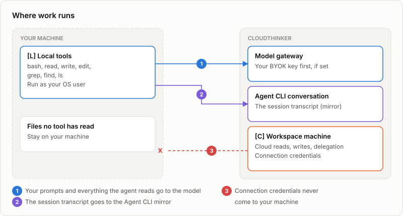
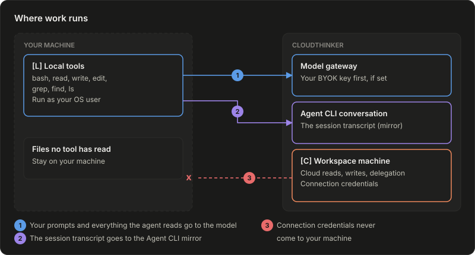
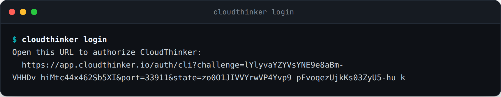

CloudThinker CLI（`cloudthinker`）は、CloudThinker のワークスペースをターミナルに持ち込みます。`cloudthinker` と入力してタスクを平易な言葉で説明すると、エージェントがカレントディレクトリで作業します。スクリプトでは `cloudthinker chat -p` を使って stdout で回答を受け取ります。

<Note>
**ベータ版。** CLI はベータ版です。コマンド名やフラグは一般提供前に変更される場合があります。CLI は [environment](/guide/workers) を **outpost** と呼ぶため、コマンドには `--outpost` が登場します。`cloudthinker --version` で自分のバージョンを確認し、変更点は [リリースページ](https://github.com/cloudthinker-ai/cloudthinker-cli/releases)で確認してください。
</Note>

## できること

| タスク | コマンド |
| --- | --- |
| カレントディレクトリでエージェントセッションを開始する | `cloudthinker` を実行し、タスクを説明する |
| 開発中のアプリのローカルなセキュリティテストを実行する。Pentest は制限付きの機能です。ワークスペースで有効にするよう CloudThinker の担当者に依頼してください。テストは、自分が所有するアプリか、テストの許可を得たアプリだけに行ってください。[セキュリティテストを実行する](/ja/guide/security/security-testing)を参照してください | `cloudthinker` を実行し、「Test http://localhost:3000 for security issues」と伝える |
| 1 つ質問して回答をパイプする | `cloudthinker chat -p "Check production health"` |
| プッシュする前にローカルの Git の変更をレビューする | `cloudthinker review` |
| マージリクエストやプルリクエストの [Review](/ja/guide/code-review/overview) を追跡する | `cloudthinker review watch <MR_URL>` |
| CloudThinker の会話に、このマシンのフォルダーで作業させる | `cloudthinker worker start --outpost <name> --workdir "$PWD"`。[Environments](/guide/workers) を参照してください |

## どこで何が実行されるか

<Frame caption="ローカルツールはあなたのマシンで実行されます。エージェントが読み取った内容はモデルに送られ、接続のクレデンシャルはワークスペースのマシンに留まります。">
  
  
</Frame>

<Warning>
あなたのマシンでは、エージェントは OS ユーザーとしてファイルを読み取り・編集し、シェルコマンドを実行します。Approval mode が **Auto** のときは事前に確認しません。**Manual** のときは、ファイルの編集や何かを変更する可能性のあるコマンドの前に、ターミナルで確認します。信頼できないリポジトリでは、コンテナーや使い捨てのチェックアウトでエージェントを実行してください。
</Warning>

| 場所 | 何が起きるか | ネットワークを越えるもの |
| --- | --- | --- |
| あなたのマシン | エージェントが OS ユーザーとしてファイルを読み取り・編集し、シェルコマンドを実行します。**Manual** では、ファイルの編集や何かを変更する可能性のあるコマンドの前に、まず確認します | エージェントが読み取ったファイルの内容やコマンドの出力などのツール結果が、クラウドのモデルに送られます |
| クラウド | モデルが実行され、ワークスペースの[接続](/ja/guide/connections/overview)（リンクしたクラウドアカウントやツール）がそこで使われます | 接続のクレデンシャルがあなたのマシンに届くことはありません。クラウドへの書き込みは [Approvals](/guide/approvals/overview) の設定に従います |

モデルに送ってもかまわない内容のフォルダーでのみ、エージェントを実行してください。詳細は [Where work runs](/ja/guide/cli/agent#作業が実行される場所) を参照してください。

## 前提条件

- macOS（Apple Silicon または Intel）、Linux（x86_64 または arm64）、Windows（x86_64）。Windows ではヘッドレスチャットやその他のコマンドは動作しますが、対話型エージェント（`cloudthinker`）と `cloudthinker remote` は動作しません。エージェントの Windows ビルドがないためです。
- 少なくとも 1 つのワークスペースにアクセスできる CloudThinker アカウント。ヘッドレスチャット（`cloudthinker chat`）は Free を含むすべてのプランで動作します。対話型エージェント（`cloudthinker`）には Team、Scale、Enterprise が必要で、Free ではアップグレードの案内を表示して起動を拒否します。[料金](/ja/guide/billing/pricing)を参照してください。
- `cloudthinker.io`（インストーラー）、`github.com`（CLI とエージェントのダウンロード）、`app.cloudthinker.io`（API）への送信 HTTPS。プロキシの背後では `HTTPS_PROXY` を設定します。プロキシが HTTPS を再署名する場合は、`SSL_CERT_FILE` に社内の CA バンドルを設定します。

## インストールして最初のセッションを実行する

<Steps>
  <Step title="CLI をインストールする">
    ```bash
    curl -fsSL https://cloudthinker.io/install.sh | sh
    ```

    インストーラーは `cloudthinker` バイナリを `~/.local/bin` に配置し、シェルプロファイルでそのフォルダーを `PATH` に追加します。ターミナルでは、すでにログインしていない限り、続けてログインを開始します。CI の中や、`CLOUDTHINKER_CLI_NO_LOGIN=1` を設定した場合はログインをスキップします。完了したら新しいシェルを開いてください。

    Windows では、代わりに PowerShell のインストーラーを実行します。

    ```powershell
    powershell -ExecutionPolicy Bypass -c "irm https://github.com/cloudthinker-ai/cloudthinker-cli/releases/latest/download/cloudthinker-cli-installer.ps1 | iex"
    ```

    マシンがスクリプトを `sh` にパイプすることをブロックしている場合や、特定のバージョンが必要な場合は、代わりに[リリースページ](https://github.com/cloudthinker-ai/cloudthinker-cli/releases)から、プラットフォームに合ったアーカイブとその `.sha256` ファイルをダウンロードします。

    ```bash
    shasum -a 256 -c <archive>.sha256   # prints "<archive>: OK"
    tar xf <archive>
    mkdir -p ~/.local/bin && mv <extracted-folder>/cloudthinker ~/.local/bin/
    ```

    **完了の状態:** `cloudthinker --version` がバージョン番号を表示します。
  </Step>

  <Step title="ログインする">
    インストーラーがすでに `Logged in to <workspace>.` と表示した場合は、この手順をスキップしてください。

    ```bash
    cloudthinker login
    ```

    CLI が **How would you like to log in?** と尋ねます。自分のマシンでは **Log in with browser** を、SSH 経由では **Log in with a code** を選びます。ブラウザーでリクエストを承認し、ワークスペースが複数ある場合は 1 つ選びます。

    <Frame>
      
    </Frame>

    **完了の状態:** ターミナルに `Logged in to <workspace>.` と表示されます。リモートマシン、複数のワークスペース、CI については [CLI の認証](/ja/guide/cli/authentication)を参照してください。
  </Step>

  <Step title="自分のアカウントを確認する">
    ```bash
    cloudthinker whoami
    ```

    **完了の状態:** `host=https://app.cloudthinker.io email=you@example.com workspace=Production (<workspace-id>)` のような 1 行が表示されます。
  </Step>

  <Step title="エージェントを起動するか、1 つ質問する">
    ```bash
    cloudthinker                                    # interactive agent in this folder
    cloudthinker chat -p "Check production health"  # one headless prompt, answer on stdout
    ```

    最初の `cloudthinker` の実行で、CLI のバージョンに対応するエージェントビルドを `~/.cloudthinker/agent/bin/<version>/` にダウンロードし、リリースの SHA-256 チェックサムと照合します。以降の実行ではそれを再利用します。

    **完了の状態:** エージェントのヘッダーにワークスペース、ユーザー、ワークスペースの Approval mode（`· Auto` または `· Manual`）が表示され、プロンプトがリクエストを受け付ける状態になります。[Agent CLI](/ja/guide/cli/agent) を参照してください。
  </Step>
</Steps>

## カスタムドメインを使う

セルフホストなど、CloudThinker が独自のドメインで動いている場合は、そのドメインに一度ログインします。パスを付けずにオリジンだけを渡します。

```bash
cloudthinker login --url https://cloudthinker.example.com
```

CLI はドメインを記憶するため、以降のコマンドに `--url` は不要です。マシンには、`app.cloudthinker.io` の代わりにそのドメインへの送信 HTTPS が必要です。

| やりたいこと | 実行するコマンド |
| --- | --- |
| CLI が使っているドメインを確認する | `cloudthinker whoami` を実行し、`host=` を読む |
| 1 つのコマンドや CI ジョブで別のドメインを使う | `CLOUDTHINKER_URL=https://cloudthinker.example.com` を設定する |
| CloudThinker クラウドに戻る | `cloudthinker login --url https://app.cloudthinker.io` |

**完了の状態:** `cloudthinker whoami` が `host=https://cloudthinker.example.com` と表示します。`CLOUDTHINKER_URL` については [CLI リファレンス](/ja/guide/cli/reference#環境変数)を参照してください。

## コマンド

| コマンド | 内容 |
| --- | --- |
| `cloudthinker` または `cloudthinker agent` | このフォルダーで対話型エージェントを起動します。[Agent CLI](/ja/guide/cli/agent) を参照してください |
| `cloudthinker chat` | ヘッドレスプロンプトの送信、実行の確認、最近の実行の一覧表示を行います。[ヘッドレスチャット](/ja/guide/cli/headless-chat)を参照してください |
| `cloudthinker review` | ローカルの変更をレビューするか、マージリクエストの URL から追跡中のレビューを読み取ります。[Review コマンド](/ja/guide/cli/reference#review)を参照してください |
| `cloudthinker incident` | オンコールのスクリプトや CI 向けに、インシデントを一覧表示するか、解決されるまで待機します。[Incidents and recommendations](/ja/guide/cli/reference#インシデントと推奨事項) を参照してください |
| `cloudthinker recommendations` | コストと効率の推奨事項を、月間の削減額とともに一覧表示します。[Incidents and recommendations](/ja/guide/cli/reference#インシデントと推奨事項) を参照してください |
| `cloudthinker cyber` | Cyber のアプリ、ドメイン、実行、検出結果を一覧表示します。[Cyber コマンド](/ja/guide/cli/reference#cyber)を参照してください |
| `cloudthinker worker` | このマシンでワーカーを実行し、environment を管理します |
| `cloudthinker remote` | SSH 経由でリモートマシン上でエージェントを実行します。接続が切れても実行は続きます。両方のマシンに CLI が必要です。CLI のない Linux マシンでは、ノート PC からコピーするよう提案されます。[Remote agent](/ja/guide/cli/reference#リモートエージェント) を参照してください |
| `cloudthinker login` / `logout` / `whoami` | サインイン、サインアウト、現在のアカウントとワークスペースの確認を行います |
| `cloudthinker auth` | アクセストークンの表示、保存済みのワークスペースログインの一覧表示、有効なログインの切り替えを行います |
| `cloudthinker update` | 最新のリリースをインストールします |
| `cloudthinker completion <shell>` | bash、zsh、fish 用の補完スクリプトを出力します |

すべてのフラグ、環境変数、終了コードは [CLI リファレンス](/ja/guide/cli/reference)にあります。

## CLI を最新に保つ

`cloudthinker update` はいつでも実行できます。対話型のターミナルでは、新しいリリースがあると CLI が更新を提案します。チェックは最大で 20 時間ごとです。`Install it now? [y/N] (s skips this version)` と尋ねられます。

| 回答 | 結果 |
| --- | --- |
| `y` | 新しいリリースを今すぐインストールします |
| Enter、またはそれ以外 | 今はインストールしません。CLI はあとでまた提案します |
| `s` | そのバージョンをスキップします。次のバージョンが提案されます |

CI などで提案をオフにするには、`CLOUDTHINKER_NO_UPDATE_CHECK=1` を設定します。バージョンを固定したりロールバックしたりするには、`cloudthinker update --version <version>` を実行します。例：`cloudthinker update --version 0.12.2`。

## 別のコーディングエージェントから CLI を使う

バイナリには、AI コーディングエージェントに CLI の使い方（チャット、会話の追跡、コードレビューの読み取り、ローカルの Cyber テストの実行）を教える運用ガイドが含まれています。表示するのにログインやネットワークは不要です。コーディングエージェントがスキルを読み込む場所に保存してください。例:

```bash
mkdir -p .agents/skills/cloudthinker-cli
cloudthinker --skill > .agents/skills/cloudthinker-cli/SKILL.md
```

## アンインストール

```bash
cloudthinker logout --all
rm ~/.local/bin/cloudthinker
rm -rf ~/.cloudthinker   # agent builds, agent settings, session transcripts, Cyber tools
```

次に、設定ディレクトリの `cloudthinker` フォルダー（macOS では `~/Library/Application Support/cloudthinker`、Linux では `$XDG_CONFIG_HOME/cloudthinker` または `~/.config/cloudthinker`）を削除し、インストーラーがシェルプロファイルに追加した `PATH` の行を削除します。CLI が書き込むすべてのパスは [Files](/ja/guide/cli/reference#ファイル) を参照してください。

## トラブルシューティング

<AccordionGroup>
  <Accordion title="cloudthinker: command not found">
    インストーラーは `~/.local/bin` を `PATH` に追加しましたが、現在のシェルはその前に起動しています。新しいシェルを開くか、`~/.local/bin/cloudthinker --version` を直接実行してください。
  </Accordion>
  <Accordion title="コマンドがログインしていないと表示する（終了コード 3）">
    認証情報が存在しないか期限切れであるか、サーバーがアクセスを拒否しました。`cloudthinker login` を実行し、`cloudthinker whoami` で確認してください。[CLI の認証](/ja/guide/cli/authentication)を参照してください。
  </Accordion>
  <Accordion title="Ctrl-C で回答が届く前にチャットが止まった">
    止まったのは待機だけです。実行はサーバーで続き、CLI は待機を再開するコマンドを表示します。
  </Accordion>
</AccordionGroup>

## 次のステップ

<CardGroup cols={2}>
  <Card title="CLI の認証" icon="key" href="/ja/guide/cli/authentication">
    SSH 経由でログインし、ワークスペースを切り替え、CI ジョブを認証する
  </Card>
  <Card title="Agent CLI" icon="laptop-code" href="/ja/guide/cli/agent">
    自分のリポジトリでエージェントセッションを実行する
  </Card>
  <Card title="ヘッドレスチャット" icon="terminal" href="/ja/guide/cli/headless-chat">
    CloudThinker の回答をスクリプトやパイプラインに流し込む
  </Card>
  <Card title="CLI リファレンス" icon="book" href="/ja/guide/cli/reference">
    すべてのコマンド、フラグ、変数、終了コード
  </Card>
</CardGroup>
