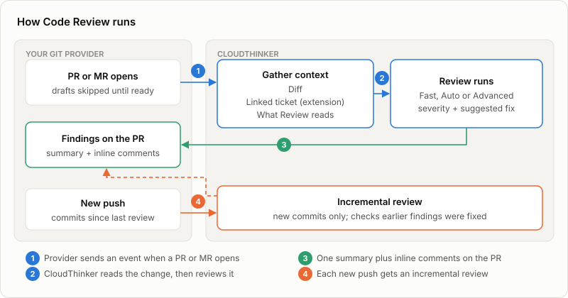
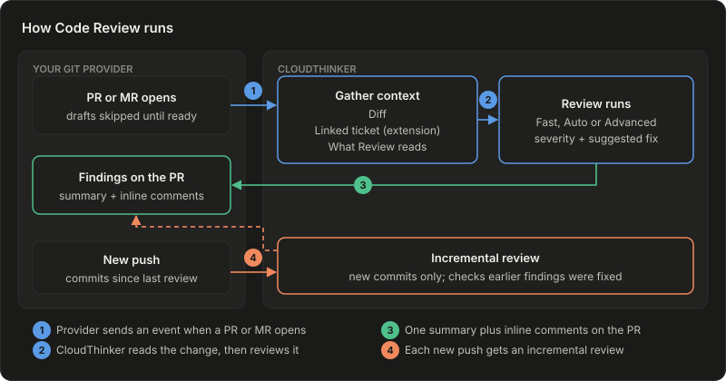

import { ReviewLoopScene } from '/snippets/iso/review-loop.jsx';

**本番環境で何も壊れません。**

Review は、コード変更のための Frontier Investigation Agent であり、プルリクエスト（PR）とマージリクエスト（MR）のための AI レビュアーです。誰かが PR や MR を開くと、CloudThinker が変更を読み、サマリーコメントとインラインの検出を投稿し、再度プッシュされたときに修正を確認します。

<ReviewLoopScene />

リンターはパターンに一致させます。Review は、変更が何をしようとしているかを読みます。差分、リンクされたチケット、チームの規約ファイル、そして用意していれば、プロダクトが守るべきルールを記述した `BUSINESS.md` です。そのため、スタイルの乱れだけでなく、壊れたビジネスルールや危険なマイグレーションも指摘できます。

## 仕組み

<Frame caption="すべての PR や MR にレビューが投稿され、新しいプッシュごとに差分レビューが行われます。">
  
  
</Frame>

1. **PR や MR が開かれる。** Git プロバイダーを接続してリポジトリを一度選べば、その後は PR や MR が開かれるたびにプロバイダーが CloudThinker にイベントを送り、誰もレビューを開始する必要はありません。下書きの PR や MR は、レビュー可能としてマークされるまでスキップされます。
2. **CloudThinker がコンテキストを集める。** 変更をチェックアウトし、差分、説明からリンクされたチケット（[拡張機能](/ja/guide/code-review/extensions)を追加すれば Jira、Linear、Backlog、プロバイダーの Issue）、および [Review が読み取るもの](#review-が読み取るもの)に挙げたファイルを読み取ります。
3. **レビューが実行される。** 深さはワークスペースの[レビューモード](/ja/guide/code-review/setup#レビューモードを選ぶ)（**Fast**、**Auto**、**Advanced**）によって決まります。各レビューはクレジットを消費します。[使用状況とクレジット](/ja/guide/billing/usage)を参照してください。
4. **検出が PR に届く。** サマリーコメント 1 つと、インラインコメントが届きます。各検出には重大度（Critical、High、Medium、Low）と修正案が付きます。
5. **新しいプッシュには差分レビューが行われる。** 前回のレビュー以降にプッシュされたコミットだけが読み取られ、以前の検出が修正されたかどうかが確認されます。

未解決の検出のうち最も重大なものがレビューの判定を決めます。完了しなかった実行やスキップされた実行には、代わりに独自のステータスが付きます。判定は CloudThinker が変更に付けるラベルであり、マージできるかどうかは引き続きプロバイダーのブランチルールが決めます。7 種類すべての判定と、それぞれで求められることは[判定](/guide/code-review/review-workspace#triage-the-changes-list)を参照してください。

<Note>
  CloudThinker は、読み取りのために選択した各リポジトリのコピーを独自に保持し、**Remove setup** をクリックするとそれらのコピーを削除します。ツール出力内のシークレットは、モデルが見る前にプレースホルダーに置き換えられます。[データ保護](/guide/security/data-protection)を参照してください。
</Note>

変更されたテストファイル、フィクスチャとテストデータ、スナップショット、生成コード、Storybook のストーリー、プロトタイプ、`docs/` 配下の HTML、ベンダリングされた Jsonnet はレビューされず、これらに検出が付くことはありません。

<Accordion title="スキップされるパスパターンの全一覧">
  ```text
  **/test_*.py              **/conftest.py              **/*_test.go
  **/src/test/java/**/*.java                            **/src/test/**/*.{kt,kts}
  **/*.test.{js,jsx,ts,tsx} **/*.spec.{js,jsx,ts,tsx}   **/__tests__/**
  **/test/**/*_test.py      **/tests/**/*_test.py       **/*_test.py
  **/*_spec.rb              **/spec/**/*_spec.rb        **/*Test.java
  **/*Tests.java            **/*_test.rs                **/oh_modules/**
  **/*.test.ets             **/test/**/*.jl             **/test/**/*.hs
  **/*Spec.hs               **/test/**/*.lhs            **/*Spec.lhs
  **/tests/**/*.nim         **/tests/**/*.R             **/__snapshots__/**
  **/*.snap                 **/testdata/**              **/fixtures/**
  **/.ipynb_checkpoints/**  **/*.generated.*            **/*.gen.go
  **/*.pb.go                **/*.pb.cc                  **/*.pb.h
  **/*Test.swift            **/*Tests.swift             **/Tests/**/*.swift
  **/tests/**/*.elm         **/vendor/**/*.{jsonnet,libsonnet}
  **/test/**/*.zig          **/*_test.zig               **/kitex_gen/**/*.go
  **/*.capnp.h              **/*.capnp.go               **/*.capnp.ts
  **/*_capnp.rs             **/*_capnp.py               **/test/**/*.ml
  **/tb_*.{v,sv,vhd,vhdl}   **/*_tb.{v,sv,vhd,vhdl}     lib/**/*.sol
  **/*.t.sol                **/test/**/*.sol            **/tests/**/*.sol
  **/test/**/*.vy           **/tests/**/*.vy            **/*.stories.{js,jsx,ts,tsx,mdx}
  **/prototypes/**          **/docs/**/*.html
  ```
</Accordion>

一致の判定はファイルパスのみで行われ、この組み込みの一覧には追加できません。意図せず対象になるパスについては、[検出が誤っている、またはノイズが多い](/guide/code-review/troubleshooting#findings-are-wrong-or-noisy)を参照してください。

## Review が読み取るもの

差分のほかに、Review はチーム自身の知識を読み取ります。すべて任意ですが、使うほどレビューの精度が上がっていきます。

| ファイル | 置き場所 | 役割 |
|---|---|---|
| [`BUSINESS.md`](/guide/code-review/business-flow) | ターゲットブランチのリポジトリのルート | プロダクトのモジュールと、それらが守るべきルール（不変条件）を記述します。Business flow の検出はこのファイルから生まれます。存在すれば常に読み取られます |
| 規約ファイル | `AGENTS.md`、`CLAUDE.md`、`CONVENTIONS.md`、および Cursor や Copilot などのコーディングエージェントのルールファイル。リポジトリのルートまたは任意のフォルダー | Review が従うコーディング規約。[認識されるすべてのパス](/ja/guide/code-review/learnings#独自の規約ファイルを追加する) |
| [Learnings](/ja/guide/code-review/learnings) | CloudThinker がリポジトリごとに保持し、ファイルは不要 | チームが解決した検出から CloudThinker が学ぶルール。Review は新しいレビューすべてにこれを適用するため、同じミスは次回に検出されます |

`BUSINESS.md` は、短い決まった形式で手書きします。[Business flow checks](/guide/code-review/business-flow) を参照してください。ファイルを解析できない場合でも、レビューはそれなしで実行されます。

## チェックする内容

各検出には 1 つのカテゴリが付きます。

| カテゴリ | 検出するもの | 例 |
|---|---|---|
| Security | インジェクション、露出したシークレット、安全でない認証や権限 | リクエストの入力からパラメーター化せずに組み立てたクエリ |
| Correctness | ロジックの誤り、null の扱い、競合状態 | 2 つのリクエストが同じ行に書き込んだときの更新の消失 |
| Performance | 遅いクエリ、N+1 ループ、ブロッキング呼び出し | リクエストハンドラー内でのフルテーブルスキャン |
| Pattern | リポジトリがすでに従っている規約を破るもの | 共通のエラーラッパーを使わない新しいハンドラー |
| Deploy、migration、後方互換性 | ロールアウトや既存のクライアントを壊す変更 | 現在のリリースがまだ読み取る列を削除するマイグレーション |
| Test gap | どのテストもカバーしていない動作の変更 | テストを追加しない PR で、テストのない新しいエラー経路 |
| Business flow | `BUSINESS.md` のルールを破る変更 | 不変条件で有料プラン専用とされている機能を、トライアルアカウントが使えるようにするコード |

## できること

| 機能 | 得られるもの | 詳細 |
|---|---|---|
| 自動レビュー | すべての新しい PR や MR へのサマリーとインラインの検出 | [Review をセットアップする](/ja/guide/code-review/setup) |
| ウォークスルーを試す | 本番環境を壊すはずだったプルリクエスト 1 件：検出、その確認方法、マージ前の修正 | [Review で危険なプルリクエストを捕まえる](/guide/use-cases/review-risky-pull-request) |
| 概要ダッシュボード | 自分の対応を待っている変更を見つけ、レビュー活動を確認する | [Review Dashboard](/guide/code-review/dashboard) |
| Codebase Atlas | チームが何をマージし、どこに入り、何に注意が必要かを確認する | [Codebase Atlas](/guide/code-review/codebase-atlas) |
| UI Review: Loupe | 変更が触れるページのスクリーンショットを、マージ前に実行中のアプリで確認する | [UI Review: Loupe](/guide/code-review/loupe) |
| Business flow checks | 記述した料金、権利、金銭のルールを変更が破ったときの検出 | [Business flow checks](/guide/code-review/business-flow) |
| パーソナライズ | チームに合わせてサマリーのセクション、トーン、言語を設定する | [Review Personalization](/guide/code-review/customizations) |
| リポジトリ管理 | リポジトリごとに Review、Atlas のマッピング、Learnings を制御する | [Manage Review Repositories](/guide/code-review/repository-management) |
| Review ワークスペース | レビューされたすべての変更、その検出とステータスを CloudThinker で確認する | [Review ワークスペース](/guide/code-review/review-workspace) |
| メンションコマンド | PR のコメントで `@cloudthinker-ai` を使い、質問、レビューの再実行、検出の修正を行う | [メンションコマンド](/ja/guide/code-review/mention-commands) |
| Learnings | 解決済みの検出から繰り返されるパターンを、今後のレビューに適用する | [Learnings](/ja/guide/code-review/learnings) |
| パイプライン分析 | 失敗した CI の実行ごとの説明と修正案 | [Pipeline Analysis](/guide/code-review/pipelines) |
| コンフリクトの自動解決 | オープン中の MR/PR のマージコンフリクトを解決するフォローアップの MR/PR。Azure DevOps では利用できません | [Auto-resolve conflicts](/guide/code-review/conflict-resolution) |
| Release Risk | リリースに対するリリース可否の判定 1 つと、各ブロッカーの理由 | [Release Risk](/guide/code-review/releases) |
| Insights | どの検出カテゴリがチームに影響し、どれだけ速く修正されているか | [Insights](/ja/guide/code-review/analytics) |
| トラブルシューティング | レビューが投稿されなかった、止まった、スキップされた理由と、原因、確認方法、修正 | [Review のトラブルシューティング](/guide/code-review/troubleshooting) |

## 対応プロバイダー

GitHub、GitLab（GitLab.com またはセルフホスト）、Bitbucket Cloud、Azure DevOps、AWS CodeCommit に対応しています。それぞれに必要なものは[プロバイダーの認証](/guide/code-review/provider-auth)を参照してください。展開を計画する前に、次の制限を確認してください。

- **ワークスペースごとにプロバイダー 1 つ、Azure DevOps プロジェクト 1 つ。** 2 つ目のプロバイダーや、2 つ目の Azure DevOps プロジェクトのリポジトリには、別のワークスペースが必要です。
- **入力できるインスタンス URL はセルフホストの GitLab だけです。** GitHub Enterprise Server と Bitbucket Data Center は選択できません。CodeCommit の接続は 1 つの AWS アカウントとリージョンを対象とします。

自動レビューは 5 つのプロバイダーすべてで実行されます。その上の操作はそうではありません。

- `@cloudthinker-ai` を使ったコメントコマンドはプロバイダーによって異なり、AWS CodeCommit はトップレベルの質問のみに対応します。[プロバイダーの対応状況](/ja/guide/code-review/mention-commands#プロバイダーの対応状況)を参照してください。
- **Apply fix** のプロバイダー別の対応は [Work the findings](/guide/code-review/review-workspace#work-the-findings) に、**Fix all findings** と **Merge** は [Re-run, fix, and merge](/guide/code-review/review-workspace#re-run-fix-and-merge) に記載しています。
- [コンフリクトの自動解決](/guide/code-review/conflict-resolution)は、Azure DevOps を除くすべてのプロバイダーで動作します。

似ていますが置き場所が異なる 2 つのテキストがあります。コメント内の `@cloudthinker-ai` は質問、再レビュー、修正を依頼し、説明内の `@cloudthinker:ignore` はその変更の[レビューをスキップ](/ja/guide/code-review/mention-commands#レビューをスキップする)します。[メンションコマンド](/ja/guide/code-review/mention-commands)を参照してください。

## はじめに

<CardGroup cols={2}>
  <Card title="Review をセットアップする" icon="gear" href="/ja/guide/code-review/setup">
    プロバイダーを接続し、リポジトリを選んで、最初のレビューを受けます。
  </Card>
  <Card title="プロバイダーの認証" icon="key" href="/guide/code-review/provider-auth">
    各 Git プロバイダーのトークン、スコープ、Webhook。
  </Card>
</CardGroup>
