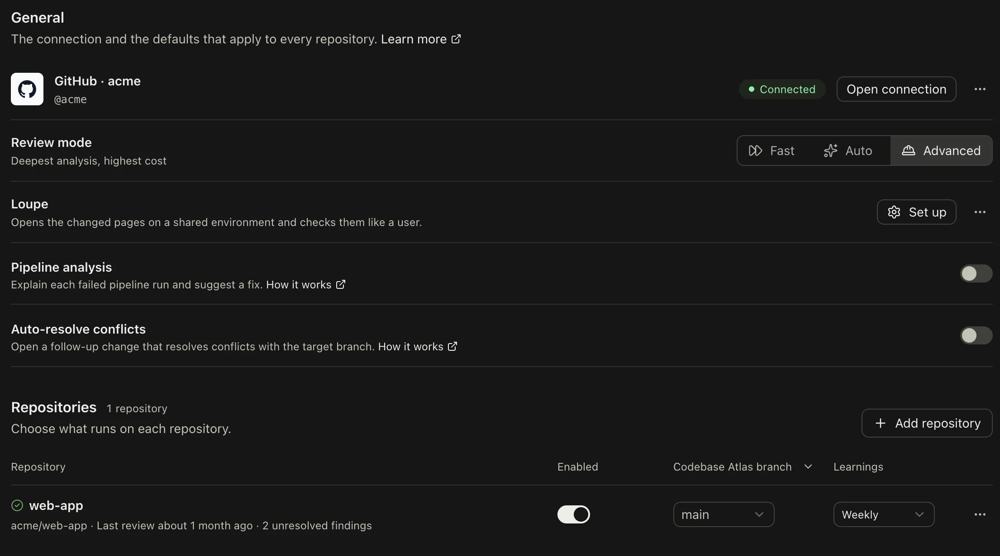

Git プロバイダーを一度接続して監視するリポジトリを選べば、そこでの新しいプルリクエスト（PR）やマージリクエスト（MR）はすべて、手動のトリガーなしでレビューされます。Review が初めての場合は、まず[概要](/ja/guide/code-review/overview)を読んでください。

## 前提条件

- あなたがワークスペースの **Admin** である CloudThinker ワークスペース。Developer と Viewer はレビューを閲覧できますが、セットアップは実行できません。[roles](/guide/security/roles) を参照してください。
- レビュー対象のリポジトリにアプリをインストールしたりアクセストークンを作成したりできる、GitHub、GitLab、Bitbucket Cloud、または Azure DevOps のアカウント。
- 約 10 分。GitLab と Azure DevOps では Webhook の手順が 1 つ追加で必要です。
- セルフホストの GitLab の場合のみ: CloudThinker が HTTPS で GitLab の URL に到達でき、GitLab インスタンスがウィザードに表示される Webhook URL に到達できること。

<Note>
  各ワークスペースが接続できる Git プロバイダーは 1 つです。チームが 2 つ使っている場合は、それぞれ別のワークスペースで Review をセットアップしてください。
</Note>

## プロバイダーとリポジトリを接続する

<Steps>
  <Step title="Review を開く">
    左のナビゲーションで **Review** をクリックします。セットアップ前のページには **AI reviews every pull request and analyzes failed pipelines.** と表示されます。
  </Step>
  <Step title="セットアップを開始する">
    **Connect repository** をクリックするか、同じページの **Where is your code hosted?** でプロバイダーを選びます。**Provider**、**Connect**、**Finish** の 3 ステップのセットアップシートが開きます。
  </Step>
  <Step title="プロバイダーを選ぶ">
    **Where is your code hosted?** で、**GitHub**、**GitLab**、**Bitbucket**、**Azure DevOps** のいずれかを選びます。シートが **Connect** に進みます。
  </Step>
  <Step title="アカウントを接続する">
    プロバイダーが許可する方法で認証します。

    | プロバイダー | 接続方法 |
    |---|---|
    | GitHub | **Install GitHub App** |
    | GitLab | **OAuth** タブ（**Connect to GitLab**、GitLab.com のみ）または **Access Token** タブ |
    | Bitbucket | **OAuth** タブ（**Connect to Bitbucket**）または **Access Token** タブ |
    | Azure DevOps | 個人用アクセストークンを入力し、**Check token** と **Connect** |

    どれを選べばよいか分からない場合: チームでのセットアップには、プロジェクト、グループ、ワークスペース、またはリポジトリのアクセストークンを使うと、コメントがボットユーザーから投稿されます。GitLab.com や Bitbucket で手早く試すには OAuth を使います。それぞれの正確なスコープと手順は [Provider authentication](/guide/code-review/provider-auth#pick-an-auth-method) にあります。

    <Tip>
      アクセストークンと PAT には有効期限があります。作成時に有効期限を控え、それより前に [Update token](/guide/code-review/provider-auth#token-expiry) で置き換えてください。
    </Tip>

    **成功時の状態:** シートが **Finish** に進みます。
  </Step>
  <Step title="リポジトリを選ぶ">
    **Select Repositories** で、レビューする各リポジトリにチェックを入れます。表示されるのは接続から見えるリポジトリだけです。GitHub では、先にアプリのリポジトリアクセスでそのリポジトリを許可する必要もあります（[GitHub](/guide/code-review/provider-auth#github) を参照）。

    後でプロバイダーに作成したリポジトリは自動では表示されません。**Review → Settings → Repositories** の **Add repository** で追加してください。
  </Step>
  <Step title="Webhook を追加する（GitLab、Azure DevOps）">
    GitLab と Azure DevOps では、**Finish** に Webhook の **URL** と **Secret token** も表示されます。ステップに記載されたトリガーとともにプロバイダーに追加し、**Mark as Configured** をクリックします。GitHub と Bitbucket では Webhook が自動で登録されるため、この手順は不要です。それぞれの手順は [Configure webhooks](/guide/code-review/provider-auth#configure-webhooks) にあります。

    <Warning>
      この Webhook がないと、CloudThinker は新しい MR や PR を検知できず、レビューは実行されません。
    </Warning>

    後で URL とシークレットトークンを再確認するには、**Review → Settings** を開き、**General** セクションの **Connection** 行で **Webhook** をクリックします。
  </Step>
  <Step title="レビューを開始する">
    **Start reviewing** をクリックします（ボタンには選んだリポジトリの数が表示されます）。

    **成功時の状態:** シートに **Connect your Git provider** と **Save the Review setup** が完了として表示され、準備ができたリポジトリの数が示されます。CloudThinker がリポジトリをクローンしている間、**Review → Settings → Repositories** のその行には **Setting up** と表示されます。クローンが失敗すると、行に **Setup failed** と表示されます。[repository problems](/guide/code-review/troubleshooting#repository-problems) を参照してください。待機中のオープンな PR がある場合、シートは最新の PR をレビューすることを提案します。それ以外の場合は **Close** をクリックし、新しい PR を開きます。
  </Step>
</Steps>

## 最初のレビューを受け取る

<Steps>
  <Step title="プルリクエストまたはマージリクエストを開く">
    選んだリポジトリにブランチをプッシュし、そのリポジトリに対して PR または MR を開きます。ドラフトとして開かないでください。ドラフトは、レビュー可能にマークするまでスキップされます。

    リポジトリのクローン中に届いた PR には「setting up」の注記が付き、クローンが完了するとレビューされます。
  </Step>
  <Step title="PR で検出事項を読む">
    CloudThinker はまず進捗コメントを投稿し、その後概要に置き換えます。インラインコメントは該当する行に付き、それぞれに重大度（Critical、High、Medium、Low）、説明、修正案が含まれます。

    **成功時の状態:** PR に概要コメントが表示され、CloudThinker のその変更へのリンクが含まれます。

    コメントは、接続に使った ID から投稿されます。

    | 接続方法 | コメントの投稿者 |
    |---|---|
    | GitHub App | CloudThinker GitHub App |
    | GitLab または Bitbucket のアクセストークン | トークンのボットユーザー |
    | GitLab または Bitbucket の OAuth | 接続した人 |
    | Azure DevOps の PAT | PAT の所有者 |
    | CodeCommit | セットアップスクリプトが作成した IAM ロールまたはユーザー |
  </Step>
  <Step title="PR からフォローアップする">
    検出事項のスレッドに返信して異議を唱えるか、PR のコメントでボットをメンションします。

    ```text
    @cloudthinker-ai why is this query a problem?
    @cloudthinker-ai review
    @cloudthinker-ai autofix
    ```

    AWS CodeCommit では、質問と `@cloudthinker-ai help` だけが機能します。CodeCommit は `review`、`autofix`、検出事項のスレッドへの返信を無視します。CodeCommit の PR を再度レビューするには、そのソースブランチに新しいコミットをプッシュします。

    1 つの PR のレビューをスキップするには、PR の説明欄のどこかに `@cloudthinker:ignore` を書きます。完全な一覧は[メンションコマンド](/ja/guide/code-review/mention-commands)を参照してください。
  </Step>
</Steps>

レビューされたすべての変更は、検出事項とステータスとともに **Review → Changes** でも開けます。[review workspace](/guide/code-review/review-workspace) を参照してください。

## レビューモードを選ぶ

レビューモードはワークスペース内のすべてのリポジトリに適用されます。**Review → Settings → General → Review mode** で変更します。新しいワークスペースは **Fast** で開始します。

<Frame caption="Review の Settings: 接続済みのプロバイダー、レビューモード、Add repository">
  
</Frame>

| モード | 動作 | 使う場面 |
|---|---|---|
| **Fast** | 1 人のレビュアーが変更を読みます。分析が速く、コストが低くなります | ほとんどのリポジトリ、小さな PR、素早いフィードバック |
| **Auto** | 小さな変更には Fast、複雑な変更には Advanced を選びます | 小さな変更と大きな変更が混在するリポジトリ |
| **Advanced** | 変更を並列のレビュアーに分割して最も深く分析しますが、コストは最も高くなります | 欠陥を見逃すと高くつく重要なサービス |

## その他のワークスペース設定

これらは **Review → Settings** の同じ **General** セクションにあり、オンにするまで**オフ**です。

| 設定 | 動作 |
|---|---|
| **Pipeline analysis** | 失敗した各パイプラインの実行を説明し、修正を提案します。各分析はエージェントの実行であり、クレジットを使います。[pipelines](/guide/code-review/pipelines) を参照してください |
| **Auto-resolve conflicts** | マージの競合を解決するフォローアップの MR/PR を開きます。Azure DevOps では表示されません。各解決はエージェントの実行であり、クレジットを使います。[auto-resolve conflicts](/guide/code-review/conflict-resolution) を参照してください |

リポジトリのスイッチ、Atlas のブランチ、一括変更については [Manage Review Repositories](/guide/code-review/repository-management) を参照してください。概要のセクション、トーン、言語を変更するには [Review Personalization](/guide/code-review/customizations) を参照してください。

## レビューする PR を絞り込む

各リポジトリにはフィルターを設定でき、ボットによる依存関係の更新など、レビューしたくない PR を CloudThinker にスキップさせられます。

<Steps>
  <Step title="リポジトリのフィルターを開く">
    **Review → Settings → Repositories** に移動し、リポジトリの操作メニュー（⋯）を開いて **Configure filters** をクリックします。
  </Step>
  <Step title="ルールを追加する">
    **Add Filter Rule** をクリックし、フィルターの種類、**Include** または **Exclude**、値を選びます。その後 **Save Filters** をクリックします。
  </Step>
</Steps>

| フィルター | 一致する対象 |
|---|---|
| **Authors** | PR の作成者のユーザー名。完全一致で、大文字小文字は区別しません。ワイルドカードは使えません。例: `dependabot[bot]` |
| **Branches** | ターゲットブランチ（マージ先のブランチ）。グロブパターンが使えます。例: `release/*`。大文字小文字を区別します |
| **Labels** | PR または MR のラベル。完全一致で、大文字小文字は区別しません。例: `needs-review` |

ルールの組み合わせ方:

- まず Exclude ルールが確認されます。いずれかの Exclude ルールに一致する PR はスキップされます。
- 次に、すべての Include ルールを満たす必要があります。1 つのルール内では、いずれかの値に一致すれば十分です。

<Note>
  複数のブランチは **1 つの** Branches ルールにまとめてください。2 つの別々の **Branches** の Include ルールは、両方とも同じターゲットブランチに一致する必要があるため、ほぼすべての PR がスキップされます。
</Note>

| ルール | レビューされるもの | スキップされるもの |
|---|---|---|
| **Include** Branches `main`、`release/*`（1 つのルール） | `main` または任意の `release/` ブランチへの PR | それ以外のブランチへの PR |
| **Include** Branches `main` と **Include** Branches `release/*`（2 つのルール） | なし | すべての PR: `main` かつ `release/` ブランチであるターゲットブランチは存在しません |
| **Include** Branches `main` と **Include** Labels `needs-review` | `needs-review` が付いた `main` への PR | ラベルのない `main` への PR と、他のブランチへのすべての PR |

フィルターは新しいイベントのたびに確認されるため、CloudThinker がすでに追跡している MR/PR にも、次のプッシュから適用されます。フィルターで除外された MR/PR をそれでもレビューするには、その MR/PR に `@cloudthinker-ai review` とコメントします。CodeCommit には `review` コマンドがないため、除外された CodeCommit の PR は、フィルターを変更して新しいコミットをプッシュするまでレビューされません。

たとえば、**Exclude** Authors `dependabot[bot]` と **Include** Branches `main` を組み合わせると、Dependabot のもの以外の `main` へのすべての PR がレビューされます。スキップされた PR は追跡されますがレビューされません。**Review → Changes** の **All** タブに **Skipped** の判定で表示されます。[verdicts](/guide/code-review/review-workspace#triage-the-changes-list) を参照してください。

## トラブルシューティング

<AccordionGroup>
  <Accordion title="新しい PR にコメントが表示されない">
    **原因:** PR がドラフトである、リポジトリが選択されていないかクローン中である、フィルターで除外された、または Webhook がない。

    **確認:** **Review → Settings → Repositories** を開き、そのリポジトリの **Enabled** スイッチがオンであることを確認します。次にプロバイダーを確認します。

    - **GitHub:** 組織またはアカウントの設定で **GitHub Apps** を開き、CloudThinker アプリの横の **Configure** をクリックして、リポジトリにアクセス権があることを確認します。
    - **Bitbucket:** **Repository settings → Webhooks** で、CloudThinker の Webhook が存在し、最近のリクエストが成功していることを確認します。
    - **GitLab:** **Settings → Webhooks** で CloudThinker の Webhook を編集し、**Recent events** に失敗したリクエストがないか確認します。
    - **Azure DevOps:** **Project Settings → Service hooks** で CloudThinker の各サブスクリプションを開き、**History** を確認します。
    - **CodeCommit:** Webhook のログはありません。リポジトリのリージョンの Amazon EventBridge で、`CloudThinker-CodeCommit-*` ルールが存在することを確認します。存在しない場合は、CodeCommit の Webhook セットアップスクリプトを再実行します。

    **対処:** PR をレビュー可能にマークするか、リポジトリを有効にするか、[Webhook を再追加](/guide/code-review/provider-auth#configure-webhooks)します。その後、PR に `@cloudthinker-ai review` とコメントすると、プッシュせずにレビューを開始できます。CodeCommit では、代わりに PR のソースブランチに新しいコミットをプッシュします。
  </Accordion>
  <Accordion title="Review に Reconnect your Git provider と表示される">
    **原因:** トークンの期限が切れたか取り消された、または OAuth の許可が削除された。

    **対処:** Review ページに **Connection needs attention** のアラートが表示されます。OAuth で接続した場合は、**Reconnect with GitLab**（または **Bitbucket**）をクリックしてアクセスを再度承認します。トークンを使った場合は、**Update Token**（CodeCommit では **Update Credentials**）をクリックし、新しいものを貼り付けて検証します。リポジトリと設定は保持されます。

    接続が壊れている間に開かれた PR にはレビューがない場合があります。その PR に `@cloudthinker-ai review` とコメントして開始するか、CodeCommit ではソースブランチに新しいコミットをプッシュします。

    有効期限が切れる前にトークンを置き換えるには、**Review → Settings** を開き、**General** セクションの **Connection** 行で操作メニュー（⋯）を開いて **Update token** をクリックします。
  </Accordion>
  <Accordion title="レビューが概要を投稿する前に停止した">
    **確認:** PR の進捗コメントが **CloudThinker Review Did Not Finish** になっており、CloudThinker がリポジトリを開けなかったなど、理由が記載されている場合があります。CloudThinker でレビューを開き、**More actions (⋯) → View review conversation** で実行を確認します。

    **対処:** リポジトリを開けなかった場合は、**Review → Settings** で再接続します。その後、PR に `@cloudthinker-ai review` とコメントすると、最後にレビューしたコミットから続行します。CodeCommit では、代わりに PR のソースブランチに新しいコミットをプッシュします。
  </Accordion>
  <Accordion title="PR にワークスペースのクレジットが不足していると表示される">
    **原因:** 進捗コメントが **CloudThinker Review Did Not Finish** になっており、原因として "this workspace is out of credits. Add credits or upgrade the plan in CloudThinker, then run the review again." と記載されています。

    **確認:** **Settings → Organization → Usage** に、組織に残っているクレジットが表示されます（Owner と Admin が開けます）。ワークスペースが独自の[クレジット上限](/guide/billing/credit-limits)に達している場合もあります。

    **対処:** クレジットを追加するか、プランをアップグレードするか、クレジットの更新を待ってから（各クレジットの種類がいつリセットされるかは[使用量とクレジット](/ja/guide/billing/usage)を参照）、PR に `@cloudthinker-ai review` とコメントします。CodeCommit では、代わりに PR のソースブランチに新しいコミットをプッシュします。
  </Accordion>
  <Accordion title="リポジトリが Setup failed になる、または Setting up のまま">
    **確認:** **Review → Settings → Repositories** で、行に **Setup failed** と、クローンのエラーがあればそれが表示されます。多くの場合、トークンの期限切れか、そのリポジトリへのアクセス権の不足です。

    **対処:** アクセス権を修正してから、行の **Retry** をクリックします。リポジトリが **Setting up** のままの場合は、**Cancel** をクリックし、**Cancel clone** を確定します。行に **Setup cancelled** と表示されたら **Retry** をクリックします。
  </Accordion>
</AccordionGroup>

## 次のステップ

**ウォークスルー:** [Catch a risky pull request with Review](/guide/use-cases/review-risky-pull-request) で、本番環境を壊す変更を Review が止める様子を確認できます。

<CardGroup cols={2}>
  <Card title="Provider authentication" icon="key" href="/guide/code-review/provider-auth">
    各 Git プロバイダーのトークンスコープと Webhook の手順。
  </Card>
  <Card title="メンションコマンド" icon="at" href="/ja/guide/code-review/mention-commands">
    PR のコメントから質問、再レビュー、検出事項の修正を行います。
  </Card>
  <Card title="Review workspace" icon="table-list" href="/guide/code-review/review-workspace">
    レビューされたすべての変更とその検出事項を CloudThinker で追跡します。
  </Card>
  <Card title="Learnings" icon="scroll" href="/ja/guide/code-review/learnings">
    チームが繰り返し修正しているパターンをレビューに教えます。
  </Card>
</CardGroup>
