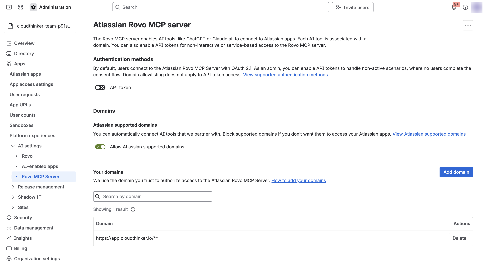

import ApprovalDefault from '/snippets/approval-default.mdx';
import ConnectionSecurity from '/snippets/ja/connection-security.mdx';

Atlassian Cloud サイトを接続すると、CloudThinker エージェントが Jira 課題と Confluence ページを検索し、コード変更の背景にあるチケットを読み、承認を経て課題やページを作成・更新できるようになります。1 つの接続で Jira と Confluence の両方をカバーします。この接続は Atlassian MCP server（旧 Rovo MCP Server）を通じて **OAuth** でサインインし、認可した人の権限で動作します。

## 前提条件

- **Scale** プラン以上の CloudThinker ワークスペース。下位プランではボタンが **Upgrade to Connect** と表示されます。
- Jira、Confluence、またはその両方を含む Atlassian Cloud サイト。
- 組織でまだ実施していない場合は、1 回限りのドメイン設定を行う Atlassian の **organization admin**。
- 組織で **Atlassian MCP server**（旧 Rovo MCP Server）が利用可能であること。Atlassian Administration に **Connectors → Atlassian MCP server** が表示されない場合は、先に Atlassian 側で解決してください。
- CloudThinker ワークスペースで接続を管理する権限。

<Info>
この接続では Jira Service Management のアラートやオンコールスケジュールにはアクセスできません。Atlassian はそれらを API トークン経由でのみ公開しているため、専用の [Jira Service Management](/guide/connections/jsm) 接続があります。
</Info>

## セットアップ

<Steps>
  <Step title="Atlassian で CloudThinker ドメインを許可する">
    組織の管理者が [admin.atlassian.com](https://admin.atlassian.com) にアクセスし、**Connectors → Atlassian MCP server** を開いて **Add domain** をクリックします。次を入力します。

    ```text
    https://app.cloudthinker.io/**
    ```

    正確に入力してください。`/**` ワイルドカードにより、そのドメイン配下のすべての CloudThinker コールバックパスが許可されます。

    <Frame>
      
    </Frame>

    **成功時の状態:** 許可されたドメインの一覧にドメインが表示されます。この操作は Atlassian 組織ごとに 1 回だけ行います。
  </Step>
  <Step title="CloudThinker で接続を開始する">
    **Settings → Workspace → Connections** を開き、**Discover** タブを開いて **Atlassian** を選択し、**Connect** をクリックします。新しいウィンドウで Atlassian が開きます。ブラウザがブロックした場合、CloudThinker に **Popup blocked. Please allow popups for this site.** と表示されます。CloudThinker のポップアップを許可し、もう一度 **Connect** をクリックしてください。
  </Step>
  <Step title="アクセスを認可する">
    エージェントに代理で操作させる Atlassian アカウントでサインインし、サイトを選んでアクセスを承認します。ウィンドウは自動で閉じます。

    **成功時の状態:** CloudThinker で Atlassian に **Connected** ステータスが表示されます。
  </Step>
</Steps>

## 接続の詳細

入力するフィールドはありません。Atlassian が OAuth トークンを発行し、CloudThinker がそれを保存します。

| 項目 | 値 |
|------|-------|
| **Sign-in** | 認可した Atlassian アカウントによる OAuth |
| **Allowed domain**（Atlassian 側） | `https://app.cloudthinker.io/**` |
| **Products reached** | 認可時に承認したサイトの Jira と Confluence |

1 つのワークスペースには Atlassian 接続を 1 つだけ持てます。アカウントを切り替えるには、接続を解除し、別のアカウントで再度接続してください。

## 必要な権限

- CloudThinker ドメインを追加するために、1 回だけ **organization admin** が必要です。
- その後、エージェントが Jira と Confluence で参照・変更できるのは、**認可したアカウント**ができることだけです。その人がプロジェクトやスペースを開けない場合、エージェントも開けません。

<Tip>
エージェントに必要なプロジェクトとスペースだけに所属する専用の Atlassian アカウントで認可してください。個人アカウントで接続すると、接続がその人のアクセス権と職務に結び付いてしまいます。専用アカウントには Jira と Confluence の製品アクセスが必要なため、Atlassian プランのユーザーとしてカウントされます。
</Tip>

## エージェントの機能

| 機能 | エージェントができること | 承認 |
|------------|--------------------|----------|
| **Jira search** | JQL または自然言語で課題を検索し、課題の詳細、コメント、リンクを読む | 不要 |
| **Jira projects** | 参照可能なプロジェクトとその課題タイプを一覧表示する | 不要 |
| **Confluence search** | ページとスペースを検索して読む | 不要 |
| **Jira updates** | 課題の作成、編集、ステータス遷移、コメント | 必要 |
| **Confluence updates** | ページの作成・更新、またはコメントの追加 | 必要 |

変更は [Approvals](/guide/approvals/overview) を経由します。Atlassian MCP server は Jira のオートメーションルール、ボード設定、Confluence のスペース権限を公開していないため、エージェントはそれらを確認できません。

CloudThinker の他の機能も同じ接続を使います。

| 場所 | 役割 |
|-------|--------------|
| [Resolve Triggers & Outcomes](/guide/incident/triggers-and-outcomes#outcomes) | Jira プロジェクトで **Create follow-up tickets** と **Keep tickets updated** を行います（`ENG` のような **Jira project key** を設定）。Confluence スペースに **Publish postmortems** を行います（`OPS` のような **Confluence space key** を設定）。 |
| [Runbooks](/ja/guide/incident/runbooks) | 根本原因分析中に Confluence スペースから修正手順を読み取ります。 |
| [Review extensions](/ja/guide/code-review/extensions) | **Jira / Confluence** 拡張機能が、プルリクエストの説明にリンクされたチケットや仕様ページを読み、変更がそれに沿っているか確認します。 |

### 接続の確認

```text
List the Jira projects the connected account can see, and the five most recently updated issues in the first three
```

プロジェクトがキーごとに、最近の課題数件とともに表示されるはずです。プロジェクトが表示されない場合、認可したアカウントはそのプロジェクトを開けません。プロンプト内の「me」や「I」は、チャットしている人ではなくそのアカウントを指します。

### プロンプト例

```text
Find open Jira bugs in the PAY project labeled production, grouped by assignee
Search Confluence for our database failover runbook and summarize the steps
Create a Jira task in OPS to rotate the expiring TLS certificate on api.example.com
```

最後のプロンプトは課題を作成するため、Jira での変更として扱われます。

<ApprovalDefault />

## トラブルシューティング

<Accordion title="ボタンに Upgrade to Connect と表示される">
CloudThinker のプランに Atlassian 接続が含まれていません。Scale プラン以上が必要です。[料金](/ja/guide/billing/pricing)を参照してください。
</Accordion>

<Accordion title="Atlassian が認可を拒否する">
組織で CloudThinker ドメインが許可されていません。組織の管理者に **Connectors → Atlassian MCP server** を確認してもらい、許可されたドメインの一覧に `https://app.cloudthinker.io/**` があることを確認してから、もう一度 **Connect** をクリックしてください。
</Accordion>

<Accordion title="ドメインが許可されているのに権限エラーになる">
組織が IP 許可リストを適用しています。そのルールは MCP server の設定とは別に Atlassian Administration で管理され、これらのリクエストにも適用されます。管理者に CloudThinker の送信元 IP アドレスをその許可リストに追加してもらってください。このドキュメントでは CloudThinker の送信元 IP リストを公開していません。CloudThinker の担当者に問い合わせるか、[お問い合わせ](https://cloudthinker.io/contact)ください。
</Accordion>

<Accordion title="以前は動いていたのに、リクエストが 401 で失敗する">
OAuth の許可が期限切れになったか取り消された、または認可したアカウントが無効化されました（たとえば、その人が退職した場合）。**Settings → Workspace → Connections** から Atlassian を再接続してください。できれば専用アカウントを使ってください。アカウントの所有者は、Atlassian プロフィールの **Connected apps** で許可を取り消すこともできます。
</Accordion>

<Accordion title="プロジェクトやスペースが表示されない">
エージェントは認可したアカウントとして動作します。Atlassian でそのアカウントにプロジェクトやスペースへのアクセス権を付与してから、もう一度依頼してください。再接続は不要です。
</Accordion>

<Accordion title="エージェントが JSM アラートやオンコール担当者を参照できない">
想定どおりの動作です。アラートとスケジュールには別の [Jira Service Management](/guide/connections/jsm) 接続が必要です。
</Accordion>

## セキュリティ

<ConnectionSecurity />

- **ユーザー単位のアクセス**: すべての読み取りと書き込みは認可したアカウントとして実行されるため、そのアカウントの Jira と Confluence の権限が実際の上限になります。
- **ドメインの管理権はお客様に**: 組織の管理者は、いつでも **Atlassian MCP server** ページから CloudThinker ドメインを削除してアクセスを遮断できます。

## 関連情報

<CardGroup cols={2}>
  <Card title="Jira Service Management" icon="/images/icons/jsm.svg" href="/guide/connections/jsm">
    別の API トークン接続でアラートとオンコールを追加します。
  </Card>
  <Card title="Resolve Triggers & Outcomes" icon="arrow-right-from-bracket" href="/guide/incident/triggers-and-outcomes#outcomes">
    Jira のフォローアップチケットと Confluence のポストモーテムを有効にします。
  </Card>
</CardGroup>
