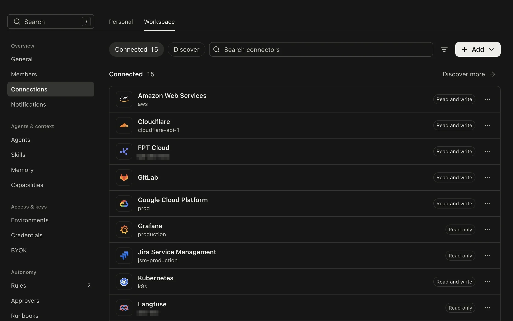
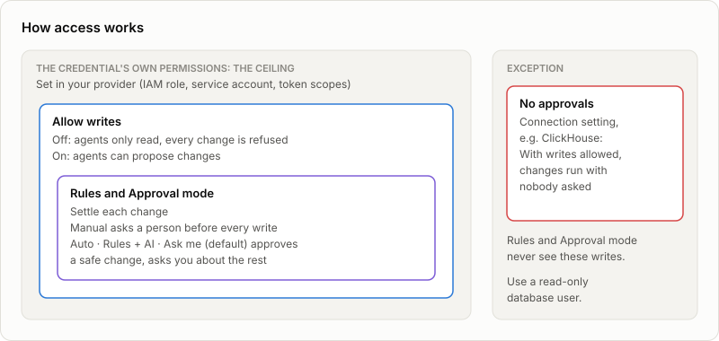
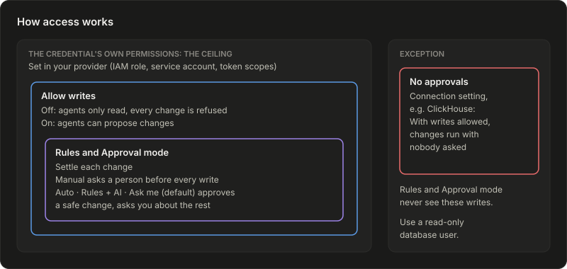

import ConnectionSecurity from '/snippets/ja/connection-security.mdx';

接続とは、AWS アカウント、Kubernetes クラスター、GitHub 組織など、1 つの外部サービスに対して保存された認証情報です。エージェントは接続が許可するものしか見たり行ったりできないため、このページでは接続の追加、範囲の限定、確認、正常な状態の維持の方法を説明します。サービスの完全な一覧は[接続カタログ](#接続カタログ)にあります。

## 接続を追加する

<Steps>
  <Step title="Connections を開く">
    **Settings → Workspace → Connections** を開きます。**Discover** タブには対応しているすべてのサービスが、**Connected** タブには接続済みのサービスが一覧表示されます。カテゴリで絞り込むか、名前で検索します。セットアップガイドで「Connections を開く」と書かれている場合は、この画面を指します。

    <Frame caption="workspace の Settings にある Connections: Connected と Discover のタブ、検索、Add メニュー">
      
    </Frame>
  </Step>
  <Step title="セットアップガイドを開き、その順序に従う">
    [カタログ](#接続カタログ)からサービスのセットアップガイドを開くか、サービスの詳細パネルで **Setup guide** をクリックします。各ガイドには認証情報に必要な最小限の権限が記載されています。順序はサービスによって異なります。

    | サービス | 最初にすること |
    |---|---|
    | AWS | 接続ダイアログを開きます。ロールに必要な External ID が生成されます。 |
    | GitHub、Linear、Sentry などの OAuth サービス | 通常は何も不要です。**Connect** をクリックしてサインインします。いくつかは最初に一度だけのセットアップが必要です。Asana には独自の Asana アプリの Client ID とシークレットが、Atlassian には組織の管理者による CloudThinker ドメインの許可が必要で、Bitbucket はワークスペースのスラッグを求めます。各ガイドを参照してください。 |
    | Google Cloud、Azure、Firebase、Cloudflare など、その他すべて | プロバイダーで認証情報を作成してから、ダイアログを開きます。 |
  </Step>
  <Step title="接続する">
    サービスを選んで **Connect** をクリックします。認証情報を入力またはアップロードし、ダイアログの **Connect** をクリックします。

    AWS、Google Cloud、SSH など複数のアカウントに対応するサービスでは、**Alias**（`production` のような短い名前）と **Description** も求められます。エージェントは説明を読んで適切なアカウントを選ぶため、具体的に書いてください: `Production AWS account, us-east-1 workloads`。

    <Note>
    複数の接続を持てるのは、AWS、Google Cloud、SSH など一部のサービスだけで、その接続ダイアログでは **Alias** が求められます。Microsoft Azure、Kubernetes、VMware vCenter、OAuth サインインで接続するすべてのサービスなど、その他はワークスペースごとに 1 つの接続しか持てません。2 つ目の Azure テナントや 2 つ目のクラスターを接続するには、別のワークスペースを使ってください。
    </Note>
  </Step>
  <Step title="テストを待つ">
    CloudThinker は接続を保存する前にテストします。ほとんどのサービスでは、テストはあなたの認証情報でサービスを呼び出します。Argo CD、Buildkite、CircleCI、Clarity、Databricks、[Notion](/guide/connections/notion)、[Prowler](/guide/connections/prowler)、[Render](/guide/connections/render)、[Rollbar](/ja/guide/connections/rollbar) など一部のサービスでは、接続のツールが起動することだけを確認するため、誤ったトークンでも **Connected** と表示されることがあります。それらでは、セットアップガイドの確認用プロンプトが本当のテストです。

    | ステータス | 意味 | 対応 |
    |---|---|---|
    | **Connecting** | テストを開始しています | 待ちます |
    | **Verifying** | CloudThinker があなたの認証情報でサービスを呼び出しています | 待ちます |
    | **Connected** | テストに合格し、接続が保存されました。テストで認証情報を確認しないサービスでは、ツールが起動したことだけを意味します。 | ガイドの確認用プロンプトを実行し、その接続に対して質問します |
    | **Failed** | サービスが認証情報を拒否しました。プロバイダーのエラーが表示されます。 | 認証情報またはその権限を修正してから、再度接続します |
    | **Timed out** | テストが時間内に完了しませんでした | CloudThinker Cloud からサービスに到達できることを確認します。[プライベートサービスへの到達](#プライベートサービスへの到達)を参照してください。 |
    | **Error** | 以前は機能していたが、バックグラウンドで失敗しました | [接続が壊れたとき](#接続が壊れたとき)を参照してください |

    **成功時の状態:** Connections の一覧でサービスに **Connected** と表示されます。
  </Step>
  <Step title="その接続に対して質問する">
    チャットを開き、そのサービスでしか答えられないことを質問します。各セットアップガイドに確認用のプロンプトがあります。

    ```text
    Which AWS account and regions can you reach through my connection?
    ```

    **成功時の状態:** 回答に、一般的な説明ではなく、実際のアカウント ID やプロジェクトが含まれます。
  </Step>
</Steps>

## 環境を設定する

各接続には **Environment** があります: **Production**、**Staging**、**Development**、**Not set**。これは接続を読む人とエージェントに向けて接続にラベルを付けるものです。[Rules](/guide/approvals/rules)（エージェントの変更を実行するか、人の判断を待つか、拒否するかを決める条件）はこれを読みません。

<Note>
接続ダイアログは環境を尋ねないため、接続した直後に設定してください。Microsoft Azure などの単一接続のサービスや、GitHub、Linear、Sentry などのすべての OAuth サービスは、**Not set** から変更できません。ある接続を別の接続と異なる扱いにするには、その接続を指定する [Rule](/guide/approvals/rules#what-a-rule-contains) を作成します。
</Note>

複数の接続に対応するサービスでは、各アカウントがサービスの詳細パネルに行として表示されます。環境を設定するには、アカウントの行の鉛筆アイコンをクリックし、**Edit Instance** ダイアログで **Environment** を更新します。

## 接続した後に起こること

接続が初めて **Connected** になると、CloudThinker は `Take a deep look at my <service> connection` というメッセージでチャットを開きます。エージェントは接続したばかりのサービスを探索し、到達できる範囲を報告します。多くの場合約 15 分かかり、実行中にチャットを離れても構いません。テストに合格したときに別のダイアログで作業中の場合は、代わりに通知が表示され、**Deep look** ボタンでチャットを開始できます。例外は、Optimize がまだスキャンしていない AWS、Azure、Google Cloud の接続です。この場合、CloudThinker は代わりに **Turn on Optimize?** と尋ね、詳細調査は **Try in chat** で自分で開始します。

詳細調査（deep look）は多くの場合、最初に得られる役立つ回答なので、最初のプロンプトを書く前に読んでください。認証情報の権限を広げた後などに再実行するには、接続のカードの **More** メニューを開き、**Try in chat** をクリックします。カスタム MCP サーバーの場合は、詳細パネルの **Deep look** をクリックします。

詳細調査は他のチャットと同様にクレジットを消費します。ワークスペースのクレジットが不足している場合、CloudThinker はチャットを開始せず、**A deep look needs credits.** と **View plans** ボタンを表示します。他のチャットと同じツールと [Approvals](/guide/approvals/overview) を使います。

## アクセスの仕組み

すべての接続は 1 つの[ワークスペース](/ja/guide/workspaces)に属します。組み込みの [CloudThinker エージェント](/ja/guide/agents/overview)やカスタムエージェントを含め、そのワークスペースで作業する人は誰でも、再設定せずに接続を使えます。

| ワークスペースのロール | 接続を見る | 追加、編集、ローテーション、削除 |
|---|---|---|
| Admin | はい | はい |
| Developer、Viewer | はい | いいえ |

組織の Owner と Admin は、すべてのワークスペースでワークスペース Admin を持ちます。[Workspace roles](/ja/guide/workspace-users#ワークスペースロール) を参照してください。

<Warning>
**Allow writes** がある接続のほとんどで、これは最初からオンです。AWS、Google Cloud、Azure、Kubernetes、GitHub、GitLab、Bitbucket、Azure DevOps、AWS CodeCommit、Cassandra、Drata、FortiGate、Okta が含まれます。Docker Hub、FireHydrant、Snowflake など、一部は最初からオフです。Argo CD にはトグルがなく、接続フォームの **READ_ONLY** フィールドは **Full access** で始まります。接続する認証情報に書き込み権限があれば、接続した瞬間からエージェントは変更を提案でき、Rules と Approval mode がそれぞれを判断します。最初からオフにするワークスペースや組織の設定はないため、制御手段は、読み取り専用の認証情報と、各接続で **Allow writes** をオフにすることです。各セットアップガイドの **Write access** または **Agent capabilities** のセクションに、その接続の初期状態が記載されています。
</Warning>

エージェントが接続で何をできるかは、2 つの制御で決まります。

<Frame caption="認証情報が上限で、Allow writes が変更を開き、Rules と Approval mode がそれぞれを決着させます。ただし Connection setting, no approvals の接続は除きます。">
  
  
</Frame>

| 制御 | 場所 | 決めること |
|---|---|---|
| 認証情報自体の権限 | プロバイダー（IAM ロール、サービスアカウント、API トークンのスコープ） | 上限。エージェントは認証情報が許可する以上のことは決してできません。 |
| **Allow writes** | CloudThinker の接続の詳細パネル | オフ: エージェントは読み取りしかできず、すべての変更が拒否されます。オン: エージェントは変更を提案でき、[Rules](/guide/approvals/rules) と [Approval mode](/guide/approvals/approval-mode) がそれぞれを決着させます。**Manual** はすべての書き込みの前に人に確認します。デフォルトの **Auto · Rules + AI · Ask me** は、Allow Rule または AI の判断で安全な変更を承認し、残りはあなたに確認します。 |

書き込みの制御方法は接続によって異なります。各セットアップガイドの **Agent capabilities** のセクションに、どのモデルが適用されるかが記載されています。

| 書き込みのモデル | 仕組み | デフォルト | 例 |
|---|---|---|---|
| **Allow writes** トグル | エージェントがサービスに対してコマンドラインツールやスクリプトを実行する接続。クラウドに加え、Bitbucket、Azure DevOps、Cassandra、Drata、Docker Hub などのスクリプトベースの接続も含みます。トグルは接続の詳細パネルにあります。読み取りは確認なしで実行されます。トグルがオンの場合、すべての書き込みが Rules と Approval mode に照らして確認されます。 | AWS、Google Cloud、Azure、Azure DevOps、Bitbucket、Cassandra、Drata など、ほとんどはオン。Docker Hub、FireHydrant、Snowflake など、一部はオフ。 | [AWS](/ja/guide/connections/aws)、[Google Cloud](/ja/guide/connections/gcp)、[Azure](/ja/guide/connections/azure)、[Cassandra](/guide/connections/cassandra) |
| 接続フォームの書き込み設定 | 詳細パネルのトグルではなく、接続時に設定するフィールド。書き込みを許可した場合でも、すべての変更は [Approvals](/guide/approvals/overview) を経由します。 | ガイドごとに設定。RabbitMQ の **RABBITMQ_ALLOW_MUTATIONS** は **Allow writes** で始まります。Argo CD の **READ_ONLY** は **Full access** で始まります。 | [RabbitMQ](/ja/guide/connections/rabbitmq)、[Argo CD](/ja/guide/connections/argocd) |
| 変更ごとの承認 | トグルはありません。認証情報のスコープで可能な範囲が決まり、すべての変更が [Approvals](/guide/approvals/overview) を経由します。一部の読み取りも承認を経由します: Cloudflare と PostHog のすべての API 呼び出し、Neon と Databricks の SQL ステートメント（`SELECT` を含む）、Firebase のプロジェクトの切り替えとデプロイステータスの確認。 | 該当なし | [Neon](/ja/guide/connections/neon)、[Firebase](/ja/guide/connections/firebase)、[Cloudflare](/ja/guide/connections/cloudflare) |
| Connection setting, no approvals | 接続フォームの書き込み設定ですべてが決まります。書き込みを許可すると、変更は誰にも確認されずに実行され、Rules と Approval mode はそれを見ることがありません。 | 読み取り専用。ClickHouse の **Write access** は **Read-only (default)** で始まります。 | [ClickHouse](/ja/guide/connections/clickhouse) |
| 読み取り専用 | エージェントには書き込み操作が一切ないため、トグルや Rule で許可することはできません。 | 該当なし | [Rancher](/guide/connections/rancher)、[UptimeRobot](/guide/connections/uptimerobot) |
| [VictoriaMetrics](/guide/connections/victoriametrics) | MetricsQL を実行し、カーディナリティとアラートを確認して、スナップショットを作成します。 |
| MCP ツール、トグルなし | カスタム MCP 接続には **Allow writes** スイッチがありません。CloudThinker はサーバーが提供する各ツールを読み取りと書き込みに分類します。読み取りは確認なしで実行され、書き込みは Rules と Approval mode を経由します。名前に `get` や `check` などの読み取りの単語を含むツールは、サーバーが破壊的とマークしない限り、`get_and_delete_user` も含めて読み取りとみなされ、承認なしで実行されます。 | サーバー自身のヒントとツール名から、ツールごとに決まります。 | [Custom MCP](/ja/guide/connections/mcp) |

<Warning>
ClickHouse のような **Connection setting, no approvals** の接続で書き込みをオンにすると、エージェントは Rule や承認を経ずにデータを変更できます。それを望む場合を除き、読み取り専用のデータベースユーザーを使ってください。
</Warning>

ほとんどの接続で **Allow writes** が最初からオンなのは、認証情報が上限だからです。読み取り専用の認証情報は、すでにすべての変更をブロックします。読み取り専用から始め、エージェントにさせたい具体的な変更がある場合にのみ認証情報を広げてください。

接続のサインイン方法は 2 つあります。

| 方法 | 接続方法 | 例 |
|---|---|---|
| 貼り付けまたはアップロードする認証情報 | IAM ロールの ARN、アクセスキー、サービスアカウントの JSON ファイル、API トークン | AWS、Google Cloud、Datadog、PostgreSQL |
| OAuth サインイン | ポップアップでプロバイダーにサインインし、アクセスを承認します | GitHub、GitLab、Linear、Sentry |

## プライベートサービスへの到達

接続は CloudThinker Cloud から実行されるため、サービスはインターネットからの接続を受け付ける必要があります。これは、社内の vCenter、PostgreSQL、Prometheus、Argo CD など、プライベートネットワーク上のものすべてに関係します。

| 選択肢 | 使う場面 |
|---|---|
| エンドポイントを公開し、CloudThinker の送信元 IP を許可リストに追加する | サービスをファイアウォールのルールの背後に置ける場合。このドキュメントでは CloudThinker の送信元 IP の一覧を公開していません。CloudThinker の担当者に問い合わせるか、[お問い合わせ](https://cloudthinker.io/contact)ください。認証のないサービスは決して公開しないでください。 |
| ネットワーク内で [Environment](/guide/workers) を実行する | サービスをプライベートのままにする必要がある場合。Environment とは、エージェントがコマンドを実行できる、あなたが運用するマシン上のフォルダーです。Environment は接続をプライベートにするものではありません。ワークスペースの接続は、Environment のチャットでも引き続き CloudThinker Cloud で実行されます。代わりに、サービスのコマンドラインツール（`psql` など）とその認証情報を Environment のマシンにインストールすると、エージェントのシェルがそこでそれらを使います。サービスは **Settings → Workspace → Connections** には表示されません。[What an environment can reach](/guide/workers#what-a-worker-can-reach) を参照してください。セルフホストの Environment はベータ版です。 |

## 認証情報をローテーションする

保存された認証情報は、切断せずに置き換えられます。接続はエイリアス、設定、履歴を保持します。AWS のロール接続は短期の STS 認証情報を使うため、ローテーションするものはありません。External ID は同じままです。アクセスキー、クライアントシークレット、JSON キー、API トークンにはローテーションが必要です。

<Steps>
  <Step title="プロバイダーで新しい認証情報を作成する">
    まず新しいキーまたはトークンを作成します。切り替えが完了するまで、古いものは有効のままにしておきます。
  </Step>
  <Step title="CloudThinker で置き換える">
    **Settings → Workspace → Connections** でサービスを開き、アカウントの行の鉛筆アイコンをクリックし、**Edit Instance** で保存された認証情報の横の **Replace…** をクリックします。新しい値を入力し、**Save and test** をクリックします。

    **成功時の状態:** テストに合格し、接続は **Connected** のままです。テストが失敗した場合、CloudThinker は以前の認証情報を保持し、エラーを表示します。
  </Step>
  <Step title="古い認証情報を取り消す">
    プロバイダーで古いキーを削除または無効化します。
  </Step>
</Steps>

Microsoft Azure や Backstage などの単一接続のサービスには鉛筆アイコンがありません。**Replace credentials** ボタンは接続に **Error** と表示されている間だけ現れるため、早めにローテーションするには、切断して新しい値で再接続します。例外はトークンベースの Git プロバイダー（GitLab、Bitbucket、Azure DevOps、AWS CodeCommit）で、Review をセットアップした後は、切断せずに **Review → Settings → Connection actions → Update token** でトークンをローテーションします。[Azure DevOps](/guide/connections/azure-devops) と [Bitbucket](/guide/connections/bitbucket) を参照してください。

切断して再接続すると新しい接続が開始されるため、落ち着いた時期に計画してください。

- 切断から再接続までの間、エージェント、スケジュールされたオートメーション、Optimize の更新はサービスを使えません。
- 詳細調査のチャットが再度開始され、クレジットを消費します。
- **Allow writes** はデフォルト（ほとんどの接続でオン）に戻ります。オフにしていた場合は、もう一度オフにしてください。
- その接続を指定している [Rules](/guide/approvals/rules) が、引き続きその接続を含んでいることを確認してください。

ほとんどの OAuth 接続には置き換える認証情報がありません。サインインしたアカウントを切り替えるには、切断して再度接続します。Asana は例外で、Asana アプリの Client secret を保存するため、再接続のたびに入力し直します。

## 接続が壊れたとき

認証情報がバックグラウンドで機能しなくなると（トークンの期限切れ、キーの取り消し、ロールの削除など）、接続は **Error** に切り替わります。AWS では、1 回の一時的な不調で切り替わらないよう、バックグラウンドでの失敗が 3 回続く必要があります。その他の接続は、バックグラウンドのトークン更新や実行が認証エラーになったときに切り替わります。ワークスペースの管理者には、失敗した再試行ごとではなく、障害ごとに 1 回[通知](/ja/guide/notifications)が届きます。自分で実行したテストで誰かに通知されることはありません。

接続が **Error** の間は、それに依存するスケジュールされた作業がスキップされます。[Optimize](/ja/guide/cost-optimization/overview) のコスト更新、スケジュールされた[オートメーション](/guide/automation/automations)、[Resolve → Signals](/ja/guide/pulse/overview) のアラートポーリングが含まれます。

復旧するには:

1. プロバイダーで原因を修正します。たとえば、ロールを復元するか、新しいキーを発行します。
2. 接続を開きます。詳細パネルにエラーが表示されます。**Retry** をクリックして保存された認証情報を再テストするか、**Replace credentials** をクリックして新しい認証情報を入力します。**Replace credentials** は **Replace…** と同じ **Edit Instance** ダイアログを開きます。OAuth 接続の場合は、**Connect** をクリックして再度サインインします。
3. ステータスが **Connected** に戻ると、スケジュールされた作業は次のサイクルで再開します。

## 接続を切断する

**Settings → Workspace → Connections** でサービスを開きます。アカウントの行があるサービスでは、アカウントの行のゴミ箱アイコンをクリックします。単一接続のサービスでは、詳細パネルの **Disconnect** をクリックします。**Disconnect** ダイアログで確定します。元に戻すことはできません。

切断が完了するとすぐに、エージェントはサービスへのアクセスを失います。その後、プロバイダーでロール、キー、トークンを削除してください。切断してもプロバイダー側では削除されないためです。

サービスを再度接続すると、新しい接続になります。

- 詳細調査のチャットが再度開始され、クレジットを消費します。
- **Allow writes** はデフォルトに、**Environment** は **Not set** に戻ります。
- [Rules](/guide/approvals/rules) は **Alias** で接続を照合します。再接続するときに同じ Alias を使えば、その接続を指定している Rules は引き続き一致します。

## セキュリティ

<ConnectionSecurity />

接続はそれだけで読み取り専用になるわけではありません。多くは **Allow writes** がオンで始まるため（[アクセスの仕組み](#アクセスの仕組み)を参照）、接続を読み取り専用に保つのは読み取り専用の認証情報です。

CloudThinker が接続したものをどう扱うか:

| 質問 | 回答 |
|---|---|
| 認証情報はどこに保存されますか？ | 保存時に暗号化されます。コマンドが実行されるときにだけ CloudThinker が管理するサンドボックスに注入され、Environment に送られることはなく、チャットに表示されることもありません。 |
| データがモデルに届くことはありますか？ | はい。コマンドの出力は会話の一部になるため、認証情報が読めるものはすべてモデルに届く可能性があります。認証情報はエージェントが必要とする範囲に限定してください。 |
| データは学習に使われますか、またどのくらい保持されますか？ | このドキュメントは、モデルプロバイダーのデータに関する条件を扱っていません。扱っている内容は [Security](/ja/guide/security/overview#概要) を参照し、それ以外はベンダーレビューで問い合わせてください。 |
| 何が記録されますか？ | Scale と Enterprise のプランでは、[Audit Logs](/guide/security/audit-logs)（**Settings → Organization → Audit log**）に、接続の作成、編集、再試行、削除、認証情報の置き換え、承認の判断が記録されます。接続の **Allow writes** スイッチの切り替えはそこには記録されません。 |
| エージェントのコマンドは記録されますか？ | エージェントが実行した各コマンドとその出力は、チャットの履歴に残ります。呼び出しは、AWS CloudTrail や Google Cloud Audit Logs など、プロバイダー自身の監査ログにも記録されます。 |

暗号化の詳細、保持期間、モデルプロバイダーについては [Security](/ja/guide/security/overview) を参照してください。

## 接続カタログ

### クラウド

| サービス | エージェントができること |
|---|---|
| [Amazon Web Services](/ja/guide/connections/aws) | コンピューティング、ストレージ、ID、コスト、モニタリングを確認します。 |
| [Cloudflare](/ja/guide/connections/cloudflare) | ゾーン、トラフィック分析、ファイアウォールのイベント、Workers を確認します。 |
| [DigitalOcean](/guide/connections/digitalocean) | Droplet、データベース、Kubernetes、ネットワーク、コストを確認します。 |
| [FPT Cloud](/guide/connections/fptcloud) | VM、ネットワーク、アクティビティ、リソースタグを調べます。 |
| [Google Cloud Platform](/ja/guide/connections/gcp) | コンピューティング、GKE、BigQuery、ストレージ、ID、コストを確認します。 |
| [GreenNode](/guide/connections/greennode) | CLI でコンピューティング、Kubernetes、データベース、ストレージを操作します。 |
| [Microsoft Azure](/ja/guide/connections/azure) | 仮想マシン、AKS、データベース、ID、コストを確認します。 |
| [OpenStack](/guide/connections/openstack) | コンピューティング、ネットワーク、ストレージ、イメージ、クォータを確認します。 |
| [VMware vCenter](/guide/connections/vmware) | 仮想マシン、ホスト、クラスター、データストアを確認します。 |
| [Oracle Cloud Infrastructure](/guide/connections/oracle) | コンパートメント、リソース、Cloud Guard の問題を調べます。 |

### インフラストラクチャ

| サービス | エージェントができること |
|---|---|
| [AWX](/ja/guide/connections/awx) | Ansible のインベントリを調べ、ジョブテンプレートを起動します。 |
| [HCP Terraform](/guide/connections/terraform) | ワークスペースと実行のヘルスを確認し、空のワークスペースを整理します。 |
| [NetBox](/guide/connections/netbox) | デバイスと IP アドレスを調べ、IP の予約やステータス設定を行います。 |
| [Pulumi](/ja/guide/connections/pulumi) | スタック、管理対象リソース、ポリシー違反を確認し、AWS にデプロイします。 |
| [SSH](/ja/guide/connections/ssh) | サーバーのヘルス、ログ、ディスク容量、プロセスを調べます。 |

### コンテナ

| サービス | エージェントができること |
|---|---|
| [ArgoCD](/ja/guide/connections/argocd) | デプロイ、同期の状態、管理対象リソースを調べます。 |
| [Docker Hub](/guide/connections/dockerhub) | リポジトリ、タグ、サイズ、古いイメージを確認します。 |
| [Kubernetes](/ja/guide/connections/kubernetes) | ワークロード、ロールアウト、ログ、ノードの逼迫を調べます。 |
| [Red Hat OpenShift](/guide/connections/openshift) | クラスターのバージョン、オペレーター、ノード、失敗している Pod、ルートを確認します。 |
| [Rancher](/guide/connections/rancher) | クラスター、プロジェクト、ノード、ロールバインディングを調べます。 |

### アプリプラットフォーム

| サービス | エージェントができること |
|---|---|
| [Firebase](/ja/guide/connections/firebase) | プロジェクト、アプリ、セキュリティルール、デプロイの状態を確認します。 |
| [Heroku](/guide/connections/heroku) | アプリ、dyno、ログ、アドオン、デプロイを確認します。 |
| [IBM API Connect](/guide/connections/ibm-api-connect) | カタログ、公開された API、分析、ガバナンスのルールセットを確認します。 |
| [MuleSoft Anypoint Platform](/guide/connections/mulesoft) | Mule アプリ、デプロイ、ログ、API ポリシーを調べ、再起動やスケールを行います。 |
| [Netlify](/guide/connections/netlify) | プロジェクト、デプロイ、フォームを確認し、変更をデプロイします。 |
| [Render](/guide/connections/render) | サービス、デプロイ、ログ、Postgres を確認し、デプロイします。 |
| [Supabase](/guide/connections/supabase) | プロジェクト、スキーマ、マイグレーションを確認し、変更を実行します。 |
| [Vercel](/ja/guide/connections/vercel) | プロジェクト、デプロイ、ログを確認し、デプロイのキャンセルやプロジェクトの一時停止を行います。 |

### データベース

| サービス | エージェントができること |
|---|---|
| [Cassandra](/guide/connections/cassandra) | キースペース、テーブル、レプリケーション、ノードのヘルスを調べます。 |
| [ClickHouse](/ja/guide/connections/clickhouse) | クラスターをまたいでデータベース、テーブル、スキーマをクエリします。 |
| [CockroachDB](/guide/connections/cockroachdb) | データベース、スキーマ、クエリ性能を調べます。 |
| [Databricks](/guide/connections/databricks) | クラスター、ジョブ、ノートブック、カタログのアセットを調べます。 |
| [dbt](/ja/guide/connections/dbt) | 失敗した実行を説明し、リネージを追跡し、モデルをプレビューします。 |
| [InfluxDB](/guide/connections/influxdb) | バケット、データベース、保持期間、シリーズの増加をクエリします。 |
| [Microsoft SQL Server](/guide/connections/mssql) | スキーマを把握し、承認されたテーブルを読み取り・編集します。 |
| [MongoDB](/ja/guide/connections/mongodb) | データベース、コレクション、インデックス、クエリプランを調べます。 |
| [MySQL](/ja/guide/connections/mysql) | スキーマ、インデックス、テーブルのヘルス、遅いクエリを調べます。 |
| [Neon](/ja/guide/connections/neon) | プロジェクト、ブランチ、スキーマ、マイグレーションを調べます。 |
| [Oracle Database](/guide/connections/oracle) | スキーマ、テーブルの統計、セッション、遅い SQL を調べ、承認された単一行の変更を行います。 |
| [PostgreSQL](/ja/guide/connections/postgresql) | テーブル、インデックス、ロック、遅いクエリの性能を調べます。 |
| [Redis](/ja/guide/connections/redis) | メモリ、容量、有効期限、遅いコマンドを調べます。 |
| [Snowflake](/ja/guide/connections/snowflake) | クレジットの支出、クエリ履歴、遅いクエリ、ロールを追跡します。 |

### AI とベクトル

| サービス | エージェントができること |
|---|---|
| [Braintrust](/guide/connections/braintrust) | プロジェクトをまたいで実験、スコア、データセットを比較します。 |
| [Langfuse](/ja/guide/connections/langfuse) | LLM のトレース、プロンプト、コスト、評価を調査します。 |
| [LangSmith](/guide/connections/langsmith) | 実行ツリー、プロジェクト、データセット、実験を調べます。 |
| [Pinecone](/guide/connections/pinecone) | ベクトルインデックスと名前空間を調べ、レコードを更新します。 |

### モニタリング

| サービス | エージェントができること |
|---|---|
| [AppDynamics](/ja/guide/connections/appdynamics) | APM のトランザクション、ティア、ノード、ヘルスルールを追跡します。 |
| [Axiom](/guide/connections/axiom) | ログ、トレース、メトリクスをクエリし、モニターとダッシュボードを編集します。 |
| [Centreon](/guide/connections/centreon) | 問題とダウンタイムを確認し、確認応答、再チェック、ダウンタイム設定を行います。 |
| [Checkmk](/guide/connections/checkmk) | ホストとサービスを確認し、問題の確認応答やダウンタイム設定を行います。 |
| [Coralogix](/ja/guide/connections/coralogix) | ログパイプライン、メトリクス、アラート、インシデントを調べます。 |
| [Datadog](/ja/guide/connections/datadog) | ログ、メトリクス、トレース、モニター、ダッシュボードを検索します。 |
| [Dynatrace](/ja/guide/connections/dynatrace) | ログ、トレース、メトリクスをまたいで APM の問題を追跡します。 |
| [Grafana](/ja/guide/connections/grafana) | ダッシュボード、メトリクス、ログ、アラートルールを調べます。 |
| [Honeycomb](/ja/guide/connections/honeycomb) | トレース、データセット、ウォーターフォール、トリガー、SLO を調べます。 |
| [Icinga](/guide/connections/icinga) | ホストとサービスを確認し、確認応答、再チェック、ダウンタイム設定を行います。 |
| [Juniper Junos](/guide/connections/juniper) | インターフェース、BGP ピア、アラームを確認し、インターフェースを変更します。 |
| [LibreNMS](/guide/connections/librenms) | デバイスとアラートを確認し、アラートの確認応答やメンテナンス設定を行います。 |
| [New Relic](/ja/guide/connections/newrelic) | APM のエンティティ、ダッシュボード、アラート、インシデントをクエリします。 |
| [Prometheus](/ja/guide/connections/prometheus) | ライブと過去のメトリクス、ラベル、アラートをクエリします。 |
| [PRTG Network Monitor](/guide/connections/prtg) | センサーとアラームを調査し、履歴を読み、監視オブジェクトを操作します。 |
| [Rollbar](/ja/guide/connections/rollbar) | 上位の問題、デプロイ、リプレイを確認し、1 つを更新します。 |
| [Sentry](/guide/connections/sentry) | 問題、トレース、イベント、根本原因のシグナルを検索します。 |
| [SigNoz](/ja/guide/connections/signoz) | サービス、ダッシュボード、アラート、ログ、メトリクスを追跡します。 |
| [Splunk Observability](/guide/connections/splunkobservability) | サービスのヘルス、依存関係、レイテンシー、エラーを追跡します。 |
| [UptimeRobot](/guide/connections/uptimerobot) | モニターのステータス、稼働時間の履歴、最近のインシデントを追跡します。 |
| [Zabbix](/ja/guide/connections/zabbix) | ホスト、テンプレート、トリガー、イベント、ダッシュボードを確認します。 |

### ログと検索

| サービス | エージェントができること |
|---|---|
| [Elasticsearch](/ja/guide/connections/elasticsearch) | インデックス、マッピング、シャード、クラスターのヘルスを調べます。 |
| [Graylog](/guide/connections/graylog) | 読み取り専用の API トークンでメッセージとストリームを検索します。 |
| [OpenSearch](/guide/connections/opensearch) | インデックス、シャード、ドキュメント、検索の関連性を調べます。 |
| [Splunk Platform](/guide/connections/splunkplatform) | 期間を指定してログを検索し、インデックスの量を確認します。 |
| [Sumo Logic](/guide/connections/sumologic) | ログ、モニター、コレクター、Cloud SIEM のインサイトを検索します。 |
| [VictoriaLogs](/guide/connections/victorialogs) | ログ行を検索し、時間ごとのエラーを数え、ストリームを把握します。 |
| [Wazuh](/guide/connections/wazuh) | アラートとエージェントを調査し、検出ルールを管理します。 |

### インシデント

| サービス | エージェントができること |
|---|---|
| [Better Stack](/ja/guide/connections/betterstack) | インシデント、オンコールの担当状況、稼働時間、ハートビートを確認します。 |
| [BMC Helix ITSM](/guide/connections/bmc-helix) | インシデント、作業ログ、変更、問題を調査します。 |
| [FireHydrant](/guide/connections/firehydrant) | インシデント、重大度、アラート、サービスカタログを確認します。 |
| [Freshservice](/guide/connections/freshservice) | チケット、変更、問題とその SLA の状態を確認します。 |
| [Jira Service Management](/guide/connections/jsm) | アラートとオンコールを確認し、確認（acknowledge）やエスカレーションを行います。 |
| [PagerDuty](/ja/guide/connections/pagerduty) | インシデントを [Resolve](/ja/guide/incident/overview) に送ります。 |
| [ServiceNow](/ja/guide/connections/servicenow) | インシデント、変更、問題を確認・更新します。 |
| [KeepHQ](/guide/connections/keephq) | セルフホストの KeepHQ を接続し、API キーで保存されたアラート、インシデント、ワークフロー、トポロジーを確認します。 |

Opsgenie は接続ではありません。**Resolve → Triggers & Outcomes** から、[Webhook シグナル](/ja/guide/incident/webhook-integrations/overview)としてアラートを Resolve に送ってください。

### コードと CI/CD

| サービス | エージェントができること |
|---|---|
| [AWS CodeCommit](/guide/connections/aws-codecommit) | リポジトリ、プルリクエスト、レビューコメントを閲覧します。 |
| [Azure DevOps](/guide/connections/azure-devops) | プルリクエスト、パイプライン、作業項目を確認します。 |
| [Bitbucket](/guide/connections/bitbucket) | リポジトリ、プルリクエスト、パイプライン、issue を確認します。 |
| [Buildkite](/ja/guide/connections/buildkite) | ジョブとログを通じてビルドの失敗を追跡し、再試行します。 |
| [CircleCI](/ja/guide/connections/circleci) | パイプラインの失敗と不安定なテストを確認し、再実行します。 |
| [GitHub](/guide/connections/github) | リポジトリ、プルリクエスト、Actions の実行を確認します。 |
| [GitLab](/guide/connections/gitlab) | リポジトリ、マージリクエスト、issue、パイプラインを確認します。 |
| [Harness](/guide/connections/harness) | パイプライン、デプロイ、サービス、コストを確認します。 |
| [Jenkins](/ja/guide/connections/jenkins) | ジョブ、ビルド、ログ、テストを確認し、1 つを起動します。 |
| [Sonatype Nexus Repository](/guide/connections/nexus) | 読み取り専用のアカウントで Nexus Repository を接続し、リポジトリ、ストレージ、タスク、コンポーネントのバージョンを調べます。 |

### セキュリティ

| サービス | エージェントができること |
|---|---|
| [Cortex XDR](/guide/connections/cortex-xdr) | インシデント、アラート、エンドポイントをトリアージし、インシデントを更新します。セルフホストのデプロイのみ。 |
| [F5 BIG-IP](/guide/connections/f5) | アプリケーション、ファイアウォールポリシー、DNS を確認し、設定を編集します。 |
| [FortiGate](/guide/connections/fortigate) | デバイスのヘルスとトラフィックを確認し、設定を編集します。 |
| [GitGuardian](/ja/guide/connections/gitguardian) | 漏洩したシークレットをコードでスキャンし、各出現箇所を追跡します。 |
| [HashiCorp Vault](/ja/guide/connections/vault) | KV シークレットを読み、一時的な認証情報を生成します。 |
| [IBM QRadar SIEM](/guide/connections/qradar) | オフェンスをトリアージし、AQL でイベントを検索し、オフェンスを更新します。セルフホストのデプロイのみ。 |
| [Keycloak](/ja/guide/connections/keycloak) | レルム、ユーザー、クライアント、ロール、認証フローを調べます。 |
| [Okta](/guide/connections/okta) | ユーザー、グループ、アプリ、1 人のアクセスを確認します。 |
| [Palo Alto PAN-OS](/guide/connections/pan-os) | ファイアウォールのヘルス、セキュリティルール、ログ、ライブのセッションを確認します。セルフホストのデプロイのみ。 |
| [Prowler](/guide/connections/prowler) | セキュリティの検出事項、チェック、クラウドのコンプライアンスを確認します。 |
| [Semgrep](/guide/connections/semgrep) | リポジトリをまたいでコードのセキュリティの検出事項をスキャンします。 |
| [SonarQube](/ja/guide/connections/sonarqube) | 問題、品質ゲート、ホットスポット、重複を確認します。 |
| [Sonatype Nexus IQ Server](/guide/connections/nexus-iq) | アプリケーション、ポリシー違反、危険なコンポーネントを確認します。 |

### コンプライアンス

| サービス | エージェントができること |
|---|---|
| [Drata](/guide/connections/drata) | 失敗しているテスト、コントロールの準備状況、人員を追跡します。 |
| [Secureframe](/guide/connections/secureframe) | 失敗しているテスト、フレームワークの進捗、ベンダーリスクを追跡します。 |

### 生産性

| サービス | エージェントができること |
|---|---|
| [Asana](/guide/connections/asana) | プロジェクト、タスク、作業量を確認し、タスクを更新します。 |
| [Atlassian](/ja/guide/connections/atlassian) | Jira の issue と Confluence のページを検索し、1 つを更新します。 |
| [Backlog](/ja/guide/connections/backlog) | チケット、マイルストーン、Wiki を確認し、チケットを更新します。 |
| [Backstage](/guide/connections/backstage) | カタログでサービス、オーナー、API、ドキュメントを検索します。 |
| [Linear](/guide/connections/linear) | issue、プロジェクト、サイクルを検索し、1 つを更新します。 |
| [monday.com](/ja/guide/connections/monday) | ワークスペース、ボード、アイテムを確認し、ボードを更新します。 |
| [Notion](/guide/connections/notion) | ページとデータベースを検索し、コンテンツを更新します。 |

### 分析

| サービス | エージェントができること |
|---|---|
| [HubSpot](/guide/connections/hubspot) | コンタクト、会社、取引、チケット、見積もりを検索します。 |
| [Microsoft Clarity](/guide/connections/clarity) | トラフィック、エンゲージメント、セッションの録画を確認します。 |
| [PostHog](/guide/connections/posthog) | フィーチャーフラグ、インサイト、ユーザーの傾向を調べます。 |

### メッセージング

| サービス | エージェントができること |
|---|---|
| [Apache Kafka](/ja/guide/connections/kafka) | トピック、パーティション、コンシューマーの遅延、クラスターのヘルスを確認します。 |
| [Flespi](/ja/guide/connections/flespi) | デバイス、チャネル、メッセージ、ストリームを調べます。 |
| [RabbitMQ](/ja/guide/connections/rabbitmq) | キューの深さ、コンシューマーの遅延、デッドレター、アラームを確認します。 |

### カスタム MCP

| サービス | エージェントができること |
|---|---|
| [Custom MCP](/ja/guide/connections/mcp) | MCP サーバーを実行する任意のツールや API を追加します。**Add → Custom MCP server** からセットアップします。 |

一覧にないサービスは、[カスタム MCP 接続](/ja/guide/connections/mcp)として接続してください。MCP（Model Context Protocol）は、AI エージェントにツールを提供するためのオープン標準です。

チャットプラットフォームは接続ではなく、ワークスペースの連携としてセットアップします: [Slack](/ja/guide/slack-integration)、[Microsoft Teams](/ja/guide/teams-integration)、[Google Chat](/guide/google-chat-integration) を参照してください。GitHub、GitLab、Bitbucket、Azure DevOps を接続すると、[Review](/ja/guide/code-review/setup) も利用できるようになります。

## 次のステップ

<CardGroup cols={2}>
  <Card title="AWS を接続する" icon="/images/icons/aws.svg" href="/ja/guide/connections/aws">
    CloudShell で 1 つのスクリプトを使い、読み取り専用の IAM ロールを作成します。
  </Card>
  <Card title="Google Cloud を接続する" icon="/images/icons/gcp.svg" href="/ja/guide/connections/gcp">
    閲覧者のサービスアカウントを作成し、その JSON キーをアップロードします。
  </Card>
  <Card title="Approvals" icon="shield-check" href="/guide/approvals/overview">
    エージェントが単独で行える変更と、人が必要な変更を決めます。
  </Card>
  <Card title="カスタム MCP 接続" icon="/images/icons/mcp.svg" href="/ja/guide/connections/mcp">
    カタログにないサービスを接続します。
  </Card>
</CardGroup>
