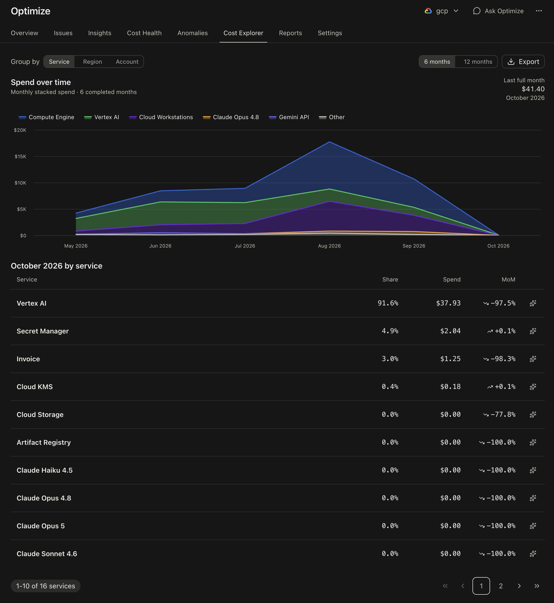
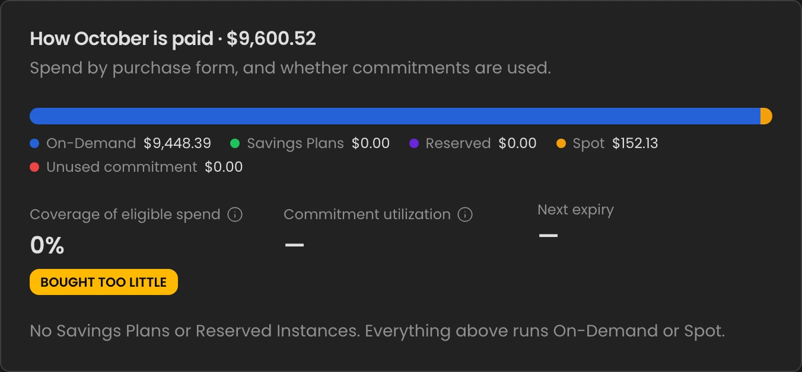
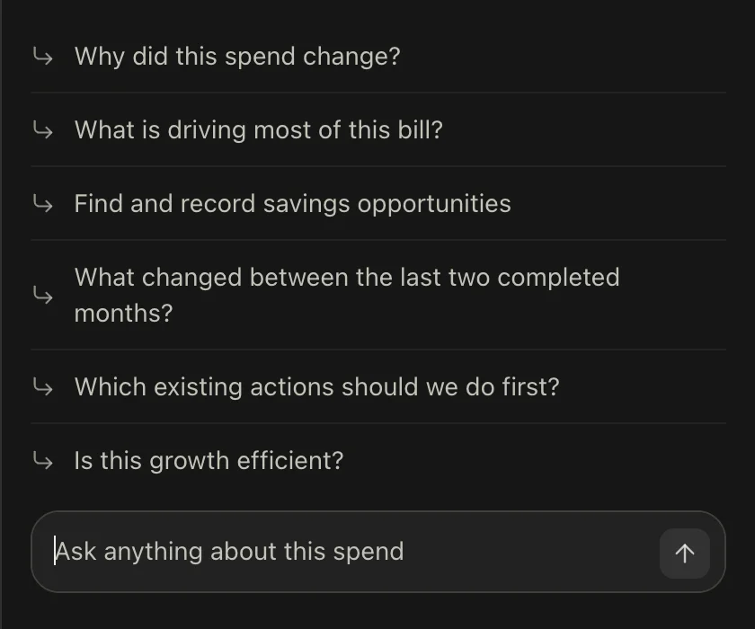

Cost Explorer は、1 つのクラウドアカウントの支出が、完了した過去 6 か月または 12 か月でどう変化したかを示し、その理由を CloudThinker に尋ねられるようにします。これは **Optimize** の下にある CloudThinker 独自のページで、AWS の請求データを読み取る AWS Cost Explorer サービスとは別物です。

## 前提条件

- 完了した請求月が少なくとも 1 か月ある、Optimize に接続されたクラウドアカウント。[Optimize quickstart](/guide/cost-optimization/quickstart) を参照してください。
- Cost Explorer は、Viewer を含むすべてのワークスペースロールで閲覧できます。CloudThinker にそれについて尋ねるには、Developer 以上が必要です。

## 期間ごとの支出を読む

<Steps>
  <Step title="Cost Explorer を開く">
    **Optimize → Cost Explorer** をクリックし、ページタイトルの横のセレクターでアカウントを選びます。

    **成功時の状態:** **Spend over time** のグラフと、月とグループ化の単位でタイトルが付いた内訳の表（例: **October by service**）が表示されます。

    <Frame caption="Google Cloud アカウントの Cost Explorer。完了した 6 か月をサービス別にグループ化しています">
      
    </Frame>
  </Step>

  <Step title="期間を選ぶ">
    **6 months** または **12 months** を選びます。積み上げグラフには、その数の完了した月の月次支出が表示されます。グラフのヘッダーの **Last full month** には、最も新しい完了した月の合計が表示されます。Optimize は期間の 1 か月前も読み込むため、表の最も古い月にも MoM の数値が付きます。
  </Step>

  <Step title="グループ化の単位を選ぶ">
    **Group by** の横で、**Service**、**Region**、**Account** のいずれかを選びます。グラフと表が一緒に再グループ化され、表のタイトルもそれに合わせて変わります（例: **October by region**）。**Account** は接続の名前でグループ化するため、1 つのアカウントを選んでいる場合は 1 行になります。
  </Step>
</Steps>

Cost Explorer には、現在の未完了の月は含まれません。月初来の支出と月末の予測には、[Overview](/ja/guide/cost-optimization/overview) を使ってください。

## 内訳の表を読む

グラフは、期間全体で上位 5 つのグループを積み上げ、残りを **Other** としてまとめます。表には、期間内の最も新しい完了した月のすべてのグループが、1 ページあたり 10 行で一覧表示されます。

| 列 | 意味 |
|---|---|
| **Service**、**Region**、**Account** | グループ。プロバイダーの請求データでの名前が使われます |
| **Share** | その月の総支出に占める割合 |
| **Spend** | その月の確定した支出 |
| **MoM** | 前月からの変化率。符号と上下の矢印付きで表示されます（例: **+12.4%**）。増加は赤、減少は緑でも示されます。ダッシュは比較する前の月がないことを意味します |

グラフと表は常に 1 つのアカウントを対象にします。1 つのドキュメントで複数のアカウントを比較するには、[Reports](/ja/guide/cost-optimization/reports) で **All accounts** のスコープのレポートを生成してください。

## 今月の支払い方法を確認する（AWS）

AWS アカウントでは、内訳の下のカードに今月の支払い方法が表示されます（例: **How October is paid · $9,600.52**）。GCP と Azure のアカウントには表示されません。

<Frame caption="すべてを On-Demand または Spot で実行しているため、カバー率が Under-committed になっているアカウント">
  
</Frame>

バーは、その月の支出を **On-Demand**、**Savings Plans**、**Reserved**、**Spot**、**Unused commitment** に分割します。その下の 3 つの数値には、それぞれバッジが付きます。

| 数値 | 測定する内容 | バッジ |
|---|---|---|
| **Coverage of eligible spend** | Savings Plans とリザーブドインスタンスがカバーできる支出のうち、実際にカバーしている割合 | 70% 未満は **Under-committed**、それ以外は **Covered** |
| **Commitment utilization** | 購入したコミットメントのうち、使用している割合 | 95% 未満は **Unused**、それ以外は **Healthy** |
| **Next expiry** | 最も近いコミットメントの終了日 | 60 日以内は **No decision yet**、それ以外は **Healthy** |

Savings Plan やリザーブドインスタンスはそれぞれ独自の行を持ちます。使用率が 80% 未満の行には **Unused** が、30 日以内に終了する行には **Renew?** が付きます。コミットメントがない場合、カードにはすべてが On-Demand または Spot で実行されていると表示されます。コミットメントは毎日の更新で読み込まれるため、新しいアカウントでは最初に **Commitments are read on the next daily refresh** と表示されることがあります。

[Cost Health](/guide/cost-optimization/cost-health) は、同じコミットメントを **Rate optimization** でスコアリングします。

## 支出が変わった理由を CloudThinker に尋ねる

<Steps>
  <Step title="質問用のドロワーを開く">
    アカウントセレクターの横にある **Ask Optimize** をクリックします。1 つのサービスについて尋ねるには、**Service** でグループ化し、その行のスパークルアイコン（スマートフォンでは **Ask why**）をクリックします。

    ページの横にドロワーが開き、選択したアカウントと期間にスコープが限定されます。Cost Explorer にとどまったままです。
  </Step>

  <Step title="質問を選ぶか書く">
    提案された質問を選ぶか、**Ask anything about this spend** に自分の質問を入力します。**Ask why** からの質問は自動で入力されますが、あなたが送信するまで送られません。

    <Frame caption="Ask Optimize ドロワーにある 6 つの提案された質問">
      
    </Frame>

    **Find and record savings opportunities** は、新しい検出事項を [Issues](/ja/guide/cost-optimization/recommendations) に保存できます。その他の提案は回答するだけです。

    ```text
    Why did Amazon EC2 spend go up last month, and which resources drove it?
    Which services grew the most over the last 6 months?
    ```
  </Step>

  <Step title="送信して回答を読む">
    Enter キーを押すか、矢印をクリックします。CloudThinker がドロワー内で、尋ねたアカウント、期間、サービスにスコープを限定した新しい会話を開始します。

    **成功時の状態:** CloudThinker の返信がドロワーに表示されます。**Ask another question**（鉛筆アイコン）をクリックすると、新しい会話を開始します。
  </Step>
</Steps>

ドロワーを閉じても、下書きとページはそのまま保持されます。

## 内訳をエクスポートする

**Export** をクリックすると、現在のグループ化の単位での内訳の表を CSV でダウンロードします。CSV には 4 つの列があります: グループ、**Last full month spend**、**Share of total**、**MoM change**。エクスポートするデータがあるまで、**Export** はグレー表示のままです。

CSV が対象にするのは最も新しい完了した月だけで、グラフの月次の系列は含まれません。月ごとの数値には、**Ask Optimize** を使ってください（例: 「Give me a table of monthly spend by service for the last 12 months」）。

## 通貨

AWS と GCP は USD で表示します。Azure は請求スコープ自身の通貨で表示します（[Provider differences](/ja/guide/cost-optimization/overview#プロバイダーごとの違い) を参照）。Optimize は Azure の金額を他の通貨に換算しないため、Azure のアカウントは同じ通貨の他のアカウントとだけ比較してください。

## トラブルシューティング

<AccordionGroup>
  <Accordion title="No cost history yet">
    **原因:** アカウントに、Optimize でまだ完了した請求月がありません。少なくとも 1 つの暦月全体の請求がインポートされると、履歴が表示されます。

    **対処:** **Overview** で最初のスキャンが完了していることを確認します。新しいクラウドアカウントでは、最初の 1 か月が終わってから履歴が表示されます。
  </Accordion>

  <Accordion title="Couldn't load Cost Explorer">
    **原因:** リクエストが失敗しました。保存されたデータには影響しません。

    **対処:** **Retry** をクリックします。失敗が続く場合は、**Settings → Workspace → Connections** で接続のステータスを確認します（[Connections](/ja/guide/connections/overview) を参照）。
  </Accordion>

  <Accordion title="最新の月が低く見える、または表示されない">
    **原因:** プロバイダーは、使用が発生した後に請求を確定します。AWS Cost Explorer は 24〜48 時間遅れることがあります。

    **対処:** ページヘッダーの **More Optimize actions**（⋯）メニューで **Updated** の時刻を確認します。Optimize が遅れて届いた請求データを自動で取り込むよう、**Daily refresh** はオンのままにしてください。
  </Accordion>

  <Accordion title="スパークルアイコンや Ask why が表示されない">
    **原因:** 行ごとの質問は、**Service** でグループ化している場合にのみ機能します。

    **対処:** **Group by** を **Service** に切り替えるか、アカウントセレクターの横にある **Ask Optimize** を使います。

    アイコンは表示されるものの、パネルに **Chat access is required to ask CloudThinker** と表示される場合、あなたのロールは Viewer です。質問には Developer 以上が必要なため、ワークスペースの Admin にロールの変更を依頼してください。
  </Accordion>

  <Accordion title="Couldn't open the investigation">
    **原因:** 会話が開始されませんでした。

    **対処:** 質問は保持されています。**Retry** をクリックして再送信します。失敗が続く場合は、**Settings → Workspace → Connections** で接続のステータスを確認します（[Connections](/ja/guide/connections/overview) を参照）。
  </Accordion>
</AccordionGroup>

## 次のステップ

<CardGroup cols={2}>
  <Card title="検出事項に取り組む" icon="lightbulb" href="/ja/guide/cost-optimization/recommendations">
    最大のコスト要因を、完了まで追跡する削減につなげます
  </Card>
  <Card title="異常を確認する" icon="wave-pulse" href="/ja/guide/cost-optimization/anomalies">
    サービスが想定より多く支出した日を確認します
  </Card>
</CardGroup>
