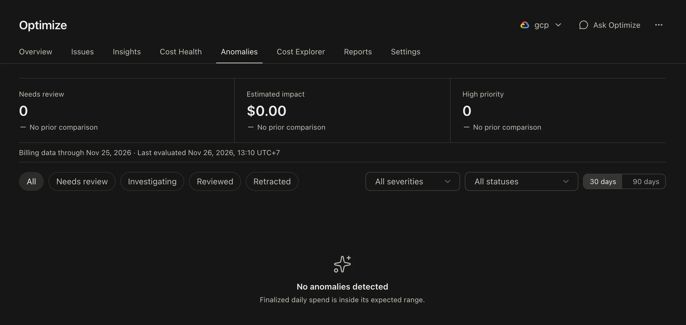

コスト異常とは、確定済みの請求データに基づき、あるサービスのコストが最近の通常値より目立って高くなった日のことです。**Optimize → Anomalies** には 1 つのクラウドアカウントの異常が一覧表示され、各急増を確認し、その意味を記録し、原因の分析を CloudThinker に任せられます。

## 前提条件

- 請求データがある Optimize の接続。[Optimize quickstart](/guide/cost-optimization/quickstart) を参照してください。
- サービスごとに 14 日分以上の確定済みの日次請求履歴。それまでは、ページは異常がないとは表示せず、**Baseline preparing** と確定済みの日数を表示します。後から使い始めたサービスも、古いアカウント上であっても、検出対象になるまでにそのサービス自身の 14 日分が必要です。
- 確認や調査を行うには、ワークスペースの Developer 以上のロール。Viewer は一覧と証拠を読めます。[Roles](/guide/security/roles) を参照してください。

## 検出の仕組み

Optimize は、各サービスの日次コストを直前 14 日間の中央値と比較します。その日が中央値からどれだけ上にあるかを、スケーリングした中央絶対偏差（MAD）で測ってスコアを付けます。次の 2 つの条件を両方満たした日だけが検出されます:

- **異常であること:** スコアが 3.5 を超える。
- **十分に大きいこと:** 増加額が 20 またはベースラインの 15% のいずれか高い方以上である。

検出されるのは増加だけです。障害や壊れたワークロードを示す可能性のある減少を見つけるには、[Cost Explorer](/ja/guide/cost-optimization/analytics) で月を比較するか、そのサービスについて CloudThinker に聞いてください。

重大度は、増加額とスコアから決まります:

| 重大度 | ルール |
|---|---|
| High | 増加額が 500 超、またはスコアが 6 超 |
| Medium | 増加額が 100 超、またはスコアが 4.5 超 |
| Low | 検出を通過したそれ以外のもの |

<Note>
金額（20、100、500）はアカウントの請求通貨での単純な数値で、USD から換算されません。JPY や VND などの通貨で請求される Azure のスコープでは、これらは小さな値になるため、15% の条件がフィルタリングの大部分を担い、Medium や High になる異常が多くなります。
</Note>

異常の数値（実コスト、ベースライン、推定影響額、重大度）は常に保存済みの請求データから算出され、エージェントの判断から来ることはありません。請求データは遅れて届くため、これはリアルタイムのアラートではなく、日次の確認ツールです。

## 異常を確認する

<Steps>
  <Step title="Anomalies を開く">
    サイドバーで **Optimize → Anomalies** を選び、ページヘッダーでクラウドアカウントを選びます。

    **成功の状態:** サマリーカードに、期間内の **Needs review** の件数、**Estimated impact** の合計、**High priority** の件数が表示されます。

    <Frame caption="直近 30 日間に未解決の異常がない Google Cloud アカウントの Anomalies">
      
    </Frame>
  </Step>
  <Step title="期間を選ぶ">
    **30 days** または **90 days** を選びます。タブ（**All**、**Needs review**、**Investigating**、**Reviewed**、**Retracted**）と、重大度と状態のフィルターで一覧を絞り込みます。

    **Needs review** タブは、この急増の意味をまだ誰も記録していないことを表します。**Issues** の **Needs review** [finding class](/ja/guide/cost-optimization/recommendations#finding-の読み方) とは関係ありません。
  </Step>
  <Step title="証拠を開く">
    異常を選択します。詳細パネルには次が表示されます:

    | フィールド | 意味 |
    |---|---|
    | Actual cost | 検出された日のサービスのコスト |
    | Rolling baseline | 比較に使った 14 日間の中央値 |
    | Estimated impact | 実コストからベースラインを引いた値。節約見込みや請求のクレジットではありません。 |
    | Deviation | ベースラインからどれだけ上かを示す割合 |
    | Detector score | [検出の仕組み](#検出の仕組み)の MAD スコア。3.5 を超えると最初の条件を通過します |
    | Billing data through | 検出に使った最後の確定済み請求日 |
    | Top contributors | コストの大部分を占めたリージョン。リージョンのみです。リソースや使用タイプについては **Investigate with CloudThinker** を使います |

    グラフには、実際の日次コストがベースラインと **Expected upper bound** に対してプロットされます。
  </Step>
  <Step title="関連する finding を確認する">
    エージェントが急増を節約の finding と結び付けている場合、**Explained by** の一覧が表示されます。finding を選ぶと、その記録が開きます。[Optimize Issues](/ja/guide/cost-optimization/recommendations) を参照してください。
  </Step>
</Steps>

1 つの異常は、最長 31 日間の複数日にわたるエピソードをカバーできます。増加が続いている間、日次の更新が同じ記録を延長します。検出は新しく取得した請求データに対して実行されるため、**Daily refresh** をオフにすると、新しい異常も見つからなくなります。

## 変化の意味を記録する

詳細パネルのボタンを使います:

| ボタン | 使う場面 | 何が起きるか |
|---|---|---|
| **Mark as expected** | ローンチや移行など、計画された変更と一致する場合 | 異常は **Expected change** の disposition とともに **Reviewed** タブに移り、**Needs review** の件数から外れます。**Marked Expected change** のメッセージに **Undo** が表示されます |
| **Mark as wrong** | 請求の訂正で課金が取り消された場合など、実際のコスト急増ではなかった場合 | 理由を入力します。異常はキューと合計から外れ、理由とともに **Retracted** タブに残ります |
| **Reopen review** | キューに戻したい場合 | 異常に disposition が付くと表示されます。**Review reopened** のメッセージに **Undo** が表示されます。再オープンしても履歴は残ります |

**All statuses** フィルターでは、引き続き disposition ごとに異常を分けられます: **Unexpected change**、**Expected change**、**Insignificant**。

## CloudThinker で調査する

詳細パネルで **Investigate with CloudThinker** を選びます。異常はすぐに **Investigating** に移り、組み込みのアシスタントである CloudThinker が、異常の証拠と正確なクラウド接続をすでに含んだ新しい会話を開きます。続いて、そのアカウントのライブのコスト内訳と変更履歴を読みます。調査は読み取りを求め、CloudThinker が提案する変更はすべて [Approvals](/guide/approvals/overview) のルールを通ります。

**成功の状態:** 会話は、考えられる原因とその証拠で終わるか、利用できるアクセスやデータでは原因を特定できないという明確な説明で終わります。CloudThinker は原因を推測しません。

同じ会話で追加の質問をします:

```text
Which resources inside this service drove the increase, and when were they created or changed?
Is the increase still going on today, or did it stop after the flagged days?
```

同じ異常の後の調査では、以前の会話で見つかったことを再利用できます。**Open in Cost Explorer** を使うと、急増を[完了した月の支出](/ja/guide/cost-optimization/analytics)と比較できます。

## 撤回された異常

請求データが修正されて異常を裏付けなくなった場合、エージェントは理由を記録して異常を撤回します。**Mark as wrong** で自分で撤回することもできます。撤回された記録が削除されることはありません。**Retracted** タブで確認でき、それぞれに理由と撤回された時刻が表示されます。エージェントは **Investigating** や **Reviewed** の異常は撤回しません。すでに人が対応しているためです。

## 通知を受け取る

異常が High の重大度に達すると、ワークスペースのオーナーにアプリ内で **High cost anomalies** の通知が届きます（メールはデフォルトでオフ）。2 つの Optimize ダイジェストには、まだ誰も確認していない新しい異常と、確認待ちのままの古い異常の件数が載ります。それぞれのオンとオフは [Notifications](/ja/guide/notifications) で切り替えます。

| ダイジェスト | 受け取る人 | タイミング | デフォルトのメール |
|---|---|---|---|
| **Optimize weekly digest** | 1 人: [ワークスペースのオーナー](/guide/security/roles) | 毎週月曜日、変化があった場合のみ | オフ |
| **Optimize monthly digest** | ワークスペースの Admin のみ | 毎月 2 日、前月分 | オン |

組織が所有するワークスペースにはオーナーがいないことがあります。デフォルトのままでは、オーナーはオンにするまで週次のメールを受け取らず、Developer と Viewer はどちらのダイジェストも受け取りません。それ以外の人は **Optimize → Anomalies** か、**Insights** の **Running anomalies** セクションを確認する必要があります。

## トラブルシューティング

<AccordionGroup>
  <Accordion title="新しいアカウントで異常が表示されない">
    **原因:** 検出にはサービスごとに 14 日分の確定済み履歴が必要です。**確認:** ページに **Baseline preparing** と、利用できる確定済みの日数が表示されます。**対処:** 請求履歴が溜まるのを待ちます。古いアカウントの場合は、Optimize のページヘッダーで日次の更新がオンになっていることを確認してください。
  </Accordion>
  <Accordion title="クラウドコンソールで見える急増が一覧にない">
    **原因:** プロバイダーがその日の請求をまだ確定していないか、増加がサイズのしきい値を下回っているか、減少です。**確認:** 日付を **Billing data through** と比較します。
  </Accordion>
  <Accordion title="Mark as expected または Investigate with CloudThinker が表示されない">
    **原因:** ロールが Viewer であるか、異常が撤回されています。**対処:** Viewer の場合は、ワークスペースの Admin に Developer ロールを依頼してください。撤回された記録は読み取り専用です。**Retracted** タブで理由を確認してください。
  </Accordion>
  <Accordion title="Optimize の更新が一時停止している、またはデータが古い可能性があるというアラートが出る">
    **原因:** 権限の不足や請求ソースが読めないなどの理由で、前回の請求の更新が失敗しました。最後に取得できた証拠は引き続き読め、クラウド接続も接続されたままです。**対処:** アラートに従います。権限の不足が表示されている場合は **Copy policy** を使い、**Check connection** でクレデンシャルを確認してから、**Retry refresh** を実行してください。
  </Accordion>
</AccordionGroup>

## 次のステップ

<CardGroup cols={2}>
  <Card title="Optimize の finding" icon="lightbulb" href="/ja/guide/cost-optimization/recommendations">
    急増を説明する、または急増に対応する節約の finding に対処します
  </Card>
  <Card title="Optimize のレポート" icon="file-chart-column" href="/ja/guide/cost-optimization/reports">
    直近 30 日間の異常確認ログを生成します
  </Card>
</CardGroup>
