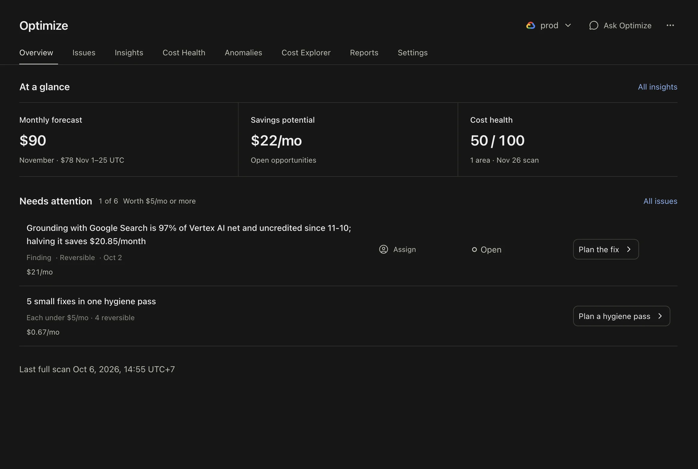

import { OptimizeScene } from '/snippets/iso/optimize.jsx';
import ApprovalDefault from '/snippets/approval-default.mdx';

**使った分だけを支払います。**

Optimize は、クラウドコストのための Frontier Investigation Agent です。一度に 1 つのクラウドアカウントの請求データを読み、支出のスナップショット、ヘルススコア、行動に移せる削減の機会のランク付きの一覧に変えます。[AWS](/ja/guide/connections/aws)、[GCP](/ja/guide/connections/gcp)、[Azure](/ja/guide/connections/azure) で動作し、削減の機会を見つけるスキャンは読み取り専用です。

<OptimizeScene />

## 仕組み

1. **クラウドアカウントを接続します。** CloudThinker には請求データへの読み取りアクセスが必要です。GCP と Azure では、初回に請求のソース（BigQuery の請求エクスポートのテーブル、または Azure の請求スコープ）も選びます。
2. **CloudThinker が最初のスキャンを実行します。** 最大 13 か月分の請求履歴を取得し、請求された各サービスを読み取り専用のコマンドで確認します。スキャンはバックグラウンドで実行されるため、ページを離れても構いません。
3. **Optimize がスコアリングとランク付けを行います。** Cost Health のスコア、検出事項（それぞれ見積もり付きの削減の機会）の一覧、通常と異なるコストの変化を指摘する日次のベースラインが得られます。
4. **次に何をするかはあなたが決めます。** 各検出事項を確認し、CloudThinker に分析や実施を依頼するか、対応が不要な理由を記録します。スキャン中にクラウドアカウントで何かが変わることはありません。
5. **毎日の更新で数値を最新に保ちます。** コストデータが存在すると、CloudThinker は 1 日に 1 回新しい請求データを取得します。Developer または Admin は、ページヘッダーの **More Optimize actions**（⋯）メニューにある **Daily refresh** スイッチでオフにできます。このメニューには最終更新時刻も表示されます。

<Frame caption="Google Cloud アカウントの Optimize の Overview: 月の予測、削減の可能性、Cost health スコア、最初に対応すべき問題">
  
</Frame>

## できること

Optimize には 8 つのタブがあります: **Overview**、**Issues**、**Insights**、**Cost Health**、**Anomalies**、**Cost Explorer**、**Reports**、**Settings**。各ページは、ページタイトルの横のセレクターで選んだアカウントにスコープが限定されます。

| ページ | 答える質問 | ガイド |
|---|---|---|
| **Overview** | 今月はどこで着地するか、どの問題を最初に判断する必要があるか | [Quickstart, step 4](/guide/cost-optimization/quickstart) |
| **Issues** | どの削減の機会がオープン中で、それぞれいくらの価値があり、誰が取り組んでいるか | [Issues](/ja/guide/cost-optimization/recommendations) |
| **Insights** | Optimize がこれまでに何を削減したか、どのサービスが支出の要因か、どの異常がまだ続いているか | [削減の見積もり](/ja/guide/cost-optimization/savings) |
| **Cost Health** | このアカウントがどのコストのプラクティスを正しく行い、どのチェックが失敗し、何がスコアを上げるか | [Cost Health](/guide/cost-optimization/cost-health) |
| **Anomalies** | どのサービスがある日に想定より多く支出したか、その理由は何か | [Anomalies](/ja/guide/cost-optimization/anomalies) |
| **Cost Explorer** | 1 つのアカウントで、完了した過去 6 か月または 12 か月の支出がサービス別やリージョン別にどう変化したか（アカウントを比較するには **All accounts** のレポートを使います） | [Cost Explorer](/ja/guide/cost-optimization/analytics) |
| **Reports** | 文章のコストレポートを今すぐ、またはスケジュールで送れるか | [Reports](/ja/guide/cost-optimization/reports) |
| **Settings** | このアカウントはどの請求のソースを読み、その更新は正常か | [Optimize settings](/guide/cost-optimization/settings) |

**Overview** のページには 2 つのセクションがあります。**At a glance** には **Monthly forecast**、**Savings potential**、**Cost health** が表示され、コストの異常が続いている間は **Extra spend** も表示されます。**Needs attention** には、最初に対応する価値のあるオープン中の問題が、それぞれ **Plan the fix** とともに一覧表示されます。支出と削減の分析は **Insights** にあります。

## 削減がどのように提案され、承認されるか

スキャンは提案するだけです。各検出事項を、証拠、月間の削減見積もり、労力、リスクとともに保存し、誰かが検出事項で **Implement** を選ぶまで、クラウドアカウントでは何も変わりません。その間に、チームは **Issues** で検出事項をトリアージし、CloudThinker にそれをどうさせるかを選びます。影響の分析、実施計画の作成、それについての質問への回答、変更の実施のいずれかです。クラス、4 つのステータス、各操作については [Issues](/ja/guide/cost-optimization/recommendations) で説明しています。

**Implement** はクラウドに対するエージェントの操作のため、他の操作と同じ [Approvals](/guide/approvals/overview) のルールとモードを経由します。すべての **Implement** を人の判断待ちにしたい場合は、Approvals を **Manual** に切り替えてください。

<ApprovalDefault />

<Note>
**Potential monthly savings** は上限であり、保証ではありません。検出事項は重複することがあるため、オープン中の検出事項をすべてクローズしても、削減額は合計より少なくなります。[削減の見積もり](/ja/guide/cost-optimization/savings)を参照してください。
</Note>

## 主な概念

| 用語 | 意味 |
|---|---|
| Finding（検出事項） | 1 つのアカウントにおける 1 つの削減の機会。証拠と月間の削減見積もりを持ちます |
| Cost Health | 5 つの FinOps の能力（**Rate optimization**、**Workload optimization**、**Allocation**、**Anomaly management**、**Forecasting**）にわたる、100 点満点の日次のスコア。段階は FinOps Framework に従います: 50 未満は **Crawl**（**Needs work**）、50 以上は **Walk**（**On track**）、支出の 80% が測定された状態で 80 以上は **Run**（**Strong**）。CloudThinker の最初の測定の前は、カードにプロバイダーの 3 本柱のスコアが表示されます。[Cost Health](/guide/cost-optimization/cost-health) を参照してください |
| Anomaly（異常） | サービスの確定した支出が、ローリングベースライン（過去 14 日間の中央値）に対して想定範囲を上回った日。[検出の仕組み](/ja/guide/cost-optimization/anomalies#検出の仕組み)を参照してください |
| Billing source（請求のソース） | Optimize がコストデータを読む場所: AWS Cost Explorer、GCP の BigQuery の請求エクスポート、または Azure Cost Management |

## プロバイダーごとの違い

| プロバイダー | 請求のソース | 通貨 |
|---|---|---|
| AWS | AWS Cost Explorer。使用から 24〜48 時間遅れることがあります | USD |
| GCP | BigQuery の Cloud Billing Standard エクスポート | インポート時に、エクスポート自身の `currency_conversion_rate` を使って行ごとに USD に換算されます |
| Azure | Cost Management のサブスクリプションまたは請求スコープ | 請求スコープの通貨 |

遅れて届いた請求データが支出ゼロとして表示されることはありません。Optimize は最後に正常だったデータを保持し、いつ更新されたかを表示します。

## 複数アカウントの構成

各クラウドアカウントはそれぞれ独立した接続で、Optimize のすべてのページは一度に 1 つのアカウントを表示します。

- **AWS Organizations:** Optimize は、管理（支払者）アカウントであっても、接続されたアカウント自身の支出だけを読みます。カバーしたい各メンバーアカウントを接続してください。[Work across multiple AWS accounts](/ja/guide/use-cases/multi-aws-accounts) を参照してください。
- **アカウントをまたいだビュー:** **Optimize → Reports** で **All accounts** のスコープのレポートを生成します。各アカウントに独自のセクションがあり、異なる通貨が合算されることはありません。アカウントをまたいだ単一の削減合計はありません。

## Optimize がカバーするもの

**カバーするもの:**

- 請求された各サービスの削減の検出事項。リソースレベル（アイドル、過大、未使用のリソース）まで
- コミットメントのカバー率: AWS の RI と Savings Plans、GCP の確約利用割引、Azure の予約
- Cost Health でのタグ付けとコスト配分のチェック
- サービスごとの日次の異常検出

**カバーしないもの:**

- AWS、GCP、Azure 以外のクラウド
- Kubernetes の名前空間やワークロード別のコストの分割。クラスターは請求されたノードとサービスとして表示されます
- 変更後に実現した削減や ROI
- コストの減少。異常検出は増加だけを指摘します

## データとアクセス

- **保存されるもの:** Optimize が取得した請求の行と、検出事項、Cost Health の結果、異常の記録。これらはワークスペースに保存されるため、ページとレポートはプロバイダーを再度呼び出さずに読み込まれます。
- **誰が見られるか:** ワークスペースのすべてのメンバーが、Optimize のすべてのページを読めます。スキャンの実行と検出事項への対応には Developer が、アカウントの接続と検出事項のマークには Admin が必要です。[Roles](/guide/security/roles) を参照してください。

CloudThinker がデータをどこでホストし、どのように保護するかは [Security](/ja/guide/security/overview) を参照してください。スキャン、請求のソース、権限が失敗した場合は、[Optimize のトラブルシューティング](/guide/cost-optimization/troubleshooting)を参照してください。

## はじめに

<CardGroup cols={2}>
  <Card title="Optimize クイックスタート" icon="bolt" href="/guide/cost-optimization/quickstart">
    アカウントを接続し、最初のスキャンを実行し、レポートを共有します
  </Card>
  <Card title="検出事項に取り組む" icon="lightbulb" href="/ja/guide/cost-optimization/recommendations">
    削減の優先順位を付け、それぞれの結果を記録します
  </Card>
  <Card title="異常を確認する" icon="wave-pulse" href="/ja/guide/cost-optimization/anomalies">
    通常と異なる日次のコストの変化を確認し、調査します
  </Card>
  <Card title="コストレポートを送る" icon="file-chart-column" href="/ja/guide/cost-optimization/reports">
    今すぐレポートを生成するか、スケジュールに設定します
  </Card>
</CardGroup>
