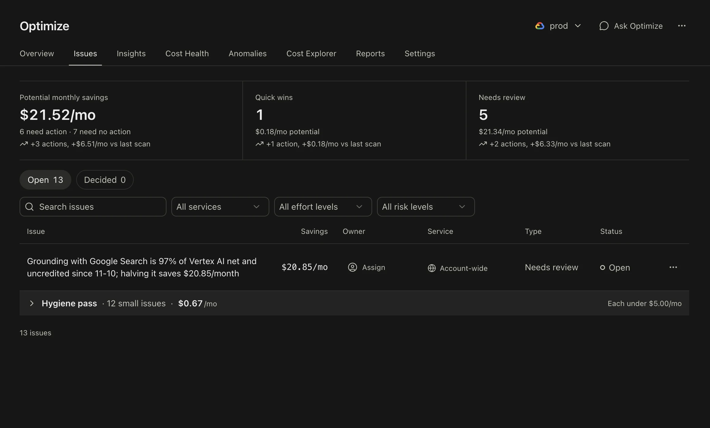
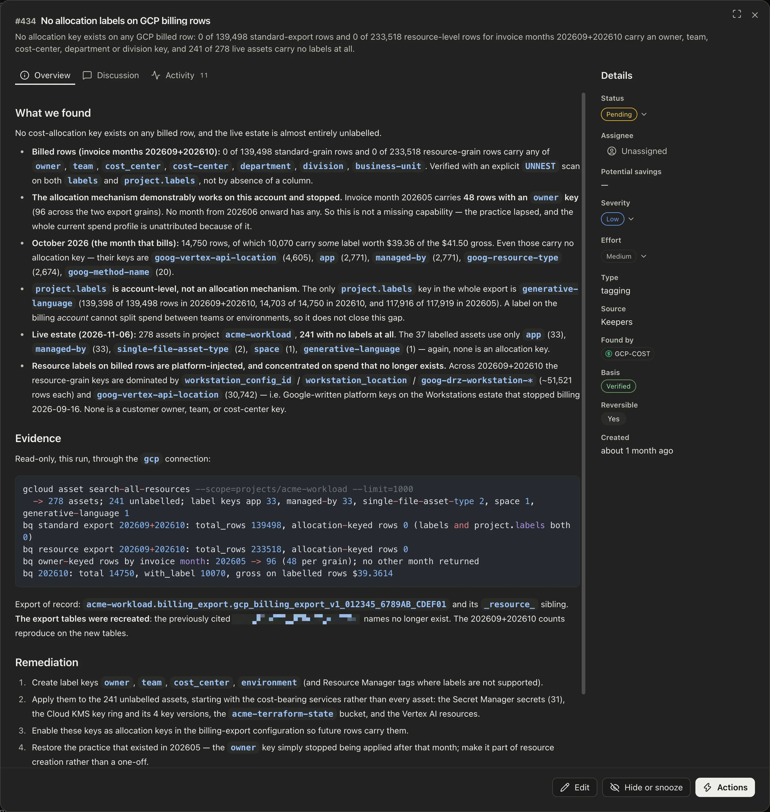
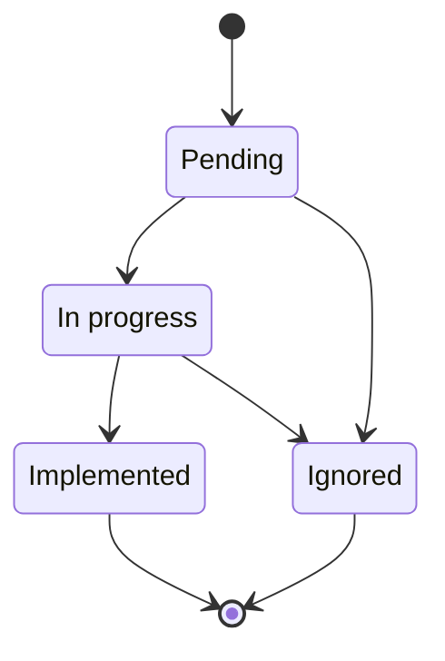
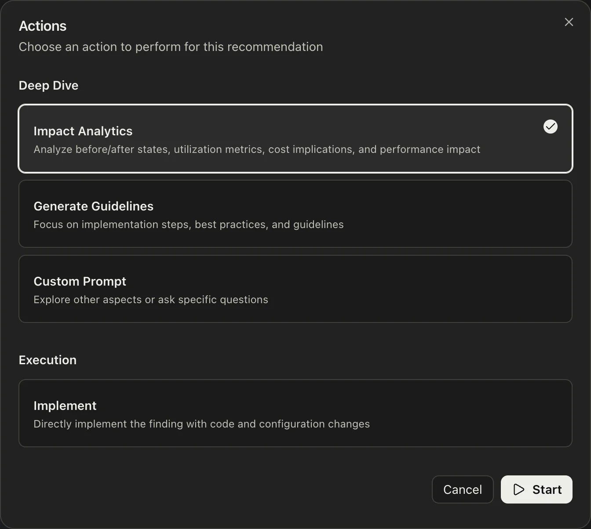
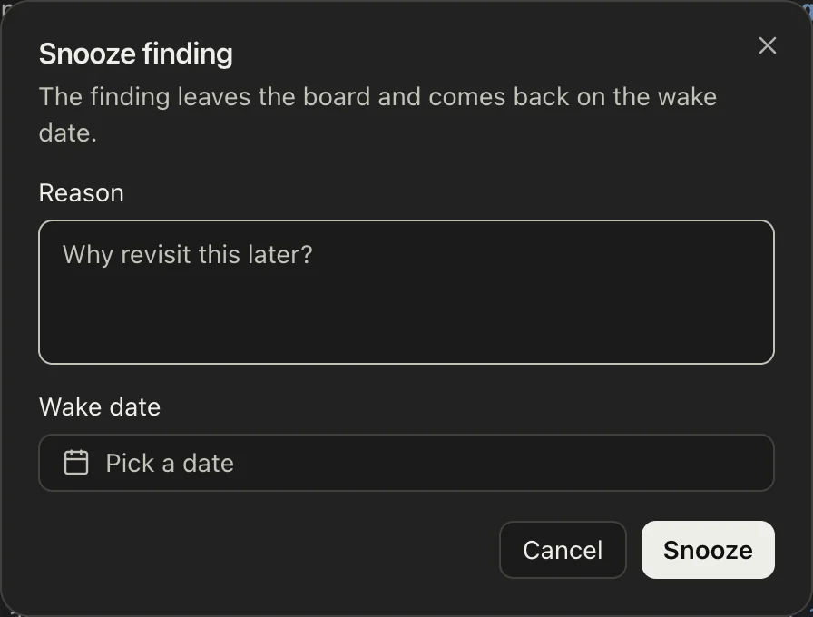
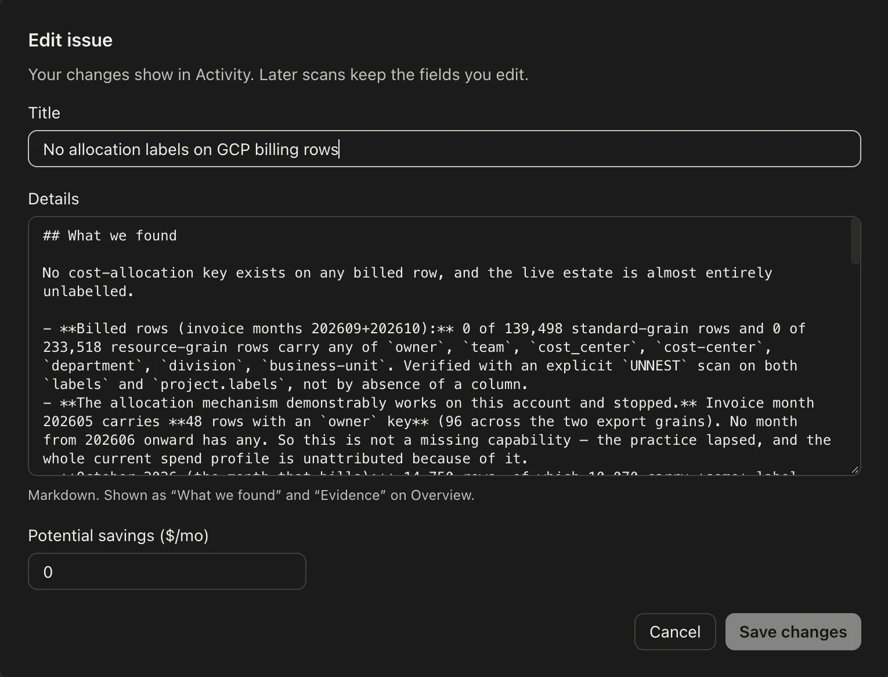

import ApprovalDefault from '/snippets/approval-default.mdx';

finding とは、Optimize のスキャンがクラウドアカウントで見つけた 1 つの節約機会で、推定月間節約額とその根拠となる証拠を伴います。**Optimize → Issues** は、最初に目にしてから実施または無視されるまで、チームがそれぞれの finding をどうするかを決める場所です。

## 前提条件

- 最初のスキャンが完了した Optimize の接続。[Optimize quickstart](/guide/cost-optimization/quickstart) を参照してください。
- 行いたい操作に応じたワークスペースのロール。[Roles](/guide/security/roles) を参照してください。

| 操作 | 最低限必要なワークスペースのロール |
|---|---|
| finding の表示と証拠の閲覧 | Viewer |
| finding の移動・編集・担当者の割り当て、スキャンの実行、**Implement** などのアクションの開始 | Developer |
| finding を expected、snoozed、disputed としてマークする | Admin |

マークに Admin が必要なのは、Optimize が後で何を提起し、何を集計するかが変わるためです。expected とした finding は、有効期限を設定しない限り再び提起されず、どのマークも finding を節約額の合計から外します。

## finding の読み方

すべての finding にはクラスと証拠バッジがあります。行動する前に両方を読んでください。

| クラス | 意味 | 節約見込み額に含まれるか |
|---|---|---|
| Quick win | 検証済みの証拠があり、手間が少なく、元に戻せる。3 つすべてを満たす必要があります。 | はい |
| Needs review | 実際の機会だが、quick win の条件を 1 つ以上満たさないため、追加の文脈や注意が必要 | はい |
| No action | スキャンが確認し、正当と判断した支出 | いいえ |

| 証拠バッジ | エージェントが finding をどう確立したか |
|---|---|
| Verified | ライブのリソースを読み、値を確認した |
| Inferred | リソースを読まずに、請求データと設定データから finding を導いた |
| Assumed | finding の一部を確認できなかった。行動する前に、その部分を自分で確認してください。 |

ここでの **Needs review** は finding のクラスであり、それ以外の意味はありません。同じ言葉が [Anomalies](/ja/guide/cost-optimization/anomalies#異常を確認する) では異常の状態を、[Code Audit](/ja/guide/security/cyber-libraries) ではライブラリの重大度を表しますが、3 つが互いに影響することはありません。

バッジは finding を限定するものであり、順位を付けるものではありません。inferred の finding が、そのアカウントで最大の節約額になることもあります。

**Effort** と **Risk** はそれぞれ **Low**、**Medium**、**High** の 3 段階のいずれかです。finding の詳細と編集フォームでは、Risk は **Severity** と呼ばれます。quick win になれるのは Effort が Low の finding だけです。

**No action** はスキャンの判定です。マークは、スキャンが対応が必要と判断した finding に対する、あなたの判定です。

## finding に優先順位を付ける

<Steps>
  <Step title="Issues を開く">
    サイドバーで **Optimize → Issues** を選び、ページヘッダーでクラウドアカウントを選びます。

    **成功の状態:** 3 つのサマリーカードに **Potential monthly savings**、**Quick wins**、**Needs review** が表示され、その下に finding が並びます。

    <Frame caption="推定節約額で並べ替えた Issues タブ。小さな問題は Hygiene pass の行にまとめられています">
      
    </Frame>
  </Step>
  <Step title="quick win から始める">
    **Quick wins** または **Needs review** のカードを選ぶと、一覧がそのクラスに絞り込まれます。もう一度選ぶか、**Potential monthly savings** を選ぶと、フィルターが解除されます。
  </Step>
  <Step title="一覧を絞り込む">
    **Search issues** に入力してタイトルと説明を検索するか、**Service**、**Effort**、**Risk** で絞り込みます。ページの URL にはフィルターが保持されるので、リンクをチームメイトに貼れば同じ一覧が表示されます。
  </Step>
  <Step title="未決定か決定済みかを選ぶ">
    **Open** タブには、まだ決定が必要な finding が並びます。**Decided** タブには、**Implemented** または **Ignored** とマークされた finding が並びます。表には **Issue**、**Savings**、**Owner**、**Service**、**Type**（クラス）、**Status** の列があり、各行に **⋯** メニューがあります。小さな問題（それぞれの節約額が **Each under …/mo** に表示された額未満のもの）は、件数と合計節約額とともに、下部の 1 つの **Hygiene pass** 行にまとめられます。行を展開すると表示されます。
  </Step>
  <Step title="finding を開く">
    行を選ぶと finding が開きます。**Overview** タブには **What we found**、**Evidence**、**Remediation**、**Savings math** が表示されます。**Details** パネルには、状態、担当者、見積もり、重大度、手間、証拠の根拠、変更を元に戻せるかどうかが表示されます。

    <Frame caption="finding の Overview タブと Details パネル">
      
    </Frame>
  </Step>
</Steps>

## ワークフローで finding を進める

Optimize の finding は独自の 4 つの状態を使い、CloudThinker の他の場所で使われる状態とは別です。finding はどの状態からどの状態へも移動でき、**Pending** に戻すこともできます。図は一般的な流れを示しています。

| 状態 | 使う場面 |
|---|---|
| Pending | まだ誰も着手していない新しい作業 |
| In progress | チームが評価中または実施中 |
| Implemented | チームが変更を行った |
| Ignored | チームが対応しないことを選んだ |



状態を変えるには、行の **⋯** メニューを開き、**Move to** の下で状態を選びます。表では、**Pending** の finding は状態が **Open** と表示されます。

**成功の状態:** 行に新しい状態が表示され、**Implemented** または **Ignored** の finding は **Decided** タブに移ります。**Potential monthly savings** に含まれるのは **Pending** と **In progress** の finding だけなので、finding を **Implemented** や **Ignored** に移すと合計が下がり、Pending と In progress の間で移しても合計は変わりません。

## finding に対応する

<Steps>
  <Step title="Actions を開く">
    finding を開き、右下の **Actions** を選びます。

    <Frame caption="Actions ダイアログ。デフォルトでは Impact Analytics が選択されています">
      
    </Frame>
  </Step>
  <Step title="アクションを選ぶ">
    | アクション | CloudThinker が行うこと |
    |---|---|
    | **Impact Analytics** | 変更前後の状態、使用率、現在の価格でのコスト、パフォーマンスへの影響、リスクを比較します。これがデフォルトです |
    | **Generate Guidelines** | テスト、ロールバック計画、成功基準を含む、段階的な実施ガイダンスを書きます |
    | **Custom Prompt** | finding についての自分の質問に答えます |
    | **Implement** | クラウドアカウントで変更を行います。接続に書き込みアクセスが必要です（下記を参照） |

    **Custom Prompt** では、知りたいことを入力します。例:

    ```text
    Would moving this instance to the next smaller size break the nightly batch job? Check its peak CPU and memory over the last 30 days.
    ```
  </Step>
  <Step title="会話を始める">
    **Start** を選びます。CloudThinker は finding を添付した新しい会話を開きます。どのアクションも、まずリソースがまだ存在し、finding と一致していることを確認します。一致しない場合、CloudThinker は何が変わったかを伝えて停止します。

    **Implement** は、依存関係が壊れる場合やロールバックの方法がない場合にも停止します。

    <ApprovalDefault />
  </Step>
</Steps>

<Note>
**Implement** には書き込みアクセスが必要です。[Optimize quickstart](/guide/cost-optimization/quickstart) は読み取り専用の権限を付与するため、その設定では CloudThinker は finding を分析できても変更はできません。変更に必要な書き込み権限をロール、サービスアカウント、またはサービスプリンシパルに追加し、接続の **Allow writes** をオンのままにしてください。[AWS](/ja/guide/connections/aws#書き込みアクセス)、[GCP](/ja/guide/connections/gcp#書き込みアクセス)、[Azure](/ja/guide/connections/azure#書き込みアクセス) の書き込みアクセスを参照してください。
</Note>

**成功の状態:** 会話は、依頼した分析やガイダンスで終わるか、**Implement** の場合は何が変わり何を監視すべきかの記録で終わります。変更が反映されたら、finding を自分で **Implemented** に移してください。

## 対応が不要な finding をマークする

finding をアクティブなキューから外したいが、記録と理由は残したい場合にマークを使います。

<Steps>
  <Step title="マークを選ぶ">
    finding のページで **Hide or snooze** を選びます。表では、代わりに行の **⋯** メニューを使います。
  </Step>
  <Step title="理由を入力する">
    下の表からオプションを選び、理由を入力し、オプションが求める場合は日付を追加して確定します。どのマークにも短い文以上の理由が必要で、**Snooze until…** の日付は明日以降でなければなりません。CloudThinker は、disputed の finding を再確認するときにあなたの理由を読みます。

    <Frame caption="Snooze until… では理由と再開日を入力します">
      
    </Frame>

    **成功の状態:** expected と snoozed の finding は一覧から消え、ツールバーに **hidden** のトグル（例: **3 hidden**）が表示されます。disputed の finding は **Disputed** のラベル付きで一覧に残ります。どのマークも finding を **Potential monthly savings** から外します。
  </Step>
</Steps>

| マーク | 使う場面 | その後どうなるか |
|---|---|---|
| Hide as expected | その支出が意図的なものである | エージェントは証拠を最新に保ちますが、任意の有効期限を設定しない限り finding を再び提起しません。その日付を過ぎるとマークは失効し、終了したスヌーズと同じように、finding は一覧に戻って再び合計に含まれます。 |
| Snooze until… | 後で重要になるかもしれない | finding は一覧から外れ、設定した再開日（必須）に戻ってきます。 |
| Dispute… | 証拠や結論が間違っているように見える | finding は表示されたままで、エージェントが次のスキャンで再確認します。 |

非表示の finding を確認するには、ツールバーの **hidden** トグルを選びます。未決定の finding がすべて非表示の場合、ページには代わりに **Show hidden findings** ボタンが表示されます。マークを取り消すには、finding を開いて **Clear mark**（行メニュー）または **Change mark** を選びます。

## finding を編集する

実際の節約額やより分かりやすいタイトルなど、チームがより正確な情報を知っている場合は、finding を開いて下部の **Edit** を選びます。**Edit issue** ダイアログで次を変更できます:

| フィールド | 変わるもの |
|---|---|
| **Title** | 一覧とレポートでの名前 |
| **Details** | **Overview** タブの **What we found** と **Evidence** に表示される Markdown |
| **Potential savings ($/mo)** | 節約額の合計に含まれる見積もり |

**Severity** や **Effort** を変えるには、finding の **Details** パネルにあるそれぞれのドロップダウンを使います。これらは **Risk** と **Effort** のフィルターが照合するレベルで、quick win になれるのは Effort が Low のものだけです。

<Frame caption="Edit issue。後のスキャンでも編集したフィールドは保持されます">
  
</Frame>

**Save changes** を選びます。**成功の状態:** finding に新しい値が表示され、節約額の合計に新しい見積もりが反映され、変更が **Activity** タブに表示されます。

後のスキャンでも、編集したフィールドはすべて保持されます。スキャンが異なる数値を測定した場合、CloudThinker はそれをスキャンの会話で報告します。その会話は **Open analysis** で開けます。スキャンの値を復元するボタンはありません。元に戻すには、その会話の数値を使ってもう一度編集してください。リソースが変わったときは、自分で編集内容を再確認してください。そうしないと、合計は古い数値のままです。

フォームを開いた後にチームメイトが finding を保存した場合、フォームに **This finding changed** と表示されます。**Load latest** を選ぶと相手の変更が表示されます。自分の編集内容はフォームに残ります。

## 話し合いと担当者の割り当て

finding を開いて **Discussion** タブを選ぶと、決定を証拠のそばに残せます。`@` を入力してチームメイトをメンションし、スレッドで返信し、決着したらスレッドを解決済みにします。finding の詳細で **Assignee** を設定すると、1 人がフォローアップを担当します。担当者には通知が届き、担当を外された人にも通知が届きます。これらは通知設定の **Recommendation assignments** でオフにできます。

## 節約額の合計を読む

**Potential monthly savings** は、選択したアカウントで **Pending** または **In progress** にある Quick win と Needs review の finding の見積もりを合計したもので、マーク済みの finding は除きます。2 つの finding が同じ支出に対して節約額を見積もることがあるため、上限として扱ってください。合計が従うのは **Service** フィルターだけです。検索、クラスのカード、**Effort** と **Risk** のフィルターは一覧の表示を変えますが、合計は変えません。[数値が表示される場所](/ja/guide/cost-optimization/savings#数値が表示される場所)を参照してください。この数値を予測に使う前に、[節約見積もり](/ja/guide/cost-optimization/savings)を読んでください。

## finding を更新する

ページヘッダーの **More Optimize actions**（⋯）メニューを開き、**Re-scan** を選ぶと新しいスキャンが実行されます。アカウントのスキャンには数十分かかることがあり、実行中はツールバーの下に進捗が表示されます。同じメニューの **Open analysis** を選ぶと、最新のスキャンでのエージェントの会話を、実行した読み取り専用のコマンドも含めて読めます。自分が開始したスキャンの実行中は、メニューに **Re-scan** の代わりに **Open CloudThinker's conversation** が表示されます。

再スキャンしても作業は保持されます。**Pending** と **In progress** の finding の証拠をその場で更新し、状態は決して変えず、担当者、話し合い、expected や snoozed のマークもそのままにします。**Implemented** または **Ignored** にした issue が再び現れた場合、スキャンはそれに対して新しい **Pending** の finding を開きます。

一度もスキャンしていないアカウントでは、ページヘッダーに代わりに **Run scan** ボタンが表示されます。

<Note>
一部のサービスが失敗した場合、ページは完了した finding を保持し、スキャンできなかったサービスの数とともに **Scan finished with errors** を表示します。ページのアラートに示された権限や請求の問題を修正してから、再スキャンしてください。
</Note>

## トラブルシューティング

<AccordionGroup>
  <Accordion title="マークのオプションがグレーアウトしている">
    **原因:** finding のマークにはワークスペースの Admin ロールが必要です。**対処:** ワークスペースの Admin にマークを付けてもらうか、[Workspace users](/ja/guide/workspace-users) でロールを変更してもらってください。
  </Accordion>
  <Accordion title="finding を移動できない、または Re-scan が表示されない">
    **原因:** ロールが Viewer です。finding の移動とスキャンには Developer 以上が必要です。**対処:** ワークスペースの Admin に Developer ロールを依頼してください。
  </Accordion>
  <Accordion title="Implement が変更を行えないと表示する">
    **原因:** 接続が読み取り専用です。ロール、サービスアカウント、サービスプリンシパルに書き込み権限がないか、接続の **Allow writes** がオフになっています。**確認:** 会話で、拒否された変更やプロバイダーからのアクセス拒否エラーを確認します。**対処:** この変更に必要な書き込み権限だけを付与し、**Allow writes** をオンにします。[AWS](/ja/guide/connections/aws#書き込みアクセス)、[GCP](/ja/guide/connections/gcp#書き込みアクセス)、[Azure](/ja/guide/connections/azure#書き込みアクセス) の書き込みアクセスを参照してください。その後、もう一度 **Implement** を開始します。
  </Accordion>
  <Accordion title="finding があるのに一覧が空になっている">
    **確認:** finding が expected または snoozed とマークされているとページに表示される場合、未決定のものはすべてマーク済みです。**対処:** **Show hidden findings** を選んで確認します。フィルターがオンの場合は、検索と **Service**、**Effort**、**Risk** のフィルターを解除してください。
  </Accordion>
  <Accordion title="このアカウントではまだスキャンが実行されていないとページに表示される">
    **原因:** このアカウントは一度もスキャンされていません。**対処:** **Run scan** を選びます。
  </Accordion>
</AccordionGroup>

## 次のステップ

<CardGroup cols={2}>
  <Card title="節約見積もり" icon="chart-pie" href="/ja/guide/cost-optimization/savings">
    どの finding が合計に含まれるのか、なぜ上限なのかを確認します
  </Card>
  <Card title="コスト異常" icon="wave-pulse" href="/ja/guide/cost-optimization/anomalies">
    日次のコストの急増を確認し、どの finding がそれを説明するかを見ます
  </Card>
  <Card title="Optimize のレポート" icon="file-chart-column" href="/ja/guide/cost-optimization/reports">
    未決定の finding を、順位付けした節約機会のレポートにします
  </Card>
  <Card title="Optimize のトラブルシューティング" icon="wrench" href="/guide/cost-optimization/troubleshooting">
    Optimize のあらゆる問題を、原因、確認、対処とともに 1 か所にまとめています
  </Card>
</CardGroup>
