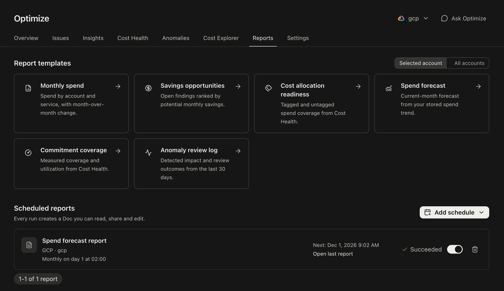
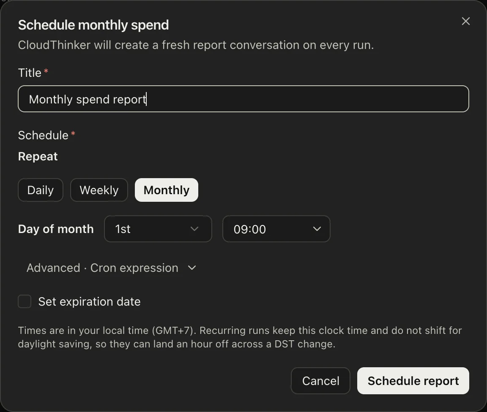

**Optimize → Reports** は、Optimize がすでに保存したコストデータを、月次の支出やランク付けされた削減の機会などの文章のレポートに変えます。組み込みのアシスタントである CloudThinker が、各レポートを新しい会話で作成し、再度開いて共有できるレポートの[アーティファクト](/ja/guide/artifacts/overview)として保存します。

## 前提条件

- 請求データを持つ Optimize の接続が少なくとも 1 つ。[Optimize quickstart](/guide/cost-optimization/quickstart) を参照してください。
- レポートの生成とスケジュールの管理には、Developer 以上のワークスペースロール。Viewer はスケジュールの一覧とその **Open last report** のリンクを見られ、**Library** で保存されたレポートを読めますが、レポートの生成やスケジュールの変更はできません。[Roles](/guide/security/roles) を参照してください。
- 各レポートは CloudThinker の実行のため、他のエージェントの実行と同様に[クレジット](/ja/guide/billing/usage)を使います。**All accounts** の日次のスケジュールは毎日実行されるため、その頻度を選ぶ前に残高を確認してください。

## レポートを選ぶ

| レポート | 要約する内容 | 用途 |
|---|---|---|
| Monthly spend | アカウント別・サービス別の支出と、前月比の変化 | 月次の財務またはエンジニアリングのレビュー |
| Savings opportunities | 月間の削減可能額でランク付けされたオープン中の検出事項 | 次に取り組む[検出事項](/ja/guide/cost-optimization/recommendations)の計画 |
| Cost allocation readiness | Cost Health による、タグ付きとタグなしの支出のカバー率 | 支出をチームに配賦できるかの確認 |
| Spend forecast | 保存された支出の傾向からの今月の予測 | 計画を超えて着地しそうな月の発見 |
| Commitment coverage | Cost Health による、測定されたカバー率と利用率 | Savings Plans、予約、確約利用の確認 |
| Anomaly review log | 過去 30 日間に検出された影響とレビューの結果 | [コストの急増](/ja/guide/cost-optimization/anomalies)がレビューされたことの提示 |

レポートは、Optimize がすでに保存している証拠だけを使います。生成時に最新のデータを得るためにクラウドプロバイダーを呼び出すことはなく、データの欠落はゼロではなく欠落として報告されます。

## スコープを選ぶ

レポートのカードの上、右上にある **Selected account** と **All accounts** のスイッチを使います。

| スコープ | 含まれるもの |
|---|---|
| Selected account | Optimize のページヘッダーで現在選択されているクラウドアカウント |
| All accounts | レポートを生成した時点、またはスケジュールを作成した時点で接続されているすべての Optimize のアカウント |

各アカウントに独自のセクションがあり、Optimize が異なる通貨を合算することはありません。スケジュールは取り込んだアカウントを保持します。後から接続したアカウントは追加されず、取り込まれたアカウントが後で切断されると、レポートでは欠落として表示されます。

## 今すぐレポートを生成する

<Steps>
  <Step title="Reports を開く">
    サイドバーで **Optimize → Reports** を選びます。

    <Frame caption="Reports: 6 つのレポートのカード、スコープのスイッチ、Scheduled reports">
      
    </Frame>
  </Step>
  <Step title="スコープを設定する">
    **Selected account** または **All accounts** を選びます。
  </Step>
  <Step title="レポートのカードを選ぶ">
    欲しいレポートのカード（例: **Savings opportunities**）を選びます。

    **成功時の状態:** 新しい会話が開き、CloudThinker が作成を始めます。完了すると、レポートがアーティファクトとして会話に表示されます。
  </Step>
  <Step title="会話の中で改善する">
    同じ会話でフォローアップを依頼します。CloudThinker は同じ保存されたデータから回答します。

    ```text
    Turn the top five savings opportunities into a checklist with an owner column for the platform team.
    Which account changed the most month over month, and which services drove it?
    ```
  </Step>
</Steps>

すでに会話の中にいるため、1 回限りのレポートでは通知は送られません。

## 定期レポートをスケジュールする

<Steps>
  <Step title="まずスコープを設定する">
    **Optimize → Reports** で、**Selected account** または **All accounts** を選びます。スケジュールはこのスコープを取り込みます。
  </Step>
  <Step title="スケジュールを追加する">
    **Scheduled reports** で **Add schedule** を選び、レポートの種類を選びます。
  </Step>
  <Step title="名前を付けて頻度を選ぶ">
    必要に応じて **Title** を編集し、**Repeat** で **Daily**、**Weekly**、**Monthly** のいずれかを選びます。それ以外の場合は、**Advanced · Cron expression** を開き、`0 9 * * 1-5` のような cron 式を入力します。Daily は時刻を、Weekly は曜日と時刻を、Monthly は日付と時刻を求めます。デフォルトは Monthly の 1 日 09:00 です。**Monthly spend** では、3 日など遅めの日を選んでください。プロバイダーは請求を遅れて確定し（AWS Cost Explorer は 24〜48 時間遅れることがあります）、レポートは Optimize がすでに保存した請求データだけを使うため、1 日の実行では前月が少なく見積もられることがあります。必要に応じて **Set expiration date** にチェックを入れると、スケジュールは指定日以降に停止します。

    時刻はブラウザのローカルのタイムゾーンで、ダイアログに表示されます（例: **GMT+7**）。定期実行は同じ時計の時刻を保ち、夏時間に合わせてずれないため、夏時間の切り替えをまたぐと 1 時間ずれることがあります。

    <Frame caption="Monthly spend レポートのスケジュール: ローカル時刻で毎月 1 日 09:00">
      
    </Frame>
  </Step>
  <Step title="保存する">
    **Schedule report** を選びます。

    **成功時の状態:** スケジュールが、アカウント、頻度、**Next** の実行時刻とともに **Scheduled reports** に表示されます。最初の実行までは、ステータスに **Not run** と表示されます。
  </Step>
</Steps>

スケジュールされた実行はそれぞれ新しい会話を開きます。レポートが保存された実行は **Succeeded**、それ以外は **Failed** になります。

実行が成功すると、スケジュールのオーナーだけに、会話へのリンク付きの **Optimize report ready** 通知がアプリ内で届きます。そのメールはデフォルトでオフです。**Settings → Personal → Notifications** でオンにしてください。失敗した実行では何も送られないため、一覧でステータスを確認してください。スケジュールがレポートを配布リストにメールで送ることはありません。財務や他のチームに届けるには、**Library** へのワークスペースのアクセス権を与えるか、公開リンクを送ってください（下記を参照）。

## スケジュールを管理する

**Scheduled reports** の各行には、最後の実行のステータス（**Running**、**Succeeded**、**Failed**）が表示され、次の操作ができます。

| 操作 | 動作 |
|---|---|
| スイッチ | 削除せずにスケジュールをオン・オフします |
| **Open last report** | 最新の実行の会話を開きます |
| ゴミ箱アイコン | 確認後にスケジュールを削除します。過去のレポートの会話は残ります。 |

編集はありません。スケジュールのスコープや頻度を変更するには、削除して新しく作成します。古いスケジュールのレポートは **Library** とその会話に残りますが、新しいスケジュールの **Open last report** はそれ自身の実行だけを指します。

## レポートを共有・エクスポートする

すべてのレポートは [Library](/ja/guide/artifacts/overview)（サイドバーの **More → Library**）に保存され、ワークスペースのメンバーはそこで開いてダウンロードできます。

ワークスペース外の人に渡すには、**Library** のレポートのカード、またはアーティファクトのページ上部で **Share** を選び、**Public link** で **Anyone with the link can view** をオンにします。URL を知っている人は誰でもサインインせずに開くことができ、リンクをオフにするまで有効なままです。公開リンクを作成できるのは Developer と Admin だけです。[Sharing](/guide/sharing) を参照してください。

<Note>
レポートには、アカウント ID、支出の数値、リソース名、アーキテクチャの詳細が表示されます。公開リンクを作成する前に、部外者の目線で読み直してください。
</Note>

現在の検出事項や Cost Health の PDF には、**Issues** または **Cost Health** のページの **More Optimize actions**（⋯）メニューにある **Download PDF** を使います。

## レポートが主張しないこと

CloudThinker は、レポートごとに保存された Optimize のデータの固定のスナップショットを 1 つ受け取ります。レポートはデータの鮮度を示し、部分的なカバーや欠落しているアカウントを明記します。実現した削減や ROI、予算との差異、購入のアドバイス、データが裏付けられない根本原因は主張しません。

## トラブルシューティング

<AccordionGroup>
  <Accordion title="Add schedule がロックされている、またはレポートのカードで何も起こらない">
    **原因:** レポートの生成とスケジュールには、Developer 以上のワークスペースロールが必要です。ツールチップに "You don't have permission to schedule reports." と表示されます。**対処:** [Workspace users](/ja/guide/workspace-users) でロールを変更するよう、ワークスペースの Admin に依頼してください。
  </Accordion>
  <Accordion title="レポートにデータが欠落している、または古いと表示される">
    **原因:** アカウントの請求の更新が失敗したか、まだ実行されていません。**対処:** そのアカウントの **Optimize → Overview** を開き、更新のアラートに従ってから、レポートを再度生成します。
  </Accordion>
  <Accordion title="スケジュールされた実行が Failed になる">
    **原因:** 実行がレポートを保存せずに終了しました。**対処:** 同じレポートをそのカードから今すぐ生成し、会話でエラーを確認します。成功すれば、次のスケジュールされた実行も成功するはずです。
  </Accordion>
  <Accordion title="新しいアカウントが All accounts のスケジュールに含まれない">
    **原因:** スケジュールは、作成時に取り込んだアカウントを保持します。**対処:** スケジュールを削除し、**All accounts** を選択して再度作成します。
  </Accordion>
</AccordionGroup>

## 次のステップ

<CardGroup cols={2}>
  <Card title="Optimize の検出事項" icon="lightbulb" href="/ja/guide/cost-optimization/recommendations">
    Savings opportunities のレポートの背後にある検出事項に取り組みます
  </Card>
  <Card title="通知" icon="bell" href="/ja/guide/notifications">
    レポート完成の通知が届く場所を選びます
  </Card>
</CardGroup>
