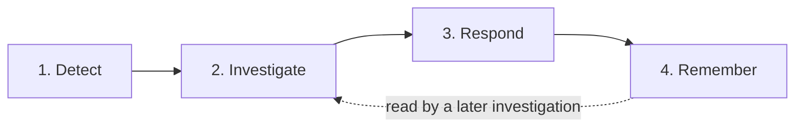

import { ResolveScene } from '/snippets/iso/resolve.jsx';

**根本原因を、数分で突き止めます。**

Resolve は、本番インシデントのための Frontier Investigation Agent です。お使いのツールがすでに送っているアラートを受け取り、ノイズを取り除き、残ったものを根本原因まで調査し、インシデントが人を必要とするときにだけ人を呼びます。始めるにはアラートソースが 1 つあれば十分です。CloudThinker が検証できる根本原因を得るには、アラートの対象となるクラウドまたはオブザーバビリティのアカウントも接続してください。

<ResolveScene />

## 仕組み

Resolve の中で、アラートは 4 つのステージを進みます。これらは [AgenticOps フィールドガイド](/ja/learn/aio/chapter-4-architecture) で説明しているプラットフォームのループのうち、Resolve が担うステップです。

| ステージ | 何が起きるか | 表示される場所 |
|---|---|---|
| 1. Detect | 検知レイヤーである [Signals](/ja/guide/pulse/overview) が既知のノイズを抑制し、関連するアラートをクラスターにまとめるので、1 件の障害は 1 項目になります。 | **Resolve → Signals** |
| 2. Investigate | CloudThinker は対応が必要な各クラスターをトリアージし、インシデントをオープンまたは再オープンして、接続されたシステム全体で根本原因分析 (RCA) を実行します。 | **Resolve → Issues** |
| 3. Respond | [On-call](/guide/incident/oncall) を有効にすると、人が必要なときに対応者のための Incident Room を開きます。既定ではオフです。CloudThinker が実行するすべての修正は、Runbook のコマンドも含めて [Approvals](/guide/approvals/overview) を通ります。新しいワークスペースは **Auto · Rules + AI · Ask me** で始まります。どの Rule も許可していない書き込みは、AI が安全と判断した場合にのみ実行され、それ以外は人を待ちます。Runbook の **Require Approval** の効果は、Runbook のコマンド効果が有効な場合にのみ適用されます ([Runbooks](/ja/guide/incident/runbooks#コマンドの効果を制御する) を参照)。すべての変更を自分で承認するには **Manual** を選びます。[初期状態で使える機能](/guide/approvals/overview#what-you-get-out-of-the-box) を参照してください。 | Incident Room、Slack の war room |
| 4. Remember | CloudThinker は、以降の調査が最初に読み込む [インシデントメモリ](/ja/guide/incident/incident-memory) を書き込みます。表示や編集のための画面はなく、新しい証拠が届くと CloudThinker が自分でエントリーを訂正します。 | 過去のインシデントを引用する、以降の RCA 結果 |

すべてのインシデントがすべてのステージに到達するわけではありません。調査が根本原因なしで終わることもあり、**Track only** のインシデント (実在するが緊急ではないため、誰も呼び出されないもの) は、人が引き上げない限りキューに残ります。

## この順序で設定する

Resolve の設定と連携を変更するには、ワークスペースの **Admin** ロールが必要です。[Roles](/guide/security/roles) を参照してください。

1. **アラートソースを接続します。** 監視ツールの送信先を Resolve に設定するか、まず [クイックスタート](/guide/incident/quickstart) でテストソースを試します。[アラートソースの接続](/guide/incident/connect-alert-sources) でお使いのツールの経路を確認し、手順は [Pulse ソースの接続](/ja/guide/pulse/setup) にあります。
2. **AI auto-investigate を使うか決めます。** 新しいワークスペースではオンになっているため、CloudThinker は自分でトリアージと調査を行います。最初の実際のソースを接続して調整する間はオフにし、その後オンに戻してください。[下記](#誰が調査を開始するかを選ぶ) を参照してください。
3. **On-call を設定します。** 対応者と、必要に応じて Slack の war room を選びます。[On-call](/guide/incident/oncall) を参照してください。
4. **Approvals のポリシーを見直します。** どの修正が自動で実行され、どの修正が人を待つかを決めます。[Approvals](/guide/approvals/overview) を参照してください。

## Overview から始める

**Resolve → Overview** を開くと、今あなたの対応が必要なものと、Resolve が単独で処理したものを確認できます。最初に **At a glance** の下に 4 つの数値が表示されます。

| タイル | 表示内容 |
|---|---|
| **Time to resolve** | 過去 7 日間のインシデントの平均解決時間 |
| **Time to root cause** | CloudThinker が根本原因に到達した速さ |
| **Causes confirmed** | 30 日間に人がレビューした根本原因のうち、確認されたもの |
| **Events filtered** | 30 日間の生のイベントのうち、インシデントにならなかったものの割合 |

タイルの下では、**Needs attention** に人を待っているインシデントが、**In progress** に CloudThinker が現在作業中のインシデントが表示されます。**All insights** をクリックすると [Insights](/guide/incident/insights) が開き、傾向、サービスごとの行、イベントからインシデントまでのファネルを確認できます。

| ファネルのステップ | 意味 |
|---|---|
| **Event** | ソースからの 1 件の生の通知。CloudWatch アラームなど |
| **Signal** | ノイズ抑制を通過したイベント |
| **Cluster** | 1 つの問題として扱われる、関連するシグナルのグループ |
| **Incident** | 対応が必要なクラスターが登録される記録、および人が直接記録する記録。CloudThinker が調査します。 |

最初の 3 つの詳細は [Signals](/ja/guide/pulse/overview) で説明しています。

## 誰が調査を開始するかを選ぶ

CloudThinker の自律スイッチである **AI auto-investigate** は、**Resolve → Issues** のタイトル行にあります。これは人のオンコールローテーションではありません。新しいワークスペースではオンになっており、変更できるのはワークスペースの Admin だけです。その他の Resolve のコントロールの場所は [Resolve の設定](/guide/incident/settings) にまとめています。

| スイッチの状態 | 動作 |
|---|---|
| オン | CloudThinker が検知し、対応が必要な各クラスターをトリアージし、自分で調査します。トリアージと調査はそれぞれ [クレジット](/ja/guide/billing/usage) を使う実行なので、ノイズの多いソースほどコストがかかります。 |
| オフ | CloudThinker はアラートの検知とグループ化を続け、対応が必要なクラスターは引き続きステータス **Open** のインシデントとして登録され、あなたのレビューを待ちます。CloudThinker が自分でトリアージや調査を行うことはなく、各インシデントは誰かが **Investigate** をクリックするまで待機します。人が記録またはエスカレートしたインシデントは、引き続きすぐに調査されます。 |

Webhook ごとのオプション、記録されたインシデント、手動の開始によってこの動作は変わります。完全なルールは [調査を開始するもの](/guide/incident/settings#what-starts-an-investigation) の 1 つの表にまとめています。

**Send to triage**、**Investigate**、**Log Incident** は、スイッチの設定にかかわらず常に使えます。

## できること

| 作業 | 内容 | 参照先 |
|---|---|---|
| 一連の流れを試す | テストアラートを送り、Signals からインシデントまで追跡します | [Resolve クイックスタート](/guide/incident/quickstart) |
| ウォークスルーに沿って進める | 1 件の本番インシデントを、最初のアラートから検証済みの根本原因、承認済みの修正、クローズしたインシデントまで追います | [チェックアウトのインシデントを一通り調査する](/guide/use-cases/resolve-checkout-incident) |
| アラートソースを接続する | お使いのツールが Resolve に入る経路: Webhook、AWS のポーリング、またはチャットチャンネル | [アラートソースの接続](/guide/incident/connect-alert-sources) |
| Resolve が返信する内容を選ぶ | フォローアップチケット、ポストモーテム、チャットでの更新、各プラットフォームの準備状況バッジ | [Triggers & Outcomes](/guide/incident/triggers-and-outcomes#outcomes) |
| アラートフィードを処理する | レーン、クラスター、Escalate、Link to incident、スヌーズ | [Signals](/ja/guide/pulse/overview) |
| 根本原因を読む | 判定、信頼度、証拠、タイムライン、修復の提案 | [調査と RCA](/ja/guide/incident/root-cause-analysis) |
| 人を呼ぶ | 対応者、呼び出し、Incident Room、Slack の war room | [On-call](/guide/incident/oncall) |
| Signals が捉えなかったものを記録する | 顧客からの報告やオペレーターの直感 | [インシデントを記録する](/ja/guide/incident/manual-logging) |
| 修正を管理する | どのアクションが自動で実行され、どれが人を待つか | [Approvals](/guide/approvals/overview) |
| 修正手順を追加する | Confluence、GitHub、GitLab、または Markdown で書かれた手順で、RCA 中に読み込まれます。Runbooks は引き続き機能しますが、サイドバーでは **Legacy** と表示されます。 | [Runbooks](/ja/guide/incident/runbooks) |
| アラートが見逃したものを捉える | アラートルールが捉えなかったインシデントのために CloudThinker が作成してバックテストするモニターで、お使いのアラートと並行して動作します | [Detectors](/guide/incident/detectors) |
| 結果を測定する | 傾向、精度、サービスごとの信頼性 | [Insights](/guide/incident/insights) |
| 動作を調整する | Resolve のすべてのコントロールとその場所 | [設定](/guide/incident/settings) |

## はじめに

<CardGroup cols={2}>
  <Card title="Resolve クイックスタート" icon="rocket" href="/guide/incident/quickstart">
    テストアラートを送り、Signals がそれをインシデントに変える様子を約 10 分で確認します。
  </Card>
  <Card title="ソースを接続する" icon="plug" href="/guide/incident/triggers-and-outcomes#triggers">
    既存の監視ツールの送信先を Resolve に設定します。
  </Card>
  <Card title="On-call を設定する" icon="users" href="/guide/incident/oncall">
    インシデントが人を必要とするときに、誰が Incident Room に参加するかを選びます。
  </Card>
  <Card title="調査結果を読む" icon="magnifying-glass" href="/ja/guide/incident/root-cause-analysis">
    RCA 結果の各部分の意味と、それに基づく対応方法を学びます。
  </Card>
</CardGroup>
